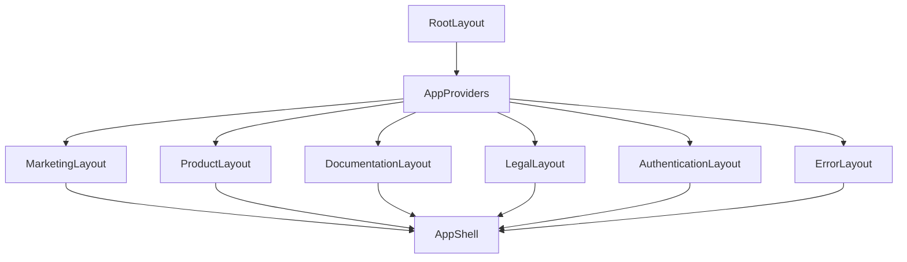

# Sprint 1.3 Completion Report — Layout System

**Date:** 2026-07-19  
**Location:** `V:\DevelopmentRepo\AOVIAS Website\AOVIAS Web`  
**Status:** Complete (structural architecture only; Sprint 1.4 not started)

---

## 1. Layout Architecture Overview

Layouts follow a **composition model**, not parallel duplicated shells:

```text
RootLayout (document)
  └── AppProviders (theme, error boundary, notifications)
        └── Specialized Layout (configures AppShell)
              └── AppShell (shared header/footer/container/sidebar/breadcrumb)
                    └── Page content
```

Specialized layouts only configure the shared `AppShell` (width, sidebar, breadcrumb, compact chrome). They do not reimplement navigation, spacing, or accessibility landmarks.

---

## 2. Layout Hierarchy Diagram



| Layout | Configures |
| --- | --- |
| Marketing | hero width, full chrome |
| Product | content width + breadcrumb |
| Documentation | hero width + sidebar + breadcrumb |
| Legal | narrow width + breadcrumb |
| Authentication | narrow + compact chrome |
| Error | narrow + compact header, no footer |

---

## 3. Shared Structural Component Inventory

| Component | Location | Role |
| --- | --- | --- |
| SkipToContent | `components/layout` | Accessibility skip link |
| SiteHeader | `components/navigation` | Shared header |
| SiteFooter | `components/navigation` | Shared footer |
| MainNav | `components/navigation` | Desktop nav structure |
| MobileNav | `components/navigation` | Mobile nav (client) |
| PageContainer | `components/layout` | Responsive content width |
| Section | `components/layout` | Vertical section rhythm |
| Grid | `components/layout` | Responsive grid |
| Stack | `components/layout` | Flex stack |
| ContentWrapper | `components/layout` | Main column |
| MainContent | `components/layout` | `<main>` landmark |
| SidebarPlaceholder | `components/layout` | Docs sidebar slot |
| PageHeader | `components/layout` | Title/description region |
| BreadcrumbPlaceholder | `components/layout` | Breadcrumb slot |
| NotificationContainer | `components/layout` | Toast host placeholder |
| AnalyticsPlaceholder | `components/layout` | Analytics slot |
| ErrorBoundary | `components/layout` | Client error boundary |
| AppShell | `layouts` | Shared shell composer |

---

## 4. Folder Structure

```text
apps/website/src/
├── app/
│   ├── layout.tsx                 # RootLayout
│   ├── not-found.tsx              # ErrorLayout
│   ├── (marketing)/layout.tsx + page.tsx
│   ├── (products)/layout.tsx + products/preview/
│   ├── (resources)/layout.tsx + resources/preview/
│   ├── (legal)/layout.tsx + legal/preview/
│   ├── (auth)/layout.tsx + auth/preview/
│   └── (company)/layout.tsx + company/preview/
├── layouts/
│   ├── app-shell.tsx
│   ├── marketing|products|documentation|legal|authentication|error/
│   └── index.ts
├── components/
│   ├── layout/
│   └── navigation/
├── providers/app-providers.tsx
└── config/navigation.ts
```

---

## 5. Responsive Strategy

- Shared `PageContainer` gutters: `px-4 sm:px-6 lg:px-8`
- Width tokens: `narrow` / `content` / `hero` / `full`
- Header: desktop `MainNav`, mobile `MobileNav` (md breakpoint)
- Grid helpers: 1→2→3/4 columns by breakpoint
- No page-specific responsive layout logic required

---

## 6. Accessibility Summary

- Skip to content link targeting `#main-content`
- Semantic landmarks: `header`, `main`, `footer`, `nav`, `aside`
- Keyboard-capable mobile menu (`aria-expanded`, `aria-controls`)
- Breadcrumb `nav` with `aria-label`
- Theme toggle remains available in header (theme-aware layouts)
- Error boundary exposes `role="alert"` fallback

---

## 7. Validation Results

| Check | Result |
| --- | --- |
| Layouts render (route previews) | Pass (build lists all routes) |
| Shared structural reuse via AppShell | Pass |
| Theme compatibility (header ThemeToggle) | Pass |
| TypeScript | Pass |
| ESLint | Pass |
| Production build | Pass (9 static pages) |
| No duplicated layout chrome | Pass (composition model) |

**Preview URLs**

- `/` — Marketing  
- `/products/preview` — Product  
- `/resources/preview` — Documentation  
- `/legal/preview` — Legal  
- `/auth/preview` — Authentication  
- `/company/preview` — Company (marketing shell)  
- unknown path — Error layout (404)

---

## 8. Remaining work before Sprint 1.4

1. Real information architecture links (replace nav placeholders)
2. Breadcrumb data model + active trail
3. Documentation sidebar navigation content
4. Auth form shells (still no auth logic)
5. Layout visual regression tests across breakpoints
6. Optional Customer Portal / Academy layout extending AppShell

Do **not** begin Sprint 1.4 automatically.
