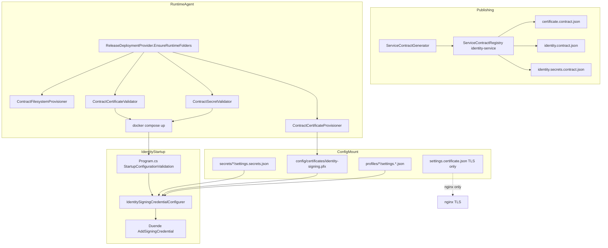

# Identity Signing Credential Analysis (Sprint 8D.1)

## Executive Summary

Identity deployment fails with `CryptographicException: The certificate data cannot be read with the provided password` because **two unrelated certificate domains were conflated**:

| Domain | Config source | Format | Purpose |
|--------|---------------|--------|---------|
| **TLS (nginx)** | `settings.certificate.json` → `Certificate:` | PEM (`fullchain.pem` / `privkey.pem`) | HTTPS termination |
| **IdentityServer JWT signing** | `certificate.contract.json` + `Identity:Signing:` | **PFX** (`identity-signing.pfx`) | OAuth/OIDC token signing |

Identity **never reads** `settings.certificate.json`. The deployed profile's Let's Encrypt PEM paths are correct for nginx but **irrelevant** to Duende IdentityServer signing.

---

## What signing credential format does Identity expect?

**Production model: password-protected PKCS#12 (`.pfx` / `.p12`).**

Loader: `IdentitySigningCredentialConfigurer.LoadCertificate()` uses `X509CertificateLoader.LoadPkcs12FromFile` for `.pfx`/`.p12`.

Configuration section: `Identity:Signing`

| Setting | Purpose |
|---------|---------|
| `Mode` | `Certificate` (production), `KeyFile` (PEM/JWK alternate), `Development` (local only) |
| `CertificatePath` | Absolute path to signing credential file |
| `CertificatePassword` | Optional inline password; otherwise resolved from secrets |

Default contract path (from deployment contract):

```
/opt/aovias/runtime/config/certificates/identity-signing.pfx
```

Password secret key (from `secret.contract.json` / `settings.secrets.json`):

```
certificatePassword  →  Identity:Signing:CertificatePassword
```

Alternate modes (not used by deployment contract today):

- `KeyFile` — PEM or JWK on disk
- `Development` — ephemeral `AddDeveloperSigningCredential()` (ASPNETCORE_ENVIRONMENT=Development only)
- `Hsm` — reserved, unsupported

---

## What format is actually deployed?

| Artifact | Observed on VPS / demo profile | Identity uses? |
|----------|-------------------------------|----------------|
| `settings.certificate.json` | PEM Let's Encrypt paths | **No** (nginx/TLS only) |
| `identity-signing.pfx` | Expected at runtime config mount | **Yes** (when provisioned) |
| Self-signed PFX | Auto-generated by `ContractCertificateProvisioner` when missing | **Yes** |

The runtime error indicates Identity **found a `.pfx` file** (or a file at a `.pfx` path) but **none of the password candidates opened it**.

Password resolution order in Identity:

1. `Identity:Signing:CertificatePassword`
2. `settings.secrets.json` → `certificatePassword`
3. Hardcoded demo fallback `aovias-demo-signing-cert`
4. Empty string

Common failure: provisioner created/retained a PFX encrypted with `aovias-demo-signing-cert` while secrets contain a different `certificatePassword`.

---

## Configuration dependency graph



---

## Why did the runtime use the wrong loading mechanism?

It did not switch to PEM/nginx loading. Identity always attempted **PKCS#12 load with password** because:

1. `Identity:Signing:Mode` is `Certificate` in non-development environments.
2. The contract declares `Type: PFX` and `FileName: identity-signing.pfx`.
3. `ContractCertificateProvisioner` writes/validates PKCS#12.
4. The `CryptographicException` is the **expected error** when password ≠ PFX encryption key — not evidence that PEM was attempted.

The **deployment gap** was missing **pre-compose validation** that proves `certificatePassword` opens `identity-signing.pfx`, plus conflation of TLS PEM settings with signing expectations.

---

## Recommendation: PFX, PEM, or both?

| Option | Verdict |
|--------|---------|
| **PFX for IdentityServer signing (production)** | **Recommended — standardize on this** |
| PEM for nginx TLS | Keep in `settings.certificate.json` only |
| Dual signing support (PFX + PEM) in Identity | **Reject for production** — increases ambiguity |
| `KeyFile` mode | Retain for advanced/manual ops, not deployment contract |

**Rationale:**

- Duende IdentityServer signing credential API is X509-centric; PKCS#12 is the standard packaging for cert + private key + password protection.
- Deployment contracts, provisioner, and DRV already model `Type: PFX`.
- PEM belongs to the TLS/nginx layer; mixing Let's Encrypt material into Identity signing couples unrelated rotation lifecycles.
- Pre-compose validation can deterministically verify PFX + password without starting containers.

---

## Required secrets (Identity)

| Secret key (`settings.secrets.json`) | Configuration key | Required |
|--------------------------------------|-------------------|----------|
| `certificatePassword` | `Identity:Signing:CertificatePassword` | Yes (when PFX) |
| `JwtSettings:SecretKey` | JWT validation | Yes |
| `JwtSettings:Issuer` | JWT issuer | Recommended |
| `JwtSettings:Audience` | JWT audience | Recommended |
| `ConnectionStrings:DefaultConnection` / `databaseConnectionString` | SQL Server | Yes |

---

## Implementation direction (Sprint 8D.1)

1. Publish `identity.contract.json` and `identity.secrets.contract.json` for every identity-service package.
2. Validate certificates and secrets on the host **before** `docker compose up`.
3. Replace raw `CryptographicException` with structured **Signing Credential FAIL** messages in Identity startup.
4. Extend DRV with a signing-credential simulation stage.
5. Remove implicit password/path assumptions; drive all paths from deployment contracts.
