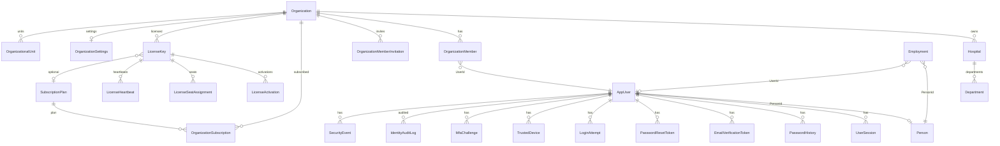
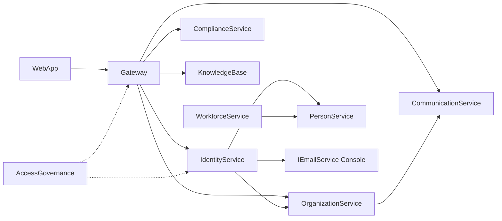

# AOVIAS Command — Identity & Onboarding Architecture Discovery

**Version:** 1.1  
**Date:** 2026-07-31  
**Mode:** Read-only production assessment (no code changes)  
**Scope:** Identity, Onboarding, User, Organization, Workforce, Licensing, Email, Security, APIs, Frontend, Background jobs, Configuration  
**Revision:** 1.1 incorporates deep-dive findings from parallel domain explorations (Identity, Org/Workforce/Onboarding, Licensing/Email/Security).

Legend: **✔ Implemented** · **🟡 Partial** · **❌ Missing**

---

## 1. Executive Summary

AOVIAS already has a **production-grade identity core** and a **working multi-step hospital onboarding path**, plus a **Phase 6 licensing foundation**. Trial Enablement should **extend** these surfaces—not replace them.

| Capability | Status | Evidence |
|---|---|---|
| Authentication (login / logout / refresh / JWT / sessions) | ✔ | `IdentityService` AuthController + AuthenticationService + TokenService |
| Authorization (roles + permission policies) | 🟡 | ASP.NET roles + AccessGovernance permissions; org claims on JWT |
| Self registration (email-only) | 🟡 | `POST /api/v1/auth/register` exists; FE `/register` is a stub |
| Hospital self-signup (org + hospital + admin) | ✔ | WebApp `/signup` → Gateway `POST /api/v1/onboarding/signup` |
| Email verification | 🟡 | Tokens + API exist; `Identity:RequireEmailVerification=false` by default; email is console-only |
| Password reset | ✔ | API + FE pages; delivery depends on email plumbing |
| MFA | ✔ | Setup / verify / disable / login challenge |
| Onboarding wizard (post-signup) | ✔ | `/onboarding` → `POST /api/v1/onboarding/onboard` |
| Organization membership invitations | 🟡 | CRUD + Communication notify; email-token redeem incomplete (`TokenHash` unused; `UseEmailInvites` not wired) |
| Workforce employment | ✔ | Employment aggregate with `PersonId` / optional `UserId` |
| Licensing (keys, seats, entitlements, trial type) | ✔ | `LicenseKey` + Gateway `/api/v1/licenses/*` + commercial provision |
| Auto 30-day trial on signup | 🟡 | Optional `OrganizationSubscription` via config; **not** auto `LicenseKey` Trial |
| Trial expiry enforcement | 🟡 | Status refresh on validate/heartbeat; Gateway entitlement middleware is **fail-open** |
| Real SMTP / production email | ❌ | `ConsoleEmailService` only in Identity + Communication |
| License expiry scheduler | ❌ | No dedicated expiry job |
| Unified subscription ↔ license model | 🟡 | Two parallel models (`OrganizationSubscription` and `LicenseKey`) |

**Strategic recommendation:** Build Trial Enablement on **SignupCommandHandler + LicenseAppService + existing user admin lifecycle**. Do not introduce a new identity stack. Wire signup → issue+activate Trial license; enable verification + SMTP; harden Gateway license gate; add a lightweight expiry refresh job.

---

## 2. Current Architecture

### 2.1 Identity architecture

```
WebApp (Bearer JWT in memory/storage)
   │  authInterceptor + token refresh
   ▼
Gateway (JWT validation, policies, soft license middleware)
   │
   ├─► IdentityService  (ASP.NET Identity + custom JWT/session store)
   │      AppUser, roles, sessions, MFA, password/email tokens, audit
   ├─► PersonService     (Person profile linked via AppUser.PersonId)
   ├─► OrganizationService (membership, org/hospital claims context)
   └─► AccessGovernanceService (effective permissions for policies)
```

- **Auth model (SPA primary):** Custom JWT access tokens + hashed refresh tokens in `UserSessions` (token family / rotation), issued via `TokenService` / `/internal/token/generate`. WebApp stores Bearer tokens in **localStorage** (not cookies).
- **Duende IdentityServer:** Packaged and `UseIdentityServer()` with in-memory clients — **secondary / optional OIDC path**; not the Angular login path. **OpenIddict:** not present.
- **User store:** `AppUser : IdentityUser<Guid>` with platform ID, status, soft-delete, `PersonId`, token version.
- **Tenancy:** No separate `Tenant` entity — `tenantId` ≡ `OrganizationId` (`Gateway` `TenantController`).

### 2.2 Onboarding architecture (two phases)

**Phase A — Signup (anonymous)**  
`WebApp /signup` → Gateway `POST /api/v1/onboarding/signup` → `SignupCommandHandler`:

1. Create Organization (`/internal/organizations`)  
2. Create Hospital (`/internal/hospitals`) — typically `IsOnboarded=false`  
3. Register user ORG_ADMIN (`/internal/users/register`)  
4. Create OrganizationMember  
5. Issue JWT with `organization_id` + `hospital_id` (`/internal/token/generate`)  
6. Optional: assign default trial **subscription** if `Subscriptions:DefaultTrialPlanId` is set  

**Phase B — Wizard (authenticated)**  
`WebApp /onboarding` (guarded) → Gateway `POST /api/v1/onboarding/onboard` → `OnboardWizardCommandHandler`:

1. Apply hospital wizard profile (`markOnboarded=true`)  
2. Save compliance / KB assessments  
3. Enroll frameworks + create journeys  
4. Invite team members  

App shell routes use `onboardingGuard` which requires at least one hospital with `IsOnboarded=true`.

### 2.3 Licensing architecture (Phase 6)

```
CommercialOps / LicensesController (Gateway)
        │ proxy
        ▼
InternalLicensesController (OrganizationService)
        │
        ▼
LicenseAppService → LicenseKeys / Activations / Seats / Heartbeats
```

Parallel older model: `SubscriptionPlan` + `OrganizationSubscription` (`IsTrial`, max users/frameworks). Signup optionally uses this; commercial docs emphasize **LicenseKey**.

### 2.4 Email architecture

Identity wraps `IEmailService` via `IdentityEmailSender`. CommunicationService has channel providers, templates, delivery attempts, and invitation event mapping — but both register **`ConsoleEmailService`** (stdout only).

---

## 3. Module Inventory

| Module | Path | Role in identity/onboarding |
|---|---|---|
| IdentityService | `ComplaincePlatform/IdentityService` | Auth, users, sessions, MFA, tokens, security |
| OrganizationService | `ComplaincePlatform/OrganizationService` | Org, hospital, members, invitations, subscriptions, licenses |
| PersonService | `ComplaincePlatform/PersonService` | Person profile created at registration |
| WorkforceService | `ComplaincePlatform/WorkforceService` | Employment / staff; links Person ↔ optional User |
| AccessGovernanceService | `ComplaincePlatform/AccessGovernanceService` | Permission evaluation |
| CommunicationService | `ComplaincePlatform/CommunicationService` | Notifications, invitation templates, delivery |
| Gateway | `ComplaincePlatform/Gateway` | Signup/onboard orchestration, license façade, auth policies |
| Shared.Authorization | `ComplaincePlatform/Shared.Authorization` | Permission policies |
| Shared.Infrastructure | `ComplaincePlatform/Shared.Infrastructure` | Domain entities, email abstraction, auth constants |
| WebApp | `WebApp` | Login, signup, onboarding wizard, auth guards/interceptors |

---

## 4. Entity Relationship Diagram



**Notes**

- There is no separate Tenant/Workspace entity; **Organization (+ Hospital)** is the tenancy boundary.  
- `Organization.Status` is a string (`"Active"` default), not a rich enum lifecycle.  
- Licensing and subscriptions are **dual tracks**.

---

## 5. Service Dependency Diagram



Critical coupling for Trial Enablement:

- Signup already orchestrates **Org + Identity**.  
- Trial license should be issued in the same orchestration (or immediately after) via existing `/internal/licenses/issue` (+ activate).  
- Email verification depends on replacing/console-wrapping `IEmailService` without rewriting RegistrationService.

---

## 6. Current User Journey

### Self-serve hospital admin (primary path today)

1. Open `/signup`  
2. Enter organization → hospital → admin credentials  
3. Backend creates org/hospital/user/member and returns JWT  
4. Client lands in authenticated session; if hospital not onboarded → `/onboarding`  
5. Complete AI setup / hospital profile / frameworks / assessment / team invites  
6. `IsOnboarded=true` → access `/app/*`  

### Email-only register path (secondary / incomplete UX)

1. `POST /api/v1/auth/register` creates user + Person + role  
2. Optional verification email if config enabled  
3. Login via `/login`  
4. **No org/hospital** unless separately provisioned → onboarding/org context may fail  

### Invited member

1. Org invitation created (wizard or Invitations API)  
2. Communication event `InvitationCreated` → template `member-invitation`  
3. Accept invitation → membership  

### Admin lifecycle

Internal/admin APIs: create / update / suspend / activate / disable / soft-delete / unlock / force password change / admin reset password.

---

## 7. Current Organization Journey

1. **Create** via signup or internal org API  
2. **Hospital** created under org (`IsOnboarded` flag gates product access)  
3. **Primary admin** = ORG_ADMIN organization member created at signup  
4. **Settings / branding / holidays / OUs / timeline** exist in OrganizationService  
5. **Subscription** optional assignment  
6. **License** issued via commercial/license APIs (manual today for LicenseKey path)  
7. **Status** field exists; soft-delete flag exists; suspension APIs for org are thinner than for users  

There is no first-class “Pending Approval” organization workflow in code (no approval queue entity found).

---

## 8. API Inventory

### Identity — `api/v1/auth` (public-facing via Gateway identity routes)

| Endpoint | Purpose | Status |
|---|---|---|
| `POST register` | Self-register user | ✔ (FE stub at `/register`) |
| `POST login` | Password login | ✔ |
| `POST login/mfa` | Complete MFA | ✔ |
| `POST refresh` | Rotate tokens | ✔ |
| `POST logout` / `logout-all` | Revoke session(s) | ✔ |
| `POST verify-email` | Confirm email token | ✔ |
| `POST forgot-password` / `reset-password` | Reset flow | ✔ |
| `PUT change-password` | Authenticated change | ✔ |
| `POST mfa/setup|verify|disable` | MFA lifecycle | ✔ |
| `GET mfa/recovery-codes` | Recovery codes | ✔ |
| `GET/DELETE sessions` | Session list/revoke | ✔ |

### Identity — users admin / internal

| Endpoint | Purpose | Status |
|---|---|---|
| `api/v1/users` CRUD + suspend/activate/disable/delete/unlock | Admin lifecycle | ✔ (internal policy) |
| `/internal/users/register` | Signup orchestration user create | ✔ |
| `/internal/token/generate` | Issue JWT with org/hospital claims | ✔ |
| `/internal/users/{id}` DELETE | Rollback | ✔ |

### Gateway onboarding / commercial / licenses

| Endpoint | Purpose | Status |
|---|---|---|
| `POST /api/v1/onboarding/signup` | Org+hospital+admin signup | ✔ |
| `POST /api/v1/onboarding/onboard` | Wizard completion | ✔ |
| Related onboarding assessment GETs | Core assessment helpers | ✔ |
| `POST /api/v1/commercial/provision` | Issue Trial license (AdminOnly) | ✔ |
| `POST /api/v1/licenses/issue|activate|heartbeat` | License ops | ✔ |
| `GET /api/v1/licenses/status|activations|usage` | Status/usage | ✔ |
| `POST /api/v1/licenses/seats/assign` | Seat assignment | ✔ |
| `GET /api/v1/licenses/entitlements/check` | Feature check | ✔ |

### Organization

| Area | Purpose | Status |
|---|---|---|
| Internal orgs/hospitals/members | Provisioning | ✔ |
| Invitations create/accept/revoke | Membership invites | ✔ |
| Settings / tree / OUs | Org administration | ✔ |
| Internal subscriptions assign | Trial/subscription plan | ✔ |
| Internal licenses | Full license API | ✔ |

### Workforce

| Endpoint area | Purpose | Status |
|---|---|---|
| `api/v1/employment` CRUD + assign/transfer/promote | Staff lifecycle | ✔ |
| Internal employment by person | Integration | ✔ |

### Communication

| Area | Purpose | Status |
|---|---|---|
| Send / events / templates / delivery | Notification engine | 🟡 (console email) |

---

## 9. Database Inventory

### Identity DB

| Table / entity | Purpose |
|---|---|
| AspNetUsers (`AppUser`) | Users + status + PersonId + soft delete |
| AspNetRoles / UserRoles | Roles |
| UserSessions | Refresh tokens / sessions |
| LoginAttempts | Brute-force evidence |
| PasswordHistory | Password reuse control |
| EmailVerificationTokens | Email verify |
| PasswordResetTokens | Password reset |
| RevokedAccessTokens | Access token denylist (jti) |
| TrustedDevices | Device trust |
| MfaChallenges | MFA challenges |
| UserSecurityPolicies | Policy gates |
| SecurityEvents / Incidents / UserRiskScores / SessionHistories | Security analytics |
| IdentityAuditLogs | Audit |
| OutboxMessages | Integration outbox |
| PlatformSequences | Platform ID generation |

### Organization DB

| Table / entity | Purpose |
|---|---|
| Organizations | Tenant root |
| Hospitals | Facility + `IsOnboarded` |
| OrganizationMembers | Membership + roles |
| OrganizationMemberInvitations | Invites |
| Departments / MasterDepartments / Services | Structure |
| OrganizationalUnits / MembershipHistory / Timeline / AuditLogs | Org evolution |
| OrganizationSettings / OrgHolidays | Settings |
| SubscriptionPlans / OrganizationSubscriptions / FrameworkSubscriptions | Older commercial model |
| LicenseKeys / LicenseActivations / LicenseSeatAssignments / LicenseHeartbeats | Phase 6 licensing |
| OutboxMessages | Events (incl. invitations) |

### Workforce DB

| Entity | Purpose |
|---|---|
| Employment | Staff record (`PersonId`, optional `UserId`) |
| Positions / department assignments / history | Workforce structure |

### Person DB

Person profiles created during registration (`CreatePersonForRegistrationAsync`).

---

## 10. Implemented Features

### Identity ✔

- Login / logout / logout-all / refresh  
- JWT access + refresh session family  
- Roles (canonical role migration hosted service)  
- Account statuses: PendingVerification, Active, Suspended, Disabled, Archived, Deleted  
- Soft delete  
- Lockout via Identity `CheckPasswordSignInAsync(lockoutOnFailure: true)`  
- Password change / forgot / reset / history / force-change gates  
- MFA TOTP setup & login challenge  
- Trusted devices + adaptive auth / risk scoring  
- Rate limiting on auth endpoints (`LoginPolicy`)  
- Identity audit + security events  
- Cleanup hosted service (sessions, login attempts)  
- Person linkage on register  

### Onboarding ✔

- Full hospital signup orchestration with compensating rollback stack  
- Post-login wizard (profile, assessment, frameworks, invites)  
- Frontend guards (`onboardingGuard`, `onboardingEntryGuard`)  
- Idempotency support on wizard API  

### Organization ✔

- Org/hospital/member model  
- Invitations  
- Settings/branding  
- Organizational units / timeline  
- Subscription plans + org subscriptions  
- License keys / activate / seats / heartbeat / entitlements  

### Workforce ✔

- Employment CRUD and career events  
- Person + optional User linkage  

### Frontend ✔

- Login, MFA login, forgot/reset/verify-email pages  
- Signup wizard (3 steps)  
- Onboarding AI setup assistant  
- Auth interceptor + refresh coordinator  
- Licensing UI referenced in commercial docs (Settings → Platform → Licensing)  

---

## 11. Incomplete Features

| Feature | Gap |
|---|---|
| Email verification in production | Config off by default; no real SMTP (CRP-006) |
| `/register` page | Stub: “to be implemented” |
| Auto Trial **LicenseKey** on signup | Only optional `OrganizationSubscription`; LicenseKey via Admin commercial provision |
| Hard license enforcement | Gateway middleware fail-open; optional header `X-Require-Entitlement` |
| License expiry job | Status only refreshed on demand |
| Org pending approval | Membership `Pending`/`ApprovedBy*` fields exist; no onboarding approval UX |
| Email invitation redeem | `OrganizationMemberInvitation.TokenHash` unset; wizard ignores `UseEmailInvites` and creates users via Identity register + temp password |
| Gateway invitation revoke | OrgService has revoke; Gateway façade create/accept only |
| Workforce from onboarding | Employment APIs exist; signup/wizard do not create Employment/Person joining records |
| Welcome email | Not a dedicated template in Identity path (plain verification text only) |
| External IdP (Google/Azure AD/SAML) | Razor Identity UI scaffolding only; no API/SPA providers |
| CSRF for SPA cookie auth | JWT Bearer only — CSRF N/A unless cookie auth added |
| Unify Subscription vs License | Dual commercial models; plan seed / `DefaultTrialPlanId` easy to miss |
| Signup → seat assignment for admin | Not automatic |
| Organization suspend/activate product gate | Status string exists; product enforcement unclear |
| Communication delivery retry | `DeliveryRecord.RetryCount` exists but not incremented on failed send |
| Product feature-flag service | AI/config flags + license entitlements JSON only — no general FF platform |
| Dedicated Archive user API | `UserAccountStatus.Archived` rejects login; no dedicated admin archive endpoint |

---

## 12. Unused / Overlapping Components

| Item | Assessment |
|---|---|
| WebApp `/register` | Dead UX surface; signup is the real path |
| ASP.NET Identity UI Areas (`Areas/Identity/Pages/...`) | Legacy Razor pages alongside API — unused by Angular SPA; ExternalLogin scaffolding without providers |
| Duende IdentityServer clients | Secondary stack parallel to custom JWT SPA path |
| `OrganizationSubscription.IsTrial` vs `LicenseType.Trial` | Overlap; commercial launch docs favor LicenseKey |
| Duplicate signup façades | `POST /api/v1/onboarding/signup` and `POST /api/v1/identity/register` both run `SignupCommand` |
| Identity `POST /auth/register` for hospital tenants | Insufficient alone (no org) — used mainly internally / secondary |
| Soft entitlement middleware | Present but rarely blocking |
| Named entities BusinessUnit / Workspace / Employee / Staff / Facility table | Absent — Facility is OrganizationalUnit type code; Workforce uses Employment; Workspace is UI language only |

---

## 13. Potential Bugs / Fragility

1. **Signup succeeds without license** → tenants can onboard with no operational LicenseKey unless commercial provision runs.  
2. **`RequireEmailVerification=false` + `RelaxLoginSecurityGates`** (Development) can auto-activate pending users / weaken MFA on login — prod-risk if mis-copied.  
3. **Membership rollback is no-op** in SignupCommandHandler (commented limitation) → orphan members possible after partial failure recovery edge cases.  
4. **Console email** means forgot-password / verify-email / invitations “succeed” without delivery.  
5. **Dual trial models** can diverge (subscription trial active, license expired, or vice versa).  
6. **Entitlement middleware fail-open** may silently skip license checks on proxy errors.  
7. **Register FE stub** can confuse testers vs `/signup`.  
8. **Hospital claim validation** on wizard is strict — token without hospital_id cannot complete onboard (by design, but brittle if token generation drifts).  
9. **`Licensing:SigningKey` unsafe default** for offline activation HMAC if not overridden.  
10. **Identity outbox processor** marks messages processed without a real bus publisher.  
11. **Login JWT scopes** include `compliance.api` / `organization.api` / `ai.api` — `audit.api` not issued in the login token builder (scope policy gaps possible).

---

## 14. Security Risks

| Risk | Severity | Notes |
|---|---|---|
| No production SMTP / secrets for mail | High for verification/reset integrity | Tokens exist but undelivered |
| JwtSettings.SecretKey empty in checked-in appsettings | High if deployed without override | Must come from secure config |
| Internal API keys in appsettings | Medium | Dev key present (`praman-internal-dev-key`) |
| License fail-open | Medium | Commercial controls bypassable under failure |
| Self-register role parameter | Medium | Constrained by `IsAssignableRole`, still needs review |
| Account enumeration | Low/Med | Forgot-password returns success message generically (good); register conflicts reveal existence |
| MFA optional | Medium | Adaptive step-up exists but can be relaxed |
| Sensitive logging | Low | Prefer ensuring tokens/passwords never logged (signup rollback logs bodies carefully) |

---

## 15. Technical Debt

- Parallel commercial models (Subscription vs LicenseKey)  
- Dual auth stacks: custom JWT (SPA) + Duende (secondary)  
- Identity Razor UI Areas coexisting with SPA APIs  
- Console email abstraction without provider strategy (SMTP/SendGrid)  
- Onboarding success criteria tied to `Hospital.IsOnboarded` only — not license state  
- Gateway signup orchestration is long procedural handler (works, but trial wiring will add another step)  
- Permission model split across roles + AccessGovernance (powerful but harder to reason about for trial gates)  
- `Identity:EnableBackgroundJobs=false` in Development hides cleanup/outbox behavior locally  
- Designation is a string on `OrganizationMember`, not a managed Workforce master

---

## 16. Recommended Refactoring

**Prefer extension, minimize rewrites.**

1. **Do not** replace ASP.NET Identity or custom JWT.  
2. **Do not** invent a new Tenant entity — Organization is the tenant.  
3. **Extend** `SignupCommandHandler.TryAssignDefaultTrialSubscriptionAsync` into a coherent `TryProvisionTrialAsync` that:  
   - Issues `LicenseType.Trial` (30 days)  
   - Optionally activates online with deployment fingerprint or auto-activates for SaaS  
   - Assigns seat to admin user  
   - Still can assign `OrganizationSubscription` for plan limits if needed  
4. **Introduce** `IEmailService` SMTP implementation behind existing interface; keep Console for local.  
5. **Harden** Gateway license middleware to fail-closed for write paths when org has expired license (keep read/help paths softer).  
6. **Deprecate** `/register` stub by redirecting to `/signup` (or completing it only for invite accept).  
7. **Add** hosted job in OrganizationService: refresh license statuses (Active → Grace → Expired).  
8. Treat `OrganizationSubscription` as plan catalogue metadata; treat `LicenseKey` as enforcement SSOT going forward.

---

## 17. Gap Analysis (vs Trial Enablement goals)

| Goal | Status | Gap to close |
|---|---|---|
| Self Registration | ✔ (signup) / 🟡 (register) | Keep signup; fix register stub |
| Email Verification | 🟡 | Enable config + SMTP + FE verify path already exists |
| 30-Day Trial | 🟡 | LicenseAppService defaults Trial to 30 days; not auto on signup |
| Manual Activation | ✔ users / 🟡 licenses | License activate APIs exist; org product activation UX/process needs productization |
| Manual Deactivation | ✔ users / 🟡 licenses | User suspend/disable exist; license revoke exists in status model — confirm admin UX |
| Organization Provisioning | ✔ | Signup + internal APIs |
| Trial Expiration | 🟡 | RefreshStatus exists; need scheduled enforcement + UX banner + hard gate |
| Future Subscription Support | ✔ foundation | Plans + LicenseType.Subscription + commercial docs |

---

## 18. Proposed Trial Enablement Design

### Design principles

- Reuse Signup orchestration, LicenseAppService, user admin lifecycle, onboarding guards.  
- LicenseKey is enforcement SSOT; SubscriptionPlan remains catalogue/billing metadata.  
- Backward compatible: existing orgs without keys keep current behavior until flag enabled.

### Target happy path

```
Signup
  → Org + Hospital + Admin User + Member + JWT
  → Issue LicenseKey(Trial, 30d, seats=N, entitlements=defaults)
  → Activate (SaaS: auto-activate; on-prem: Issued until activation UI)
  → Assign seat to admin
  → Send verification + welcome email (when SMTP on)
  → User completes /onboarding wizard
  → Product access while license IsOperational
  → Expiry → Grace → Expired (read-only / block writes)
```

### Manual controls

- **Activate user:** existing `POST /api/v1/users/{id}/activate`  
- **Deactivate user:** suspend/disable  
- **Activate license:** `POST /api/v1/licenses/activate`  
- **Deactivate/revoke license:** extend/admin wrap existing `LicenseStatus.Revoked` path (verify API surface; add if only internal)  
- **Suspend organization:** set `Organization.Status` + enforce in Gateway (small additive policy)

### Config flags (suggested)

```
TrialEnablement:AutoIssueOnSignup = true
TrialEnablement:ValidDays = 30
TrialEnablement:MaxSeats = 10
TrialEnablement:AutoActivate = true|false
Identity:RequireEmailVerification = true (prod)
Subscriptions:DefaultTrialPlanId = <optional plan catalogue id>
Email:Provider = Smtp|Console
```

### Frontend

- Keep `/signup` + `/onboarding`  
- Add trial status banner (days remaining) from `GET /licenses/status`  
- Redirect `/register` → `/signup`  
- Licensing settings page already in commercial docs — ensure wired to Gateway license APIs  

---

## 19. Migration Strategy

1. **Config-first:** enable trial auto-issue behind feature flag (off by default).  
2. **Backfill:** commercial provision existing pilot orgs via `POST /api/v1/commercial/provision` (already AdminOnly).  
3. **Email:** deploy SMTP provider; keep console in Development.  
4. **Verification:** turn on `RequireEmailVerification` in non-dev; ensure signup path uses confirmed policy intentionally (signup currently uses internal register — decide whether signup admins are pre-confirmed).  
5. **Enforcement:** flip Gateway middleware from fail-open to policy-based fail-closed for selected routes.  
6. **Do not** migrate away from Organization/Hospital IDs or JWT claim names (`organization_id`, `hospital_id`).  
7. **Dual-write period:** if `DefaultTrialPlanId` set, continue assigning OrganizationSubscription alongside LicenseKey until billing UI catches up.  

---

## 20. Recommended Implementation Order

Prioritized for **minimum rework / maximum reuse**:

| Priority | Work item | Effort | Reuses |
|---|---|---|---|
| P0 | Auto-issue + optional auto-activate Trial LicenseKey in `SignupCommandHandler` | S | LicenseAppService, InternalLicenses |
| P0 | Assign license seat to signup admin | S | seats/assign |
| P0 | SMTP `IEmailService` implementation + config | M | IdentityEmailSender, Communication EmailChannelProvider |
| P1 | Enable email verification for self-register path; define signup confirmation policy | S | RegistrationService, verify-email FE |
| P1 | Trial status in WebApp (banner + settings) | S | `/licenses/status` |
| P1 | Redirect/remove `/register` stub | XS | routes |
| P2 | License status refresh hosted service (Active/Grace/Expired) | S | LicenseAppService.RefreshStatus |
| P2 | Harden Gateway entitlement/license gate (feature-flagged fail-closed) | M | LicenseEntitlementMiddleware |
| P2 | Manual org suspend/activate enforcement in Gateway | M | Organization.Status |
| P3 | Unify docs + APIs around LicenseKey SSOT; keep SubscriptionPlan as catalogue | M | commercial-launch docs |
| P3 | Welcome + richer email templates via CommunicationService | M | templates/events |
| P4 | External IdP / advanced SSO (only if product requires) | L | — |

### Out of scope for first Trial Enablement slice

- Rewriting Identity to OIDC server  
- New Tenant aggregate  
- Payment gateway / Stripe  
- Replacing onboarding wizard  

---

## Appendix A — Capability Matrix (condensed)

| Domain capability | Status |
|---|---|
| Authentication | ✔ |
| Refresh tokens / sessions | ✔ |
| JWT / claims (org, hospital, roles, session) | ✔ |
| Roles | ✔ |
| Permissions / policies | 🟡 |
| Password mgmt / reset | ✔ |
| Email verification | 🟡 |
| MFA | ✔ |
| External providers | ❌ |
| Registration (signup) | ✔ |
| Registration (simple) | 🟡 |
| Invitation flow | 🟡 |
| Org creation / hospital provisioning | ✔ |
| Default data / master depts | 🟡/✔ |
| Welcome / first login | 🟡 |
| Pending verification | 🟡 |
| Pending approval | ❌ |
| Trial creation | 🟡 |
| Activation flows (user + license) | ✔/🟡 |
| Workforce joining | ✔ |
| Licensing foundation | ✔ |
| Feature entitlements | 🟡 |
| Real email delivery | ❌ |
| Rate limit / lockout | ✔ |
| License expiry job | ❌ |

---

## Appendix B — Key source references

- `IdentityService/Controllers/V1/AuthController.cs`  
- `IdentityService/Application/Services/RegistrationService.cs`  
- `IdentityService/Application/Services/AuthenticationService.cs`  
- `IdentityService/Infrastructure/IdentityDbContext.cs`  
- `Gateway/Application/Handlers/SignupCommandHandler.cs`  
- `Gateway/Application/Handlers/OnboardWizardCommandHandler.cs`  
- `Gateway/Controllers/OnboardingController.cs`  
- `Gateway/Controllers/CommercialOpsController.cs`  
- `Gateway/Controllers/LicensesController.cs`  
- `Gateway/Controllers/TenantController.cs`  
- `Gateway/Middleware/LicenseEntitlementMiddleware.cs`  
- `OrganizationService/Application/Services/LicenseAppService.cs`  
- `OrganizationService/Domain/Entities/LicenseEntities.cs`  
- `Shared.Infrastructure/Domain/OrganizationSubscription.cs`  
- `Shared.Infrastructure/Email/ConsoleEmailService.cs`  
- `WebApp/src/app/signup/signup.ts`  
- `WebApp/src/app/core/guards/onboarding.guard.ts`  
- `WebApp/src/app/features/auth/pages/register.component.ts` (stub)  
- `ComplaincePlatform/commercial-launch/licensing/activation-guide.md`  
- `docs/commercial-readiness/10-master-gap-register.md` (CRP-006 email)  
- `docs/organization-member-invitations.md`

---

## Appendix C — Deep-dive deltas (v1.1)

Incremental findings confirmed by domain explorations after v1.0:

| Topic | Finding | Impact on Trial Enablement |
|---|---|---|
| Tenant model | `tenantId` = `OrganizationId`; no Tenant table | Do not invent a Tenant aggregate |
| Facility / BusinessUnit / Workspace | Facility = OU type; BU/Workspace entities missing | Out of scope for trial slice |
| Employee / Staff | Workforce uses `Employment` only | Do not create Employee entity for trial |
| Email invites | `TokenHash` unused; `UseEmailInvites` not wired | Prefer SMTP + welcome first; email-invite redeem is P2+ |
| Membership approval | Status enum + approval fields unused in signup | Not required for self-serve trial |
| Duende | Present but secondary to custom JWT | Leave alone for trial slice |
| SPA tokens | localStorage Bearer | CSRF not a trial blocker |
| Communication retry | RetryCount unused | Fix when SMTP lands (ops reliability) |
| Plan seed | `Subscriptions:DefaultTrialPlanId` optional | Prefer LicenseKey auto-issue over relying on plan seed alone |
| Licensing signing key | Dev default unsafe | Must set for offline/prod activation |

---

*End of discovery report. No application code was modified.*
