# AOVIAS Command — CRP Phase 0
# Commercial Onboarding Architecture Specification

**Version:** 1.0 (Architecture Freeze)  
**Date:** 2026-07-31  
**Status:** FROZEN — changes require CRP change control  
**Grounding:** [AOVIAS-Identity-Onboarding-Architecture-Discovery.md](./AOVIAS-Identity-Onboarding-Architecture-Discovery.md) v1.1  
**Mode:** Architecture only — no code, APIs, migrations, or UI in this phase

---

## 1. Executive Summary

This specification is the **definitive business architecture** for AOVIAS commercial onboarding and licensing. It transforms Discovery v1.1 findings into frozen lifecycles, ownership, events, rules, and provisioning — while **extending** existing Identity, Organization, Workforce, Licensing, Gateway orchestration, and Communication — not replacing them.

### Locked product decisions

| ID | Decision |
|----|----------|
| **1A** | After trial grace ends → **read-only** product access (view existing data; block writes, seat expansion, new provisioning); reactivation/billing surfaces remain available |
| **2B** | Default email verification is **Async** — signup may return a session and onboarding may start before verification completes |
| **Policy** | `Identity:EmailVerificationMode` is **configurable** (`None` \| `Async` \| `RequiredBeforeLogin` \| `RequiredBeforeOrganizationProvisioning`) |

### Core ownership (non-negotiable)

| Concern | Owner |
|---------|--------|
| Authentication / credentials / sessions / email verification | **IdentityService** |
| Tenancy / org / hospital / membership / invitations / licenses | **OrganizationService** |
| Employment / HR events | **WorkforceService** |
| Person profile | **PersonService** |
| Commercial enforcement SSOT | **LicenseKey** (OrganizationService) |
| Pipeline orchestration | **Gateway** (Signup / Onboard wizard) |
| Notification delivery | **CommunicationService** |

### Design posture

- **Organization is the Tenant** — no Tenant entity.  
- **LicenseKey** is commercial enforcement SSOT; `SubscriptionPlan` / `OrganizationSubscription` are catalogue / billing metadata.  
- **Hospital.IsOnboarded** = product setup completeness — orthogonal to commercial license state.  
- Prefer extending existing aggregates (`AppUser`, `Organization`, `Hospital`, `OrganizationMember`, `LicenseKey`, `Employment`).  
- Duende remains secondary; SPA auth remains custom JWT + refresh sessions.

---

## 2. Architectural Principles

1. **Organization = Tenant.** `tenantId` ≡ `OrganizationId`. Do not introduce a Tenant table.  
2. **Single owner per state.** No duplicated ownership of the same lifecycle field.  
3. **Domains own state; Gateway only orchestrates; Communication only delivers.**  
4. **Business rules are UI-independent.** Guards and screens consume rules; they do not define them.  
5. **Every business action produces a domain event** (outbox-backed where reliability is required).  
6. **Extend, don’t rewrite.** Preserve signup (`SignupCommandHandler`), wizard (`OnboardWizardCommandHandler`), Phase 6 licensing, and Identity JWT path.  
7. **Derived commercial/trial phases** are projections over `LicenseKey` timestamps/status — not duplicate persisted enums unless change control allows.  
8. **Backward compatible.** Existing APIs remain extension points; new behavior is additive / config-gated.  
9. **Extensibility without redesign** for multi-hospital, offline license, paid subscription, IdP/SCIM, seat expansion.  
10. **Email verification is policy-driven**, never hard-coded to a single mode.

---

## 3. Identity Lifecycle

**Owner:** IdentityService  
**Persistence:** `AppUser.Status` (`UserAccountStatus`), `EmailConfirmed`, ASP.NET Identity lockout fields, `UserSessions`, security entities.

### 3.1 Business states and persistence mapping

| Business state | Persistence mapping | Purpose |
|----------------|---------------------|---------|
| PendingVerification | `Status=PendingVerification`, `EmailConfirmed=false` | Account created; email not confirmed |
| Verified | `EmailConfirmed=true` (may still be PendingVerification or Active) | Email proof completed |
| Active | `Status=Active`, typically `EmailConfirmed=true` under Async/Required modes after verify | Normal authenticated use |
| Locked | Identity lockout (`LockoutEnd` in future) — transient, not a `UserAccountStatus` value | Brute-force protection |
| Suspended | `Status=Suspended` | Admin temporary block; sessions revoked |
| Disabled | `Status=Disabled` | Admin permanent block without soft-delete |
| Archived | `Status=Archived` | Retained identity, no login |
| Deleted | `Status=Deleted`, `IsDeleted=true` | Soft delete |

**Note:** “Locked” is an Identity lockout overlay, not a row in `UserAccountStatus`. Exit unlock clears lockout without changing `Status` unless admin also suspended the user.

### 3.2 State catalog

#### PendingVerification

| Attribute | Definition |
|-----------|------------|
| Purpose | Hold self-registered or invite-created accounts until email policy is satisfied |
| Owner | Identity |
| Entry trigger | User created with `EmailConfirmed=false` (self-register or mode-driven signup) |
| Exit trigger | Email verified → Verified/Active; admin activate; soft-delete |
| Allowed | Request verification email; password reset (if policy allows); limited auth per EmailVerificationMode |
| Blocked | Product write actions when mode requires verification; login when mode is `RequiredBeforeLogin` |
| Produced events | `UserRegistered`, `EmailVerificationRequested` |
| Consumed | — |

#### Verified

| Attribute | Definition |
|-----------|------------|
| Purpose | Mark email confirmation complete |
| Owner | Identity (`EmailConfirmed`) |
| Entry | Successful `VerifyEmail` token consumption |
| Exit | Remains true; not cleared on suspend |
| Allowed | Transition to Active if Status was PendingVerification |
| Blocked | N/A |
| Produced | `EmailVerified` |
| Consumed | `EmailVerificationRequested` (token redemption) |

#### Active

| Attribute | Definition |
|-----------|------------|
| Purpose | Operational identity |
| Owner | Identity |
| Entry | Registration with confirmed email; verify completing PendingVerification; admin Activate |
| Exit | Suspend / Disable / Archive / Soft-delete / Lockout overlay |
| Allowed | Login (subject to license/org rules), MFA, password change, sessions |
| Blocked | None at identity layer beyond security policy |
| Produced | `UserActivated`, `UserLoggedIn` (optional audit), `PasswordChanged` |
| Consumed | `EmailVerified`, admin commands |

#### Locked (overlay)

| Attribute | Definition |
|-----------|------------|
| Purpose | Temporary lock after failed logins |
| Owner | Identity (ASP.NET Identity lockout) |
| Entry | Failed password threshold |
| Exit | Lockout expiry or admin Unlock |
| Allowed | Unlock by admin; wait |
| Blocked | Login |
| Produced | `UserLocked`, `UserUnlocked` |
| Consumed | Login failures |

#### Suspended / Disabled / Archived / Deleted

| State | Entry | Exit | Login | Produced |
|-------|-------|------|-------|----------|
| Suspended | Admin Suspend | Admin Activate | Blocked | `UserSuspended` / `UserActivated` |
| Disabled | Admin Disable | Admin Activate (if allowed) | Blocked | `UserDisabled` |
| Archived | Admin Archive | Restore policy (rare) | Blocked | `UserArchived` |
| Deleted | Soft-delete | No recovery except privileged restore | Blocked | `UserDeleted` |

### 3.3 EmailVerificationMode policy

| Mode | Signup org provisioning | First session after signup | Subsequent login | Notes |
|------|-------------------------|----------------------------|------------------|--------|
| **None** | Allowed | Allowed | Allowed without verify | Dev / air-gapped |
| **Async** (default SaaS / **2B**) | Allowed | Allowed | Allowed; nudge to verify; may restrict sensitive ops later | Default freeze |
| **RequiredBeforeLogin** | Allowed (user may be PendingVerification) | May issue one-time bootstrap session **or** require verify first — freeze: **bootstrap session allowed for signup response only**; password login requires `EmailConfirmed` | Blocked until verified | Stricter SaaS |
| **RequiredBeforeOrganizationProvisioning** | **Blocked** until a verified identity exists | N/A until identity verified first | Standard | Partner / compliance packs: register→verify→then provision org |

Modes are configuration (`Identity:EmailVerificationMode`), not code forks of the pipeline.

---

## 4. User Lifecycle

**Composite journey** across Identity + Organization membership + optional Workforce. Identity owns the user aggregate; Organization owns membership; Workforce owns employment.

### 4.1 Stages

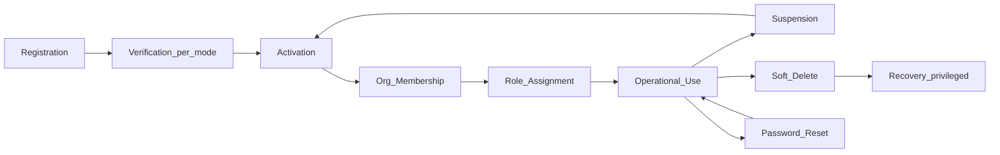

| Stage | Owner | Description |
|-------|-------|-------------|
| Registration | Identity (+ Gateway signup) | Create `AppUser` + `Person`; commercial signup also creates org context |
| Verification | Identity | Per `EmailVerificationMode` |
| Activation | Identity | `Status=Active` |
| Organization membership | Organization | `OrganizationMember` Active; role e.g. `ORG_ADMIN` |
| Role assignment | Identity roles + Org membership role + AccessGovernance permissions | Canonical roles; permissions evaluated externally |
| Password reset | Identity | Opaque reset tokens; Communication/email delivery |
| Suspension | Identity | Sessions revoked |
| Deletion | Identity soft-delete | Membership should be suspended/archived by org policy |
| Recovery | Privileged Identity admin | Restore from soft-delete / reactivate |
| Multi-org (future-ready) | Organization | Multiple memberships; JWT one active `organization_id` |
| Administrator ownership | Organization | First signup member is `ORG_ADMIN`; not exclusive — multiple admins allowed |

### 4.2 Administrator ownership

- Signup creates the **first** `ORG_ADMIN` membership for the organization.  
- Additional admins via invitation / admin create — **allowed**.  
- There is **no** singleton `PrimaryAdmin` column; `IsPrimary` on membership means primary membership for that user within an org, not “the only admin.”

---

## 5. Organization Lifecycle

**Owner:** OrganizationService  
**Persisted administrative status:** `Organization.Status` (string today: default `"Active"`; architecture freezes canonical values below).  
**Persisted setup:** `Hospital.IsOnboarded`.  
**Commercial phase:** **derived** from operational `LicenseKey` — do not add a second commercial status column that duplicates `LicenseStatus`.

### 5.1 Administrative states (`Organization.Status`)

| State | Purpose | Entry | Exit | Login to tenant | Product writes |
|-------|---------|-------|------|-----------------|----------------|
| Draft | Reserved / unused in self-serve today; partner pre-create | Manual create without activation | Provisioning complete → Active | Per license | No |
| Provisioning | Transient during SignupCommand steps | Signup start | Signup success → Active | N/A | N/A |
| Active | Normal tenant | Signup success / admin activate | Suspend / Archive / Delete | Yes | Per license phase |
| Suspended | Admin commercial/compliance hold | Admin suspend | Admin activate | Blocked for product; billing may allow | No |
| Archived | Soft end-of-life | Admin archive | Privileged restore | Blocked | No |
| Deleted | Soft delete `IsDeleted=true` | Admin delete | Privileged restore | Blocked | No |

### 5.2 Derived commercial phase (projection)

Computed from the organization’s operational `LicenseKey` (prefer Active/Grace over Issued/Expired/Revoked):

| Phase | Derivation |
|-------|------------|
| NoLicense | No key |
| TrialIssued | Trial + Issued |
| ActiveTrial | Trial + Active and before expiry |
| ActiveSubscription | Subscription/Perpetual/Offline + Active |
| Grace | LicenseStatus.Grace |
| ExpiredReadOnly | LicenseStatus.Expired (**1A**) |
| Revoked | LicenseStatus.Revoked |

Hospital setup:

| Flag | Meaning |
|------|---------|
| `IsOnboarded=false` | Wizard incomplete — product shell redirected to `/onboarding` |
| `IsOnboarded=true` | Setup complete — `/app/*` allowed subject to license/org rules |

### 5.3 Ownership, provisioning, trial, subscription, deletion

| Concern | Rule |
|---------|------|
| Ownership | Organization aggregate; first admin via membership |
| Provisioning | Gateway SignupCommand: Org → Hospital → User → Member → License → Seat |
| Activation (admin org) | Set `Organization.Status=Active` |
| Suspension | Set Suspended; revoke product writes; emit `OrganizationSuspended` |
| Trial | Auto Trial LicenseKey on signup (see §8) |
| Subscription | Convert Trial → Subscription LicenseKey + optional OrganizationSubscription metadata |
| Deletion | Soft-delete org; cascade policy for hospitals/members per existing services |
| Recovery | Privileged clear `IsDeleted` / Status restore |

---

## 6. Workforce Lifecycle

**Owner:** WorkforceService (Employment); PersonService (Person); Organization (Membership, Department masters, designation string).

### 6.1 Concepts

| Concept | Entity | Notes |
|---------|--------|-------|
| Person | PersonService `Person` | Created at Identity registration |
| Employment | `Employment` | `PersonId`, `OrganizationId`, optional `UserId`, `OrganizationMemberId` |
| Organization membership | `OrganizationMember` | Access path into tenant |
| Department | Org `Department` / `MasterDepartment` | Org-owned |
| Designation | String on membership (Phase 0) | Future master optional — not required for freeze |
| Invitation | `OrganizationMemberInvitation` | Org-owned; token redeem to be completed in later CRP |
| Termination / Transfer / Promotion | Employment domain events/commands | Existing Workforce APIs |

### 6.2 Relationship rules

- Signup **does not** create Employment.  
- Path: Person ← AppUser.PersonId; Membership ← UserId; Employment optional later linking Person/User/Member.  
- Invitation acceptance creates/activates Membership (+ Identity user if needed); Employment is a separate join flow.

### 6.3 Employment states (business)

| State | Entry | Exit | Events |
|-------|-------|------|--------|
| Joined | CreateEmployment | Transfer / Promote / Separate | `EmploymentCreated` |
| Active | Default after join | Suspend employment / separate | — |
| Transferred | Transfer command | — | `EmploymentTransferred` |
| Promoted | Promote command | — | `EmploymentPromoted` |
| Terminated | Soft-delete / separation | — | `EmploymentTerminated` |

Identity relationship: optional `Employment.UserId`. User without employment is valid (admin-only tenants).

---

## 7. License Lifecycle

**Owner:** OrganizationService (`LicenseAppService`)  
**Persistence:** `LicenseStatus` on `LicenseKey`: Issued → Active → Grace → Expired → Revoked.  
**Architecture adds business alias “Operational”** = Active (and optionally Grace for read-write under grace rules).  
**“Suspended” for licenses** = organizational Suspended **or** Revoked — do not invent a sixth DB enum without migration; treat Suspended-license as **Revoked or Org Suspended**.  
**“Archived”** = historical keys retained after conversion/replacement (soft business archive; key may stay Revoked/Expired).

### 7.1 States

| State | Purpose | Entry | Exit | Writes | Reads (1A) |
|-------|---------|-------|------|--------|------------|
| Issued | Key created, not activated | Issue API / signup auto-issue | Activate | No | Limited |
| Activated / Active | Operational | Online/offline activate | Expiry→Grace; Revoke | Yes (if seats OK) | Yes |
| Operational | Alias of Active (+ Grace for continued limited writes if policy allows) | — | — | See Grace | Yes |
| Grace | Post-expiry grace window | `RefreshStatus` when past ExpiresAt within GracePeriodDays | GraceEnds → Expired | **Yes with warnings** (freeze: writes allowed in Grace) | Yes |
| Expired | Past grace | RefreshStatus / job | Convert / re-issue | **No (1A)** | **Yes (1A)** |
| Revoked | Manual commercial revoke | Admin revoke | Re-issue new key | No | Reactivation UI only |
| Archived | Replaced after conversion | New subscription key issued | — | No | Audit |

### 7.2 Seats, heartbeat, entitlements, offline, future subscription

| Capability | Rule |
|------------|------|
| Seat assignment | Required for write-capable product use; signup assigns seat to admin |
| Heartbeat | Online deployments report fingerprint + seat usage; refreshes status |
| Entitlements | JSON codes on key; Gateway may require feature codes (fail-closed for writes when licensed) |
| Offline activation | Signed payload; `LicenseType.Offline` |
| Future subscription | Issue/activate `LicenseType.Subscription`; link `SubscriptionPlanId`; dual-write OrganizationSubscription optional |

---

## 8. Trial Lifecycle

**Not a separate table.** Trial is `LicenseKey` with `LicenseType=Trial`.  
**TrialPhase** is a derived projection.

### 8.1 Phases

| Phase | Condition | Actions |
|-------|-----------|---------|
| TrialCreated | Key Issued (Trial) | Emit `TrialStarted` / `LicenseIssued` |
| Active | Status Active, now < ExpiresAt − reminder window | Full product per entitlements |
| Reminder | Configurable: e.g. 7 days before expiry | Email `TrialReminder` |
| Expiring | e.g. 3 days before expiry | Stronger nudge |
| Grace | LicenseStatus.Grace | Writes allowed with banner; emit `TrialEnteredGrace` |
| Expired | LicenseStatus.Expired | **Read-only (1A)**; emit `TrialExpired` |
| Converted | Subscription key active for org | Emit `SubscriptionActivated`; archive trial key |
| Archived | Trial key superseded | Retain for audit |

### 8.2 Extension / upgrade / manual controls

| Action | Rule |
|--------|------|
| Extension | Commercial ops may extend `ExpiresAtUtc` — **max 2 extensions, 15 days each** (configurable via `TrialEnablement:MaxExtensions`, `TrialEnablement:ExtensionDays`) |
| Upgrade / Convert | Issue Subscription license, activate, migrate seats, archive trial |
| Manual activation | `licenses/activate` (online/offline) |
| Manual deactivation | Revoke license or suspend organization |

Default trial length: **30 days** (`LicenseAppService` Trial default). Signup: **auto-issue + auto-activate** + seat admin.

---

## 9. State Ownership Matrix

| Concern | Single owner | Supporting | Consumers |
|---------|--------------|------------|-----------|
| Credentials / password | Identity | — | Gateway, WebApp |
| Email verification | Identity | Communication (delivery) | Gateway signup policy |
| Authentication / JWT / sessions | Identity | Gateway validation | All APIs, WebApp |
| Security events / risk / MFA | Identity | — | Admin security UI |
| Organization administrative status | Organization | Gateway commercial ops | Gateway gates |
| Hospital setup (`IsOnboarded`) | Organization | Gateway wizard | WebApp onboarding guards |
| Membership / roles on member | Organization | Identity (user exists) | Gateway, AccessGovernance |
| Invitations | Organization | Communication | WebApp, Gateway |
| Org settings / branding | Organization | — | WebApp settings |
| License / seats / entitlements / heartbeat | Organization (Licensing) | Gateway façade | Gateway middleware, WebApp licensing |
| Subscription catalogue metadata | Organization | — | Commercial ops |
| Trial phase (derived) | Organization (Licensing) | Scheduler/job | Communication, WebApp banner |
| Person profile | Person | Identity (PersonId) | Workforce |
| Employment / departments assign | Workforce | Org master depts | WebApp workforce |
| Designation (string) | Organization (membership) | — | UI |
| Email templates / delivery / retry | Communication | Producers via events | Users |
| Pipeline sequencing | Gateway | All domain services | WebApp |
| Effective permissions | AccessGovernance | Identity roles | Gateway Authorize |

---

## 10. Domain Events Catalog

Reliability: **Outbox** (at-least-once) for cross-service; **in-process** for local audit. Idempotency: `DedupeKey` = `{EventType}:{AggregateId}:{VersionOrToken}`.

| Event | Producer | Consumers | Payload (min) | Reliability | Retry | Idempotency |
|-------|----------|-----------|---------------|-------------|-------|-------------|
| UserRegistered | Identity | Person (done sync), Audit, Comm (welcome) | userId, email, platformId | Outbox | Yes | userId |
| EmailVerificationRequested | Identity | Communication | userId, link | Outbox | Yes | tokenId |
| EmailVerified | Identity | Gateway/analytics | userId | Outbox | Yes | userId+ts |
| PasswordResetRequested | Identity | Communication | userId, link | Outbox | Yes | tokenId |
| PasswordChanged | Identity | Audit, session revoke | userId | Outbox | Yes | userId+ts |
| UserLocked / UserUnlocked | Identity | Audit, Comm (optional) | userId | Outbox | Yes | userId+ts |
| UserSuspended / UserActivated / UserDisabled / UserDeleted | Identity | Org (membership sync optional), Audit | userId, actorId | Outbox | Yes | userId+status |
| OrganizationCreated | Organization | Audit, Licensing signup | orgId, name | Outbox | Yes | orgId |
| HospitalCreated | Organization | Wizard later | hospitalId, orgId | Outbox | Yes | hospitalId |
| OrganizationActivated / OrganizationSuspended | Organization | Gateway cache, Comm | orgId | Outbox | Yes | orgId+status |
| MembershipCreated | Organization | AccessGovernance seed optional | memberId, userId, orgId, role | Outbox | Yes | memberId |
| InvitationSent | Organization | Communication | inviteId, email | Outbox | Yes | inviteId |
| InvitationAccepted | Organization | Identity (ensure user), Membership | inviteId, userId | Outbox | Yes | inviteId |
| EmploymentCreated / Transferred / Promoted / Terminated | Workforce | Audit, Org link | employmentId, personId | Outbox | Yes | employmentId+event |
| LicenseIssued | Organization | Comm, Commercial | keyId, orgId, type | Outbox | Yes | keyId |
| LicenseActivated | Organization | Gateway, Comm | keyId, orgId | Outbox | Yes | keyId+activationId |
| LicenseSeatAssigned | Organization | — | keyId, userId | Outbox | Yes | seatId |
| TrialStarted | Organization | Comm welcome/trial | keyId, orgId, expiresAt | Outbox | Yes | keyId |
| TrialReminder / TrialExpiring | Organization (job) | Communication | orgId, daysLeft | Outbox | Yes | keyId+dayBucket |
| TrialEnteredGrace | Organization | Comm, WebApp | keyId | Outbox | Yes | keyId+Grace |
| TrialExpired | Organization | Comm, Gateway | keyId | Outbox | Yes | keyId+Expired |
| TrialExtended | Organization | Comm | keyId, newExpiry | Outbox | Yes | keyId+expiry |
| SubscriptionActivated | Organization | Comm, archive trial | keyId, planId | Outbox | Yes | keyId |
| HospitalOnboarded | Organization | Deficiency bootstrap etc. | hospitalId | Outbox | Yes | hospitalId |

---

## 11. Business Rules

### BR-ID Identity & access

| ID | Rule |
|----|------|
| BR-I1 | Suspended, Disabled, Archived, Deleted users **cannot** login. |
| BR-I2 | Locked (lockout) users **cannot** login until unlock/expiry. |
| BR-I3 | `EmailVerificationMode=None`: verification never blocks login or provisioning. |
| BR-I4 | `Async` (default): signup and login allowed without verification; verification email still sent when SMTP configured; UI may nudge. |
| BR-I5 | `RequiredBeforeLogin`: password login requires `EmailConfirmed=true`; signup may return bootstrap tokens once. |
| BR-I6 | `RequiredBeforeOrganizationProvisioning`: SignupCommand must not create Org/Hospital until actor identity is verified (register/verify first). |
| BR-I7 | Force password change / PasswordResetRequired blocks login until password changed. |

### BR-ORG Tenancy

| ID | Rule |
|----|------|
| BR-O1 | One email **may** have memberships in multiple organizations. |
| BR-O2 | JWT carries **one** active `organization_id` / `hospital_id` context (switch is future). |
| BR-O3 | An organization **may** have multiple `ORG_ADMIN` members. |
| BR-O4 | Suspended organization: product login to tenant blocked except reactivation/billing surfaces. |
| BR-O5 | `Hospital.IsOnboarded=false` blocks `/app/*` (redirect onboarding), independent of license. |
| BR-O6 | After license **Expired** (post-grace): **read-only (1A)** — GET/read allowed; mutating APIs blocked; seat assign blocked; new hospital provisioning blocked. |
| BR-O7 | Grace: writes allowed with mandatory trial/grace messaging. |

### BR-LIC Licensing & trial

| ID | Rule |
|----|------|
| BR-L1 | Commercial enforcement SSOT = operational `LicenseKey`. |
| BR-L2 | Self-serve signup **must** auto-issue Trial (30d default), auto-activate, assign seat to admin. |
| BR-L3 | Trial extensions: max **2**, each max **15 days**, configurable. |
| BR-L4 | Conversion: Subscription key becomes operational; trial key archived/revoked. |
| BR-L5 | Write-capable actions require active seat assignment for the user (when seat enforcement enabled). |
| BR-L6 | Revoked license: no product writes; reads limited to reactivation. |
| BR-L7 | `OrganizationSubscription` does not override LicenseKey for enforcement. |

### BR-WF Workforce

| ID | Rule |
|----|------|
| BR-W1 | Employment is optional for platform users. |
| BR-W2 | Onboarding wizard does not create Employment. |
| BR-W3 | Invitation accept creates Membership (+ user if needed), not Employment. |

### BR-ONB Onboarding

| ID | Rule |
|----|------|
| BR-N1 | Wizard requires JWT claims matching org/hospital. |
| BR-N2 | Completing wizard sets `IsOnboarded=true`. |
| BR-N3 | Wizard start blocked if org license Expired/Revoked or org Suspended. |
| BR-N4 | Already onboarded users hitting `/onboarding` redirect to dashboard. |

---

## 12. Provisioning Pipeline

**Visitor → Operational Organization**

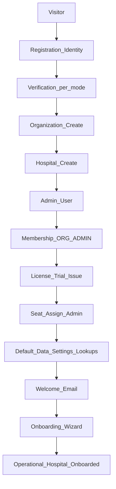

| Step | Service | Inputs | Outputs | Validation | Rollback | Events |
|------|---------|--------|---------|------------|----------|--------|
| Registration | Identity (+ Person) | email, password | userId, personId | email unique, password policy | Delete user | UserRegistered |
| Verification | Identity | mode, token | EmailConfirmed | mode rules | — | EmailVerified |
| Organization | Organization | name, type, address | orgId | unique name/code | Delete org | OrganizationCreated |
| Hospital | Organization | orgId, profile | hospitalId | code unique | Delete hospital | HospitalCreated |
| Admin | Identity | email, ORG_ADMIN | userId | — | Delete user | UserRegistered |
| Membership | Organization | orgId, userId, role | memberId | — | Best-effort | MembershipCreated |
| License | Organization | orgId, Trial | keyId | — | Revoke/delete key | LicenseIssued, TrialStarted |
| Seats | Organization | keyId, userId | seat | max seats | Release seat | LicenseSeatAssigned |
| Default data | Organization | orgId | settings, lookups | — | — | — |
| Welcome | Communication | user/org | delivery | SMTP | Retry | — |
| Onboarding | Gateway → Org/Compliance/KB | wizard DTO | IsOnboarded | claims match | Compensating per step | HospitalOnboarded |
| Operational | — | — | product access | license Active/Grace | — | — |

SignupCommand remains the transactional orchestrator with compensating rollback stack (extend with license/seat rollback).

---

## 13. Sequence Diagrams

### 13.1 Self Registration (commercial signup, Async mode)

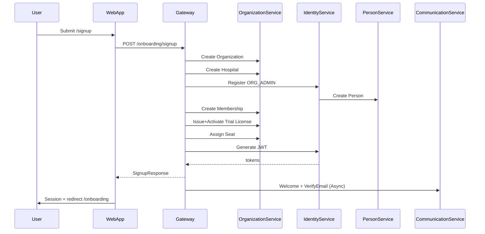

### 13.2 Email Verification

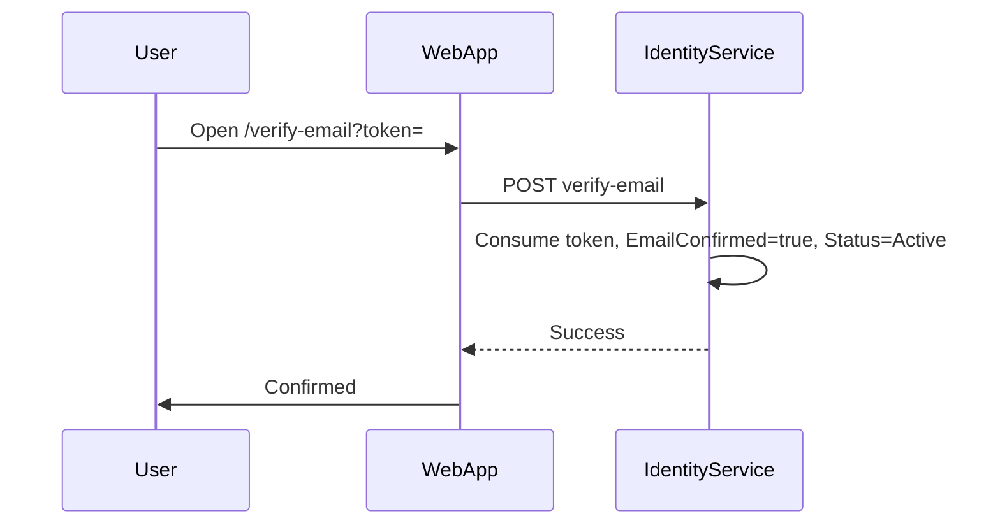

### 13.3 Organization Provisioning

Covered by 13.1 (Org+Hospital steps inside SignupCommand). Partner path with `RequiredBeforeOrganizationProvisioning`: verify identity first, then invoke provisioning with authenticated verified user.

### 13.4 Trial Creation

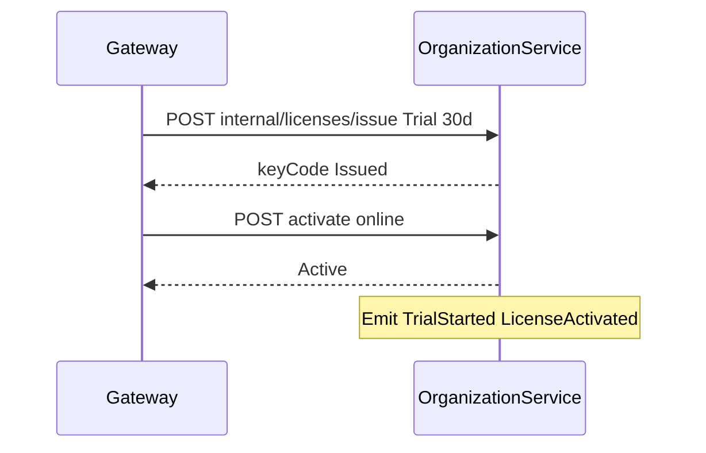

### 13.5 License Activation

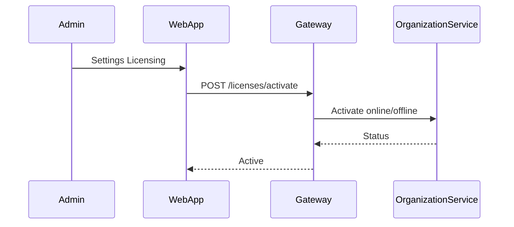

### 13.6 Invitation Acceptance

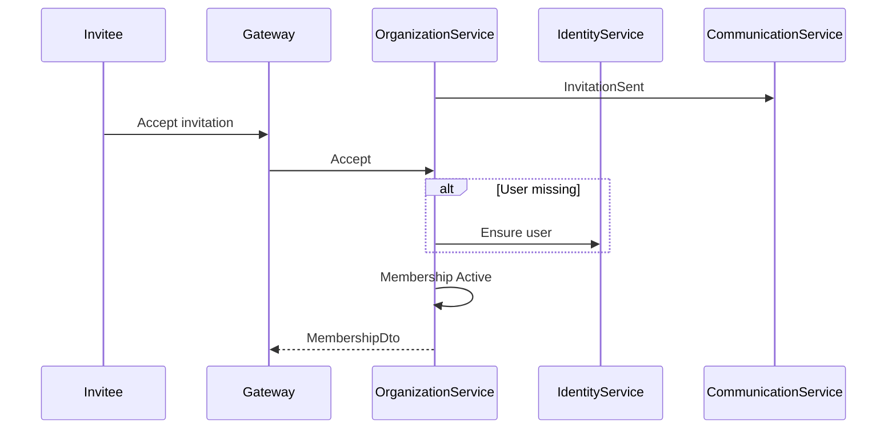

### 13.7 Password Reset

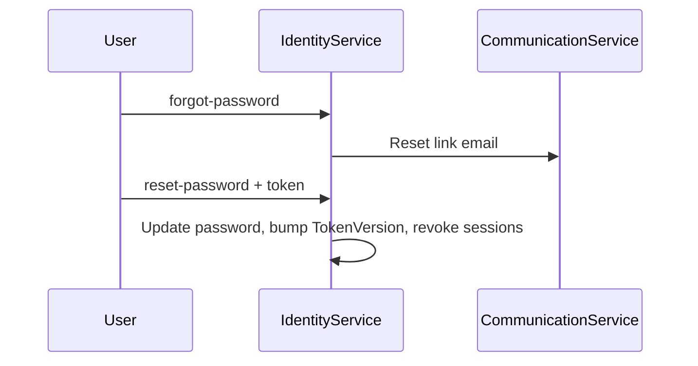

### 13.8 User Activation

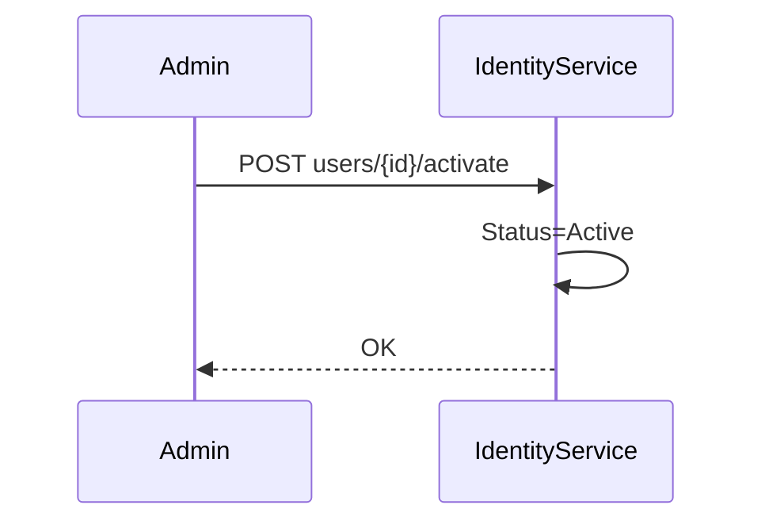

### 13.9 Trial Expiry (1A)

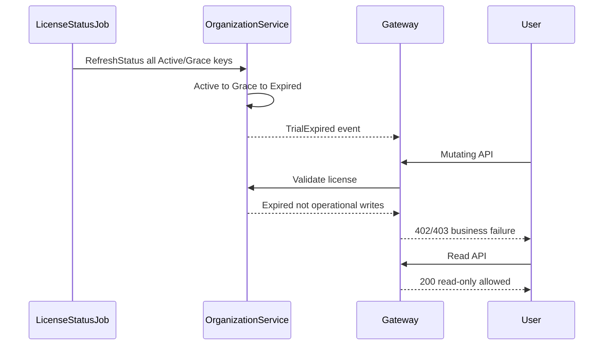

### 13.10 Organization Suspension

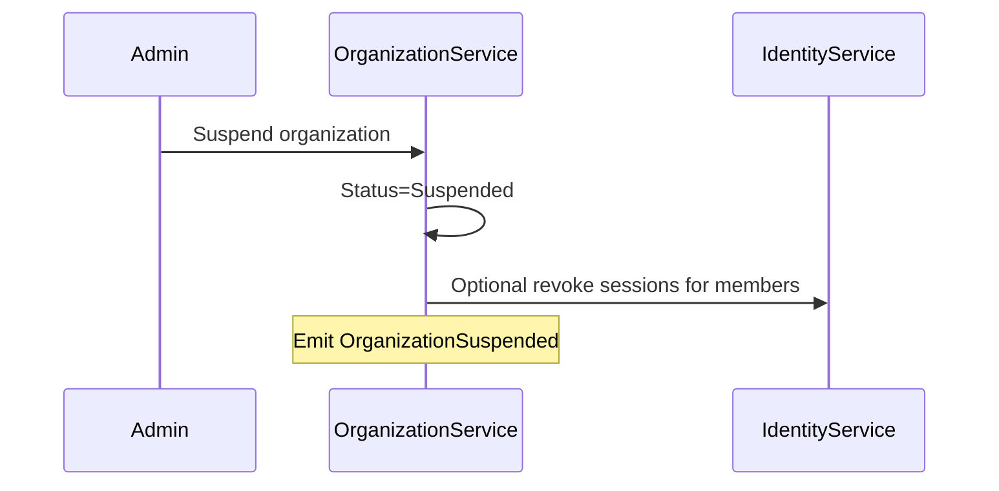

---

## 14. Updated Domain Model

### 14.1 Reuse (no new aggregate)

- `AppUser`, sessions, tokens, MFA, security entities  
- `Organization`, `Hospital`, `OrganizationMember`, `OrganizationMemberInvitation`, `OrganizationSettings`  
- `LicenseKey`, `LicenseActivation`, `LicenseSeatAssignment`, `LicenseHeartbeat`  
- `SubscriptionPlan`, `OrganizationSubscription` (catalogue)  
- `Person`, `Employment`  
- Gateway `SignupCommand` / `OnboardWizardCommand`

### 14.2 Additions (architecture contracts — implement in later CRP phases)

| Addition | Type | Justification |
|----------|------|---------------|
| `EmailVerificationMode` | Enum + config | Configurable verification without redesign |
| `OrganizationCommercialPhase` | Derived projection | Avoid duplicate SSOT vs LicenseStatus |
| `TrialPhase` | Derived projection | Reminder/expiring UX without Trial table |
| `TrialEnablementOptions` | Config VO | Days, seats, auto-activate, max extensions |
| Canonical `Organization.Status` values | Convention / optional enum | Draft, Provisioning, Active, Suspended, Archived, Deleted |
| Domain event contracts + dedupe keys | Shared messaging | Reliability |
| Invitation `TokenHash` redeem | Complete existing entity | Discovery gap — extend, don’t replace |

### 14.3 Explicitly not added

Tenant, Employee, Staff, BusinessUnit, Workspace entity, separate Trial table, duplicate OrgCommercialStatus column.

### 14.4 Domain services / policies (logical)

- `EmailVerificationPolicy` (Identity)  
- `LicenseOperationalPolicy` (read vs write given LicenseStatus) — encodes **1A**  
- `TrialExtensionPolicy`  
- `ProvisioningOrchestrator` (Gateway — existing Signup handler)  
- `SeatEnforcementPolicy`

---

## 15. Updated ER Diagram

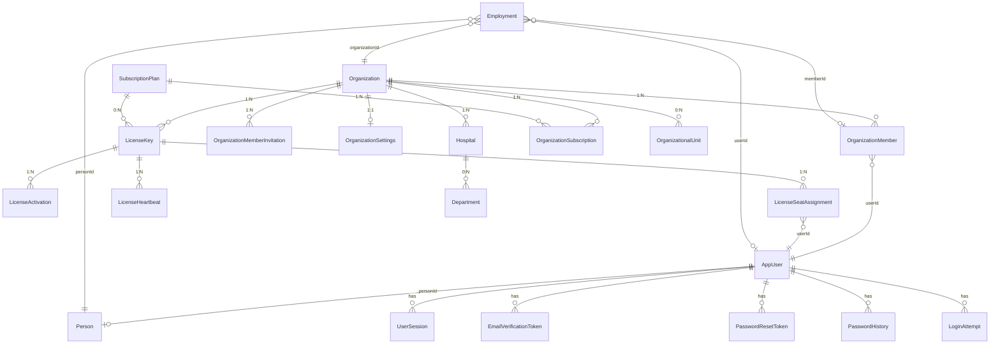

**Cardinalities (summary):** Org 1—N Hospitals; Org 1—N Members; User N—N Org via Membership; Org 1—N LicenseKeys (one operational preferred); License 1—N Seats; User 0—1 Person; Person 0—N Employments.

---

## 16. Module Responsibilities

| Module | May | Must not |
|--------|-----|----------|
| **Identity** | Auth, credentials, verification policy, sessions, user status | Own org status, licenses, employment |
| **Organization** | Tenancy, hospitals, membership, invitations, licenses, settings | Authenticate users, send SMTP directly long-term (emit events) |
| **Workforce** | Employment lifecycle | Create tenants or issue licenses |
| **Person** | Profile demographics | Auth or tenancy |
| **Licensing** (within Org) | Keys, seats, entitlements, trial projection | User passwords |
| **Gateway** | Orchestrate signup/wizard/commercial façades, enforce gates | Persist domain aggregates |
| **Communication** | Templates, delivery, retry | Decide business eligibility |
| **AccessGovernance** | Effective permissions | Store membership source of truth |
| **WebApp** | UX, guards consuming APIs | Encode irreversible business rules alone |

---

## 17. Cross-Service Interaction Model

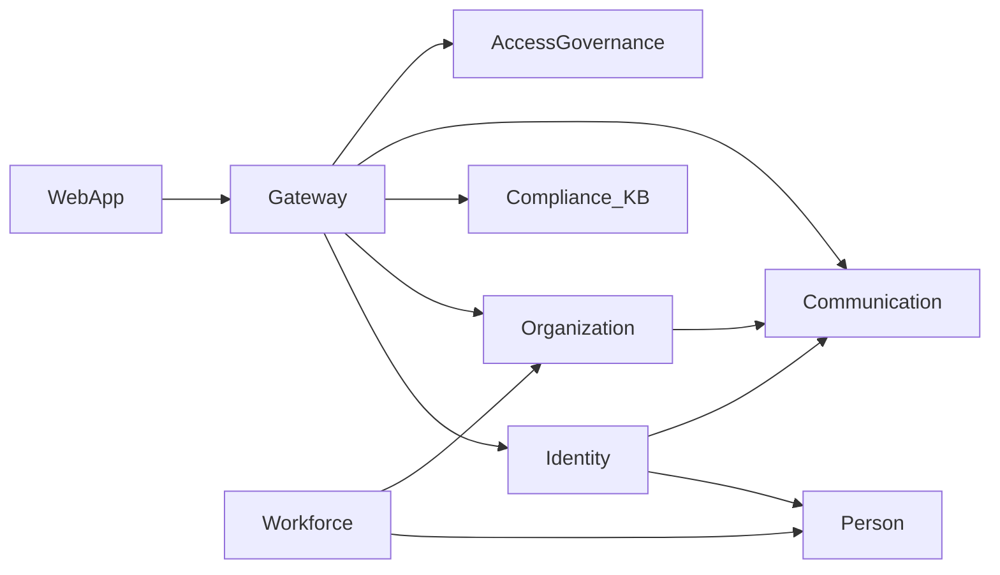

- **Sync commands** for signup compensation (Gateway).  
- **Async events** for email, trial reminders, analytics.  
- **License validation** on Gateway for mutating routes when org context present (fail-closed for writes; reads allowed when Expired per **1A**).

---

## 18. Future Extensibility

| Capability | How architecture supports it |
|------------|------------------------------|
| Multiple hospitals | Existing Hospital N under Org; JWT hospital_id switch |
| Enterprise orgs | ParentOrganizationId; OU hierarchy |
| Offline activation | Existing Offline license type + signing |
| Marketplace licensing | Issue keys with entitlement packs |
| Paid / annual subscription | LicenseType.Subscription + plan metadata + EndsAt |
| Seat expansion | MaxSeats update + assign API |
| Feature flags | Entitlement codes now; general FF later without changing LicenseKey |
| External IdP / Azure AD / Google / SAML | Add providers to Identity; keep AppUser as local principal |
| SCIM | Provision users/memberships into Identity+Org APIs |
| Multi-region | Org as tenant boundary; license heartbeat per region deployment |

No core model redesign required.

---

## 19. Risks

| Risk | Mitigation in architecture |
|------|----------------------------|
| Dual Subscription vs LicenseKey drift | LicenseKey SSOT; subscription metadata only |
| SMTP missing | Architecture requires Communication delivery; CRP email phase |
| Fail-open entitlement middleware | Freeze requires fail-closed **writes** |
| Async verification abuse | Mode can tighten to RequiredBeforeLogin without redesign |
| Signup without license (today) | Pipeline mandates trial issue+seat |
| Invite TokenHash incomplete | Explicit later CRP; events already defined |
| Derived phases mis-implemented as new tables | Spec forbids Trial table / duplicate commercial column |

---

## 20. Final Recommendations

1. Treat this document as the **frozen baseline** for commercial onboarding, trial, and licensing implementation.  
2. Implement later CRP phases by **extending** `SignupCommandHandler`, `LicenseAppService`, Identity verification config, Gateway license gate, and Communication SMTP — not by replacing Identity.  
3. Default runtime: `EmailVerificationMode=Async`, trial auto-issue 30d, post-grace **read-only (1A)**.  
4. Dual-write `OrganizationSubscription` only if catalogue reporting needs it; never use it to override LicenseKey.  
5. Complete invitation token redeem and license expiry job as architecture-mandated capabilities in subsequent phases.  
6. Any change to locked decisions (1A, 2B, ownership, LicenseKey SSOT, EmailVerificationMode set) requires **CRP change control** and a new Architecture Spec version.

---

## Architecture Freeze Statement

**Document:** CRP-Phase0-Commercial-Onboarding-Architecture.md  
**Version:** 1.0  
**Frozen on:** 2026-07-31  

This specification is the authoritative business architecture for AOVIAS Command commercial onboarding and licensing. Implementation work must conform to sections 1–20. Deviations require an explicit architecture amendment.

**Validated against:** Discovery Report v1.1 (reuse of Identity JWT, Signup/Onboard handlers, Phase 6 LicenseKey, Hospital.IsOnboarded, Employment/Person separation, Communication delivery role).

---

*End of CRP Phase 0 Architecture Specification.*
