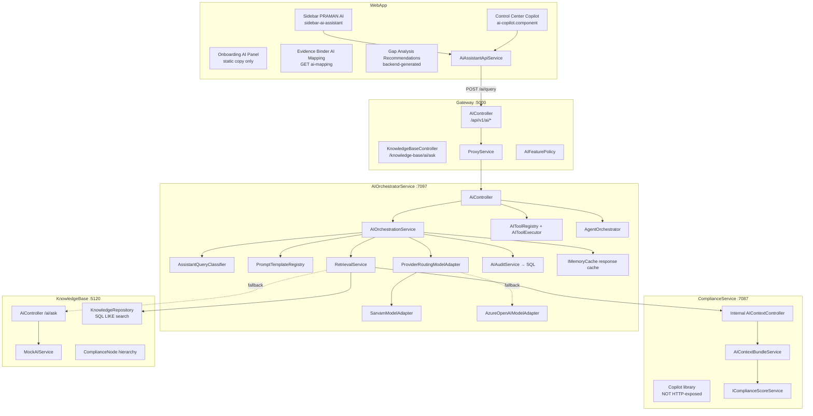

# PRAMAN AI Assistant Audit

**Type:** Analysis & architecture review (no implementation)  
**Date:** June 2026  
**Scope:** Capability, context, architecture, and Compliance Copilot readiness  
**Prerequisite domains:** Findings → Deficiency → CAPA → SLA → Maturity → Analytics Hub (Sprint 12B-1)

---

## Executive Summary

PRAMAN has **two AI tracks** that are not fully unified:

| Track | Status | User-facing? |
|-------|--------|--------------|
| **AIOrchestratorService** (Gateway `/api/v1/ai/*`) | Production path for sidebar + Control Center copilot | **Yes** |
| **ComplianceService Copilot library** (`ExplanationComposer`, `CopilotResponseFactory`, …) | Rule-based explainability; LLM adapter is stub; **no HTTP controller** | **No** |
| **KnowledgeBase `/ai/ask`** | Uses **MockAIService** (not a real LLM) | Proxied only; no WebApp UI wired |

The live assistant is a **Level 2–2.5 Knowledge + partial Organization Assistant**: it can answer general NABH/compliance questions and ground answers in a **limited, capped snapshot** of findings, tasks, evidence, OE metadata, and framework readiness scores. It is **not yet workflow-aware** for deficiencies, CAPA, SLA, escalations, stage unlocking, or Analytics Hub metrics.

**Recommended maturity rating:** **Level 2 — Knowledge Assistant** (approaching Level 3 for read-only org Q&A).

---

# Deliverable 1 — AI Architecture Diagram

## High-level architecture

## Module inventory

| Layer | Location | Key types |
|-------|----------|-----------|
| Frontend shell | `WebApp/src/app/core/layout/sidebar-ai-assistant*` | In-memory turns, rich presentation cards |
| Frontend API | `WebApp/.../ai-assistant-api.service.ts` | `sendQuery`, `getAssistiveSuggestions` (unused) |
| Gateway | `Gateway/Controllers/AIController.cs` | JWT + hospital header injection, feature flags |
| Orchestration | `AIOrchestratorService/Application/AI/` | Read, assist, actions, workflows |
| LLM adapters | `AIOrchestratorService/Infrastructure/LLM/` | Sarvam primary, Azure fallback |
| Compliance context | `ComplianceService/.../AIContextBundleService.cs` | Tenant-scoped facts + sources |
| Copilot library (dormant) | `ComplianceService/Application/Services/Copilot*.cs` | Rule-based explainability |
| Knowledge | `KnowledgeBase/` | Nodes, knowledge items, mock ask |

---

# Deliverable 2 — Model Inventory

| Attribute | Configuration |
|-----------|---------------|
| **Primary provider** | Sarvam (`sarvam-30b` via `/v1/chat/completions`) |
| **Fallback provider** | Azure OpenAI (chat completions, deployment from config) |
| **Routing** | `ProviderRoutingModelAdapter` — Sarvam for D1 use cases; Azure on failure or out-of-scope |
| **KB ask provider** | `MockAIService` — returns prefixed mock string, **not production LLM** |
| **Embedding models** | **None** — no vector store |
| **Prompt orchestration** | `PromptTemplateRegistry` (versioned system prompts) + `AIOrchestrationService` pipeline |
| **Inference strategy** | Single-shot: retrieve → classify → prompt → LLM → sanitize → validate → present |
| **Streaming** | **No** — `stream: false` in Sarvam payload; frontend uses full HTTP response |
| **Temperature** | **0.05** (Sarvam), deterministic JSON-oriented |
| **Token limits** | Sarvam `MaxTokensPerRequest`: 2048; retrieval budget `MaxContextTokens`: 1200 |
| **Timeout** | Sarvam 45s; orchestration performance config |
| **JSON repair** | `JSONRepairLayer` + retry with stronger formatter prompt |
| **Fallback strategy** | Sarvam retry → unstructured fallback → Azure provider → sanitized generic response |

## How intelligent is the assistant actually?

| Dimension | Assessment |
|-----------|------------|
| **General compliance knowledge** | **Strong** — prompts explicitly authorize NABH/JCI/CAPA/FMS expert answers when org data is thin |
| **Organization-specific accuracy** | **Moderate** — limited to last 20 findings/tasks/evidence + readiness aggregates; no deficiency/CAPA/SLA depth |
| **Structured output quality** | **Good intent** — strict JSON executive briefing schema; validation + sanitizer enforce UX |
| **Tool use / actions** | **Low maturity** — manifest exists; assist path hardcodes `create_task`; LLM does not choose tools |
| **Memory / continuity** | **Weak** — stateless backend; frontend in-memory only |
| **RAG quality** | **Basic** — SQL `LIKE` on KB + structured fact injection, not semantic retrieval |

---

# Deliverable 3 — Context Source Matrix

| Context source | Accessible today? | How retrieved | Limits / notes |
|----------------|-------------------|---------------|----------------|
| Hospital profile | Partial | JWT `hospital_id` → scope only | No structured hospital metadata in bundle |
| Organization | Partial | JWT `organization_id` / tenant headers | Not explicit facts in bundle |
| Framework | **Yes** | Request `frameworkId` + readiness scoring | Required by frontend |
| Standards / OE catalog | Partial | KB nodes + optional single OE in bundle | Max 5 OE sources in policy |
| Journey | **No** | — | Not in AI context bundle |
| Tasks | **Yes** | `AIContextBundleService` — last 20 by hospital | Summary only (title, status) |
| Evidence | **Yes** | Last 20 uploads by hospital | No review/verification state detail |
| Findings | **Yes** | Last 20 by tenant (hospital) | Not promoted-deficiency linkage |
| Deficiencies | **No** | — | Not in bundle or Copilot assembler |
| CAPA fields | **No** | — | Prompt mentions CAPA conceptually only |
| SLA / Escalations | **No** | — | — |
| Verification backlog | **No** | — | Evidence lifecycle status only |
| Obligations | **No** | — | — |
| Compliance Maturity / CMI | **No** | — | Readiness % from score service only |
| Stage Unlocking | **No** | — | — |
| Analytics Hub / KPIs | **No** | — | No `/analytics/*` integration |
| User profile / roles | **No** | JWT exists but not passed to LLM context | — |
| Conversation history | **No** (backend) | Frontend keeps turns locally | Prior turns not sent to API |
| Knowledge Base content | **Yes** | KB search + optional `/ai/ask` fallback | Top 10 LIKE matches |
| NABH node hierarchy | **Yes** | `ComplianceNode` in KB | Text search, not graph traversal |
| Policies / documents | Partial | KB knowledge items | Coverage depends on seeding |
| Readiness scores | **Yes** | `IComplianceScoreService` | Overall %, audit confidence, NC counts, top gap chapters |
| Program / Control / Regulation | Copilot library only | `ComplianceContextAssembler` | **Not wired to live assistant** |

---

# Deliverable 4 — Capability Inventory

| Capability | Implemented? | Data source | Prompt template | Limitations |
|------------|--------------|-------------|-----------------|-------------|
| General Q&A (NABH, accreditation) | **Yes** | Model knowledge + KB | `ExplainCompliance` 1.0/1.1 | May hallucinate without retrieval |
| Organization compliance briefing | **Partial** | Context bundle + readiness | `ExplainCompliance` | Capped lists; no deficiencies |
| Gap / readiness explanation | **Partial** | Score service + chapter gaps | `ExplainCompliance` | Assessment NCs, not operational gaps |
| Evidence suggestions | **Partial** | `SuggestMapping` template exists | `SuggestMapping` | `/ai/assist` **not wired in UI** |
| Task recommendations | **Partial** | `TaskRecommendation` template | `TaskRecommendation` | Not exposed in sidebar |
| Deficiency explanations | **No** | — | — | — |
| Journey / stage guidance | **No** | — | — | — |
| Policy / standard search | **Partial** | KB LIKE search | Embedded in retrieval | No semantic ranking |
| Analytics explanation | **No** | — | — | — |
| Explain task | **Legacy** | Gateway `/ai/explain-task` → read/explain | ExplainCompliance | Unclear UI usage |
| Create finding / task (action) | **Backend only** | Tool manifest + executor | — | Gateway `EnableAIAssist` often false; approval gates |
| Autonomous workflows | **Backend only** | `AgentOrchestrator` | Workflow templates | Feature flags; not in sidebar UI |
| Evidence binder AI mapping | **Stub** | `GET .../ai-mapping` | — | API may return `[]` |
| Gap analysis recommendations | **Separate** | KB assessment API | Backend-generated | Not unified with sidebar AI |
| Onboarding assistant | **Cosmetic** | Static strings | — | No LLM |
| Copilot rule-based explainability | **Library** | `ExplanationComposer` | Structured rewrite stub | No HTTP endpoint |

---

# Deliverable 5 — Tooling Audit

**Pattern:** Server-side tool manifest — **not** LLM native function calling.

| Tool | Risk | Purpose | Data / execution target | Current usage |
|------|------|---------|-------------------------|---------------|
| `create_finding` | High | Create audit finding | `POST /findings` | Manifest only; gated execution |
| `create_task` | High | Create compliance task | `POST /compliance-tasks` | **Hardcoded** in assist response |
| `link_evidence` | Low | Link evidence to OE | Evidence binder API | On approval |
| `validate_evidence` | Low | Read-only validation | Stub | Not fully implemented |
| `query_tasks` | Low | Task lookup | Stub | Not fully implemented |
| `analyze_missing_oes` | Low | OE gap analysis | Stub | Not fully implemented |
| Compensation tools | — | Undo create/link/close | Various | Governance / rollback |

**Pre-execution guards:** context version match, idempotency token, approval attestation, D0 `ForceApprovalForAllActions`.

**Missing tools (expected for Copilot):** `query_deficiencies`, `query_capa`, `query_sla`, `query_escalations`, `get_analytics_overview`, `get_stage_unlock_state`, `suggest_evidence_for_oe`, `explain_readiness`.

---

# Deliverable 6 — Knowledge Base Audit

| Aspect | Status |
|--------|--------|
| **Service** | `KnowledgeBase` microservice with `ComplianceNode` hierarchy (Chapter → Standard → OE) |
| **Content types** | Knowledge items: explanation, how-to-comply, tags, versioned |
| **NABH content** | Seeded via master data / knowledge items (framework-scoped) |
| **Search strategy** | SQL `LIKE` on explanation, tags, how-to-comply, node code/title — **top 10** |
| **Embeddings / RAG** | **Not implemented** — explicitly forbidden in prompts to mention vectors |
| **Graph** | Relational parent-child nodes; Control Center knowledge graph page is **mock UI** |
| **Freshness** | Version field on knowledge items; no automated staleness detection for AI |
| **Retrieval quality** | Adequate for keyword queries ("NABH", OE code); weak for paraphrase / multi-hop |
| **`/ai/ask` endpoint** | Builds rich prompt via `CompliancePromptBuilder`; LLM is **mock** |
| **WebApp integration** | `postAiAsk()` defined; **no UI caller** |
| **Gap analysis** | Separate assessment pipeline — not merged into orchestrator retrieval |

---

# Deliverable 7 — Memory Audit

| Memory type | Exists? | Scope | Persistence | Notes |
|-------------|---------|-------|-------------|-------|
| Session chat turns | Frontend only | Browser session | **Lost on refresh** | `SidebarAiAssistantStateService.turns` |
| Copilot widget messages | Frontend only | Component lifetime | In-memory | |
| Backend conversation API | **No** | — | — | Each `/ai/query` is stateless |
| Prior turns to LLM | **No** | — | — | Only current prompt sent |
| Response cache | Yes | Hospital + use case + context version + prompt | ~60s TTL | `IMemoryCache` |
| AI audit log | Yes | Per request | SQL `AIAuditEntries` | Metadata, not full chat |
| KB ask history | Yes | Per ask | SQL `AIInteractions` | Prompt + response |
| Agent workflow state | Yes | Workflow execution | SQL | Autonomy feature |
| Proactive suggestions | In-process queue | Server | Max 500 items | Feature flag off |
| User memory | **No** | — | — | |
| Organization memory | **No** | — | — | |
| Conversation summaries | **No** | — | — | |

**Answer:** The assistant **cannot remember prior interactions** across API calls. The sidebar shows multi-turn UX, but each turn is an independent retrieval + LLM call. Memory lasts **until the user clears conversation or refreshes** (frontend only).

---

# Deliverable 8 — Workflow Awareness Audit

Classification for the **live assistant** (AIOrchestrator path):

| Domain | Awareness | Evidence |
|--------|-----------|----------|
| Findings | **Partial** | Up to 20 recent findings in bundle |
| Deficiencies | **Unaware** | Not in context bundle |
| Tasks | **Partial** | Counts + 20 recent task summaries |
| Evidence | **Partial** | Upload list; no verification pipeline detail |
| Verification | **Unaware** | No pending-review counts in bundle |
| CAPA | **Unaware** | Prompt vocabulary only |
| RCA / root cause | **Unaware** | No deficiency RCA fields |
| SLA | **Unaware** | — |
| Escalations | **Unaware** | — |
| Compliance Maturity / CMI | **Unaware** | Only aggregate readiness % |
| Stage Unlocking | **Unaware** | — |
| Analytics Hub | **Unaware** | No analytics API integration |
| Journey / operational mode | **Unaware** | — |
| Assignment / routing | **Unaware** | Separate assignment suggestion API exists (DCC), not in AI |

**Copilot library** (`ComplianceContextAssembler`) loads programs, controls, tasks, evidence, regulations, audit findings — still **no deficiency/CAPA/SLA**, and it is **not connected** to the user-facing assistant.

---

# Deliverable 9 — Operational Data Access Audit

| Data | Live access? | Access level | Mechanism |
|------|--------------|--------------|-----------|
| Live deficiencies | **No** | None | — |
| Open tasks | **Partial** | Read snapshot | Last 20 + pending count |
| Pending evidence review | **No** | None | Lifecycle status label only |
| CAPA reviews | **No** | None | — |
| Escalations | **No** | None | — |
| Analytics metrics | **No** | None | Analytics platform not integrated |
| Readiness scores | **Yes** | Read aggregate | `IComplianceScoreService` |
| NC counts (assessment) | **Yes** | Read aggregate | Critical/major/minor/OFI |
| Top gap chapters | **Yes** | Read aggregate | Lowest completion % chapters |
| Open findings | **Yes** | Read snapshot | Last 20, open count |
| Create task/finding | **Gated** | Write (approval) | Tool executor when flags enabled |

**Gap:** Operational execution domains built in Sprints 8–12B are **largely invisible** to the AI context layer.

---

# Deliverable 10 — Gap Analysis

| User expectation | Current capability | Gap severity |
|------------------|-------------------|--------------|
| "Why is Commitment locked?" | General readiness % only; no stage unlock evaluation | **High** |
| "What deficiencies block accreditation?" | No deficiency data | **Critical** |
| "Which CAPAs are overdue?" | No CAPA data | **Critical** |
| "Show me recurring issues" | No recurrence / analytics | **High** |
| "Suggest evidence for MOM.6" | `SuggestMapping` exists but UI not wired; binder AI mapping empty | **High** |
| "Explain our SLA breach rate" | No SLA metrics | **High** |
| "What's our CMI / maturity stage?" | No CMI in context | **Medium** |
| "Summarize Analytics Hub KPIs" | No analytics integration | **High** |
| "What happened in our last audit finding?" | Recent findings in bundle | **Low–Medium** |
| "What tasks are overdue?" | Pending task count + summaries | **Medium** |
| Multi-turn "follow up on that deficiency" | No memory + no deficiencies | **High** |
| "Create a remediation task" | Tool exists; assist hardcodes suggestion; flags often off | **Medium** |

---

# Deliverable 11 — Compliance Copilot Readiness Assessment

| Future capability | Readiness | Rationale |
|-------------------|-----------|-----------|
| **Operational Assistant** | **Partially Ready** | Orchestrator + tools + context version exist; missing deficiency/task/evidence depth |
| **Accreditation Coach** | **Partially Ready** | Readiness scores + KB + strong prompts; missing stage unlock + CMI + journey |
| **Deficiency Advisor** | **Missing** | No deficiency in context; no DCC integration |
| **Evidence Advisor** | **Partially Ready** | Evidence list + SuggestMapping template; mapping UI stub |
| **CAPA Advisor** | **Missing** | No CAPA metrics or lifecycle in retrieval |
| **Executive Intelligence Assistant** | **Missing** | Analytics Hub (12B-1) not connected; executive briefing format exists but data thin |
| **RCA Advisor** | **Missing** | No root cause breakdowns in context |
| **SLA / Escalation Advisor** | **Missing** | No escalation service integration |

**Foundation assets reusable for Copilot:**

- Gateway AI surface + feature flags
- Retrieval pipeline + token budgeting
- Structured JSON presentation layer (executive cards)
- Context version + approval gates for safe actions
- Analytics SSOT services (ready to expose read-only tools)
- Copilot explainability library (needs HTTP wiring + real LLM)

---

# Deliverable 12 — AI Maturity Rating

## Rating: **Level 2 — Knowledge Assistant** (early Level 3 for org read Q&A)

| Level | Description | PRAMAN fit |
|-------|-------------|------------|
| **1 — FAQ Bot** | Static or generic answers | Surpassed — real LLM + retrieval |
| **2 — Knowledge Assistant** | Domain KB + general expert answers | **Current core** — NABH KB + Sarvam + prompts |
| **3 — Workflow Assistant** | Understands live operational state across modules | **Partial** — findings/tasks/evidence/readiness only |
| **4 — Compliance Copilot** | Cross-module advisor with safe actions + memory | Infrastructure started (tools, workflows); data + wiring incomplete |
| **5 — Autonomous Agent** | Proactive, multi-step execution | Agent orchestrator exists; flags conservative; not user-facing |

**Justification:** Production LLM orchestration, KB retrieval, and org-scoped readiness grounding exceed FAQ bots. However, the assistant lacks deficiency→CAPA→SLA→maturity→analytics operational graph, persistent memory, semantic retrieval, and unified Copilot endpoint — all required for Level 4.

---

# Deliverable 13 — Recommendation Roadmap

## Immediate improvements (0–6 weeks, analysis-only priorities)

1. **Extend `AIContextBundleService`** to include read-only slices from SSOT services: open deficiencies (counts + top critical), CAPA metrics, SLA/escalation summary, stage unlock blocking reasons — without duplicating formulas (delegate to `IDeficiencyMetricsService`, `IAnalyticsAggregationService`).
2. **Wire `/ai/assist`** in Evidence Binder and OE wizard via existing `getAssistiveSuggestions()` — template already exists.
3. **Send conversation history** (last N turns) in `AIRequest` for continuity; store optional thread id in audit log.
4. **Replace KnowledgeBase `MockAIService`** with orchestrator-routed LLM or remove fallback to mock in production paths.
5. **Expose read-only Copilot endpoint** wrapping `CopilotExplanationService` for structured "why non-compliant" on a specific OE/program — reuses existing library.
6. **Unify feature flags** — Gateway dev disables assist while orchestrator enables it; align environments.

## Medium-term improvements (6–12 weeks)

1. **Analytics Copilot tools** — `get_analytics_overview`, `get_department_scorecard` calling `/analytics/*` (read-only).
2. **Semantic retrieval** — embeddings over KB + obligation text; keep SQL search as fallback.
3. **Contextual "Explain this"** buttons on Findings, Deficiency, OE, CM stage cards → pass entity IDs to orchestrator.
4. **Register `ComplianceContextAssembler` + full Copilot stack** in DI; route high-risk explanations through rule-based gaps + LLM rewrite via orchestrator.
5. **LLM tool selection** — move from hardcoded `create_task` to validated tool proposals parsed from model output.
6. **Streaming responses** — SSE for sidebar UX (optional).

## Long-term Copilot roadmap (Sprint 13+ alignment)

| Phase | Goal |
|-------|------|
| **13A — Context completeness** | Full operational graph in retrieval: finding→deficiency→task→evidence→CAPA→SLA→readiness |
| **13B — Compliance Copilot UX** | Page-aware assistant, deep links, memory, suggested actions with approval |
| **13C — Executive Copilot** | Analytics Hub narration, trend explanation, department coaching |
| **13D — Safe autonomy** | Event-driven suggestions (SLA breach, recurrence) → proactive panel |
| **13E — Autonomous agent (controlled)** | Workflow templates with human-in-the-loop only for high-risk writes |

---

## Success Criteria Checklist

| Criterion | Status |
|-----------|--------|
| Full understanding of current AI Assistant | ✅ |
| Clear context visibility | ✅ |
| Clear capability inventory | ✅ |
| Clear operational awareness assessment | ✅ |
| Clear gap analysis | ✅ |
| Copilot readiness assessed | ✅ |
| No implementation assumptions | ✅ |
| Ready for AI roadmap planning | ✅ |

---

## Key file reference index

| Area | Path |
|------|------|
| Sidebar UI | `WebApp/src/app/core/layout/sidebar-ai-assistant*.ts` |
| API client | `WebApp/src/app/features/control-center/services/ai-assistant-api.service.ts` |
| Gateway AI | `Gateway/Controllers/AIController.cs` |
| Orchestrator | `AIOrchestratorService/Application/AI/Orchestration/AIOrchestrationService.cs` |
| Prompts | `AIOrchestratorService/Application/AI/Prompting/PromptTemplateRegistry.cs` |
| Retrieval | `AIOrchestratorService/Application/AI/Retrieval/RetrievalService.cs` |
| Context bundle | `ComplianceService/Application/Services/AIContextBundleService.cs` |
| Tools | `AIOrchestratorService/Application/AI/Actions/AITooling.cs` |
| Copilot library | `ComplianceService/Application/Services/ExplanationComposer.cs` |
| KB search | `KnowledgeBase/Infrastructure/Repositories/KnowledgeRepository.cs` |
| Architecture notes | `docs/backend/ai-assistant-retrieval-architecture-notes.md` |

---

**End of PRAMAN AI Assistant Audit**
