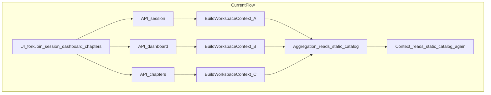
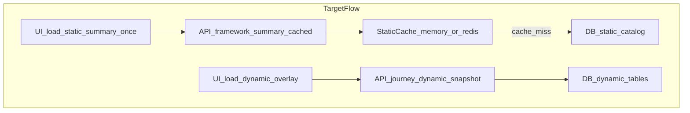

# PRAMAN Performance Audit & Optimization Report

Date: 2026-04-23  
Scope: Journey + Journey Execution (API + Angular UI)  
Constraint honored: no behavior changes in this audit deliverable

## 1) Current implementation analysis

### Backend (Gateway + ComplianceService)

#### Endpoint surface area used by Journey UI

- Gateway route fan-out is defined in [V:\DevelopmentRepo\V1.0\ComplaincePlatform\Gateway\Controllers\JourneysController.cs](V:\DevelopmentRepo\V1.0\ComplaincePlatform\Gateway\Controllers\JourneysController.cs). Journey split reads are proxied as:
  - `GET /journeys/{journeyId}/session`
  - `GET /journeys/{journeyId}/dashboard`
  - `GET /journeys/{journeyId}/chapters`
  - plus execution endpoints (`objective-elements/*`, `evidence/*`, `history`, wizard endpoints).
- ComplianceService handler routes are in [V:\DevelopmentRepo\V1.0\ComplaincePlatform\ComplianceService\Controllers\V1\JourneysController.cs](V:\DevelopmentRepo\V1.0\ComplaincePlatform\ComplianceService\Controllers\V1\JourneysController.cs), including:
  - split reads (`session`, `dashboard`, `chapters`)
  - backward-compatible full workspace (`workspace`)
  - paged chapter standards (`chapters/{chapterId}/standards`)
  - OE detail, evidence CRUD/download/verify/versioning, OE history, OE execution wizard APIs.
- Service contract is centralized in [V:\DevelopmentRepo\V1.0\ComplaincePlatform\ComplianceService\Application\Contracts\IJourneyWorkspaceService.cs](V:\DevelopmentRepo\V1.0\ComplaincePlatform\ComplianceService\Application\Contracts\IJourneyWorkspaceService.cs).

#### Data loading pattern in Journey hot path

- `GetSessionAsync`, `GetDashboardAsync`, `GetChaptersIndexAsync`, `GetObjectiveElementDetailAsync`, and `GetChapterStandardsAsync` all start from `BuildWorkspaceContextAsync` in [V:\DevelopmentRepo\V1.0\ComplaincePlatform\ComplianceService\Application\Services\JourneyWorkspaceAppService.cs](V:\DevelopmentRepo\V1.0\ComplaincePlatform\ComplianceService\Application\Services\JourneyWorkspaceAppService.cs).
- `BuildWorkspaceContextCoreAsync` performs broad reads:
  - framework record
  - chapters
  - standards
  - objective elements
  - score rows
  - findings
  - observations
  - evidence links
  - action plans
- It also calls `IAggregationService.ComputeFrameworkAsync`, and that service re-reads chapters, standards, objective elements, and score rows in [V:\DevelopmentRepo\V1.0\ComplaincePlatform\ComplianceService\Application\Aggregation\AggregationService.cs](V:\DevelopmentRepo\V1.0\ComplaincePlatform\ComplianceService\Application\Aggregation\AggregationService.cs). This duplicates static catalog work inside one request.

#### Query efficiency and shape

- Positive:
  - Most reads are batched (`ToListAsync`) and `AsNoTracking` is widely used.
  - No obvious per-item async database query loops (not classic N+1 in controller/service code).
- Bottleneck pattern:
  - Large `Contains(list)` filters for standards/OEs/scores are used repeatedly per request. This is acceptable for moderate catalogs but expensive at scale.
  - Chapter standards paging is currently in-memory, not database-level paging:
    - `GetChapterStandardsAsync` builds full workspace context, maps all chapter standards, then applies `Skip/Take` on the mapped list.

#### Index coverage

- Relevant index coverage in [V:\DevelopmentRepo\V1.0\ComplaincePlatform\ComplianceService\Infrastructure\Persistence\ComplianceDbContext.cs](V:\DevelopmentRepo\V1.0\ComplaincePlatform\ComplianceService\Infrastructure\Persistence\ComplianceDbContext.cs):
  - `ComplianceChapters.FrameworkId`
  - `ComplianceStandards (ChapterId, Code)` and `(ChapterId, Sequence)`
  - `ObjectiveElements (ComplianceStandardId, Code)` and `Classification`
  - `ObjectiveElementScores (JourneyId, ObjectiveElementId)`
  - observations/findings composite indexes for journey + OE paths
- Conclusion: base indexes are present; primary performance issue is repeated broad reads and duplicated computation, not missing fundamental indexes.

#### Payload design observations

- Split-read DTOs are in [V:\DevelopmentRepo\V1.0\ComplaincePlatform\ComplianceService\Application\DTOs\JourneyScreenDtos.cs](V:\DevelopmentRepo\V1.0\ComplaincePlatform\ComplianceService\Application\DTOs\JourneyScreenDtos.cs):
  - `JourneySessionDto`, `JourneyDashboardDto`, `JourneyChaptersIndexDto`.
- Full workspace DTO is in [V:\DevelopmentRepo\V1.0\ComplaincePlatform\ComplianceService\Application\DTOs\JourneyWorkspaceDtos.cs](V:\DevelopmentRepo\V1.0\ComplaincePlatform\ComplianceService\Application\DTOs\JourneyWorkspaceDtos.cs).
- `JourneyDashboardDto` currently carries three trend arrays (`OeScoreTrend`, `ChapterImprovementTrend`, `RiskEvolutionTrend`), and in current service mapping all three are fed from the same `trends` source, increasing payload volume without distinct value.

#### Caching/compression status

- `IMemoryCache` exists in DI and is used for security/rate-limiting concerns (for example token blacklist), but not for Journey static framework/catalog reads:
  - [V:\DevelopmentRepo\V1.0\ComplaincePlatform\ComplianceService\Infrastructure\Extensions\ServiceCollectionExtensions.cs](V:\DevelopmentRepo\V1.0\ComplaincePlatform\ComplianceService\Infrastructure\Extensions\ServiceCollectionExtensions.cs)
  - [V:\DevelopmentRepo\V1.0\ComplaincePlatform\ComplianceService\Infrastructure\Services\TokenBlacklistService.cs](V:\DevelopmentRepo\V1.0\ComplaincePlatform\ComplianceService\Infrastructure\Services\TokenBlacklistService.cs)
- No in-repo app-level response compression middleware was found in Gateway/ComplianceService startup code (validate host/proxy-level compression separately).

### Frontend (Angular)

#### Data flow and state handling

- Journey route shell provides a shared store once:
  - [V:\DevelopmentRepo\V1.0\WebApp\src\app\features\journey\pages\journey-feature-shell.component.ts](V:\DevelopmentRepo\V1.0\WebApp\src\app\features\journey\pages\journey-feature-shell.component.ts)
  - This is a good architectural choice because dashboard and execution routes reuse one in-memory workspace.
- Core load path in [V:\DevelopmentRepo\V1.0\WebApp\src\app\features\journey\state\journey-workspace.store.ts](V:\DevelopmentRepo\V1.0\WebApp\src\app\features\journey\state\journey-workspace.store.ts):
  - `forkJoin` for `getSession`, `getDashboard`, `getChaptersIndex`.
  - chapter standards are lazy-loaded per chapter selection.
- API calls are defined in [V:\DevelopmentRepo\V1.0\WebApp\src\app\features\journey\services\journey-data.service.ts](V:\DevelopmentRepo\V1.0\WebApp\src\app\features\journey\services\journey-data.service.ts).

#### Caching and persistence

- `clearWorkspaceCache()` in `JourneyDataService` is currently a no-op.
- Store-level persistence exists for some interaction states in `sessionStorage` (OE wizard/task draft), but not for framework structure/chapters/standards snapshots.
- Result: structural data is still reconstructed through API calls instead of being reused as a cacheable static slice.

#### Rendering behavior

- Strength:
  - Journey feature uses `ChangeDetectionStrategy.OnPush` broadly across pages/components.
  - New control-flow loops use tracked identity (`@for ... track id`) in hot lists.
- Remaining risk:
  - Standard cards render OE rows for expanded standards; at large OE counts this can still create a heavy DOM even with OnPush.
  - No virtual scrolling is currently used in the journey execution list components.

#### Deprecated execution path

- Legacy component [V:\DevelopmentRepo\V1.0\WebApp\src\app\features\journey\pages\journey-execution\journey-execution.component.ts](V:\DevelopmentRepo\V1.0\WebApp\src\app\features\journey\pages\journey-execution\journey-execution.component.ts) is marked deprecated but still re-provides `JourneyWorkspaceStore`.
- If reintroduced by route drift/rollback, it can fragment shared state and duplicate loads.

## 2) Identified problems

### Critical issues

1. Triple full-context rebuild on initial page load:
  - Frontend sends three parallel calls (`session`, `dashboard`, `chapters`).
  - Backend rebuilds the same broad workspace context for each call.
2. Duplicate static framework reads inside one backend call:
  - `BuildWorkspaceContextCoreAsync` reads chapter/standard/OE sets.
  - `ComputeFrameworkAsync` reads the same sets again.
3. Chapter standards endpoint appears progressive but still pays full backend cost:
  - Full context build first, paging later in memory.
4. No server-side cache for static framework structure:
  - static catalog data is repeatedly recomputed under user concurrency.

### Moderate issues

1. Payload inflation in dashboard trends (same source sent via multiple trend arrays).
2. No explicit frontend structural cache service (only store lifetime caching).
3. Potential large-DOM pressure in expanded standards/OE rendering without virtualization.
4. Compression configuration not explicit in app startup code (depends on hosting tier).

### Minor issues

1. `clearWorkspaceCache()` is a no-op and can mislead maintainers.
2. Deprecated execution container still exists and re-provides store scope.
3. Some DTO fields are currently mode-dependent placeholders and can be streamlined in future API versions.

## 3) Performance impact model (code-derived)

The following estimate is based on current query orchestration, not environment-specific latency:

- One `BuildWorkspaceContextAsync` path executes approximately:
  - journey lookup
  - framework lookup
  - 4 aggregation queries (chapters, standards, OEs, scores)
  - 8 workspace queries (chapters, standards, OEs, scores, findings, observations, evidence links, action plans)
  - ~= 14 query executions before optional method-specific extras
- Initial Journey load currently triggers:
  - `session` (~14)
  - `dashboard` (~15 including trends)
  - `chapters` (~14)
  - approximate total: ~43 query executions per first screen load event, before user interaction calls.

This estimate is intended for prioritization and should be validated against real telemetry.

## 4) Optimized architecture blueprint

### Data segmentation strategy (most important)

Split Journey data into two contracts:

1. Static data (cacheable, long TTL):
  - framework metadata
  - chapters
  - standards
  - OE definitions/classification metadata
2. Dynamic data (short TTL / uncached or per-user scoped):
  - latest scores/status
  - findings/observations
  - evidence status
  - action plans
  - wizard/task interaction state

### Proposed backend API shape (compatible rollout)

Add progressive endpoints (or versioned equivalents) while keeping current endpoints live:

- `GET /framework/summary?frameworkId=...&mode=...`
  - chapter list + aggregate counters only
- `GET /framework/chapters/{chapterId}/standards?...`
  - standards for one chapter, with true DB paging
- `GET /framework/standards/{standardId}/objective-elements?...`
  - OE list only when expanded
- `GET /journeys/{journeyId}/dynamic-snapshot?...`
  - dynamic overlays for currently visible entities

Compatibility rule:

- existing `session`, `dashboard`, `chapters`, and `workspace` endpoints continue to function during migration.

### Backend optimization actions

1. Remove duplicate static reads:
  - Refactor aggregation to accept preloaded static collections, or make context builder consume one shared static-query result.
2. Introduce cache layer:
  - MemoryCache initially, Redis for multi-instance deployments.
  - Tenant/framework/mode keyed entries with explicit invalidation hooks.
3. Implement true database paging:
  - Apply `Where chapterId` + `OrderBy` + `Skip/Take` before materialization.
4. Slim DTO contracts for split reads:
  - avoid repeated trend payload where values are identical.
5. Enable and verify compression:
  - app middleware and/or host/proxy compression policy with minimum size threshold.

### Frontend optimization actions

1. Smart client cache service (high impact):
  - singleton map keyed by `journeyId + operationalMode`.
  - cache static slices (chapters/standards/OE definitions) across dashboard/execution routes.
2. Progressive loading UX:
  - load chapters first
  - on chapter expand/select, fetch standards
  - on standard expand/select, fetch OEs
3. Preserve dynamic state separately:
  - keep wizard/task drafts in sessionStorage (already partly done)
  - avoid invalidating static slices on non-structural interactions.
4. Rendering optimization:
  - keep OnPush + tracked loops
  - add virtual scrolling for very large OE sets.
5. Optional prefetching:
  - fetch next likely chapter/standard in idle time.

## 5) Phased non-breaking refactoring plan

### Phase 0: instrumentation and baseline

- Add request correlation and timings around:
  - `BuildWorkspaceContextAsync`
  - `ComputeFrameworkAsync`
  - split read endpoints (`session`, `dashboard`, `chapters`)
- Capture payload size and TTFB baseline in lower and staging environments.

### Phase 1: remove duplicate backend work

- Refactor context + aggregation to avoid static catalog double-load.
- Keep public API contracts unchanged.

### Phase 2: cache static structure

- Add static catalog cache with invalidation on framework/chapter/standard/OE master updates.
- Maintain same response contracts.

### Phase 3: introduce progressive APIs

- Add new progressive endpoints for chapter/standard/OE expansion.
- Feature-flag frontend to consume new endpoints gradually.

### Phase 4: frontend cache and rendering hardening

- Add explicit journey structural cache service.
- Add virtual scroll for large OE lists.
- Remove dead/deprecated execution path once rollout is stable.

### Phase 5: deprecation cleanup

- After adoption, deprecate heavy full-workspace read paths in a versioned manner.
- Keep old endpoints for backward compatibility window, then retire safely.

## 6) Metrics collection methodology

Environment note:

- This repository audit did not include live authenticated runtime execution in a deployed environment, so exact payload byte counts and P95 latency numbers are not embedded here.

When running measurements, use this repeatable approach:

1. Browser network baseline:
  - Open Journey page.
  - Record `session`, `dashboard`, `chapters`, and `chapters/{id}/standards`.
  - Capture:
    - response size (`Content-Length` or transferred bytes),
    - TTFB,
    - total duration.
2. CLI timing sample (Gateway):

```bash
curl -sS -o /dev/null \
  -w "code=%{http_code} size=%{size_download} ttfb=%{time_starttransfer} total=%{time_total}\n" \
  -H "Authorization: Bearer <token>" \
  -H "api-version: 1.0" \
  "https://<gateway-host>/api/v1/journeys/<journeyId>/session?operationalMode=0"
```

1. SQL/APM correlation:
  - Enable short-window EF command logging or SQL profiler trace.
  - Correlate query counts and durations by request ID.
2. Compare before/after each phase:
  - first paint latency,
  - DB query count per page load,
  - total bytes downloaded,
  - user interaction latency (chapter expand, OE open).

## 7) Architecture flow (current vs target)







## 8) Final recommendation

The primary root cause is architectural over-fetch and duplicated backend computation, not a single bad query. Highest ROI comes from:

1. removing duplicate static reads inside one request,
2. preventing triple context rebuilds from split endpoint fan-out,
3. caching static framework structure,
4. moving to true progressive loading at API and UI layers.

This sequence preserves current behavior while materially improving scalability, tail latency, and infrastructure cost.