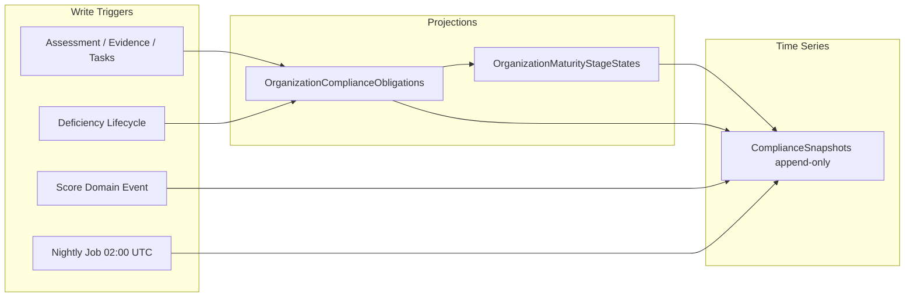
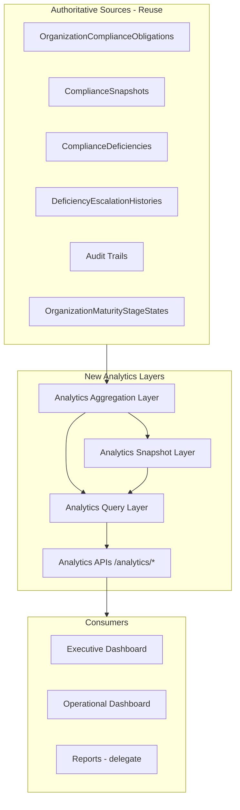

# Sprint 12A — Analytics Readiness Audit

**Objective:** Establish a single analytics architecture for PRAMAN before building Cross Module Analytics (Sprint 12B).

**Scope:** Analysis only. No dashboards, no module redesigns, no AI.

**Principle:** Maximize reuse of existing projections (`ProgramOverviewSnapshot`, `ComplianceSnapshots`, `OrganizationComplianceObligations`, deficiency/CAPA/SLA metrics, stage-unlock state) before proposing new analytics tables.

---

## Executive Summary

PRAMAN has **rich operational data** across 11 sprints but **analytics logic is distributed** across 10+ query/aggregation services with **material KPI duplication** and **inconsistent scoping** (org vs hospital vs framework vs global).

| Strength | Gap |
|----------|-----|
| Append-only `ComplianceSnapshots` time series | Three trend arrays in Journey are identical copies of `OverallScore` |
| `OrganizationComplianceObligations` as per-OE SSOT | No unified analytics query layer |
| Mature DCC + CM + Findings + Journey dashboards | Same KPIs computed 2–3 ways with different filters |
| Rich `ComplianceEvent` outbox → Service Bus | **No analytics consumer** on the bus (AI-only) |
| CAPA/SLA/Escalation metrics services exist | DCC re-implements CAPA/SLA counts inline; several APIs have no UI consumer |

**Recommendation:** Sprint 12B should introduce an **Analytics Aggregation Layer** that reads authoritative projections and exposes a single `/analytics` API surface—**not** new scattered KPI loops in each module.

---

# Deliverable 1 — Analytics Source Catalog

## Module Inventory

| Module | Authoritative Service | Primary Storage | Key Metrics | API Surface | Frontend Consumer |
|--------|----------------------|-----------------|-------------|-------------|-------------------|
| **Compliance Maturity** | `ComplianceMaturityAggregationService` | Live query + `OrganizationComplianceObligations`, `ComplianceDeficiencies`, stage state | CMI, stage scores, core gaps, predicted gaps, SLA/CAPA governance, unlock timeline | `GET /api/v1/compliance/maturity-dashboard` | `compliance-maturity.component`, `cm-executive-kpi` |
| **Deficiency Command Center** | `DeficiencyCommandCenterQueryService` | `ComplianceDeficiencies`, obligations join | 40+ KPIs: severity, lifecycle, SLA, escalation, CAPA, origin, breakdowns | `GET /deficiencies/command-center/dashboard` | `dcc-dashboard`, `corrective-actions` |
| **Findings Workbench** | `FindingsWorkspaceQueryService` | `Findings` | Total/open/critical, promotion funnel, by source/dept/chapter | `GET /findings/workspace/dashboard` | `findings-dashboard` |
| **Journey** | `JourneyWorkspaceAppService` | OE scores, obligations, action plans, snapshots | Core %, accreditation readiness, stage breakdown, trends | `GET /journeys/{id}/dashboard` | `journey.component`, metrics bar |
| **Program Overview** | `DashboardSnapshotService` | Live scores + `ComplianceSnapshots` (trends) | Executive summary, tasks, frameworks, hospitals, score trends | `GET /compliance/snapshots/hospital/{id}` | `dashboard.component`, sidebar |
| **Program Overview (legacy)** | `ProgramOverviewSnapshotReadService` | `ComplianceSnapshots` | Overall score, NC counts | **Registered, no HTTP route** | None |
| **Tasks** | `DashboardSnapshotService`, `TaskReportService` | `ComplianceTasks` | Open/overdue/due-soon, by priority/type | Dashboard + `GET /reporting/tasks` | Dashboard, reports |
| **Evidence** | `EvidenceReportService`, obligation projection | `Evidence`, obligations | Pipeline counts, verification backlog | `GET /reporting/evidence` | Reports |
| **Verification** | Obligation projection | `OrganizationComplianceObligations.VerificationStatus` | Pending/failed/success % | Obligation APIs, stage unlock | Journey, CM |
| **CAPA** | `CapaQueryService` | `ComplianceDeficiencies` (CAPA fields) | Effectiveness, recurrence, closure time, dept performance | `GET /deficiencies/{id}/capa` (detail only); metrics internal | DCC inline + CM governance |
| **SLA** | `SlaEvaluationService` (per-row), `EscalationService` (aggregate) | `ComplianceDeficiencies`, `DeficiencyEscalationHistories` | Status bands, breach/escalation rates, dept compliance | `GET /sla/metrics` | DCC only (no aggregate UI) |
| **Escalation** | `EscalationService` | `DeficiencyEscalationHistories` | Levels, critical escalations, resolution hours | Per-deficiency in DCC + `/sla/metrics` | DCC detail |
| **Assignment/Routing** | `AssignmentRoutingService` | `AssignmentRoutingLogs` | Auto-assign rate, rule breakdown | `GET /assignment/metrics` | None |
| **Stage Unlocking** | `StageUnlockingService` | `OrganizationMaturityStageStates`, `MaturityStageUnlockAuditEntries` | Readiness %, blocking reasons, unlock timeline | Via CM + Journey dashboards | CM timeline, journey stepper |
| **Reports** | `ComplianceReportService`, `AuditReportService`, `ReadinessReportService`, `TaskReportService`, `EvidenceReportService` | Snapshots + live queries | Export-oriented aggregates with date filters | `GET /reporting/*` | Report export UI |
| **Control Center** | `ControlCenterAggregationService` | `ActivityEvents`, `Alerts`, snapshots | KPIs, trends, activity feed | Control Center APIs | Admin/control views |

## Detailed Metric Catalog (Representative)

| Metric | Source Table/Service | Owner Service | Calculation Summary | Consumers |
|--------|---------------------|---------------|---------------------|-----------|
| Compliance Maturity Index (CMI) | Stage scores → `ComplianceMaturityIndexService` | CM Aggregation | Weighted: Core×0.4 + Commitment×0.3 + Achievement×0.2 + Excellence×0.1 | CM dashboard |
| Core Readiness Score | `IComplianceScoringService.CalculateFrameworkScoreAsync` | CM Aggregation | Framework-level score from OE assessments | CM, reports |
| Accreditation Readiness % | `IComplianceScoreService.GetJourneyScoreAsync` | Journey Workspace | **Canonical journey headline score** | Journey, dashboard snapshot |
| Open Deficiencies | `ComplianceDeficiencies` | **3 implementations** | See KPI Ownership Matrix | CM, DCC, CAPA |
| Open CAPAs | `ComplianceDeficiencies` CAPA fields | DCC inline + `CapaQueryService` | Corrective/preventive started or summary present | DCC, CM governance |
| SLA Health Score | Open deficiencies with SLA policy | CM (via Escalation metrics) | (OnTrack + Warning) / TotalWithSla × 100 | CM `SlaGovernance` (backend only) |
| CAPA Effectiveness Rate | Closed deficiencies with review outcome | `CapaQueryService` | Effective / (Effective + NotEffective) | CM `CapaGovernance` |
| Finding Promotion Rate | `Findings` + readiness rules | Findings Workspace | Promoted / (Promoted + Eligible) × 100 | Findings dashboard |
| Score Trend | `ComplianceSnapshots.CalculatedAt` + `OverallScore` | Dashboard/Journey/Reports | Last N snapshot points | Program dashboard, journey trends |
| Stage Readiness % | `OrganizationComplianceObligations` | Stage Unlocking | Band-filtered obligation readiness | CM stages, journey maturity |
| Obligation Readiness | `ObligationQueryService.GetSummaryAsync` | Obligation projection | Implemented/verified counts, overall readiness | Snapshots JSON, unlock engine |

---

# Deliverable 2 — Snapshot & Projection Audit

## Active Snapshots & Projections

### ComplianceSnapshots (PRIMARY time-series)

| Attribute | Value |
|-----------|-------|
| **Entity** | `Domain/ComplianceSnapshot.cs` → table `ComplianceSnapshots` |
| **Write pattern** | **Append-only** — new row per recalculation |
| **Writer** | `ComplianceFrameworkSnapshotRecalculationService` |
| **Refresh triggers** | `ComplianceScoreUpdatedDomainEvent`; obligation/deficiency outbox → recalc queue; evidence/task/journey changes; stage unlock; nightly Hangfire 02:00 UTC; on-demand `POST /snapshots/recalculate`; read-miss fallback |
| **Key fields** | `OverallScore`, `AuditConfidenceScore`, NC counts, `ChapterBreakdownJson`, `HighRiskChaptersJson`, `CalculatedAt` |
| **Embedded analytics** | `ChapterBreakdownJson` includes obligation maturity breakdown + deficiency summary |
| **Consumers** | `DashboardSnapshotService` (trends), `JourneyWorkspaceAppService`, `ComplianceReportService`, `ControlCenterAggregationService`, `ProgramOverviewSnapshotReadService` |

### OrganizationComplianceObligations (OPERATIONAL projection SSOT)

| Attribute | Value |
|-----------|-------|
| **Entity** | `Domain/OrganizationComplianceObligation.cs` |
| **Write pattern** | Upsert per org × OE on projection |
| **Writer** | `ObligationProjectionService` (triggered by assessment, journey, evidence, tasks, deficiencies) |
| **Refresh** | Event-driven on every obligation-affecting command; sets `LastSnapshotRefreshDate` |
| **Key fields** | Implementation/assessment/journey/evidence/verification status, readiness scores, OE metadata |
| **Downstream** | Stage unlock evaluation, CM dashboard, deficiency engine, snapshot recalc enqueue |
| **Consistency** | Eventually consistent; unlock re-evaluated after each projection |

### OrganizationMaturityStageStates + MaturityStageUnlockAuditEntries

| Attribute | Value |
|-----------|-------|
| **Purpose** | Persisted stage unlock state + governance audit trail |
| **Writer** | `StageUnlockingService.EvaluateAndPersistAsync` |
| **Trigger** | After obligation projection; OE wizard completion |
| **Consumers** | CM dashboard (`UnlockAuditTimeline`, stage cards), Journey workspace |
| **Post-write** | Enqueues CMI warm-cache + ComplianceSnapshot recalc |

### ComplianceJourneyHistories.SnapshotJson

| Attribute | Value |
|-----------|-------|
| **Purpose** | Point-in-time journey state on lifecycle transitions |
| **Consumer** | `DashboardSnapshotService` activity feed |

### Legacy / Orphaned (do not use for 12B without revival)

| Table | Status |
|-------|--------|
| `FrameworkChapterSnapshots` | Schema only — **no writers** |
| `OrganizationComplianceOverviewSnapshots` | Schema only — **no writers** |
| `ProgramOverviewSnapshotReadService` | Code registered — **no HTTP route** |

## Refresh Strategy Summary



## Which Projections Already Support Analytics?

| Projection | Analytics-ready? | Notes |
|------------|------------------|-------|
| `ComplianceSnapshots` | **Yes** | Score trends, historical readiness; chapter detail in JSON (not extracted) |
| `OrganizationComplianceObligations` | **Yes (live)** | Point-in-time only unless snapshotted; powers readiness breakdowns |
| `OrganizationMaturityStageStates` | **Partial** | Current state only; history in unlock audit (last 25 in CM UI) |
| `DeficiencyAuditTrails` | **Yes (event log)** | Per-deficiency timeline; not pre-aggregated |
| `DeficiencyEscalationHistories` | **Yes** | Structured escalation funnel |
| `AssignmentRoutingLogs` | **Yes** | Routing effectiveness |
| `ActivityEvents` | **Partial** | Control center feed; limited event types |
| `ChapterBreakdownJson` in snapshots | **Partial** | Rich payload; requires JSON parsing for analytics |

---

# Deliverable 3 — KPI Ownership Matrix (Single Source of Truth)

| KPI | Authoritative Service | Authoritative Projection | Authoritative Calculation | Duplicate Locations | Action for 12B |
|-----|----------------------|--------------------------|---------------------------|---------------------|----------------|
| **Accreditation / Journey Readiness %** | `IComplianceScoreService.GetJourneyScoreAsync` | Live OE scores | Journey-level weighted score | CM `CoreSummary.ReadinessScore` uses `CalculateFrameworkScoreAsync` (may differ) | **SSOT: Journey score service**; CM should delegate or document delta |
| **CMI (Composite Index)** | `ComplianceMaturityIndexService` | Stage scores from unlock/scoring | Weighted formula | None | Keep as SSOT |
| **Open Deficiencies (operational)** | `DeficiencyQueryService` / deficiency table | `ComplianceDeficiencies` | `Status ∉ {Closed, Cancelled}` + hospital + framework | CM uses `!= Closed` only (includes Cancelled); counts differ | **SSOT: DCC filter definition**; CM must align |
| **Critical Deficiencies (compliance blockers)** | `StageUnlockingService` metrics | Open Critical on OE band | Count for unlock criteria | CM `CoreSummary.CriticalCount` from **OE scoring** (different meaning) | **Rename/disambiguate**: "Critical OE Gaps" vs "Critical Deficiencies" |
| **Open CAPAs** | `CapaQueryService.GetMetricsAsync` | Deficiency CAPA fields | Started corrective/preventive or summary present | DCC inline loop (same formula, hospital+framework scope) | **SSOT: CapaQueryService**; DCC should delegate |
| **Overdue CAPAs** | `CapaQueryService.IsOverdue` | Target dates + status | Past target, not completed | DCC inline | Delegate to CapaQueryService |
| **CAPA Effectiveness Rate** | `CapaQueryService` | Closed + review outcome | effective / reviewed | CM `CapaGovernance` (subset) | Keep CapaQueryService; expose via analytics API |
| **SLA Status Counts** | `EscalationService.GetMetricsAsync` | Open with `SlaPolicyId` | By `CurrentSlaStatus` | DCC counts **all rows including closed** | **SSOT: EscalationService** (open with policy only) |
| **SLA Health Score** | `EscalationService` + CM formula | Same | (OnTrack+Warning)/TotalWithSla | CM only | Expose in analytics API + CM UI |
| **Critical Escalations** | `EscalationService.GetMetricsAsync` | Escalation history + severity | Critical + Escalated/Acknowledged | DCC, CM (org vs hospital scope) | Parameterize scope; single method |
| **Audit Findings Count** | `FindingsWorkspaceQueryService` | `Findings` org-scoped | By status/severity | DCC `AuditFindings` is **global unscoped** | **SSOT: Findings workspace**; fix DCC |
| **Predicted Gaps** | `PredictedGapEngineService` | Live prediction engine | Rules-based per stage | DCC merges via **second client API call** | SSOT: PredictedGapEngine; analytics layer joins |
| **Promotion Rate** | `FindingsWorkspaceQueryService` | Findings + readiness | Promoted / eligible | None | Keep |
| **Score Trend** | `ComplianceSnapshots` | Append-only rows | `OverallScore` by `CalculatedAt` | Journey copies same series 3× | **SSOT: ComplianceSnapshots**; extract chapter/risk dimensions in 12B |
| **Stage Progress / Unlock %** | `StageUnlockingService` | `OrganizationMaturityStageStates` | Obligation readiness + criteria | `MaturityStageUnlockService` (legacy thresholds) | SSOT: StageUnlockingService |
| **Obligation Readiness** | `ObligationQueryService.GetSummaryAsync` | `OrganizationComplianceObligations` | Aggregated status counts | Embedded in snapshot JSON | SSOT: ObligationQueryService |
| **Overdue Tasks** | `DashboardSnapshotService` | `ComplianceTasks` | Past due, not complete | `DashboardAppService` (similar) | Consolidate in analytics layer |
| **Assignment Auto-Rate** | `AssignmentRoutingService.GetMetricsAsync` | `AssignmentRoutingLogs` | Auto / total | None | Expose in 12B |

---

# Deliverable 4 — Event Catalog

## ComplianceEvent Outbox (→ Azure Service Bus `compliance-events`)

**Emitter:** `ComplianceEventEmitter` | **Relay:** `OutboxRelayBackgroundService`

### Analytics-Worthy Events (Emitted)

| Event | Entity | Analytics Use | Emitted |
|-------|--------|---------------|---------|
| `FindingPromotedToDeficiency` | Finding | Promotion funnel, time-to-remediation | Yes |
| `DeficiencyCreatedFromFinding` | Deficiency | Origin tracking | Yes |
| `DeficiencyCreated` | Deficiency | Volume trends | Yes |
| `TaskAssigned` / `TaskReassigned` | Task | Assignment load, throughput | Yes |
| `TaskCreated` / `TaskCompleted` | Task | Work pipeline | Yes |
| `EvidenceUploaded` / `EvidenceApproved` / `EvidenceRejected` / `NeedsMoreEvidence` | Evidence | Evidence pipeline analytics | Yes |
| `VerificationRequired` | Obligation | Verification backlog driver | Yes |
| `DeficiencySlaWarning` / `DeficiencyAtRisk` / `DeficiencySlaBreached` | Deficiency | SLA breach trends | Yes |
| `DeficiencyEscalated` / `EscalationAcknowledged` | Escalation | Escalation funnel | Yes |
| `StageUnlocked` / `StageCompleted` / `ReadinessThresholdAchieved` | Journey | Maturity progression | Yes |
| `CriticalDeficiencyBlockingProgress` | Stage | Blocking analytics | Yes |
| `RoutingRecommendationGenerated` | Assignment | Routing effectiveness | Yes |
| `FindingCreated` | Finding | Intake volume | Yes |
| `ComplianceEvaluated` | Framework | Evaluation cycles | Yes |
| `RiskUpdated` | Various | Risk exposure trends | Yes |

### Defined But NOT Emitted (Gap)

| Event | Impact |
|-------|--------|
| `EvidenceAnalyzed` | Missing AI/analysis milestone |
| `FindingUpdated` | No update funnel metrics |
| `EscalationResolved` | Cannot compute resolution rate from events alone |

## Domain Events (Outbox — projection path)

| Event | Projection Consumer | Analytics Note |
|-------|---------------------|----------------|
| `ComplianceScoreUpdatedDomainEvent` | Snapshot projector | **Reliable** score snapshot trigger |
| `ObligationStatusUpdatedDomainEvent` | Snapshot recalc queue | **Reliable** obligation-driven refresh |
| `DeficiencyIdentified/Closed/StatusChanged` | Intended snapshot recalc | **Likely broken** — not dispatched in `OutboxDomainEventDispatcher` |
| Journey lifecycle events | Relay only | Good for event-sourced analytics if subscribed |

## Current Event Consumers

| Consumer | Subscribes To | Purpose |
|----------|---------------|---------|
| `ProactiveSuggestionConsumer` (AI) | 4 event types | AI workflows only |
| **Analytics consumer** | — | **Does not exist** |

## Recommended Event Catalog for Sprint 12B

Subscribe an **Analytics Projection Worker** to Service Bus (or in-process outbox processor extension) for:

1. All deficiency lifecycle + CAPA + SLA + escalation events
2. Stage unlock events
3. Finding promotion events
4. Task/evidence/verification events

Write to: **`AnalyticsFactTables`** (new) or append to **`ComplianceSnapshots` dimensional JSON** — prefer dedicated fact tables for trend queries.

---

# Deliverable 5 — Historical Data Readiness Report

## Trend Analysis Capability

| Question | Ready? | Source | Gap |
|----------|--------|--------|-----|
| Readiness over time | **Partial** | `ComplianceSnapshots.OverallScore` | Daily-ish granularity; no obligation-level history |
| Month-over-month compliance | **Partial** | Snapshots by `CalculatedAt` | No calendar aggregation layer |
| Department trends | **Missing** | Deficiency has `Department` | No historical dept snapshots |
| CAPA trends | **Missing** | Live deficiency CAPA fields | No CAPA snapshot table |
| Escalation trends | **Partial** | `DeficiencyEscalationHistories` | Event log exists; no daily rollup |
| Deficiency volume trends | **Missing** | Live count only | Need fact table or snapshot dimension |
| Root cause trends | **Partial** | Live grouping in `CapaQueryService` | No historical series |
| Stage unlock history | **Partial** | `MaturityStageUnlockAuditEntries` | CM UI caps at 25 entries |

## Data Retention

| Store | Retention Policy | Risk |
|-------|------------------|------|
| `ComplianceSnapshots` | **Unbounded append** | Storage growth; good for analytics |
| `OutboxMessages` | Unbounded | Operational debt |
| Audit trails | Unbounded | Good for forensics |
| Log files | 90 days | N/A for product analytics |

## Snapshot Frequency

| Mechanism | Frequency |
|-----------|-----------|
| Event-driven recalc | On score/obligation changes (variable) |
| Nightly batch | Daily 02:00 UTC all hospitals |
| On-read fallback | When snapshot missing |
| Deficiency-driven recalc | **Unreliable** (outbox gap) |

## Historical Readiness Verdict

**Overall: Partially Ready**

- **Ready:** Compliance score trends (single dimension)
- **Partially Ready:** Stage unlock audit, escalation history, deficiency timelines (per-entity, not aggregated)
- **Missing:** Department/CAPA/SLA/deficiency volume time series, multi-dimensional chapter trends (JSON exists but not extracted)

---

# Deliverable 6 — Executive Analytics Readiness

| Executive Question | Status | Current Source | Gap |
|--------------------|--------|----------------|-----|
| Compliance Readiness | **Ready** | CM CMI + Core Readiness; Journey accreditation % | Two score methods may diverge |
| Accreditation Readiness | **Ready** | Journey `AccreditationReadinessPercent`, CM forecast | Consolidate headline metric |
| Department Performance | **Partial** | CAPA dept breakdown (live); SLA dept compliance (API exists) | No historical dept view; no unified dashboard |
| Risk Exposure | **Partial** | DCC risk KPIs; `RiskUpdated` events | No aggregate risk trend |
| CAPA Effectiveness | **Partial** | CM `CapaGovernance` (backend); CM UI shows subset | No executive CAPA dashboard |
| SLA Health | **Partial** | CM `SlaGovernance` computed but **not in frontend model** | Wire UI or 12B executive module |
| Escalation Health | **Partial** | Escalation metrics service; DCC KPIs | Org-level API exists; no executive view |
| Stage / Maturity Progression | **Ready** | CM stages + unlock timeline | Timeline capped at 25 |

---

# Deliverable 7 — Operational Analytics Readiness

| Operational Question | Status | Source | Gap |
|---------------------|--------|--------|-----|
| Deficiency Trends | **Missing** | DCC is point-in-time | Need time-series fact |
| Task Throughput | **Partial** | Task report + dashboard task summary | No trend charts |
| Verification Backlog | **Partial** | Obligation verification status | Live only |
| Evidence Pipeline | **Partial** | Evidence report | Export-oriented |
| Assignment Load | **Partial** | Assignment metrics API | No UI |
| Recurring Issues | **Ready** | DCC + CAPA service | Live count only |
| Root Cause Trends | **Partial** | DCC breakdown + CAPA top causes | No history |
| SLA Breach Rate | **Partial** | Escalation metrics | Not on DCC dashboard |
| Promotion Funnel | **Ready** | Findings workspace | Good |

---

# Deliverable 8 — RCA Analytics Readiness

## Available Data

| Dimension | Field | Storage | Query Today |
|-----------|-------|---------|-------------|
| Root Cause Category | `RootCauseCategory` enum | `ComplianceDeficiencies` | DCC `ByRootCauseCategory` breakdown |
| 5 Why | `Why1`–`Why5`, `FinalRootCause` | Deficiency | Detail panel only |
| Problem / Impact | `ProblemStatement`, `ImpactDescription` | Deficiency | Detail only |
| Risk | `RiskLikelihood`, `RiskImpact`, `RiskScore`, `AssessedRiskLevel` | Deficiency | DCC grid + breakdown |
| Department | `Department` | Deficiency | DCC `ByDepartment` |
| Chapter / OE | Via obligation join | Workspace query | Grid columns |
| Recurrence | `IsRecurringIssue`, `RecurrenceReason` | Deficiency | DCC KPI + CAPA service |

## Analytics Support Matrix

| Analysis | Status | Implementation Path |
|----------|--------|---------------------|
| Top Root Causes | **Ready (live)** | `CapaQueryService.TopRootCauses` / DCC breakdown |
| Root Cause by Department | **Ready (live)** | Group deficiencies by dept + category |
| Root Cause by Chapter | **Ready (live)** | Workspace join to chapter |
| Root Cause by Stage | **Ready (live)** | Group by `MaturityLevel` |
| Recurrence Trends | **Missing** | Need historical snapshots of recurrence flags |
| 5-Why Text Mining | **Missing** | Data exists; no aggregation (defer past 12B) |

---

# Deliverable 9 — CAPA Analytics Readiness

## Available Data (Sprint 11)

| Entity | Fields |
|--------|--------|
| Corrective Action | Summary, owner, start/target/completed dates, status |
| Preventive Action | Summary, owner, target/completed dates, success criteria, status |
| Effectiveness Review | Status (incl. Scheduled), scheduled date, offset, reviewer, notes, outcome |
| Recurrence | Flag, reason, detected timestamp |
| Audit | Corrective/Preventive/Effectiveness/Recurrence events in `DeficiencyAuditTrails` |

## Analytics Support Matrix

| Metric | Status | Source |
|--------|--------|--------|
| CAPA Effectiveness % | **Ready (live)** | `CapaQueryService.CapaEffectivenessRate` |
| CAPA Closure Time | **Ready (live)** | `AverageClosureDays` in CapaQueryService |
| Preventive Action Success | **Partial** | Status + success criteria stored; no outcome tracking separate from effectiveness |
| Recurring Issue Rate | **Ready (live)** | `RecurrenceRate` in CapaQueryService |
| Department CAPA Performance | **Ready (live)** | `DepartmentCapaPerformance` in CapaQueryService |
| Open / Overdue CAPAs | **Ready (live)** | Duplicated in DCC + CapaQueryService |
| CAPA Trends (MoM) | **Missing** | No snapshot |

**Gap:** `CapaQueryService.GetMetricsAsync` has **no public Gateway endpoint** — only CM internal + DCC inline duplication.

---

# Deliverable 10 — SLA & Escalation Analytics Readiness

## Available Data

| Entity | Content |
|--------|---------|
| SLA Policy | `SlaPolicyId`, due dates, status enum on deficiency |
| SLA Evaluation | `SlaEvaluationService` — OnTrack/Warning/AtRisk/Breached |
| Escalation History | Level, target, reason, state, timestamps |
| Events | `DeficiencySlaWarning`, `DeficiencyAtRisk`, `DeficiencySlaBreached`, `DeficiencyEscalated`, `EscalationAcknowledged` |

## Analytics Support Matrix

| Metric | Status | Source |
|--------|--------|--------|
| Breach Rate | **Ready (live)** | `EscalationService.GetMetricsAsync.BreachRate` |
| Escalation Rate | **Ready (live)** | Same service |
| Average Resolution Time | **Ready (live)** | `AverageResolutionHours` (closed with SLA) |
| Department SLA Compliance | **Ready (live)** | `DepartmentSlaCompliance` breakdown |
| Critical Deficiency Resolution | **Partial** | Resolution hours exist; not filtered to Critical-only in metrics DTO |
| SLA Trend (MoM) | **Missing** | No snapshot of SLA counts |
| Escalation Funnel | **Partial** | History per deficiency; org aggregate only via metrics API |

**Gap:** `GET /sla/metrics` exists but **no WebApp consumer**. DCC SLA KPIs use a **different counting scope** (includes closed deficiencies).

---

# Deliverable 11 — Analytics Architecture Recommendation

## Target Architecture (Sprint 12B)



## Layer Responsibilities

### 1. Analytics Aggregation Layer (NEW)

**Purpose:** Single place for cross-module KPI formulas.

**Implementation:** `AnalyticsAggregationService` in ComplianceService.

**Rules:**
- DCC, CM, and future dashboards **call aggregation service** — no inline KPI loops
- Parameterized scope: `{ organizationId, hospitalId?, frameworkId?, dateRange? }`
- Delegates to existing SSOT services:

| Domain | Delegate To |
|--------|-------------|
| Deficiencies | `DeficiencyQueryService` + filters |
| CAPA | `CapaQueryService.GetMetricsAsync` |
| SLA/Escalation | `EscalationService.GetMetricsAsync` |
| Assignment | `AssignmentRoutingService.GetMetricsAsync` |
| Maturity | `ComplianceMaturityAggregationService` (or decompose) |
| Findings | `FindingsWorkspaceQueryService` |
| Readiness trend | `ComplianceSnapshots` reader |
| Obligations | `ObligationQueryService` |

### 2. Analytics Snapshot Layer (EXTEND existing)

**Do NOT create parallel snapshot tables initially.**

| Snapshot Type | Strategy |
|---------------|----------|
| **Score / Readiness** | Continue append-only `ComplianceSnapshots` |
| **Daily KPI rollup** | **NEW** `AnalyticsDailySnapshots` — one row per org/hospital/framework/date with denormalized KPIs (open deficiencies, SLA counts, CAPA counts, findings, tasks) |
| **Chapter breakdown** | Extract from `ChapterBreakdownJson` at snapshot time into queryable columns or JSON index |

**Refresh:**
- Nightly job after `ComplianceSnapshotJob` (02:30 UTC)
- On-demand via existing recalc queue + new analytics projector
- Fix deficiency outbox dispatch → include in event-driven refresh

### 3. Analytics Query Layer (NEW)

**Purpose:** Serve pre-aggregated + live queries with consistent filters.

**Patterns:**
- **Live:** Current-state KPIs (today's open count) — query authoritative tables via aggregation service
- **Historical:** Trend queries — read `AnalyticsDailySnapshots` or `ComplianceSnapshots`
- **Drill-down:** Delegate to existing workspace query services (DCC, Findings, Journey)

### 4. Analytics APIs (NEW — Sprint 12B)

| Endpoint | Purpose |
|----------|---------|
| `GET /analytics/executive` | CMI, readiness, SLA health, CAPA effectiveness, escalation summary |
| `GET /analytics/operational` | Deficiency lifecycle, task/evidence pipeline, assignment load |
| `GET /analytics/trends?metric=&from=&to=` | Time series from snapshots |
| `GET /analytics/rca` | Root cause breakdowns by dept/chapter/stage |
| `GET /analytics/capa` | Expose `CapaQueryService.GetMetricsAsync` |
| `GET /analytics/sla` | Expose `EscalationService.GetMetricsAsync` |
| `GET /analytics/departments` | Cross-module dept performance |

### 5. Analytics DTOs (NEW)

**Namespace:** `Application/DTOs/Analytics/`

- `ExecutiveAnalyticsDto`
- `OperationalAnalyticsDto`
- `AnalyticsTrendSeriesDto`
- `RcaAnalyticsDto`
- `CapaAnalyticsDto` (wrap existing `CapaMetricsDto`)
- `SlaAnalyticsDto` (wrap existing `SlaEscalationMetricsDto`)

Gateway mirrors with thin BFF DTOs (fix current CM DTO drift).

## Live vs Snapshotted vs Pre-Aggregated

| Data | Strategy | Rationale |
|------|----------|-----------|
| Current open counts | **Live** | Must be real-time for operations |
| SLA status on open deficiencies | **Live** (re-eval on read OK for analytics API) | Already computed in DCC |
| CMI / stage state | **Live** (cached via Hangfire warm) | Changes with obligations |
| Score trend | **Snapshotted** | Already in `ComplianceSnapshots` |
| MoM KPI comparison | **Pre-aggregated daily** | Avoid scanning full deficiency table |
| RCA/CAPA top-N | **Live** for now; **daily snapshot** in 12B+ | Acceptable at current scale |
| Department performance | **Pre-aggregated daily** | Missing today |
| Event audit forensics | **Live query** on audit tables | No snapshot needed |

## Performance Risks

| Risk | Mitigation |
|------|------------|
| DCC re-evaluates SLA for all open deficiencies on every dashboard load | Analytics API should use persisted `CurrentSlaStatus` for aggregates; batch eval on schedule |
| CM dashboard heavy live query | Keep Hangfire warm-cache; analytics reads cache/snapshot |
| JSON parsing `ChapterBreakdownJson` | Extract at write time in snapshot projector |
| Unbounded snapshot growth | Partition/archival policy in 12B (not purge yet) |

## Immediate Fixes (Pre-12B, low risk)

1. Fix `OutboxDomainEventDispatcher` to persist deficiency domain events
2. DCC dashboard delegates CAPA/SLA counts to existing metrics services
3. Align open deficiency filter (`Cancelled` handling) across CM and DCC
4. Add `slaGovernance` + `capaGovernance` to Gateway CM DTO and frontend model
5. Deprecate or wire `ProgramOverviewSnapshotReadService`

---

# Deliverable 12 — Sprint 12B Blueprint

## Cross Module Analytics Platform

### Vision

One **Analytics Hub** in the WebApp (`/app/analytics`) with Executive and Operational views, powered by unified `/analytics/*` APIs reading authoritative projections.

### Modules (12B Phases)

| Phase | Module | KPIs / Charts | Data Sources |
|-------|--------|---------------|--------------|
| **12B-1** | Analytics Foundation | Aggregation service, daily snapshot job, API scaffold | ComplianceSnapshots, deficiencies, obligations |
| **12B-2** | Executive View | CMI trend, readiness gauge, SLA health, CAPA effectiveness, escalation summary | CM aggregation, EscalationService, CapaQueryService, daily snapshots |
| **12B-3** | Operational View | Deficiency lifecycle funnel, task throughput, evidence/verification pipeline, assignment load | DCC queries, task/evidence reports, AssignmentRoutingService |
| **12B-4** | RCA & CAPA Analytics | Top root causes (dept/chapter/stage), recurrence trend, CAPA closure time, effectiveness | CapaQueryService, deficiency grouping, daily snapshots |
| **12B-5** | SLA & Escalation Analytics | Breach rate trend, escalation funnel, dept SLA compliance, critical resolution time | EscalationService, escalation history, events |
| **12B-6** | Department Scorecard | Cross-module dept table: open defs, SLA compliance, CAPA completion, routing success | Daily snapshot + live drill-down to DCC |

### Dashboards (No Redesign of Existing)

| Existing UI | 12B Change |
|-------------|------------|
| Compliance Maturity | **Read-only link** to Analytics Hub; remove duplicate KPI logic over time |
| DCC | Keep operational UI; dashboard tiles source from analytics API |
| Findings / Journey | Keep; add "View in Analytics" deep links |
| Program Dashboard | Trend charts source from analytics trend API |

### APIs (Gateway)

```
GET /api/v1/analytics/executive?hospitalId=&frameworkId=
GET /api/v1/analytics/operational?hospitalId=&frameworkId=
GET /api/v1/analytics/trends?metric=readiness|deficiencies|slaBreaches|capaOpen&from=&to=
GET /api/v1/analytics/rca?groupBy=department|chapter|stage
GET /api/v1/analytics/capa
GET /api/v1/analytics/sla
GET /api/v1/analytics/departments
```

### Projection Updates

| Update | Description |
|--------|-------------|
| **AnalyticsDailySnapshot** entity | New table; populated by nightly job + event hooks |
| **ComplianceSnapshotProjector** | Extract chapter/risk dimensions to daily snapshot |
| **Outbox fix** | Deficiency events → snapshot + daily rollup |
| **Event consumer (optional 12B-2)** | Analytics worker on Service Bus for near-real-time daily counters |

### Data Model (New)

```text
AnalyticsDailySnapshots
  - OrganizationId, HospitalId, FrameworkId
  - SnapshotDate (date only, unique per scope)
  - OpenDeficiencies, CriticalDeficiencies, ...
  - SlaOnTrack, SlaWarning, SlaAtRisk, SlaBreached
  - OpenCapas, OverdueCapas, RecurringIssues, PendingReviews
  - OpenFindings, PromotedFindings
  - OverallScore (from ComplianceSnapshots)
  - CapaEffectivenessRate, SlaHealthScore
  - ComputedAt
```

### Risks

| Risk | Mitigation |
|------|------------|
| KPI definition disputes across modules | This audit's SSOT matrix is binding for 12B |
| Score method divergence (framework vs journey) | Document and show both with labels in executive view |
| Scope creep into module redesign | Analytics hub is read-only aggregation |
| Deficiency outbox bug | Fix in 12B-1 before trusting deficiency trends |
| Gateway DTO drift | Single analytics DTO package shared pattern |

### Dependencies

- Sprint 11 CAPA fields (complete)
- Sprint 10 SLA/Escalation (complete)
- `ComplianceSnapshots` nightly job (operational)
- Hangfire infrastructure (operational)

### Migration Strategy

1. **12B-1:** Add `AnalyticsDailySnapshots` migration; backfill from last 90 days of `ComplianceSnapshots` + current live counts (one-time job)
2. **12B-2:** Switch DCC CAPA/SLA tiles to analytics API (feature flag)
3. **12B-3:** Launch Analytics Hub UI (executive first)
4. **12B-4:** Deprecate inline KPI loops in CM/DCC progressively
5. **No breaking API changes** — existing endpoints remain; analytics is additive

---

## Success Criteria Checklist

| Criterion | Status |
|-----------|--------|
| Every KPI has a single source of truth | **Documented** in KPI Ownership Matrix; enforcement in 12B |
| Analytics duplication identified | **Yes** — DCC/CM/CAPA/SLA/findings overlaps cataloged |
| Snapshot strategy documented | **Yes** — extend ComplianceSnapshots + new daily rollup |
| Projection strategy documented | **Yes** — reuse OCO, stage state, snapshots |
| Historical trend readiness assessed | **Partial** — score trends ready; CAPA/SLA/dept missing |
| Executive analytics readiness assessed | **Partial** |
| Operational analytics readiness assessed | **Partial** |
| CAPA/SLA/RCA analytics readiness assessed | **Live-ready; trend-missing** |
| Analytics architecture defined | **Yes** — three-layer model |
| Ready for Sprint 12B | **Yes** |

---

## Appendix — Key File References

| Area | Path |
|------|------|
| CM Aggregation | `ComplianceService/Application/Services/ComplianceMaturityAggregationService.cs` |
| DCC Query | `ComplianceService/Application/Services/DeficiencyCommandCenterQueryService.cs` |
| CAPA Metrics | `ComplianceService/Application/Services/CapaQueryService.cs` |
| SLA Metrics | `ComplianceService/Application/Services/EscalationService.cs` |
| Snapshots | `ComplianceService/Application/Services/ComplianceFrameworkSnapshotRecalculationService.cs` |
| Obligation Projection | `ComplianceService/Application/Services/ObligationProjectionService.cs` |
| Stage Unlock | `ComplianceService/Application/StageUnlock/StageUnlockingService.cs` |
| Dashboard Snapshot | `ComplianceService/Application/Services/DashboardSnapshotService.cs` |
| Events | `ComplianceService/Application/Events/ComplianceEventType.cs` |
| Outbox | `ComplianceService/Application/Services/OutboxDomainEventDispatcher.cs` |
| Reports | `ComplianceService/Application/Reporting/Services/` |
| Control Center | `ComplianceService/Application/Services/ControlCenterAggregationService.cs` |

---

*Sprint 12A complete. Proceed to Sprint 12B — Cross Module Analytics Platform implementation.*
