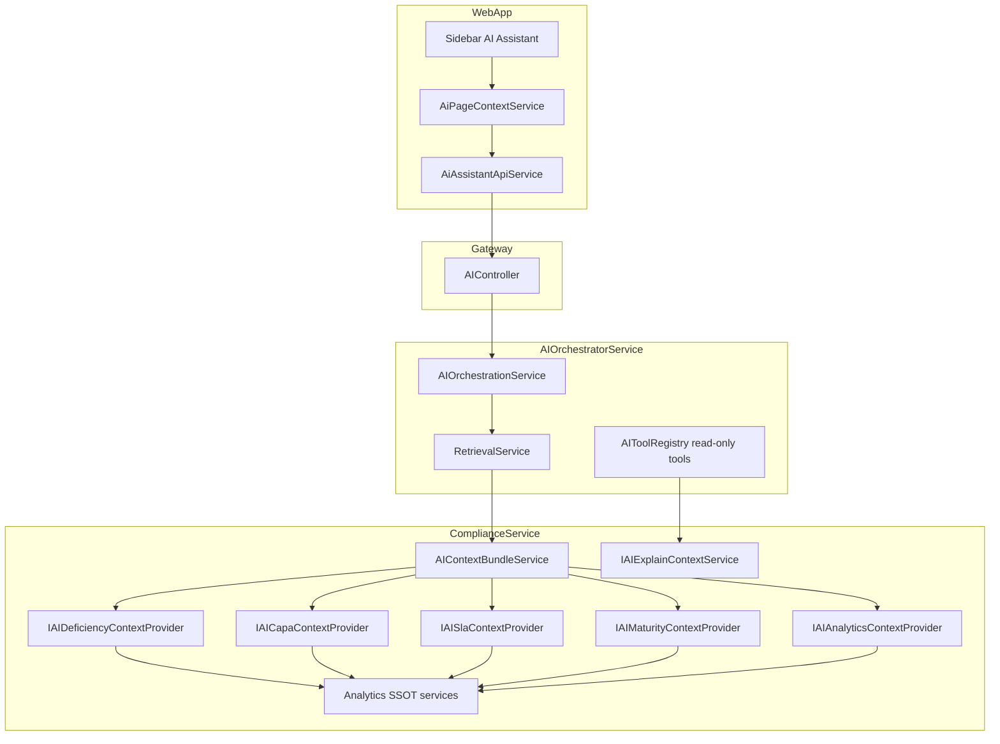

# Sprint 12C — AI Context Expansion Foundation

**Status:** Complete  
**Target maturity:** Level 3 — Workflow Assistant (read-only)  
**Prior maturity:** Level 2 — Knowledge Assistant  

---

## Objective

Transform the AI Assistant from a **Knowledge Assistant** (NABH/regulatory Q&A) to a **Workflow-Aware Assistant** that understands this hospital's deficiencies, CAPA, SLA, escalations, maturity stage unlock, and analytics — **without autonomy, write tools, or workflow mutations**.

---

## Architecture (Post-12C)

### Extension points

| Layer | Extension point |
|-------|-----------------|
| ComplianceService | `IAI*ContextProvider` — add summarized domain facts |
| ComplianceService | `AIContextBundleService.BuildAsync` — orchestrates providers |
| ComplianceService | `IAIExplainContextService` — entity-scoped explainability |
| AIOrchestratorService | `RetrievalService` — merges bundle + KB (unchanged pipeline) |
| AIOrchestratorService | `AIToolRegistry` — read-only tool manifest |
| WebApp | `AiPageContextService` — page/entity/session context |

---

## Deliverables

### 1. Expanded context bundle

`AIContextBundleService` now merges:

| Domain | Fact keys (sample) |
|--------|-------------------|
| Deficiencies | `deficiencyOpenCount`, `deficiencyCriticalOpenCount`, `deficiencyTopRisks`, `deficiencyDepartmentBreakdown` |
| CAPA | `capaOpenCount`, `capaEffectivePercent`, `capaDepartmentPerformance` |
| SLA / Escalation | `slaBreachedCount`, `slaAtRiskCount`, `slaCriticalEscalations`, `slaDepartmentHealth` |
| Maturity | `complianceMaturityIndex`, `maturityCurrentStage`, `maturityBlockingReasons`, `maturityNextStageRequirements` |
| Analytics | `analyticsReadinessScore`, `analyticsTopIssues`, `analyticsDepartmentSummary`, `analyticsTopTrends` |
| Session | `pageContext`, `conversationSummary`, `recentEntityRefs`, `focusedEntity` |

### 2. Context providers (read-only)

| Provider | SSOT delegation |
|----------|-----------------|
| `AIDeficiencyContextProvider` | `IDeficiencyMetricsService` |
| `AICapaContextProvider` | `ICapaQueryService` |
| `AISlaContextProvider` | `IEscalationService`, `IAnalyticsAggregationService` |
| `AIMaturityContextProvider` | `IStageUnlockingService`, `ComplianceMaturityIndexService` |
| `AIAnalyticsContextProvider` | `IAnalyticsQueryService` |

### 3. Explainability layer

`IAIExplainContextService` — `POST /internal/ai/explain`

Supports: Deficiency, CAPA, SLA, Escalation, StageUnlock, Analytics KPI.

### 4. Read-only tool catalog

Registered in `AIToolRegistry` (Low risk, no mutations):

- `get_deficiencies` → `GetDeficiencies`
- `get_capas` → `GetCapas`
- `get_sla_health` → `GetSlaHealth`
- `get_escalations` → `GetEscalations`
- `get_stage_unlock_status` → `GetStageUnlockStatus`
- `get_analytics_overview` → `GetAnalyticsOverview`
- `get_department_metrics` → `GetDepartmentMetrics`
- `get_recurring_issues` → `GetRecurringIssues`

Executed via `POST /internal/ai/readonly-tools/execute` (ComplianceService).

### 5. Conversation context improvements

- `conversationSummary` — rolling 3-turn summary from sidebar
- `recentEntityRefs` — last 8 entity refs (`type:id`)
- Organization-scoped; no long-term memory

### 6. Page-aware context

`AiPageContextService` sets context from:

| Screen | PageContext |
|--------|-------------|
| Deficiency Command Center | `Dcc` |
| Analytics Hub | `AnalyticsHub` |
| (extensible) | `ComplianceMaturity`, `Journey`, `Evidence`, `ReviewQueue` |

---

## Validation scenarios (Phase 12)

| Question | Expected grounding |
|----------|------------------|
| Why is Commitment locked? | `maturityBlockingReasons`, `maturityNextUnlockTarget` |
| Which deficiencies block accreditation? | `deficiencyBlockingOpenCount`, `deficiencyCriticalOpenCount` |
| Which CAPAs are overdue? | `capaOverdueCount` |
| Which department is highest risk? | `deficiencyDepartmentBreakdown`, `analyticsDepartmentSummary` |
| What recurring issues exist? | `deficiencyRecurringOpenCount`, `capaRecurringIssueCount` |
| What SLA breaches require attention? | `slaBreachedCount`, `slaCriticalEscalations` |
| How close to unlocking Achievement? | `maturityAchievementProgress`, `maturityUnlockReadinessPercent` |
| What should Quality focus on this week? | Combined analytics + deficiency top risks |

---

## AI Maturity Reassessment (Phase 13)

| Dimension | Before (12B) | After (12C) |
|-----------|--------------|-------------|
| Regulatory knowledge | Strong | Strong |
| Hospital operational awareness | Weak | **Strong (read-only)** |
| Workflow mutation | Gated write tools exist | **Unchanged — still gated; 12C adds read-only only** |
| Page context | Hospital + framework only | **Page + entity + session** |
| Explainability | Generic | **Entity-scoped explain API** |
| **Overall level** | **2 — Knowledge Assistant** | **3 — Workflow Assistant** |

### Remaining gaps (not 12C scope)

- Level 4 **Compliance Copilot** — proactive task creation, evidence upload, autonomous agents (Sprint 13+)
- LLM-initiated read-only tool invocation (tools registered; orchestrator does not auto-invoke yet)
- Compliance Maturity and Journey page hooks (pattern established; wire on navigation)
- Persistent cross-session memory
- Copilot Foundation (12D) — suggested actions from workflow context

---

## Key files

| Area | Path |
|------|------|
| Providers | `ComplianceService/Application/AI/Providers/` |
| Bundle orchestration | `ComplianceService/Application/Services/AIContextBundleService.cs` |
| Explain + tools | `ComplianceService/Application/AI/AIExplainContextService.cs` |
| Internal API | `ComplianceService/Controllers/Internal/AIContextController.cs` |
| Orchestrator request | `AIOrchestratorService/Application/AI/Models/AIContracts.cs` |
| Read-only tools | `AIOrchestratorService/Application/AI/Actions/AITooling.cs` |
| Frontend page context | `WebApp/src/app/core/services/ai-page-context.service.ts` |
| Frontend API | `WebApp/src/app/features/control-center/services/ai-assistant-api.service.ts` |

---

## Critical rules compliance

| Rule | Status |
|------|--------|
| No autonomous agents | ✓ |
| No automatic task execution | ✓ |
| No new write tools | ✓ |
| No compliance workflow mutations | ✓ |
| No AI decision making | ✓ |
| Read-only operational awareness | ✓ |
| SSOT KPI delegation (no duplicate formulas) | ✓ |
