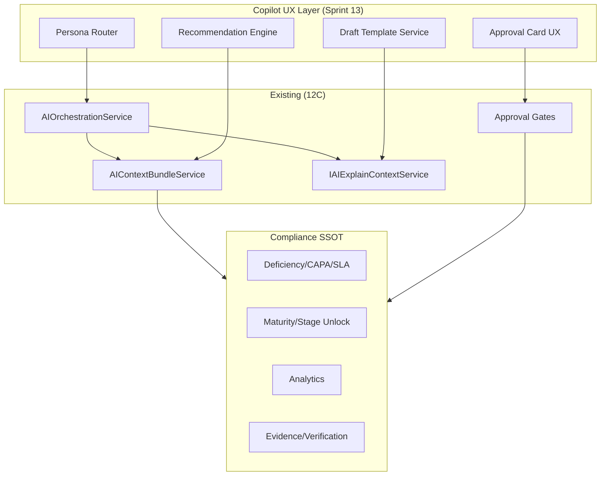

# Sprint 12D — Copilot Readiness & AI Responsibility Design

**Type:** Analysis & product design only — no implementation  
**Date:** June 2026  
**Prerequisite:** Sprint 12C (Level 3 Workflow Assistant)  
**Target consumer:** Sprint 13 — Compliance Copilot Foundation  

---

## Executive Summary

PRAMAN AI today is a **Level 3 Workflow Assistant**: it can read and explain hospital-specific deficiencies, CAPA, SLA, escalations, maturity, and analytics without mutating compliance state. Sprint 12D defines what a **Compliance Copilot** should become — not by building it, but by establishing **responsibility boundaries**, **trust levels**, **personas**, **governance**, and a **Sprint 13 blueprint**.

**Core design principle:** In healthcare accreditation, AI is an **advisor and drafter**, never an **accreditor**. Humans retain accountability for every compliance decision that affects patient safety, audit outcomes, or regulatory status.

---

# 1. AI Responsibility Matrix

Legend: **●** = permitted at maturity | **◐** = conditional (gated) | **○** = not permitted | **—** = not applicable

| Capability | Read | Explain | Recommend | Draft | Approve | Execute |
|------------|:----:|:-------:|:---------:|:-----:|:-------:|:-------:|
| **Findings** | ● | ● | ◐ | ◐ | ○ | ○ |
| **Deficiencies** | ● | ● | ◐ | ◐ | ○ | ○ |
| **Tasks** | ● | ● | ◐ | ◐ | ○ | ◐ |
| **Evidence** | ● | ● | ◐ | ◐ | ○ | ○ |
| **Verification** | ● | ● | ◐ | ○ | ○ | ○ |
| **CAPA** | ● | ● | ◐ | ◐ | ○ | ○ |
| **SLA** | ● | ● | ◐ | ○ | ○ | ○ |
| **Escalations** | ● | ● | ◐ | ○ | ○ | ○ |
| **Compliance Maturity** | ● | ● | ◐ | ◐ | ○ | ○ |
| **Analytics** | ● | ● | ◐ | ◐ | ○ | ○ |
| **Stage Unlocking** | ● | ● | ◐ | ○ | ○ | ○ |

### AI should own (Sprint 13+)

| Responsibility | Rationale |
|----------------|-----------|
| **Read** all operational domains via SSOT | Already proven in 12C; extends trust foundation |
| **Explain** blockers, KPIs, and entity state | Reduces coordinator cognitive load; no state change |
| **Recommend** prioritized actions with evidence links | Accelerates decision-making; human still chooses |
| **Draft** CAPA narratives, checklists, briefings | Saves documentation time; human edits and owns content |

### Humans must retain (always)

| Responsibility | Rationale |
|----------------|-----------|
| **Approve** evidence, deficiencies, CAPA effectiveness, stage progression | Accreditation accountability; legal and clinical duty |
| **Execute** compliance mutations without review | AI must not silently alter audit trail |
| **Verify** clinical/process adequacy of AI drafts | AI cannot assess real-world adequacy of corrective action |
| **Assign** ownership with authority | Routing requires org hierarchy and accountability |
| **Unlock stages** | Earned progression is a governance act, not inference |
| **Close deficiencies** | Closure implies verified remediation — human attestation required |
| **Interpret** regulatory intent in edge cases | Standards interpretation remains professional judgment |

### Conditional (gated) actions — AI may *propose*, human must *confirm*

- Create task (existing high-risk tool — keep approval gate)
- Create finding (existing high-risk tool)
- Link evidence (low risk but still logged)
- Suggest task owner / department routing (recommendation only until explicit assign)
- CAPA draft submission (draft → human edit → human save)

---

# 2. Trust Model

## Trust levels

| Level | Name | Definition | PRAMAN today |
|-------|------|------------|--------------|
| **L1** | Read | Access summarized operational data | **Active** (12C) |
| **L2** | Explain | Justify state, blockers, KPIs with sources | **Active** (12C explain layer) |
| **L3** | Recommend | Suggest prioritized next actions | **Partial** (prompt-level only; no structured rec engine) |
| **L4** | Draft | Produce editable artifacts for human review | **Not active** (design target for Sprint 13) |
| **L5** | Approve | AI attests compliance adequacy | **Never** |
| **L6** | Execute | AI mutates workflow without human | **Never** (except pre-approved low-risk with full audit) |

## Recommended maximum safe level for healthcare compliance

**Level 4 — Draft** (with mandatory human review before any L5/L6 equivalent action)

### Rationale

1. **Regulatory accountability** — NABH/JCI surveys hold the hospital and named officers responsible, not the software vendor or model provider.
2. **Patient safety** — CAPA and deficiency closure directly imply risk reduction; AI cannot attest effectiveness.
3. **Audit defensibility** — Surveyors expect human traceability: who decided, when, on what evidence.
4. **Hallucination risk** — Even grounded RAG can mis-rank or mis-synthesize; drafts are recoverable; approvals are not.
5. **Existing PRAMAN posture** — 12C explicitly forbade autonomy; D0/D1 gates force approval on write tools; this design extends that philosophy.

### Trust escalation path (Sprint 13+)

```
L1 Read → L2 Explain → L3 Recommend → L4 Draft → [Human Review Gate] → Human Execute
                                                              ↑
                                         AI never crosses ───┘
```

### Trust signals hospitals need

| Signal | Purpose |
|--------|---------|
| Source references | Tie every claim to SSOT object (deficiency id, KPI key, stage eval) |
| Context version id | Prove answer used current operational snapshot |
| Answer mode label | Distinguish workspace data vs general knowledge |
| Confidence band (not raw score) | "High / Moderate / Limited" — never expose model logits |
| Human approval badge | Visible when suggestion requires confirmation |
| Audit trail link | Every AI-assisted draft/action logged with user + timestamp |

---

# 3. Copilot Persona Catalog

Each persona is a **UX and prompt specialization** over the same governance core — not separate autonomous agents.

## 3.1 Accreditation Coach

| Attribute | Detail |
|-----------|--------|
| **Primary user** | Quality Manager, Accreditation Coordinator |
| **Mission** | Guide hospital through NABH/JCI readiness by stage |
| **Data sources** | Maturity/stage unlock, analytics readiness, deficiency blockers, chapter gaps |
| **Capabilities** | Explain lock reasons; recommend stage priorities; draft readiness narrative |
| **Boundaries** | Cannot unlock stages; cannot certify readiness; cannot replace self-assessment |

## 3.2 Quality Manager Assistant

| Attribute | Detail |
|-----------|--------|
| **Primary user** | Quality / CQI lead |
| **Mission** | Daily operational prioritization across deficiencies, CAPA, SLA |
| **Data sources** | DCC, CAPA metrics, SLA/escalation, department analytics |
| **Capabilities** | Weekly focus list; cross-domain risk synthesis; meeting prep drafts |
| **Boundaries** | Cannot assign owners; cannot close items; cannot override SLA policy |

## 3.3 Evidence Advisor

| Attribute | Detail |
|-----------|--------|
| **Primary user** | Department heads, evidence owners |
| **Mission** | Close evidence gaps affecting OE verification |
| **Data sources** | Evidence library, review queue, OE linkage, task context |
| **Capabilities** | Recommend evidence types; explain rejection reasons; draft checklist |
| **Boundaries** | Cannot upload files; cannot approve verification; cannot auto-map without confirm |

## 3.4 CAPA Advisor

| Attribute | Detail |
|-----------|--------|
| **Primary user** | CAPA owners, Quality team |
| **Mission** | Improve CAPA quality and timeliness |
| **Data sources** | CapaQueryService, recurrence analysis, RCA analytics, effectiveness reviews |
| **Capabilities** | Explain overdue CAPA; recommend root cause patterns; **draft CAPA sections** |
| **Boundaries** | Cannot mark effective/ineffective; cannot close CAPA; human signs effectiveness review |

## 3.5 Executive Advisor

| Attribute | Detail |
|-----------|--------|
| **Primary user** | Medical Director, CEO, Governing body |
| **Mission** | Accreditation risk at a glance |
| **Data sources** | Executive analytics, critical deficiencies, escalations, CMI trends |
| **Capabilities** | Briefing drafts; "what changed" summaries; board-ready narratives |
| **Boundaries** | No operational task creation; no detail-level CAPA editing; no raw UUIDs in view |

## 3.6 Department Head Assistant

| Attribute | Detail |
|-----------|--------|
| **Primary user** | HODs (Clinical, Nursing, FM, etc.) |
| **Mission** | Department-specific compliance workload |
| **Data sources** | Department analytics, assigned tasks, dept SLA/CAPA performance |
| **Capabilities** | Dept backlog summary; recommend sequencing; draft staff communication |
| **Boundaries** | Scoped to user's department + RBAC; cannot view other dept PHI-adjacent detail without role |

## 3.7 Auditor Assistant (internal / future external)

| Attribute | Detail |
|-----------|--------|
| **Primary user** | Internal auditor, future external surveyor workspace (Sprint 14) |
| **Mission** | Trace evidence to standard; sample deficiencies |
| **Data sources** | Findings, evidence trail, audit trail, verification history |
| **Capabilities** | Explain traceability; summarize sample; highlight inconsistencies |
| **Boundaries** | Read-only for external; no recommendations that imply compliance judgment; no write |

---

# 4. Use Case Catalog

| # | Use case | Class | Persona | PRAMAN readiness |
|---|----------|-------|---------|------------------|
| 1 | Why is Commitment locked? | Explain | Accreditation Coach | **Ready** (12C) |
| 2 | What blocks accreditation? | Explain + Recommend | Accreditation Coach | **Ready** (12C facts) |
| 3 | Which deficiencies need attention? | Read + Recommend | Quality Manager | **Ready** (12C) |
| 4 | Which CAPAs are overdue? | Read + Explain | CAPA Advisor | **Ready** (12C) |
| 5 | What SLA breaches need attention? | Read + Explain | Quality Manager | **Ready** (12C) |
| 6 | What recurring issues exist? | Read + Explain | CAPA Advisor | **Ready** (12C) |
| 7 | Generate CAPA draft (corrective/preventive) | Draft | CAPA Advisor | **Not Ready** — Sprint 13 |
| 8 | Suggest evidence for OE | Recommend | Evidence Advisor | **Partial** — mapping assist exists, not grounded copilot |
| 9 | Summarize audit findings | Explain + Draft | Auditor Assistant | **Partial** — findings in bundle, no sample engine |
| 10 | Prepare executive briefing | Draft | Executive Advisor | **Partial** — presentation model exists, no scheduled briefing |
| 11 | Prepare accreditation readiness summary | Draft | Accreditation Coach | **Partial** — readiness facts exist, no report template |
| 12 | Recommend task owner | Recommend | Quality Manager | **Not Ready** — routing service exists, not AI-wired |
| 13 | Recommend remediation sequence | Recommend | Quality Manager | **Partial** — analytics trends, no sequencer |
| 14 | Explain rejected evidence | Explain | Evidence Advisor | **Partial** — review queue exists, explain not entity-scoped in UI |
| 15 | Explain KPI regression | Explain | Executive Advisor | **Ready** (12C analytics) |
| 16 | What should Quality focus on this week? | Recommend | Quality Manager | **Partial** — needs structured priority engine |
| 17 | Draft management review agenda | Draft | Executive Advisor | **Not Ready** |
| 18 | Create task from recommendation | Action (propose) | Quality Manager | **Gated** — tool exists, needs copilot UX |
| 19 | Policy draft for standard gap | Draft | Accreditation Coach | **Not Ready** — KB only, no policy workflow |
| 20 | Department risk comparison | Read + Explain | Department Head | **Ready** (12C dept analytics) |

### Classification summary

| Class | Count | Sprint 13 priority |
|-------|-------|-------------------|
| Read / Explain | 12 | Maintain & deepen UI surfacing |
| Recommend | 8 | Structured recommendation engine |
| Draft | 6 | Template-based draft generation |
| Action (propose) | 2 | Approval-card UX over existing tools |

---

# 5. Explainability Framework

## 5.1 Principles

1. **Ground every operational claim** in a business object or SSOT metric — never orphan assertions.
2. **Separate knowledge from workspace** — label general regulatory guidance vs hospital-specific facts.
3. **Show blockers explicitly** — stage unlock and accreditation questions must list blocking reasons, not paraphrase.
4. **Never expose AI plumbing** — no "context", "RAG", "embeddings", raw UUIDs in executive views.
5. **Prefer structured explain payloads** — summary, key points, blockers, recommended actions (12C `AIExplainContextResponseDto` pattern).

## 5.2 Required explainability elements

| Element | Requirement | Example |
|---------|-------------|---------|
| **Source references** | At least one SSOT reference per finding/risk | "Deficiency AAC.1.b-004 (Critical)" |
| **Business object refs** | Typed entity links when scoped | `Deficiency:{id}`, `Stage:Commitment` |
| **Reasoning transparency** | Bullets tied to facts, not chain-of-thought | "3 open critical deficiencies exceed stage threshold" |
| **Confidence indicator** | Band only: High / Moderate / Limited | Based on fact coverage + validation outcome |
| **Blocking factor visibility** | Mandatory for lock/readiness questions | List from `maturityBlockingReasons` |
| **Deep links** | Navigate to authoritative screen | DCC row, Analytics KPI card, Review Queue |
| **Temporal context** | When snapshot was generated | "Based on data as of {timestamp}" |
| **Limitation disclosure** | When facts insufficient | "Additional evidence may be required…" (existing prompt rule) |

## 5.3 Explainability tiers by audience

| Audience | Detail level | Technical metadata |
|----------|--------------|-------------------|
| Executive | Summary + top 3 risks + actions | Hidden in collapsible panel |
| Quality Manager | Full blockers + entity list + links | Optional source panel |
| Auditor | Trace chain + version ids | Full audit metadata available |

## 5.4 Anti-patterns (forbidden)

- Stating compliance status as fact without SSOT backing
- Recommending closure or approval
- Inventing deficiency codes, OE ids, or KPI values
- Presenting AI confidence as audit confidence

---

# 6. Recommendation Framework

## 6.1 Acceptable recommendations

| Category | Example | Guardrails |
|----------|---------|------------|
| **Evidence** | "Upload training attendance for AAC.1.a" | Must cite OE + gap source; no auto-upload |
| **CAPA** | "Address root cause category: Training" | Suggest category; human confirms RCA |
| **Task owner** | "Route to Nursing Quality lead" | Suggest only; use AssignmentRouting SSOT when wired |
| **Remediation sequence** | "Close critical DCC items before stage focus" | Priority order, not automatic assignment |
| **Readiness** | "Improve Core verification rate by 8%" | Quantified from SSOT; no stage unlock implied |
| **SLA** | "Escalated items in Front Office need review" | Read-only escalation facts |

## 6.2 Unacceptable recommendations

- "Approve this evidence" / "Mark CAPA effective"
- "You are ready for survey" / "Accreditation assured"
- "Ignore this minor NC" / "De-prioritize critical item"
- Assigning blame to individuals by name without RBAC
- Clinical treatment recommendations (out of scope)

## 6.3 Recommendation structure (Sprint 13 contract)

Each recommendation should include:

```
priority: 1-N
action: human-readable verb phrase
rationale: SSOT-backed reason (1 sentence)
expectedOutcome: business outcome
sourceRefs: [typed entity refs]
riskIfIgnored: optional, for Critical/High only
requiresApproval: boolean
```

## 6.4 Limitations

- Recommendations are **decision support**, not **decision replacement**
- Max **5 prioritized recommendations** per response (executive cognitive load)
- Recurring recommendations must dedupe against open CAPA/deficiency
- Low-confidence → downgrade to "consider" language, never imperative

---

# 7. Draft Generation Framework

## 7.1 Classification

| Draft type | Allowed | Conditional | Not allowed |
|------------|:-------:|:-----------:|:-----------:|
| **CAPA draft** (problem, RCA, corrective, preventive) | | ● | |
| **Evidence checklist** | ● | | |
| **Management review summary** | | ● | |
| **Executive briefing** | | ● | |
| **Accreditation readiness report** | | ● | |
| **Meeting agenda** | ● | | |
| **Policy / SOP draft** | | | ● |
| **Audit finding narrative** | | ● | |
| **Survey response letter** | | | ● |
| **Legal/regulatory submission** | | | ● |

**Allowed** = AI may generate in Sprint 13 with templates  
**Conditional** = Requires human edit + role approval before export  
**Not allowed** = Human-authored only; AI may explain standard, not draft binding policy

## 7.2 Draft requirements

| Requirement | Detail |
|-------------|--------|
| **Template-bound** | Drafts use org-scoped templates, not free-form only |
| **Pre-filled from SSOT** | Entity codes, dates, owners pulled from system — not invented |
| **Watermark** | "AI-generated draft — requires review" on all exports |
| **Diff-friendly** | Stored as editable text; track human edits vs AI baseline |
| **Versioning** | Draft v1 (AI) → v2 (human) in audit trail |
| **No auto-submit** | Draft never writes to CAPA/deficiency without explicit save |

## 7.3 CAPA draft scope (highest-value Sprint 13 draft)

| Section | AI may draft | Human must validate |
|---------|:------------:|:-------------------:|
| Problem statement | ● | ● |
| Root cause summary | ● | ● |
| Corrective action | ● | ● |
| Preventive action | ● | ● |
| Success criteria | ◐ | ● |
| Effectiveness review conclusion | ○ | ● |

---

# 8. Action Framework

## 8.1 Classification matrix

| Action | AI may propose | AI may prepare | Human must approve | AI must never perform |
|--------|:--------------:|:--------------:|:------------------:|:---------------------:|
| Create task | ● | ● (prefilled form) | ● | ● |
| Assign task | ● | ◐ | ● | ● |
| Create finding | ● | ● | ● | ● |
| Create deficiency | ○ | ○ | ● | ● |
| Create CAPA fields | ○ | ● (draft) | ● | ● |
| Upload evidence | ○ | ◐ (checklist) | ● | ● |
| Link evidence to OE | ● | ● | ● | ● |
| Approve evidence | ○ | ○ | ● | ● |
| Reject evidence | ○ | ○ | ● | ● |
| Close deficiency | ○ | ○ | ● | ● |
| Mark CAPA effective | ○ | ○ | ● | ● |
| Trigger escalation | ○ | ○ | ● | ● |
| Acknowledge escalation | ○ | ○ | ● | ● |
| Unlock stage | ○ | ○ | ● | ● |
| Override SLA | ○ | ○ | ● | ● |

**Note:** "AI must never perform" without human approval applies to all rows — even "AI may propose" requires explicit user confirmation in PRAMAN governance model.

## 8.2 Alignment with existing PRAMAN tools

| Existing tool | Risk class | 12D stance |
|---------------|------------|------------|
| `create_task` | High | Keep; copilot prefills + approval card |
| `create_finding` | High | Keep; copilot prefills + approval card |
| `link_evidence` | Low | Keep; confirm dialog |
| `validate_evidence` | Low | Rename conceptually to "assess" — read-only |
| `get_*` (12C) | Low | Expand; copilot may invoke on user ask |

## 8.3 Autonomous agent stance

**AgentOrchestrator and workflow templates remain disabled for production copilot** until Sprint 14+ with explicit hospital opt-in, acceptance gates, and compensation strategy proven. Sprint 13 copilot is **single-turn and multi-turn assist**, not autonomous workflow execution.

---

# 9. Governance & Safety Model

## 9.1 Approval requirements

| Action tier | Approval |
|-------------|----------|
| Read / Explain | None |
| Recommend | None (disclaimer shown) |
| Draft save to system | Role-based (CAPA owner, Quality Manager) |
| Any workflow mutation | **Explicit approval attestation** + idempotency token (existing `ValidateCommandPreconditionsAsync`) |
| High-risk tools | **Always** human approval; D0 `ForceApprovalForAllActions` respected |

## 9.2 Audit logging

Every copilot interaction logs:

| Field | Purpose |
|-------|---------|
| `userId`, `hospitalId`, `organizationId` | Accountability |
| `promptHash` (not raw prompt if PHI concern) | Traceability |
| `contextVersionId` | Snapshot provenance |
| `promptTemplateId` + version | Reproducibility |
| `answerMode` | Grounding class |
| `suggestedActions[]` | Proposed mutations |
| `approvalOutcome` | Accepted / rejected / pending |
| `executedToolCalls[]` | What ran after approval |
| `presentation.insightType` | UX classification |

Retention: align with compliance audit trail policy (minimum 7 years for accreditation-relevant actions).

## 9.3 Traceability chain

```
User question
  → Context bundle (SSOT snapshot + version id)
  → Prompt template version
  → Model provider + model id
  → Raw response (internal store only)
  → Validated/sanitized presentation
  → [Optional] Approved action → ComplianceService command → Domain audit trail
```

## 9.4 User accountability

- UI copy: **"PRAMAN AI assists; you approve compliance decisions."**
- Approved actions record **approver identity**, not "AI"
- AI drafts show **last editor** after human modification
- Role-based access: copilot respects same RBAC as underlying modules

## 9.5 Healthcare alignment

| Standard expectation | PRAMAN response |
|---------------------|-----------------|
| Document control | Draft watermark + version history |
| CAPA effectiveness | Human effectiveness review only |
| Management review | AI prepares agenda; MRM minutes human-owned |
| Traceability | Source refs + deep links to evidence |
| Confidentiality | No cross-tenant context; org-scoped bundle |

---

# 10. Operational Copilot Readiness Assessment

Based on Sprint 12C implementation + SSOT maturity.

| Advisor | Read | Explain | Recommend | Draft | Overall |
|---------|:----:|:-------:|:---------:|:-----:|---------|
| **Deficiency Advisor** | Ready | Ready | Partial | Not Ready | **Partially Ready** |
| **CAPA Advisor** | Ready | Ready | Partial | Not Ready | **Partially Ready** |
| **Evidence Advisor** | Partial | Partial | Not Ready | Not Ready | **Not Ready** |
| **SLA Advisor** | Ready | Ready | Partial | N/A | **Partially Ready** |
| **Readiness Advisor** | Ready | Ready | Partial | Partial | **Partially Ready** |
| **Executive Advisor** | Ready | Ready | Partial | Partial | **Partially Ready** |

### Gap analysis for Sprint 13

| Gap | Blocks |
|-----|--------|
| No draft template engine | CAPA Advisor, Executive briefing |
| No structured recommendation object in API response | All Recommend-class use cases |
| Evidence explain not in UI | Evidence Advisor |
| LLM does not invoke read-only tools automatically | Deeper grounding on demand |
| No persona-specific prompt templates | Persona UX |
| No approval-card UX for copilot proposals | Action framework |
| Journey / Compliance Maturity page context not wired | Readiness Advisor context |
| No scheduled/batch executive briefing | Executive Advisor |

---

# 11. Executive Copilot Vision

## 11.1 Product concept: "Executive Compliance Briefing"

A **periodic, on-demand narrative** for leadership — not a dashboard replacement.

### Questions the briefing answers

| Question | Data backbone |
|----------|---------------|
| **What changed?** | Analytics trends (30/90 day), new critical deficiencies, stage progression |
| **What is at risk?** | Critical open NCs, SLA breaches, escalations, recurring CAPA |
| **What requires attention?** | Top 5 prioritized recommendations with owners |
| **What improved?** | Closed deficiencies, CAPA effectiveness, readiness score delta |
| **What threatens accreditation?** | Blocking deficiencies, stage lock reasons, chapter gaps |

### Briefing structure (design)

1. **Executive summary** (≤ 120 words)
2. **Accreditation posture** — stage, CMI, readiness %, trend arrow
3. **Critical risks** (max 3) — severity, impact, owner dept
4. **SLA & escalation alert** — breaches since last briefing
5. **CAPA health** — overdue count, effectiveness rate trend
6. **Recommended leadership actions** (max 3) — decision-oriented, not task list
7. **Appendix** — deep links to DCC, Analytics, Maturity (collapsible)

### Delivery modes (future)

| Mode | Trigger |
|------|---------|
| On-demand | CEO opens Executive Advisor |
| Scheduled | Weekly email/PDF (Quality sends) |
| Pre-survey | 30/14/7 days before announced survey |

### Trust design

- Briefing header: **"Generated from PRAMAN operational data as of {date}. Not a compliance certification."**
- Every metric links to Analytics SSOT definition
- Human "Reviewed by Quality Manager" checkbox before board circulation

---

# 12. Compliance Copilot Blueprint

## 12.1 Mission

**Empower hospital quality teams to achieve and sustain accreditation by providing a trustworthy, workflow-aware AI copilot that reads operational truth, explains blockers, recommends priorities, and drafts documentation — while humans retain every compliance decision.**

## 12.2 Personas (summary)

Accreditation Coach · Quality Manager Assistant · Evidence Advisor · CAPA Advisor · Executive Advisor · Department Head Assistant · Auditor Assistant

→ Single platform, persona = context + template + RBAC scope.

## 12.3 Capabilities roadmap

| Phase | Sprint | Capability |
|-------|--------|------------|
| **Foundation** | 12C ✓ | Read + Explain all operational domains |
| **Design** | 12D ✓ | Responsibility, trust, governance blueprint |
| **Copilot v1** | 13 | Recommend engine + Draft templates + Approval UX |
| **Copilot v2** | 14 | External auditor workspace + enhanced traceability |
| **Intelligence** | 15 | Benchmarking + accreditation intelligence |

## 12.4 Boundaries (non-negotiable)

| AI will | AI will not |
|---------|-------------|
| Read SSOT operational data | Approve evidence or CAPA |
| Explain blockers and KPIs | Unlock maturity stages |
| Recommend prioritized actions | Close deficiencies autonomously |
| Draft editable artifacts | Certify accreditation readiness |
| Propose gated actions | Execute high-risk tools silently |
| Log every interaction | Replace quality manager judgment |

## 12.5 Governance summary

- **Max trust level:** L4 Draft
- **Approval:** Required for all mutations; attestation + idempotency
- **Audit:** Full trace chain from question → context → response → action
- **Agents:** Disabled for Sprint 13; revisit Sprint 14+ with opt-in
- **RBAC:** Copilot inherits user permissions; no privilege escalation

## 12.6 Trust model summary

```
L1 Read ── L2 Explain ── L3 Recommend ── L4 Draft
                                              │
                                    Human Review Gate
                                              │
                                    Human Execute / Approve
```

## 12.7 Sprint 13 success metrics

| Metric | Target |
|--------|--------|
| Explain accuracy (blocker questions) | ≥ 90% match SSOT on QA sample |
| Recommendation adoption rate | Track; no target until baseline |
| Draft edit rate | Measure human edits per AI draft (lower = better templates) |
| Approval rejection rate | Monitor for unsafe proposals |
| Time to weekly quality briefing | ↓ 50% vs manual |
| Zero autonomous mutations | 100% compliance |
| User trust survey | ≥ 4/5 "I understand AI limits" |

## 12.8 Architecture direction (design only — no build)



## 12.9 Open decisions for Sprint 13 kickoff

1. **Persona default** — Single assistant with auto-persona vs explicit persona picker?
2. **Draft storage** — Ephemeral session vs persisted `AiDraft` entity?
3. **Recommendation ranking** — Rule-based first vs LLM-ranked?
4. **Tool invocation** — User-triggered only vs LLM-planned read tools?
5. **Executive briefing** — In-app only vs export PDF first?

---

# Deliverables checklist

| # | Deliverable | Section |
|---|-------------|---------|
| 1 | AI Responsibility Matrix | §1 |
| 2 | Trust Model | §2 |
| 3 | Copilot Persona Catalog | §3 |
| 4 | Use Case Catalog | §4 |
| 5 | Explainability Framework | §5 |
| 6 | Recommendation Framework | §6 |
| 7 | Draft Generation Framework | §7 |
| 8 | Action Framework | §8 |
| 9 | Governance & Safety Model | §9 |
| 10 | Operational Copilot Readiness Assessment | §10 |
| 11 | Executive Copilot Vision | §11 |
| 12 | Compliance Copilot Blueprint | §12 |

---

# Success criteria

| Criterion | Status |
|-----------|--------|
| Clear AI responsibility boundaries | ✓ |
| Clear human responsibility boundaries | ✓ |
| Copilot personas defined | ✓ |
| Trust model established | ✓ |
| Explainability standards defined | ✓ |
| Governance model defined | ✓ |
| Executive vision defined | ✓ |
| Compliance Copilot blueprint completed | ✓ |
| No implementation assumptions | ✓ |
| Ready for Sprint 13 — Compliance Copilot Foundation | ✓ |

---

*This document is the authoritative Sprint 12D deliverable. No code, APIs, tools, prompts, or models were modified.*
