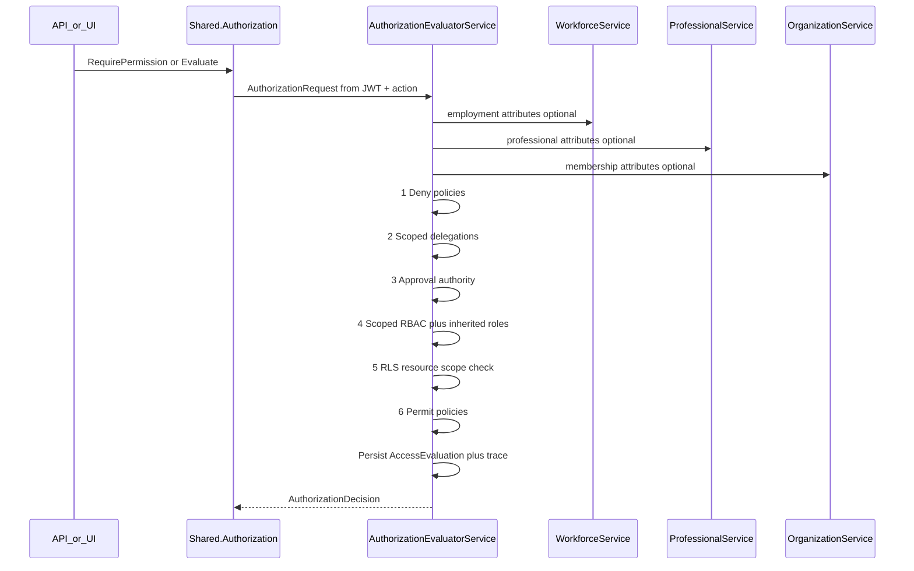

# PRAMAN Access Governance Domain Model — EIWAM Phase 5

| Field | Value |
|-------|-------|
| **Phase** | EIWAM Phase 5 — Identity & Access Governance |
| **Prior milestone** | M6.4 — Enterprise Access Governance Foundation |
| **Status** | Approved — evolve in place |
| **Bounded context** | AccessGovernanceService |

## Purpose

AccessGovernance determines **who can access what, who can approve, and who can delegate** — separate from authentication (Identity) and separate from domain identity (Person, Employment, Professional, Organization).

```
Identity (AuthN) → JWT context claims → IAuthorizationEvaluator (AuthZ)
Person / Employment / Professional / Organization → read-only attribute sources
Consuming modules → Shared.Authorization handler → single evaluation engine
```

**Authentication belongs to Identity. Authorization belongs to AccessGovernance.**

---

## Spec name mapping

| EIWAM Phase 5 spec | Implementation (unchanged code names) |
|--------------------|---------------------------------------|
| AccessPolicy | `AuthorizationPolicy` |
| RoleAssignment | `RoleAssignment` entity |
| PermissionGroup | Lookup category `PermissionGroup` + FK on `Permission` |
| AuthorizationAudit | `AccessEvaluation` + `AccessAuditLog` |

---

## Bounded context boundaries

| Context | Owns | Must NOT own |
|---------|------|--------------|
| **AccessGovernanceService** | Roles, permissions, policies, delegations, approval authorities, evaluation engine | User credentials, Person PII, employment lifecycle |
| **IdentityService** | Authentication, JWT issuance, sessions | Permission catalog, policy evaluation |
| **GovernanceService (M6.5)** | Responsibilities, committees, approval chains (accountability) | Security permission grants |
| **Person/Workforce/Professional/Organization** | Domain aggregates | Embedded authorization engines |
| **Consuming modules** | Resource business rules, DTO field masking | Custom permission engines |

---

## Scope model

Enterprise roles and assignments support layered scope:

| ScopeType | RoleDefinition scope | RoleAssignment scope |
|-----------|---------------------|---------------------|
| Platform | No org/hospital/dept | Null scope = global |
| Organization | OrganizationId | OrganizationId on assignment |
| Hospital | OrganizationId + HospitalId | HospitalId on assignment |
| Department | + DepartmentId | DepartmentId on assignment |
| Employment-targeted | — | EmploymentId on assignment (Phase 5) |

**Inherited roles:** `ParentRoleId` on `RoleDefinition` — child roles inherit parent permission grants (cycle detection required).

**Temporary / emergency:** `EffectiveFrom`/`EffectiveTo` on roles and assignments; `IsEmergency` flag on role definitions.

---

## Aggregate design

```mermaid
erDiagram
    RoleDefinition ||--o{ RoleAssignment : assigned_via
    RoleDefinition ||--o| RoleDefinition : parent_role
    RoleDefinition ||--o{ PermissionAssignment : grants
    Permission ||--o{ PermissionAssignment : granted_by
    Permission }o--|| PermissionGroup : grouped
    AuthorizationPolicy ||--o{ PolicyRule : contains
    PolicyRule ||--o{ PolicyCondition : has
    Delegation ||--o{ DelegationHistory : tracks
    ApprovalAuthority }o--|| ApprovalLevel : leveled

    RoleDefinition {
        guid Id PK
        string RoleCode UK
        string ScopeType
        guid ParentRoleId FK_optional
        bool IsEmergency
    }

    RoleAssignment {
        guid UserId
        guid OrganizationId FK_optional
        guid HospitalId FK_optional
        guid DepartmentId FK_optional
        guid EmploymentId FK_optional
        datetime EffectiveFrom
        datetime EffectiveTo
    }

    Permission {
        guid Id PK
        string Code UK
        string FieldMask
    }

    AuthorizationPolicy {
        guid Id PK
        string PolicyCode UK
        string Status
        int Priority
    }
```

---

## Evaluation order (single engine)



**Precedence:** Explicit Deny > Delegation (scoped) > Approval authority > Role permissions (scoped, inherited) > RLS filter > Policy permit > Default deny.

Responsibilities (GovernanceService) are **informational** in evaluation trace — they do not grant security permits.

---

## Row-level security (RLS) contract

Consumers pass resource scope on `AuthorizationRequest.Context`:

| Context key | Meaning |
|-------------|---------|
| `resource_id` | Target entity ID |
| `resource_organization_id` | Resource org scope |
| `resource_hospital_id` | Resource hospital scope |
| `resource_department_id` | Resource department scope |
| `resource_owner_id` | Resource owner user ID |

After a permission grant, if the user's assignment has narrower scope than the resource, access is denied. Decision may include `RowLevelFilter` hints for query layers.

**Example:** Department Head role scoped to `department_id=D1` may only access resources where `resource_department_id=D1`.

---

## Field-level security contract

`Permission.FieldMask` stores optional comma-separated field names (e.g. `Salary,MedicalRegistration`).

Consumers check `GET /authorization/effective-permissions` or evaluate field-specific permission codes (e.g. `HR.Salary.View`) and strip/mask DTO fields accordingly. No automatic EF interception in Phase 5.

---

## Workflow security

Workflow state gates (Draft, Review, Approve, Publish) are enforced by:

1. Permission codes per transition (e.g. `Policy.Publish`)
2. Approval authority for approve actions
3. Module business rules calling `IAuthorizationEvaluator` — not separate engines

---

## ABAC attributes

| Attribute source | Examples |
|------------------|----------|
| JWT / request | resource, action, org, hospital, dept |
| WorkforceService | employment_status, department_id |
| ProfessionalService | professional_category, has_active_registration, clinical_privilege |
| OrganizationService | membership_type, membership_status |

Policy operators (lookup `PolicyOperator`): Equals, NotEquals, In, Contains, GreaterThan, Exists.

**Healthcare example:**

```
Doctor AND CredentialApproved AND ClinicalPrivilegeActive
  → may Approve Clinical Indicator
```

---

## Domain invariants

1. `Permission.Code` globally unique.
2. No duplicate active `RoleAssignment` for same (UserId, RoleId, scope tuple).
3. Circular delegation forbidden.
4. Circular role inheritance forbidden.
5. Delegation without `PermissionId` does not grant blanket access (Phase 5).
6. Explicit Deny policies override Permit.
7. Published policies immutable — archive and republish to change.
8. Soft delete on catalog entities.

---

## Integration contracts

| Consumer | Provider | Contract |
|----------|----------|----------|
| All services | AccessGovernanceService | `POST /internal/authorization/evaluate` via `Shared.Authorization` |
| AccessGovernanceService | IdentityService | User existence |
| AccessGovernanceService | WorkforceService | `GET /internal/employment/{id}` |
| AccessGovernanceService | ProfessionalService | `GET /internal/professional/{id}` |
| AccessGovernanceService | OrganizationService | `GET /internal/users/{userId}/auth-context` |
| IdentityService | Workforce/Professional/Organization | Context claims on token issuance |

---

## Domain events (outbox)

- `RoleAssigned`, `RoleRevoked`
- `PermissionGranted`, `PermissionRevoked`
- `PolicyPublished`
- `DelegationCreated`, `DelegationExpired`, `DelegationRevoked`
- `ApprovalAuthorityChanged`

Responsibility events belong to **GovernanceService**.

---

## API surface (Phase 5)

| Route | Purpose |
|-------|---------|
| `GET/POST /permissions` | Permission catalog |
| `GET/POST /roles` | Role definitions |
| `POST /role-assignments` | Assign role with scope |
| `POST /role-assignments/{id}/revoke` | Revoke assignment |
| `GET/POST /policies`, `GET/PUT /policies/{id}`, publish/archive | Policy designer |
| `GET/POST /delegations`, revoke | Delegation center |
| `GET/POST /approval-authorities` | Approval matrix |
| `POST /authorization/evaluate` | Simulator + runtime checks |
| `GET /authorization/effective-permissions` | Union with source trace |

Internal: `/internal/authorization/evaluate`, `/internal/authorization/effective-permissions/{userId}`

---

## Related documents

- [ACCESS_GOVERNANCE_GAP_ANALYSIS.md](./ACCESS_GOVERNANCE_GAP_ANALYSIS.md)
- [access-governance-api-flows.md](./access-governance-api-flows.md)

---

## Approval

This document gates EIWAM Phase 5 implementation (evolution of M6.4).
