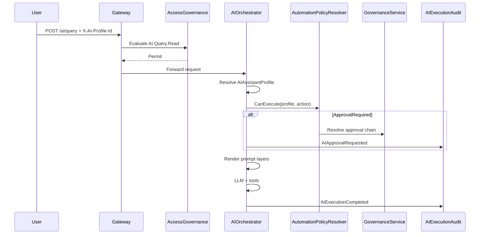

# PRAMAN AI Identity Domain Model — EIWAM Phase 9

| Field | Value |
|-------|-------|
| **Phase** | EIWAM Phase 9 — AI Identity |
| **Prior milestone** | AIOrchestrator D0/D1, Compliance Copilot Sprint 12–13 |
| **Status** | Approved — evolve AIOrchestratorService in place |
| **Bounded context** | AIOrchestratorService |

## Purpose

AI Identity establishes AI as a **governed digital workforce member** — every AI capability passes through Identity → Authorization → Governance → Audit → Communication → Business Module.

```
Human JWT → AccessGovernance (AI.* permissions)
         → AIAssistantProfile (identity + scope + tool allowlist)
         → AIAutomationPolicy (manual / approval / auto)
         → AIApprovalPolicy (optional Governance chain)
         → AIOrchestrationService (execution)
         → AIExecutionAudit (traceability)
```

**AI is not a super-user.**

---

## Spec name mapping

| EIWAM Phase 9 spec | Implementation |
|--------------------|----------------|
| AIAssistantProfile | `AIAssistantProfile` |
| AIIdentity | `AIIdentity` (1:1 with profile) |
| AIExecutionContext | `AIExecutionContext` |
| AIAutomationPolicy | `AIAutomationPolicy` |
| AIPermissionProfile | `AIProfilePermissionGrant` → AccessGovernance codes |
| AIConversationContext | `AIConversationContext` + `AIConversationMessage` |
| AIPromptProfile | `AIPromptProfile` + `AIPromptVersion` |
| AIUsagePolicy | Per-profile overrides + existing `AIUsagePolicyOptions` |
| AIApprovalRequirement | `AIApprovalPolicy` |
| AIExecutionAudit | `AIExecutionAudit` |
| AIUsageStatistics | `AIUsageStatistic` |

---

## Bounded context boundaries

| Context | Owns | Must NOT own |
|---------|------|--------------|
| **AIOrchestratorService** | Profiles, policies, prompts, execution audit, conversations | User credentials, org membership, permission evaluation engine |
| **AccessGovernanceService** | Permission codes, role grants, policy evaluation | AI prompt content, model routing |
| **GovernanceService** | Approval chains, responsibilities | AI execution state |
| **ComplianceService** | Copilot recommendations, drafts, proposals | AI profile master data (bridges only) |
| **CommunicationService** | Approval notification delivery | AI approval state |

---

## Core aggregates

### AIAssistantProfile

Governed AI identity template.

| Field | Type | Notes |
|-------|------|-------|
| Id | Guid | PK |
| Code | string | Unique, e.g. `compliance-assistant` |
| Name | string | Display name |
| Description | string | |
| CapabilitiesJson | string | JSON array of capability codes |
| OwnerUserId | Guid? | Human owner |
| ModuleCode | string | Primary module scope |
| Status | AIProfileStatus | Draft/Active/Archived |
| Version | int | Profile config version |
| CopilotPersonaKey | string? | Bridge to `CopilotPersona` enum name |

### AIIdentity

Runtime identity binding for a profile.

| Field | Type |
|-------|------|
| Id | Guid |
| ProfileId | Guid (FK) |
| PlatformId | string | `AI-{guid}` |
| DisplayName | string |
| GovernanceOwnerUserId | Guid? |
| LifecycleStatus | AIIdentityLifecycleStatus |

### AIIdentityScopeAssignment

Scope restrictions (foreign keys only — resolve via HTTP).

| Field | Type |
|-------|------|
| OrganizationId | Guid? |
| HospitalId | Guid? |
| DepartmentId | Guid? |
| ResponsibilityId | Guid? |

### AIProfilePermissionGrant

Maps profile to Access Governance permission codes (action allowlist).

| Field | Type |
|-------|------|
| ProfileId | Guid |
| PermissionCode | string | e.g. `AI.Query.Read` |
| AIActionType | AIActionType | Read/Suggest/Generate/… |

### AIAutomationPolicy

| Field | Type |
|-------|------|
| ProfileId | Guid |
| AutomationMode | ManualOnly / HumanApprovalRequired / AutoExecute |
| BusinessHoursOnly | bool |
| ConfidenceThreshold | decimal |
| RiskLevel | string |
| ApprovalPolicyId | Guid? |
| OrganizationId / HospitalId / DepartmentId | Guid? restrictions |

### AIApprovalPolicy

| Field | Type |
|-------|------|
| ApprovalType | NoApproval / ManagerApproval / CommitteeApproval / … |
| GovernanceApprovalChainId | Guid? |
| ConfidenceThreshold | decimal? |
| RiskLevelThreshold | string? |

### AIPromptProfile + AIPromptVersion

| Field | Type |
|-------|------|
| Code | string |
| LayerType | System / Role / Organization / Department / Framework / Template |
| ProfileId | Guid? |
| Status | Draft / Published / Archived |
| Version | int |
| Locale | string |
| SystemPrompt | string |
| RolePrompt | string? |

### AIExecutionAudit

| Field | Type |
|-------|------|
| RequestedByUserId | Guid? |
| ProfileId | Guid? |
| PromptVersionId | Guid? |
| ModelProvider / ModelName | string |
| InputTokens / OutputTokens / LatencyMs | int |
| Confidence | decimal |
| ToolsUsedJson | string |
| DocumentsAccessedJson | string |
| Outcome | string |
| ApprovalStatus | string? |
| TraceId | string |

---

## Execution decision flow



---

## Permission code catalog

| Code | Maps to |
|------|---------|
| `AI.Profile.Manage` | Admin profile CRUD |
| `AI.Query.Read` | `/ai/query`, sidebar assistant |
| `AI.Assist.Suggest` | `/ai/assist` |
| `AI.Action.Preview` | `/ai/actions/preview` |
| `AI.Action.Execute` | `/ai/actions/execute` |
| `AI.Workflow.Start` | Workflow start |
| `AI.Workflow.Approve` | Approve workflow step |
| `AI.Prompt.Manage` | Prompt library admin |
| `AI.Policy.Manage` | Automation policy admin |
| `AI.Analytics.View` | Usage analytics |
| `Copilot.Recommendation.View` | Copilot recommendations |
| `Copilot.Draft.Generate` | Copilot drafts |
| `Copilot.Proposal.Approve` | Approve proposals |
| `Copilot.Proposal.Execute` | Execute proposals |

---

## Copilot bridge mapping

| Profile code | CopilotPersona |
|--------------|----------------|
| `compliance-assistant` | AccreditationCoach |
| `quality-assistant` | QualityManagerAssistant |
| `evidence-assistant` | EvidenceAdvisor |
| `risk-assistant` | CapaAdvisor |
| `executive-assistant` | ExecutiveAdvisor |
| `training-assistant` | DepartmentHeadAssistant |
| `audit-assistant` | AuditorAssistant |
| `policy-assistant` | QualityManagerAssistant (shared) |
| `meeting-assistant` | (new, no enum) |
| `clinical-indicator-assistant` | (new, no enum) |

---

## Outbox domain events

| Event | Trigger |
|-------|---------|
| `AIProfileCreated` | Profile published |
| `PromptPublished` | Prompt version published |
| `PromptRolledBack` | Prompt reverted |
| `AIExecutionStarted` | Execution begins |
| `AIExecutionCompleted` | Success |
| `AIExecutionFailed` | Failure |
| `AIApprovalRequested` | Approval gate hit |
| `AIApprovalGranted` | Human approved |
| `AutomationPolicyChanged` | Policy update |

---

## Prompt layer stack (merge order)

1. System (platform-wide)
2. Role (profile-specific)
3. Organization
4. Department
5. Framework (NABH/JCI)
6. Template (use-case specific)

Later layers override earlier non-conflicting instructions.
