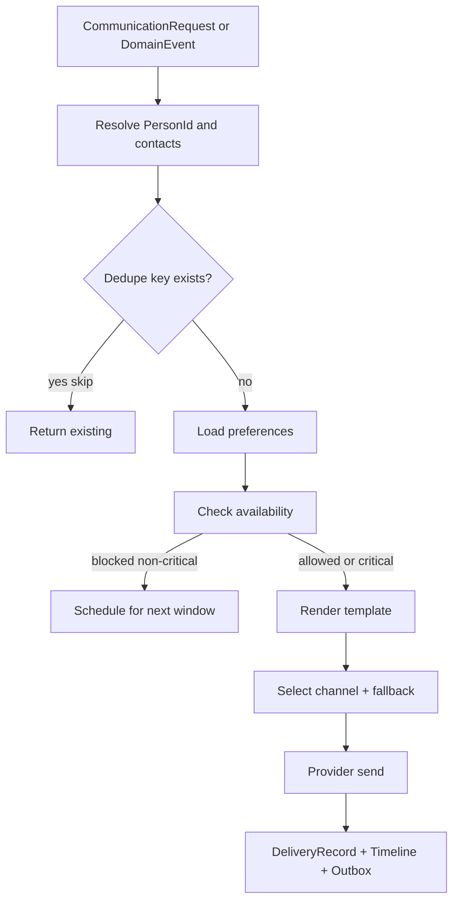

# PRAMAN Communication Domain Model — EIWAM Phase 8

| Field | Value |
|-------|-------|
| **Phase** | EIWAM Phase 8 |
| **Service** | CommunicationService |
| **Port** | HTTPS 7215 / HTTP 5215 |

## Spec mapping

| Phase 8 spec | Entity | Key fields |
|--------------|--------|------------|
| NotificationProfile | `CommunicationProfile` | PersonId, Language, TimeZone, DigestMode |
| NotificationPreference | `NotificationPreference` | PersonId, ModuleCode, Channel, Frequency, QuietHours |
| CommunicationTemplate | `CommunicationTemplate` + `TemplateVersion` | Code, Channel, Locale, Body, VariablesSchema |
| NotificationChannel | `ChannelConfiguration` | ChannelType, ProviderType, SettingsJson |
| MessageQueue | `OutboundMessage` | PersonId, Priority, Critical, DedupeKey, Status |
| DeliveryRecord | `DeliveryRecord` | OutboundMessageId, Channel, Status, LatencyMs |
| CommunicationCampaign | `CommunicationCampaign` | Name, AudienceFilterJson, TemplateId |
| ReminderRule | `ReminderRule` | RuleType, CronExpression, TemplateId, ModuleCode |
| EscalationRule | `EscalationRule` | SourceEventType, Level, TemplateId, ChannelOverride |
| AvailabilityProfile | `AvailabilityProfile` | PersonId, TimeZone, Status |
| WorkingHours | `WorkingHours` | DayOfWeek, StartTime, EndTime |
| VacationCalendar | `VacationEntry` | StartDate, EndDate, Reason |
| In-app inbox | `InAppNotification` | PersonId, Title, Body, ReadAt |

All aggregates: `CreatedAt`, `UpdatedAt`; soft-delete where applicable.

---

## Delivery decision flow



### Critical override matrix

| Condition | Non-critical | Critical |
|-----------|--------------|----------|
| Quiet hours | Defer | Send (in-app + email) |
| Vacation | Defer | Send (in-app + email) |
| Channel disabled | Use fallback | Use fallback then in-app |
| No marketing pref | Skip marketing templates | N/A |

---

## Risk / preference contract (AI-ready)

```json
{
  "personId": "guid",
  "moduleCode": "Compliance",
  "channels": ["Email", "InApp"],
  "frequency": "Immediate",
  "quietHours": { "start": "22:00", "end": "07:00" },
  "language": "en-IN",
  "timezone": "Asia/Kolkata",
  "escalationOverride": true
}
```

---

## Event subscription catalog (v1)

| Source event | Module | Default template | Channels |
|--------------|--------|------------------|----------|
| `ComplianceEvent.TaskAssigned` | Compliance | `task-assigned` | InApp, Email |
| `ComplianceEvent.DeficiencySlaWarning` | Compliance | `sla-warning` | InApp, Email |
| `ComplianceEvent.DeficiencySlaBreached` | Compliance | `sla-breached` | InApp, Email |
| `ComplianceEvent.DeficiencyEscalated` | Compliance | `deficiency-escalated` | InApp, Email |
| `ComplianceEvent.EvidenceRejected` | Compliance | `evidence-rejected` | InApp |
| `GovernanceEvent.EscalationTriggered` | Governance | `governance-escalation` | InApp, Email |
| `OrganizationEvent.InvitationCreated` | Organization | `member-invitation` | Email |

---

## Provider abstraction

```csharp
public interface ICommunicationChannelProvider
{
    CommunicationChannelType Channel { get; }
    Task<DeliveryAttemptResult> SendAsync(DeliveryContext context, CancellationToken ct);
}
```

Implementations: `EmailChannelProvider`, `InAppChannelProvider`, `SmsChannelProvider` (stub), `WebhookChannelProvider` (Teams/Slack).

---

## Outbox event catalog

| Type | When |
|------|------|
| `NotificationQueued` | OutboundMessage created |
| `NotificationDelivered` | DeliveryRecord → Delivered |
| `NotificationRead` | InAppNotification read |
| `ReminderTriggered` | ReminderRule fires |
| `EscalationSent` | EscalationRule matched |
| `TemplatePublished` | Template version published |
| `PreferenceUpdated` | Preference saved |
| `AvailabilityChanged` | Availability profile updated |

---

## Timeline composition

Merge: `CommunicationEvent` (timeline table), `DeliveryRecord` status changes, preference/template admin actions.

Sources labeled: `OutboundMessage`, `DeliveryRecord`, `Preference`, `Template`, `Reminder`.
