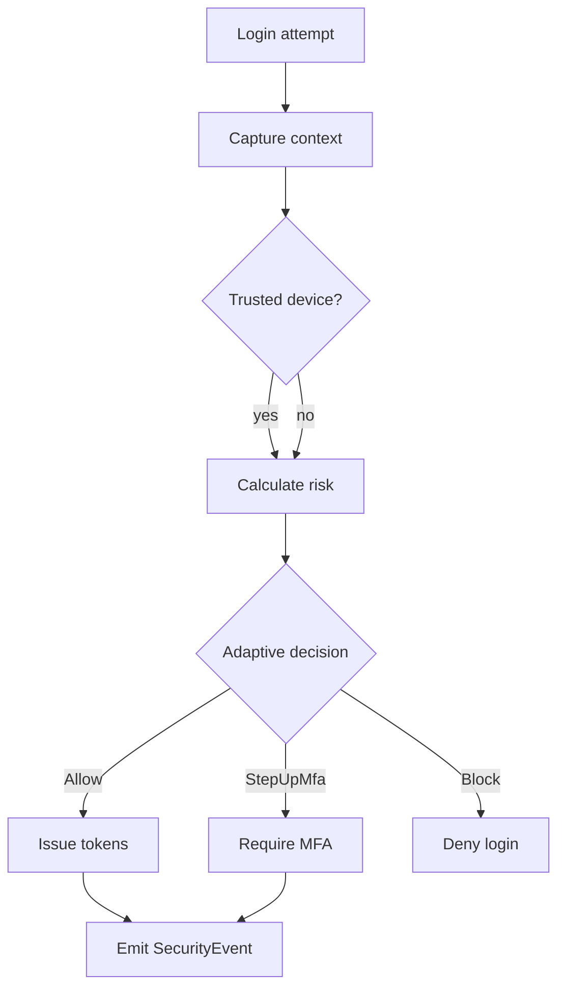

# PRAMAN Enterprise Security Domain Model — EIWAM Phase 7

| Field | Value |
|-------|-------|
| **Phase** | EIWAM Phase 7 — Enterprise Security |
| **Prior milestone** | M6 Identity Security Foundation |
| **Bounded context** | IdentityService |

## Purpose

IdentityService answers: **Who authenticated, from where, with what risk?**

```
Person → Identity (auth) → AccessGovernance (permissions) → Governance (accountability)
```

| Question | Owner |
|----------|-------|
| Can user sign in? | IdentityService |
| Is login suspicious? | IdentityService (Phase 7) |
| Can user perform action? | AccessGovernanceService |
| Who owns the outcome? | GovernanceService |

---

## Phase 7 spec name mapping

| Spec | Implementation |
|------|----------------|
| SecurityEvent | `SecurityEvent` entity |
| UserRiskScore | `UserRiskScore` entity |
| SessionHistory | `SessionHistory` entity |
| SecurityIncident | `SecurityIncident` entity |
| DeviceFingerprint | Fields on `TrustedDevice` + `UserSession` |

---

## Adaptive authentication flow



---

## Risk input/output contract (AI-ready)

**Inputs:** failed logins (24h), unknown device, password age, MFA disabled (admin), policy violations, suspicious sessions.

**Output:** `Score` (0–100), `Level` (Low/Medium/High/Critical), `FactorsJson` array.

```json
{ "factors": [{ "code": "FailedLogins24h", "weight": 25, "value": 3 }] }
```

---

## Threat rule catalog

| Rule | Trigger | Action |
|------|---------|--------|
| RefreshReuse | Revoked refresh presented | Revoke family, `SessionCompromised` |
| ImpossibleTravel | Login geo distance / time exceeds policy | `ThreatDetected`, raise risk |
| ConcurrentDistantLogin | Active sessions from distant IPs | `SuspiciousLogin` event |
| UnknownDeviceMfa | Untrusted device + policy | Step-up MFA |

---

## Policy matrix

| Domain | `UserSecurityPolicy` fields |
|--------|------------------------------|
| Password | Existing M6 fields |
| MFA | `RequireMfaForAdminRoles` + `RequireMfaOnUnknownDevice` |
| Lockout | Existing M6 fields |
| Session | `MaxConcurrentSessions`, `SessionIdleTimeoutMinutes` |
| Device trust | `DeviceTrustDurationDays` |
| Risk | `RiskThresholdMedium`, `RiskThresholdHigh`, `ImpossibleTravelMaxKmPerHour` |
| Emergency | `EmergencyAccessEnabled` |

---

## Timeline composition

Unified `/security/timeline` merges:
- `SecurityEvent` (primary)
- `SessionHistory` (session lifecycle)
- `LoginAttempt` (authentication attempts)

Ordered by `OccurredAt` descending.

---

## Outbox event catalog

- `SecurityEventRaised`, `RiskScoreChanged`, `DeviceTrusted`, `DeviceRevoked`
- `SessionCompromised`, `PolicyChanged`, `AccountCompromised`, `ThreatDetected`

---

## Related documents

- [ENTERPRISE_SECURITY_GAP_ANALYSIS.md](./ENTERPRISE_SECURITY_GAP_ANALYSIS.md)
- [enterprise-security-api-flows.md](./enterprise-security-api-flows.md)
