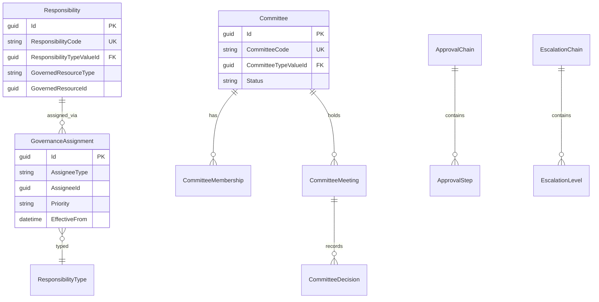
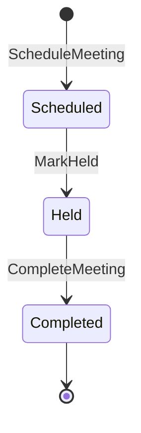
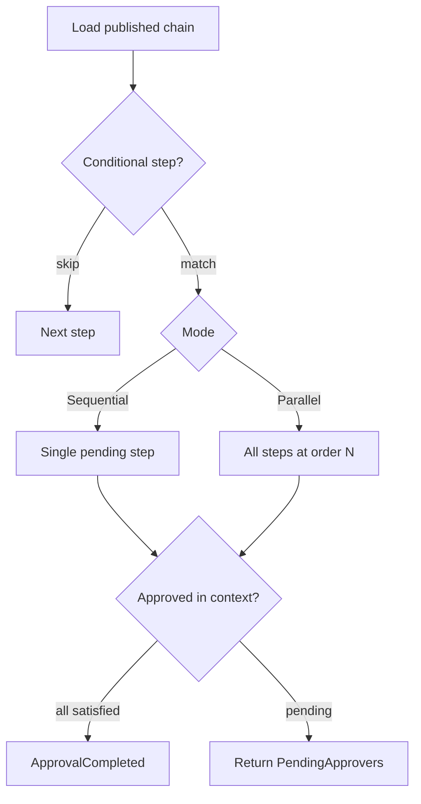

# PRAMAN Governance Domain Model — EIWAM Phase 6

| Field | Value |
|-------|-------|
| **Phase** | EIWAM Phase 6 — Governance & Accountability |
| **Prior milestone** | M6.5 — Enterprise Governance & Responsibility Framework |
| **Status** | Approved — evolve GovernanceService in place |
| **Bounded context** | GovernanceService |

## Purpose

GovernanceService answers: **Who is accountable for what?**

```
Identity → Person → Workforce → Professional → Organization → AccessGovernance → Governance
```

| Concept | Owner | Not |
|---------|-------|-----|
| Authentication | IdentityService | — |
| Security authorization | AccessGovernanceService | Governance |
| Accountability / ownership | GovernanceService | Roles, permissions, employment |

**A responsibility is not a security role. It is a governance assignment.**

---

## Phase 6 spec name mapping

| EIWAM Phase 6 spec | Implementation (code) |
|--------------------|------------------------|
| `ResponsibilityAssignment` | `GovernanceAssignment` entity |
| `GovernanceRole` | `ResponsibilityType` lookup value |
| `EscalationRule` | `EscalationLevel` entity |
| `GovernanceTimeline` | `GovernanceTimelineEntry` table |
| `ApprovalStep` | `ApprovalStep` entity (unchanged) |

No aggregate renames in Phase 6 — documentation and APIs align to spec vocabulary.

---

## Permission vs responsibility matrix

| Question | Service | Mechanism |
|----------|---------|-----------|
| Can user edit this policy? | AccessGovernance | Permission + `RequirePermission` |
| Who owns this policy outcome? | GovernanceService | `Responsibility` + `GovernanceAssignment` |
| Who must approve CAPA closure? | GovernanceService | `ApprovalChain` template |
| Can user click Approve? | AccessGovernance | `ApprovalAuthority` or permission |
| Who receives SLA escalation? | GovernanceService | `EscalationChain` |

AccessGovernance `ResponsibilityAppService` rejects writes and directs callers to GovernanceService.

---

## Governed resource contract (link-only)

Modules reference accountability without FK coupling:

```csharp
public sealed class GovernedResourceRef
{
    public required string ResourceType { get; init; }  // lookup: Policy, Evidence, Capa, Department, ...
    public Guid? ResourceId { get; init; }
}
```

GovernanceService stores `GovernedResourceType` + `GovernedResourceId` only. It does not own Compliance/Audit entities.

---

## Bounded context boundaries

| Context | Owns | Must NOT own |
|---------|------|--------------|
| **GovernanceService** | Responsibilities, committees, assignments, approval/escalation chains, timeline | Compliance entities, Person PII, security roles |
| **AccessGovernanceService** | RBAC, ABAC, delegations | Committee charters, business ownership |
| **ComplianceService** | Journeys, deficiencies, tasks | Long-term governance storage (migrate incrementally) |

M6.4 `ResponsibilityAssignments` in AccessGovernance DB is **read-only/deprecated**. GovernanceService is canonical.

---

## Aggregate design



---

## Committee meeting lifecycle



| State | Fields |
|-------|--------|
| Scheduled | `ScheduledAt`, `Agenda` |
| Held | optional interim |
| Completed | `Minutes`, `AttendanceJson`, `CompletedAt` |

Completing a meeting emits `CommitteeMeetingCompleted` outbox event.

---

## Approval / escalation evaluation order



Escalation resolves levels in `LevelOrder` ascending. `DelayHours` gates time-based levels. `ManagerChain` targets resolve via WorkforceService reporting relationships.

---

## Assignee types (lookup-driven)

Person, Employment, Position, ProfessionalCategory, Department, Organization, Hospital, Committee, Role, User

Validated at assignment time via read-only HTTP clients (Person, Workforce, Organization).

---

## Domain invariants

1. One **primary owner** per (governed resource, responsibility type) when `RequiresPrimaryOwner`.
2. No overlapping **active** assignments of same type + scope + assignee.
3. `EffectiveTo > EffectiveFrom` when end date set.
4. Committee term end after term start.
5. Published approval chains immutable (archive + republish).
6. Escalation loop prevention — duplicate targets rejected.
7. Governed resources are link-only — no FK to domain tables.

---

## Compliance migration playbook (incremental)

| Current (ComplianceService) | Target (GovernanceService) |
|-----------------------------|----------------------------|
| `DepartmentOwnership` | `GovernanceAssignment` with `ProcessOwner` / `EvidenceOwner` |
| `EscalationService` levels | `EscalationChain` + `EscalationLevel` |
| Task/deficiency owner fields | `GET /internal/governance/owners` |

Phase 6 pilot: DepartmentOwnership **read** path via `IGovernanceClient.GetOwnersAsync`. Writes remain local until feature-flagged.

---

## Domain events (outbox)

- `ResponsibilityAssigned`, `ResponsibilityRevoked`
- `OwnershipChanged` (primary reassignment)
- `CommitteeCreated`, `CommitteeMemberAdded`, `CommitteeMeetingCompleted`, `CommitteeDecisionRecorded`
- `ApprovalChainPublished`, `ApprovalCompleted`
- `EscalationTriggered`

---

## Related documents

- [GOVERNANCE_GAP_ANALYSIS.md](./GOVERNANCE_GAP_ANALYSIS.md)
- [governance-api-flows.md](./governance-api-flows.md)
- [governance-consumer-playbook.md](./governance-consumer-playbook.md)
