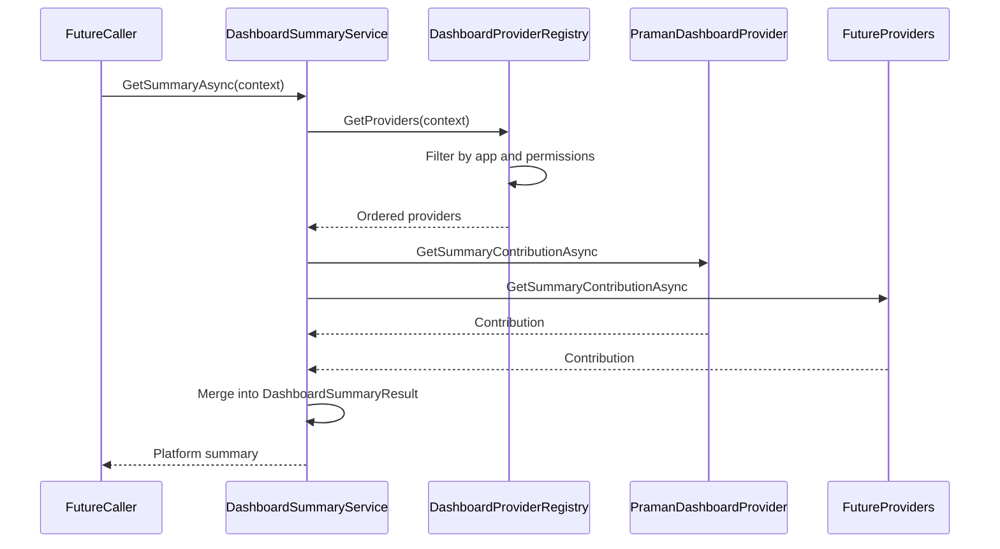

# H1.1 — Platform Dashboard Foundation

| Field | Value |
|-------|-------|
| **Sprint** | H1.1 — Platform Dashboard Foundation |
| **Date** | 2026-07-09 |
| **Status** | Implemented (foundation only) |
| **Related** | [ADR-001 — Dashboard Read Model Architecture](./ADR-001-dashboard-read-model-architecture.md) |

---

## Purpose

Establish a **reusable AOVIAS Platform Dashboard module** that coordinates application-specific providers without embedding PRAMAN/compliance business logic. This sprint delivers architecture and DI wiring only — no new HTTP endpoints, UI changes, caching, or projections.

The platform module answers: *How does AOVIAS aggregate dashboard contributions from multiple applications?*

PRAMAN answers: *What does the compliance application contribute?*

---

## Architecture



### Layering

```
Platform.Dashboard (no PRAMAN references)
├── Contracts/IDashboardProvider, IDashboardWidgetProvider, IDashboardSectionProvider
├── Models/DashboardSummaryResult, DashboardWidgetDescriptor, DashboardLoadingPhase
├── Registry/DashboardProviderRegistry
├── Services/DashboardSummaryService
└── Extensions/AddPlatformDashboard()

ComplianceService (PRAMAN provider host)
└── Application/Dashboard/Praman/PramanDashboardProvider
    ├── Summary via IDashboardAppService (lightweight)
    └── Widget/section metadata catalog (no rendering)
```

---

## Platform components

| Component | Location | Responsibility |
|-----------|----------|----------------|
| `IDashboardProvider` | `Platform.Dashboard/Contracts` | Application identity, permissions, summary contribution |
| `IDashboardWidgetProvider` | `Platform.Dashboard/Contracts` | Widget descriptor catalog |
| `IDashboardSectionProvider` | `Platform.Dashboard/Contracts` | Section descriptor catalog |
| `DashboardProviderRegistry` | `Platform.Dashboard/Registry` | DI discovery, ordering, permission/application filtering, merge |
| `DashboardSummaryService` | `Platform.Dashboard/Services` | Request summaries from providers, merge into one result |
| `DashboardSummaryResult` | `Platform.Dashboard/Models` | Lightweight platform summary only |

### Summary fields (platform contract)

- Organization
- Current Context
- Applications
- Overall Health
- Critical Alerts
- Unread Notifications
- Pending Tasks
- Last Updated

**Excluded:** charts, heatmaps, analytics, framework trees, tables, large collections.

### Widget descriptor fields

Id, Application, Title, Icon, Priority, Phase, Permissions, CacheTtl, Lazy, Critical, SectionEndpoint, Visibility.

---

## Loading phases

Metadata only in H1.1 — orchestration is a future sprint.

| Phase | Value | Purpose |
|-------|-------|---------|
| Shell | 0 | Application shell |
| Summary | 1 | Lightweight platform summary |
| CriticalWidgets | 2 | First meaningful paint widgets |
| OperationalWidgets | 3 | Tasks, alerts, heatmaps |
| Analytics | 4 | Trends and charts |
| Ai | 5 | AI insights and copilot |

Every PRAMAN widget in `PramanDashboardCatalog` declares its phase.

---

## PRAMAN provider

**Location:** `ComplianceService/Application/Dashboard/Praman/`

| File | Role |
|------|------|
| `PramanDashboardProvider.cs` | Implements all three provider interfaces |
| `PramanDashboardCatalog.cs` | Home Dashboard + Command Center widget/section metadata |
| `PramanDashboardConstants.cs` | Application name and permission constants |

**Summary source:** `IDashboardAppService.GetDashboardSummaryAsync` — not `DashboardSnapshotService`.

**Existing HTTP paths unchanged:** `DashboardController`, `SnapshotsController`, Gateway proxy handlers remain the live API surface until a later cutover sprint.

---

## Dependency injection

### Platform registration (host application)

```csharp
services.AddPlatformDashboard();
services.AddScoped<IDashboardProvider, PramanDashboardProvider>();
```

Registered in `ComplianceService/Program.cs`.

### Registry behavior

- Providers discovered via `IEnumerable<IDashboardProvider>` (constructor injection)
- Ordered by `Order`, then `ApplicationName`
- Filtered by `DashboardContext.EnabledApplications` and `DashboardContext.Permissions`
- No service locator

---

## Registering a future provider

To add HR, Audit, Assets, AI, or Workforce without modifying `Platform.Dashboard`:

1. Create `{Service}/Application/Dashboard/{App}/{App}DashboardProvider.cs` implementing `IDashboardProvider` (and widget/section interfaces as needed).
2. Add project reference to `Platform.Dashboard`.
3. Register in the host service `Program.cs`:

```csharp
services.AddPlatformDashboard(); // once per host
services.AddScoped<IDashboardProvider, HrDashboardProvider>();
services.AddScoped<IDashboardProvider, AuditDashboardProvider>();
```

4. `DashboardSummaryService` and `DashboardProviderRegistry` require **no code changes** — new providers are picked up automatically.

For cross-service aggregation at Gateway BFF (future), Gateway will call each service's summary endpoint and compose using the same platform models — still without editing the registry internals.

---

## Design rules enforced

| Rule | Status |
|------|--------|
| No PRAMAN references in `Platform.Dashboard` | Enforced |
| No duplicated dashboard logic in platform layer | Enforced |
| No UI changes | Enforced |
| No API changes | Enforced |
| No caching | Enforced |
| No projections | Enforced |
| Providers own business logic | Enforced |

---

## Non-goals (this sprint)

- CQRS read models / event projections
- Performance optimization
- New dashboard HTTP endpoints
- Angular progressive loading
- Moving or deleting `DashboardSnapshotService`
- Remote multi-service provider discovery

See [ADR-001](./ADR-001-dashboard-read-model-architecture.md) for the long-term hybrid target (summary read model + progressive sections).

---

## Verification checklist

- [ ] `Platform.Dashboard` contains no PRAMAN/compliance type references
- [ ] New provider registrable via DI only
- [ ] Solution builds: Platform.Dashboard, ComplianceService, Gateway, OrganizationService, IdentityService, CommunicationService, AIOrchestratorService, WebApp
- [ ] Existing dashboard endpoints unchanged

---

## Next sprints (not H1.1)

| Sprint | Focus |
|--------|-------|
| H1.2 | Gateway BFF endpoint + Angular shell-first rendering | [H1.2-dashboard-experience-layer.md](./H1.2-dashboard-experience-layer.md) |
| H1.3 | Dashboard Summary Engine (lightweight KPI reads + cache) | [H1.3-dashboard-summary-engine.md](./H1.3-dashboard-summary-engine.md) |
| H1.4 | Event-driven dashboard projections | [H1.4-dashboard-projection-engine.md](./H1.4-dashboard-projection-engine.md) |
| H1.5 | Snapshot decomposition |
