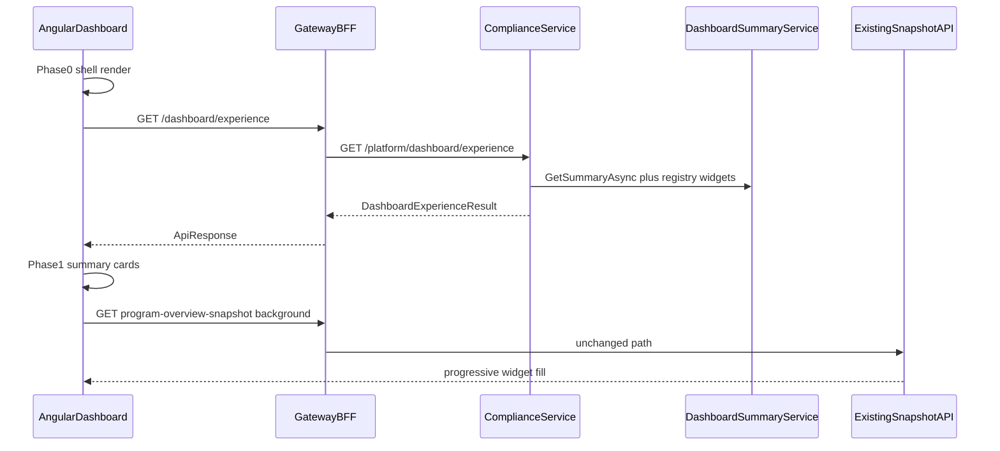

# H1.2 — Dashboard Experience Layer (Shell-First Rendering)

| Field | Value |
|-------|-------|
| **Sprint** | H1.2 — Dashboard Experience Layer |
| **Date** | 2026-07-09 |
| **Prerequisite** | [H1.1 Platform Dashboard Foundation](./H1.1-platform-dashboard-foundation.md) |
| **Related** | [ADR-001](./ADR-001-dashboard-read-model-architecture.md) |

---

## Purpose

Deliver an enterprise-grade, **shell-first** Home Dashboard experience using the H1.1 provider model. Users see layout and summary KPIs immediately while the legacy program-overview snapshot loads asynchronously in the background.

**Non-goals:** No changes to `DashboardSnapshotService`, snapshot aggregation, or Command Center.

---

## Architecture

---

## New endpoints

| Layer | Route | Response |
|-------|-------|----------|
| Gateway | `GET /api/v1/dashboard/experience` | `ApiResponse<DashboardExperienceResult>` |
| ComplianceService | `GET /api/v1/platform/dashboard/experience` | Same (source of truth) |

**Unchanged:** `/dashboard/summary`, `/dashboard/program-overview-snapshot`, `/dashboard/hospital`.

---

## Loading phases (Home Dashboard)

| Phase | UI | Data source |
|-------|-----|-------------|
| 0 Shell | Header, layout, widget frames | Immediate |
| 1 Summary | Executive KPI strip | `/dashboard/experience` |
| 2 Critical | Gauges, alerts | Snapshot (async) |
| 3 Operational | Heatmap, hospitals, frameworks | Snapshot + hospital API |
| 4 Analytics | Trends, distributions | Snapshot |
| 5 AI | Reserved for future widgets | — |

Widget hosts use H1.1 `DashboardWidgetDescriptor.phase` metadata. Failures are isolated per widget with retry.

---

## Angular components

| File | Role |
|------|------|
| `dashboard-experience.store.ts` | Fetches and caches experience API |
| `dashboard-experience.facade.ts` | Orchestrates experience + snapshot signals |
| `dashboard-widget-host.component.ts` | Loading/error/retry shell per widget |
| `dashboard-widget-skeleton.component.ts` | Shared skeleton with fixed min-height |
| `dashboard.component.ts` | Shell-first template refactor |

---

## Telemetry (dev only)

Marks: `dashboard_shell_rendered`, `dashboard_experience_received`, `dashboard_phase_1_complete`, `dashboard_phase_2_complete`, `dashboard_phase_3_complete`, `snapshot_received`, `dashboard_interactive`.

Exported via `window.__AOVIAS_PERF_REPORT__` with phase duration table.

---

## Next sprint

H1.3: [Dashboard Summary Engine](./H1.3-dashboard-summary-engine.md) — lightweight KPI reads, cache, provider refactor (completed).

H1.4: [Dashboard Projection Engine](./H1.4-dashboard-projection-engine.md) — event-driven read models (completed).
