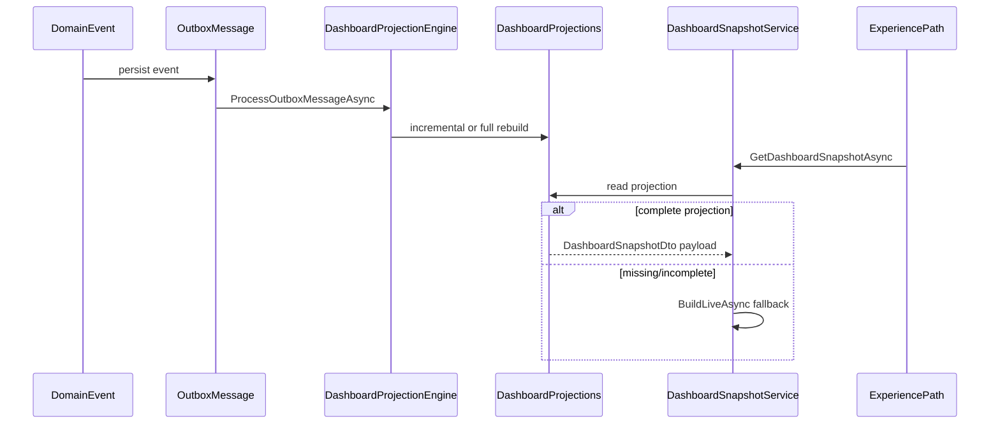

# H1.4 — Dashboard Projection Engine & Event-Driven Read Models

| Field | Value |
|-------|-------|
| **Sprint** | H1.4 — Dashboard Projection Engine |
| **Date** | 2026-07-09 |
| **Prerequisite** | [H1.3 Dashboard Summary Engine](./H1.3-dashboard-summary-engine.md) |
| **Related** | [ADR-001](./ADR-001-dashboard-read-model-architecture.md) |

---

## Objective

Replace expensive request-time dashboard aggregation with **event-driven dashboard projections**. Dashboard state is maintained incrementally as compliance data changes; reads serve precomputed projection rows with live aggregation as fallback only.

**Non-goals:** Remove existing endpoints, change snapshot HTTP contracts, or delete `DashboardSnapshotService`.

---

## Architecture shift



---

## Projection domain

Location: `ComplianceService/Application/Dashboard/Projection/`

| Component | Role |
|-----------|------|
| `DashboardProjection` (entity) | Persisted read model row |
| `DashboardProjectionPayload` | Versioned JSON sections (frameworks, tasks, alerts, trends, …) |
| `DashboardProjectionEngine` | Event router: full rebuild vs incremental update |
| `DashboardProjectionUpdater` | Field-scoped refresh (tasks, alerts, activity) |
| `DashboardProjectionRepository` | Tenant/hospital/framework scoped CRUD |
| `DashboardProjectionRebuildService` | Manual/corruption recovery rebuild |
| `DashboardProjectionFieldOwnership` | Event → field mapping matrix |

---

## Projection schema

**Table:** `DashboardProjections`  
**Unique key:** `(OrganizationId, HospitalId, FrameworkId)` — `Guid.Empty` sentinel for all-framework scope.

| Column group | Fields | Source events |
|--------------|--------|---------------|
| KPI scalars | `OverallComplianceScore`, `PendingTasksCount`, `OpenAlertsCount`, … | Score recalc, tasks, findings |
| Metadata | `ProjectionSchemaVersion`, `DataVersion`, `IsComplete`, `IsCorrupted` | Engine |
| Payload JSON | `Summary`, `Frameworks`, `TasksSummary`, `Alerts`, `ScoreTrends`, `Milestones`, `RecentActivity`, `WidgetAggregates` | See event matrix |

Schema version: `DashboardProjectionPayload.CurrentSchemaVersion = 1`.

---

## Event mapping matrix

| Event | Update mode | Affected fields |
|-------|-------------|-----------------|
| `ComplianceScoreUpdatedDomainEvent` | Full rebuild | Score, trends, frameworks, summary |
| `ComplianceFrameworkSnapshotRecalculated` | Full rebuild | Same as score |
| `ComplianceStateChangedDomainEvent` | Full rebuild | Journeys, milestones, activity, summary |
| `ObligationStatusUpdatedDomainEvent` | Full rebuild | Summary, frameworks |
| `Deficiency*DomainEvent` | Incremental | Tasks, alerts |
| `ComplianceEvent.TaskCreated/Completed` | Incremental | Task counts, tasks summary |
| `ComplianceEvent.FindingCreated/Updated` | Incremental | Alerts |
| `ComplianceEvent.EvidenceUploaded` | Incremental | Recent activity |
| Journey lifecycle outbox events | Full rebuild | Journey sections |

Full matrix: `DashboardProjectionFieldOwnership.EventToFields`.

---

## Read paths

### Program overview snapshot (`DashboardSnapshotService`)

1. Memory cache (2 min)
2. **`DashboardProjections`** when `IsComplete && !IsCorrupted`
3. **`BuildLiveAsync`** fallback (legacy aggregation)
4. Telemetry via `DashboardProjectionTelemetry` (HttpContext item)

### Experience summary (`DashboardSummaryEngine`)

1. Summary cache (60s)
2. **Projection KPI columns** when complete
3. Live query fallback (H1.3 path)

---

## Pipeline integration

- **`InProcessOutboxProcessor`** — extended filter includes `ComplianceEvent.*`, journey lifecycle, `ComplianceStateChangedDomainEvent`; calls `IDashboardProjectionEngine` after existing handlers.
- **`ComplianceCommandService`** — processes `InProcessOutboxProcessor` after task complete so task events update projections.
- **`ComplianceFrameworkSnapshotRecalculationService`** — triggers projection rebuild after snapshot append.
- **`OutboxDomainEventDispatcher`** — explicit wiring for `ComplianceStateChangedDomainEvent`.

---

## Resilience

| Capability | Implementation |
|------------|----------------|
| Rebuild | `DashboardProjectionRebuildService.RebuildHospitalAsync` |
| Corruption flag | `IsCorrupted` + `CorruptionReason`; reads fall back to live |
| Idempotency | `LastProcessedOutboxMessageId` per projection row |
| Version migration | `ProjectionSchemaVersion` on entity + payload |
| Diagnostics (dev) | `GET /api/v1/internal/dashboard-projection/diagnostics` |

---

## Configuration

```json
"DashboardProjection": {
  "Enabled": true,
  "ExposeDiagnosticsHeaders": false,
  "StaleAfterSeconds": 300
}
```

---

## Migration from request-time aggregation

| Phase | State |
|-------|-------|
| H1.3 | Live queries + cache (experience KPIs) |
| **H1.4** | Event-maintained projections; live fallback |
| H1.5 | Snapshot decomposition; reduce fallback surface |

---

## Verification checklist

- [ ] Existing snapshot/summary endpoints unchanged
- [ ] Projection row created after task complete / journey transition / score recalc
- [ ] Snapshot read uses projection when `IsComplete`
- [ ] Fallback occurs when projection missing (cold start)
- [ ] Rebuild endpoint produces equivalent snapshot to live builder
- [ ] All services + WebApp build with zero errors

---

## Next sprint

H1.5 — Snapshot decomposition and progressive section APIs.
