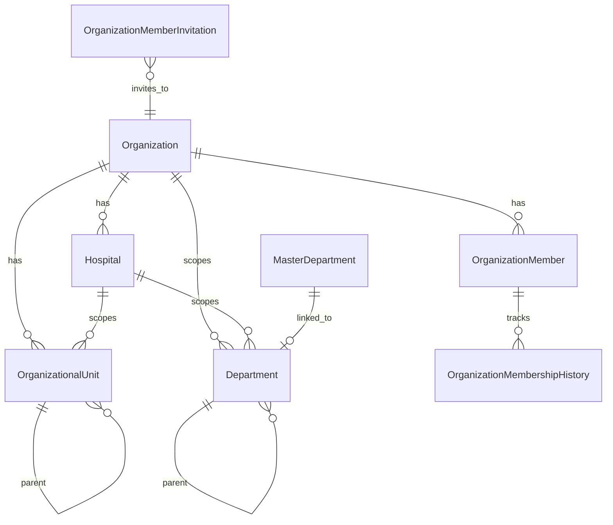

# PRAMAN Organization Domain Model (EIWAM Phase 4)

| Field | Value |
|-------|-------|
| **Milestone** | Phase 4 — Organization & Membership Evolution |
| **Bounded context** | OrganizationService |
| **Status** | Approved for implementation |

## Purpose

Evolve OrganizationService into the **canonical Organization & Membership** domain without replacement. Workforce owns employment assignments; Organization owns structure and membership affiliation.

```
Person → Employment (Workforce) → OrganizationMember (access) → Organization
         Professional              ↑ optional HospitalId affiliation
```

---

## Bounded context boundaries

| Context | Owns | Must NOT own |
|---------|------|--------------|
| **OrganizationService** | Organization, Hospital, org structure, membership lifecycle, invitations, org dept tree | Employment, dept/hospital workforce assignments, Person PII, RBAC |
| **WorkforceService** | Employment, DepartmentAssignment, hospital on employment | Org topology master, membership access |
| **PersonService** | Canonical person identity | Membership, employment |
| **IdentityService** | Authentication | Org structure |

---

## Aggregate design

### Evolved: `OrganizationMember` (membership root)

Membership affiliation and org access context.

| Field | Notes |
|-------|-------|
| `MembershipTypeValueId` | Employee, Consultant, Vendor, Auditor, etc. (lookup) |
| `MembershipStatus` | Draft, Pending, Active, Suspended, Expired, Archived |
| `EffectiveFrom` / `EffectiveTo` | Temporal validity |
| `IsPrimary` | One primary active per user+org |
| `HospitalId` | Affiliation hint (not workforce assignment) |
| `EmploymentId` | Optional link to Workforce |
| `PersonId` | M6.2 link |
| `IsDeleted` | Soft delete |

### New: `OrganizationalUnit`

Self-referencing tree for campus/building/floor/wing/section/unit/team.

| Field | Notes |
|-------|-------|
| `OrganizationId` | Required |
| `HospitalId` | Optional scope |
| `ParentUnitId` | Adjacency list — unlimited depth |
| `UnitTypeValueId` | Lookup — not hardcoded levels |
| `Code`, `Name`, `Status` | |
| `EffectiveFrom` / `EffectiveTo` | |

### Extended: `Department`

| `OrganizationId` | `null` = global compliance catalog (unchanged API) |
| `HospitalId`, `ParentDepartmentId` | Org-scoped hierarchy |
| `DepartmentTypeValueId`, `ManagerEmploymentId`, `CostCenter`, `ServiceLine` | |

### Extended: `Organization`, `Hospital`

Status, soft delete, effective dates; optional parent org / parent org unit.

### Child: `OrganizationMembershipHistory`

Status transitions with reason, actor, effective range.

### Infrastructure tables

`OrganizationTimeline`, `OrganizationAuditLogs`, `OutboxMessages`, `OrganizationLookupCategory` / `OrganizationLookupValue`.

---

## Domain events (outbox)

`OrganizationCreated`, `HospitalCreated`, `DepartmentCreated`, `DepartmentMerged`, `MembershipCreated`, `MembershipTransferred`, `MembershipExpired`, `DepartmentAssigned`, `HospitalAssigned`, `OrganizationHierarchyChanged`

---

## Invariants

1. No circular parent chains (`OrganizationalUnit`, org-scoped `Department`)
2. At most one **primary active** membership per `(UserId, OrganizationId)` at `UtcNow`
3. `EffectiveTo > EffectiveFrom` when both set
4. Pending invitation email unique per org (filtered index)
5. Expired/revoked/deleted memberships excluded from active queries
6. Workforce primary hospital/dept rules remain in WorkforceService

---

## ERD (target)



---

## API surface (new)

| Route | Purpose |
|-------|---------|
| `GET /organizations/tree` | Org → hospitals → units |
| `GET /departments/tree` | Org dept hierarchy |
| `GET/POST/PUT /membership` | Membership CRUD/search |
| `GET /membership/history` | History |
| `POST /membership/transfer` | Transfer |
| `GET /organization/graph` | Nodes + edges |
| `POST /invitations`, `POST /invitations/{id}/accept` | Invitation lifecycle |

---

## M6.2 Workforce cross-reference

Department and hospital **assignments** for employed staff are queried from WorkforceService (`Employment`, `DepartmentAssignment`). OrganizationService exposes aggregated read models in graph/timeline UIs only.

See [`WORKFORCE_DOMAIN_MODEL.md`](./WORKFORCE_DOMAIN_MODEL.md).
