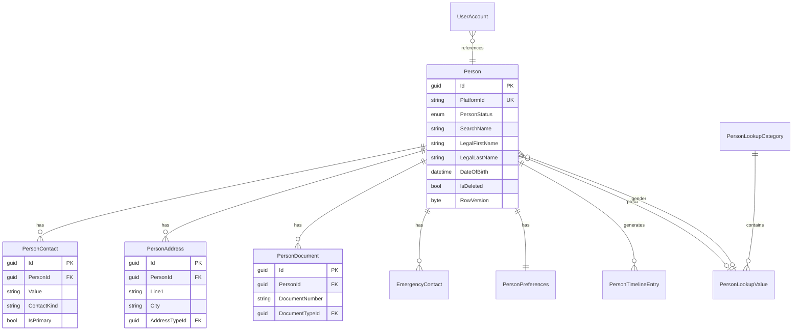

# PRAMAN Person Domain Model (M6.1)

| Field | Value |
|-------|-------|
| **Milestone** | M6.1 — Enterprise Person & Profile Foundation |
| **Status** | Approved for implementation |
| **Bounded context** | PersonService |

## Purpose

`Person` is the **canonical representation of a human being** in PRAMAN, independent of authentication, organizations, employment, hospitals, permissions, and roles.

```
Person → UserAccount → Employment → Organization Membership → Permissions
```

**Identity belongs to Person. Authentication belongs to UserAccount.**

---

## Bounded context boundaries

| Context | Owns | Must NOT own |
|---------|------|--------------|
| **PersonService** | Person profile, contacts, addresses, documents, preferences, timeline, master data lookups | Credentials, sessions, JWT, org membership, employment |
| **IdentityService** | UserAccount (`AppUser`), auth, MFA, sessions | Legal name, DOB, addresses (only `PersonId` FK) |
| **OrganizationService** | Membership, org-scoped role, designation (M6.2+ links to Person) | Canonical person PII |

---

## Aggregate design

### Aggregate root: `Person`

Single consistency boundary. All mutations go through `Person` methods or application services that load the aggregate and persist atomically.



---

## Entities (within Person aggregate)

| Entity | Responsibility |
|--------|----------------|
| `PersonContact` | Email, phone, or other contact channel with type and primary flag |
| `PersonAddress` | Physical address with type (residential, office, etc.) |
| `PersonDocument` | Identity document metadata + attachment reference |
| `EmergencyContact` | Named emergency contact with relationship |
| `PersonPreferences` | UI/locale/notification/AI placeholder preferences (1:1) |
| `PersonTimelineEntry` | Append-only audit trail per person |

---

## Value objects

| Value object | Fields |
|--------------|--------|
| `PersonName` | LegalFirst/Last, Display, Preferred, Short, Initials, Middle, LocalLanguageName, PrefixValueId, SuffixValueId → computes `SearchName` |
| `PostalAddress` | Line1, Line2, City, State, PostalCode, CountryCode |
| `ProfilePhotoRef` | StorageKey, Url, ContentType, UploadedAt |
| `CommunicationPreferences` | PreferredContactMethodId, OptIn flags |
| `IdentityDocumentMetadata` | Number, Issuer, IssueDate, ExpiryDate, VerificationStatus |

---

## Enums vs master data

| Type | Approach |
|------|----------|
| `PersonStatus` | **Enum** — lifecycle controlled by domain (Active, Inactive, Archived, Deceased, Merged, Duplicate) |
| Prefix, Suffix, Gender, Nationality, Language, ContactType, AddressType, IdentityDocumentType, MaritalStatus, BloodGroup, PreferredContactMethod, EmergencyRelationship | **Master data** (`PersonLookupCategory` + `PersonLookupValue`) — extensible without code deploy |

---

## Domain invariants

1. `Person.Id` and `Person.PlatformId` are **immutable** after creation.
2. At most **one primary email** and **one primary phone** per person.
3. `SearchName` is recomputed on any name change (normalized uppercase, indexed).
4. **Soft delete only** — `IsDeleted` + `DeletedAt`; no hard delete in M6.1.
5. **Optimistic concurrency** via `RowVersion` on `Person`.
6. Person with status `Merged` or `Duplicate` cannot be updated except by merge workflow (M6.2+).
7. `Deceased` persons are read-only for profile edits.
8. Duplicate detection: email and phone uniqueness among active persons; document number + type uniqueness.
9. A `UserAccount` must reference exactly one `Person` (enforced at registration); a `Person` may exist without `UserAccount`.

---

## Relationships

| From | To | Cardinality | Notes |
|------|-----|-------------|-------|
| UserAccount | Person | N:1 required (new) | `AppUser.PersonId`; no PII copy |
| Person | UserAccount | 0..1 | Optional login |
| Person | OrganizationMember | 0..N (future) | M6.2 via PersonId on membership |
| Person | Employment | 0..N | M6.2 Workforce |

---

## Duplicate detection rules

| Signal | Scope | Action on match |
|--------|-------|-----------------|
| Email (normalized) | Active persons | Reject create or flag duplicate |
| Phone (normalized E.164) | Active persons | Reject or warn |
| Document number + type | Active persons | Reject |
| PlatformId | Global | Exact lookup only |

---

## Future extension points

| Milestone | Extension |
|-----------|-----------|
| M6.2 Workforce | `Employment` aggregate references `PersonId` |
| M6.3 Healthcare Professional | Professional credentials linked to Person + documents |
| M6.4 Access Governance | Person-scoped ACL policies |
| M6.5+ | Merge workflow, GDPR export, consent |

---

## Domain events (outbox)

- `PersonCreatedDomainEvent`
- `PersonUpdatedDomainEvent`
- `PersonDeletedDomainEvent`
- `PersonDocumentAddedDomainEvent`

Published via `OutboxMessage` — no direct RabbitMQ from PersonService.

---

## API surface summary

Public: `/api/v1/persons/*` (JWT required)  
Internal: `/internal/persons/*` (API key, Identity registration)

---

## Approval

This document gates M6.1 implementation. Coding proceeds per attached M6.1 plan.
