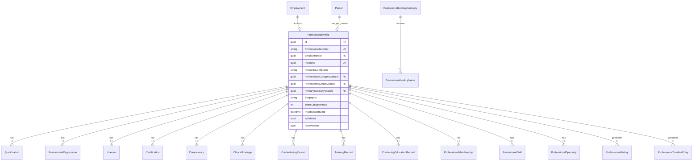
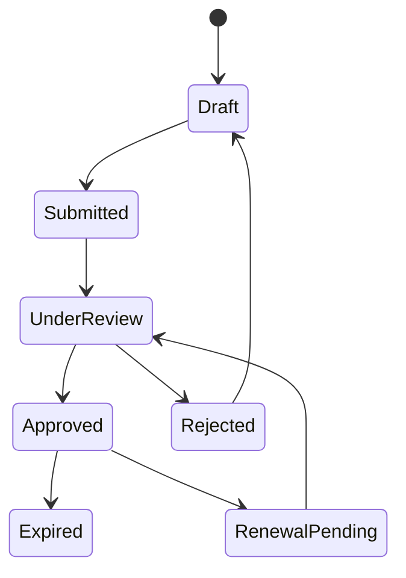
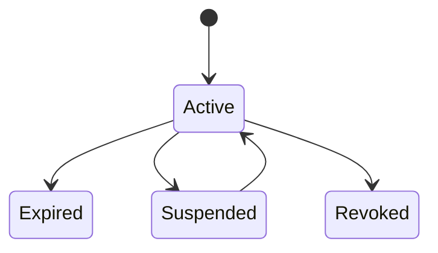
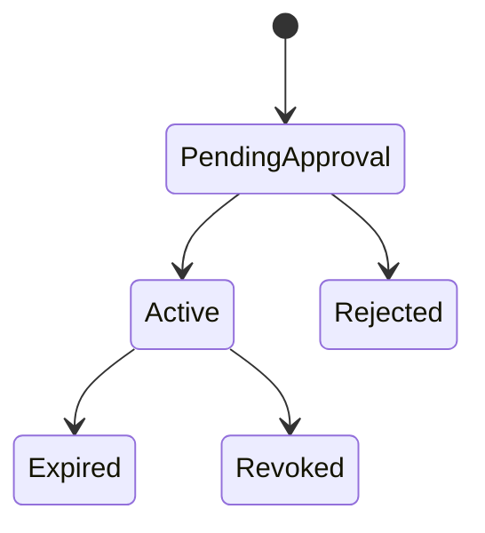

# PRAMAN Professional Domain Model (M6.3)

| Field | Value |
|-------|-------|
| **Milestone** | M6.3 — Professional Registry & Credentialing Foundation |
| **Status** | Approved for implementation |
| **Bounded context** | ProfessionalService |

## Purpose

`ProfessionalProfile` is the **canonical representation of professional identity and clinical capability** in PRAMAN. Professional credentials are not personal identity and not employment participation.

```
Person → Employment → ProfessionalProfile → Credentials / Privileges / Credentialing
         ↑ anchor      ↑ one per Person
```

**Personal identity belongs to Person. Workforce participation belongs to Employment. Professional credentials belong to ProfessionalProfile.**

---

## Bounded context boundaries

| Context | Owns | Must NOT own |
|---------|------|--------------|
| **ProfessionalService** | Qualifications, registrations, licenses, certifications, competencies, clinical privileges, credentialing lifecycle, training, CME/CPD, memberships, skills, specialties, professional timeline | Person PII, employment lifecycle, org topology, authentication |
| **PersonService** | Canonical human identity | Professional credentials |
| **WorkforceService** | Employment, assignments, org-chart | Licenses, registrations, privileges |
| **OrganizationService** | Hospital, MasterDepartment, membership access | Professional profile data |
| **IdentityService** | UserAccount, auth | Professional credentials |

---

## Aggregate design

### Aggregate root: `ProfessionalProfile`

Single consistency boundary. All credential mutations load `ProfessionalProfile` with children and persist atomically.



---

## Entities

| Entity | Responsibility |
|--------|----------------|
| `Qualification` | Degree, diploma, certificate with institution, verification |
| `ProfessionalRegistration` | Council registration with authority, expiry, renewal history |
| `License` | Jurisdiction-scoped license with suspension/revocation |
| `Certification` | Issuing organization certification with renewal |
| `Competency` | Skill level, assessment, evidence, gap analysis |
| `ClinicalPrivilege` | Department-scoped privilege with approval and conditions |
| `CredentialingRecord` | Full credentialing lifecycle with committee review |
| `TrainingRecord` | Course completion, mandatory flag, assessment score |
| `ContinuingEducationRecord` | CME/CPD credits, annual totals |
| `ProfessionalMembership` | Society membership validity |
| `ProfessionalSkill` | Link to skill master data |
| `ProfessionalSpecialty` | Primary/secondary specialty links |
| `RenewalHistoryEntry` | Audit trail for renewals |
| `ProfessionalHistory` | Structured before/after event log |
| `ProfessionalTimelineEntry` | Append-only UI timeline |

---

## Value objects

| Value object | Fields |
|--------------|--------|
| `ProfessionalNumber` | Immutable PRO platform id |
| `EffectiveDateRange` | EffectiveFrom, EffectiveTo? |
| `RegistrationRef` | RegistrationNumber, AuthorityValueId |
| `LicenseRef` | LicenseNumber, LicenseTypeValueId, Jurisdiction |
| `CreditHours` | Credits, AnnualTotal |
| `VerificationStatus` | Pending, Verified, Rejected |

---

## Enums vs master data

| Type | Approach |
|------|----------|
| `CredentialingStatus` | **Domain enum** (Draft, Submitted, UnderReview, Approved, Rejected, Expired, RenewalPending) |
| Professional Category, Qualification Type, Registration Authority, License Type, Certification Type, Competency Level, Skill Category, Specialty, Credential Status, Privilege Type, Training Type, Membership Organization | **Master data** (`ProfessionalLookupCategory` + `ProfessionalLookupValue`) |

---

## State machines

### CredentialingRecord



### ProfessionalRegistration / License / Certification



### ClinicalPrivilege



---

## Domain invariants

1. `ProfessionalNumber` is **immutable** after creation.
2. **One `ProfessionalProfile` per `PersonId`** (unique index).
3. `EmploymentId` is **required** and validated via Workforce internal API on create.
4. Registration number is **unique within issuing authority** per profile.
5. No **overlapping active licenses** of the same `LicenseTypeValueId`.
6. `ExpiryDate > IssueDate` when both set.
7. Credentialing transitions follow **CredentialingStatus** state machine only.
8. Clinical privilege cannot become **Active** without `ApprovedByUserId`.
9. **Soft delete** on ProfessionalProfile; child entities soft-deleted with profile or individually.
10. `PersonSearchName` is a **search projection** from Employment/Workforce — not canonical PII.
11. No duplicate active registration/license numbers detected across profile (duplicate detection).

---

## Relationships

| From | To | Cardinality | Notes |
|------|-----|-------------|-------|
| Person | ProfessionalProfile | 1:1 | PersonId unique |
| Employment | ProfessionalProfile | 1:1 anchor | EmploymentId required |
| ClinicalPrivilege | MasterDepartment | N:0..1 | Guid ref for dept-scoped privileges |
| ProfessionalProfile | Lookup values | N:M | Via FK value ids |

---

## Integration contracts

| Consumer | Provider | Contract |
|----------|----------|----------|
| ProfessionalService | WorkforceService | `GET /internal/employment/{id}` — validate employment, resolve PersonId |
| ProfessionalService | OrganizationService | `GET /internal/hospitals/{id}`, department validation |
| Gateway | ProfessionalService | `/api/v1/professional-profiles/*` proxy with JWT |

**No direct PersonService calls** — Person reached through Employment.

---

## Domain events (outbox)

- `ProfessionalProfileCreated`
- `QualificationAdded`
- `RegistrationAdded`
- `RegistrationExpired`
- `LicenseExpired`
- `CertificationExpired`
- `CompetencyUpdated`
- `TrainingCompleted`
- `PrivilegeGranted`
- `PrivilegeRevoked`
- `CredentialApproved`
- `CredentialExpired`

Published via `OutboxMessage` — no direct RabbitMQ from ProfessionalService.

---

## Future extension points

| Milestone | Extension |
|-----------|-----------|
| M6.4 Access Governance | Professional-scoped ACL; privilege-aware permissions |
| M6.5 Governance & Responsibility | Credentialing committee workflows, accountability |
| M6.3+ | AI gap analysis, accreditation readiness scoring (NABH/JCI/NABL/CAP) |

---

## API surface summary

Public: `/api/v1/professional-profiles/*` (JWT required)  
Internal: `/internal/professional/*` (API key)

---

## Approval

This document gates M6.3 implementation.
