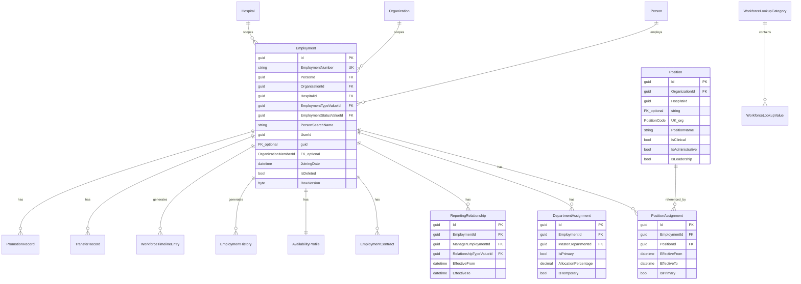

# PRAMAN Workforce Domain Model (M6.2)

| Field | Value |
|-------|-------|
| **Milestone** | M6.2 — Enterprise Workforce Foundation |
| **Status** | Approved for implementation |
| **Bounded context** | WorkforceService |

## Purpose

`Employment` is the **canonical representation of how a Person participates within an organization** in PRAMAN. Workforce is organizational—not personal.

```
Person → Employment → Organization Membership (access) → Permissions
         ↑ optional UserAccount
```

**Personal identity belongs to Person. Authentication belongs to UserAccount. Workforce lifecycle belongs to Employment.**

**EIWAM Phase 4 note:** OrganizationService owns membership affiliation and org structure trees. Workforce continues to own `Employment.HospitalId` and `DepartmentAssignment` (primary/secondary, allocation %, effective dates). Organization graph UIs aggregate Workforce data read-only. See [ORGANIZATION_DOMAIN_MODEL.md](./ORGANIZATION_DOMAIN_MODEL.md).

---

## Bounded context boundaries

| Context | Owns | Must NOT own |
|---------|------|--------------|
| **WorkforceService** | Employment lifecycle, position assignments, department assignments, reporting hierarchy, contracts, availability placeholders, workforce history/timeline | Person PII, credentials, org topology master data |
| **PersonService** | Canonical human identity | Employment, org membership, positions |
| **OrganizationService** | Organization, Hospital, MasterDepartment, OrganizationMember (access/role), OrganizationalUnit, org-scoped Department hierarchy, invitations (EIWAM Phase 4) | Employment records, position catalog, workforce department/hospital **assignments** |
| **IdentityService** | UserAccount, auth | Employment data; optional `UserId` link on Employment only |

---

## Aggregate design

### Aggregate root: `Employment`

Primary consistency boundary. All workforce mutations load `Employment` with children and persist atomically.

### Aggregate root: `Position`

Org-scoped position master data catalog. Mutated independently of a specific employment.



---

## Entities

| Entity | Aggregate | Responsibility |
|--------|-----------|----------------|
| `PositionAssignment` | Employment | Temporal link to Position; primary flag |
| `DepartmentAssignment` | Employment | Primary/secondary dept with allocation % |
| `ReportingRelationship` | Employment | Matrix reporting; multiple managers |
| `EmploymentContract` | Employment | Contract metadata + attachment ref |
| `AvailabilityProfile` | Employment | Working days/hours, leave placeholders |
| `EmploymentHistory` | Employment | Structured event log (before/after JSON) |
| `WorkforceTimelineEntry` | Employment | Append-only UI timeline |
| `TransferRecord` | Employment | Transfer command artifact |
| `PromotionRecord` | Employment | Promotion command artifact |
| `Position` | Position (root) | Org-scoped job catalog |

---

## Value objects

| Value object | Fields |
|--------------|--------|
| `EffectiveDateRange` | EffectiveFrom, EffectiveTo? |
| `AllocationPercentage` | 0–100 decimal |
| `EmploymentNumber` | Immutable EMP platform id |
| `ContractRef` | ContractNumber, AttachmentUrl |
| `SchedulePlaceholder` | WorkingDaysJson, WorkingHoursJson, ShiftPlaceholder |

---

## Enums vs master data

| Type | Approach |
|------|----------|
| Assignment active check | Domain logic on `EffectiveTo == null` or future date |
| EmploymentType, EmploymentStatus, PositionLevel, Grade, Band, ContractType, TransferReason, PromotionReason, DepartmentType, ReportingRelationshipType | **Master data** (`WorkforceLookupCategory` + `WorkforceLookupValue`) |

---

## Domain invariants

1. `Employment.EmploymentNumber` is **immutable** after creation.
2. `PersonId` is **required**; must exist in PersonService (validated on create).
3. At most **one active primary position** per employment.
4. At most **one active primary department** per employment.
5. Secondary departments may overlap if `IsTemporary` or non-primary; allocation sum ≤ 100% for concurrent active assignments.
6. Reporting graph must be **acyclic** (no manager cycles).
7. `EffectiveFrom <= EffectiveTo` when end date is set.
8. **Soft delete only** on Employment.
9. No duplicate **active** employment for same `(PersonId, OrganizationId, HospitalId)`.
10. `PersonSearchName` is a **search projection** only—refreshed from PersonService, not canonical PII.
11. Employment does **not require** UserAccount.

---

## Relationships

| From | To | Cardinality | Notes |
|------|-----|-------------|-------|
| Person | Employment | 1:N | PersonId FK |
| Employment | Organization | N:1 | Guid ref, validated via Org internal API |
| Employment | Hospital | N:1 | Guid ref |
| Employment | UserAccount | N:0..1 | Optional UserId |
| Employment | OrganizationMember | N:0..1 | Optional access link |
| Employment | Position | N:M | Via PositionAssignment |
| Employment | MasterDepartment | N:M | Via DepartmentAssignment (Guid ref) |

---

## Integration contracts

| Consumer | Provider | Contract |
|----------|----------|----------|
| WorkforceService | PersonService | `GET /internal/persons/{id}` — validate + search name |
| WorkforceService | OrganizationService | `GET /internal/hospitals/{id}`, org validation, master dept |
| WorkforceService | IdentityService | Optional user existence (future internal API) |
| Gateway | WorkforceService | `/api/v1/employment/*` proxy with JWT |

---

## Domain events (outbox)

- `EmploymentCreated`
- `EmploymentActivated`
- `EmploymentTransferred`
- `EmploymentPromoted`
- `EmploymentSuspended`
- `EmploymentTerminated`
- `DepartmentAssigned`
- `ManagerAssigned`
- `PositionAssigned`
- `ContractRenewed`

Published via `OutboxMessage` — no direct RabbitMQ from WorkforceService.

---

## Future extension points

| Milestone | Extension |
|-----------|-----------|
| M6.3 Healthcare Professional | Professional credentials linked to Person + Employment |
| M6.4 Access Governance | Employment-scoped ACL; `employment_id` JWT claim |
| M6.5 Governance & Responsibility | Duty assignments, accountability matrices |
| M6.2+ | Person timeline merge with Workforce timeline |

---

## API surface summary

Public: `/api/v1/employment/*` (JWT required)  
Internal: `/internal/employment/*` (API key)

---

## Intelligence boundary (Phase 10)

Operational workforce data remains owned by **WorkforceService**. **WorkforceIntelligenceService** consumes employment data via HTTP and events to produce snapshots, KPIs, forecasts, and recommendations. Do not duplicate `Employment` tables in the intelligence bounded context.

---

## Approval

This document gates M6.2 implementation.
