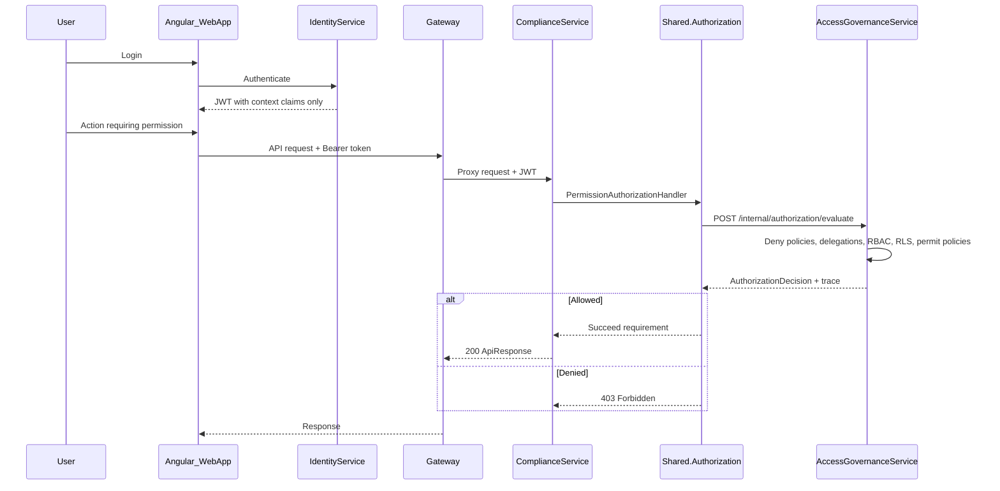
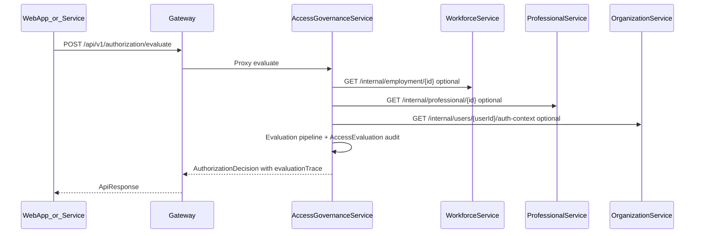

# Access Governance API Flows — EIWAM Phase 5

## End-to-end authorization (login → evaluate → API enforce)



## Evaluate authorization (direct)



## Assign role (Phase 5 dedicated route)

1. `POST /api/v1/role-assignments` — assign role with scope and effective dates
2. `GET /api/v1/role-assignments?userId=` — list assignments
3. `POST /api/v1/role-assignments/{id}/revoke` — revoke assignment
4. Outbox event: `RoleAssigned` / `RoleRevoked`

Legacy route remains: `POST /api/v1/roles/users/{userId}/assign/{roleId}`

## Policy designer

1. `POST /api/v1/policies` — create draft with rules and conditions
2. `GET /api/v1/policies/{id}` — load for editing
3. `PUT /api/v1/policies/{id}` — update draft
4. `POST /api/v1/policies/{id}/publish` — publish (immutable)
5. `POST /api/v1/policies/{id}/archive` — archive

Policy operators (lookup `PolicyOperator`): Equals, NotEquals, In, Contains, GreaterThan, Exists

## Module consumption (ComplianceService pilot)

Register in service `Program.cs`:

```csharp
builder.Services.AddTransient<InternalApiKeyForwardingHandler>();
builder.Services.AddPramanAuthorization(builder.Configuration);
```

Apply on controller action:

```csharp
[RequirePermission(CompliancePermissionCodes.EvidenceVerify)]
```

See [module-authorization-adoption-playbook.md](./module-authorization-adoption-playbook.md)

## Internal SDK entry

Services use `Shared.Authorization.IAuthorizationEvaluator` → `POST /internal/authorization/evaluate`

## JWT context claims (Identity)

- `person_id`, `employment_id`, `professional_profile_id`
- `organization_id`, `hospital_id`, `active_department_id`

Permissions are **not** embedded in JWT.
