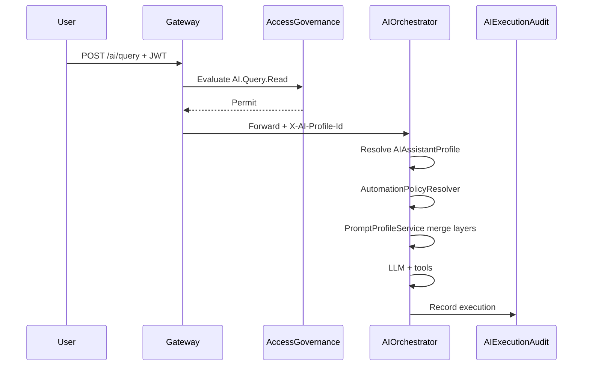
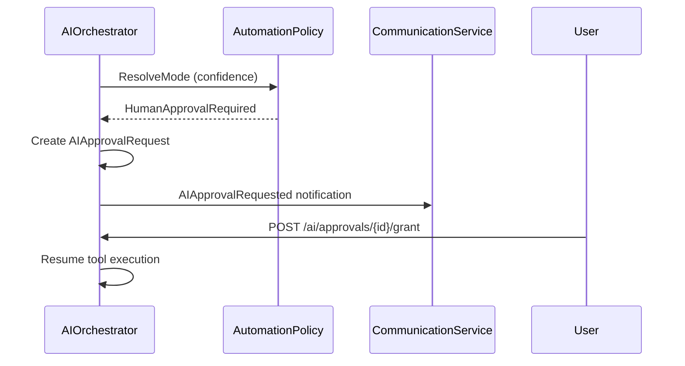

# AI Identity API Flows

Phase 9 establishes AI as a governed digital actor in PRAMAN.

## Profile-scoped execution

## Approval workflow

## Copilot bridge

Compliance `CopilotPersona` enums resolve to `AIAssistantProfile` via `GET /internal/ai/profiles/by-persona/{key}`. Persona catalog responses include `aiProfileId`.

## Gateway routes

| Route | Permission |
|-------|------------|
| GET/POST `/ai/profiles` | AI.Profile.Manage (write) |
| GET/POST `/ai/policies` | AI.Policy.Manage (write) |
| GET/POST `/ai/prompts` | AI.Prompt.Manage (write) |
| POST `/ai/prompts/evaluate` | authenticated |
| GET `/ai/executions` | authenticated |
| GET `/ai/analytics` | AI.Analytics.View |
| GET/POST `/ai/approvals` | authenticated |
| POST `/ai/query` | AI.Query.Read |

## Boundary

- **AccessGovernance** owns permission evaluation.
- **GovernanceService** owns approval chain state; AI references chain IDs.
- **Compliance Copilot** remains in ComplianceService — bridged, not migrated.
