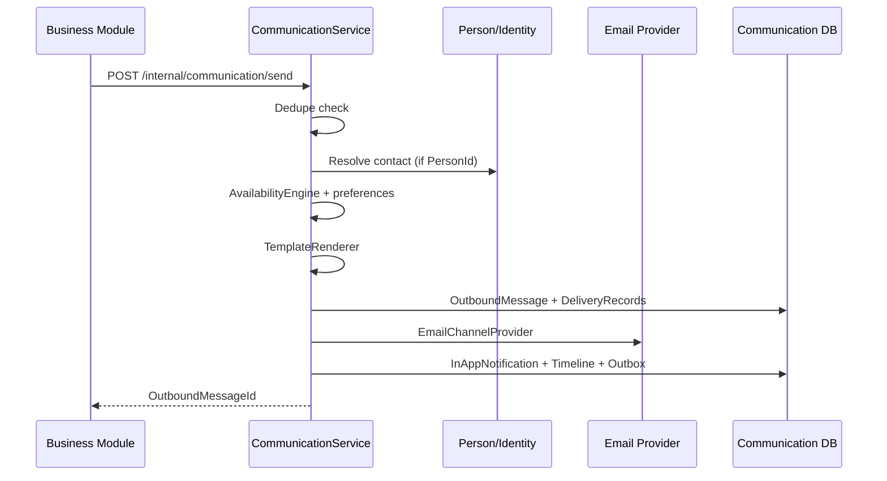
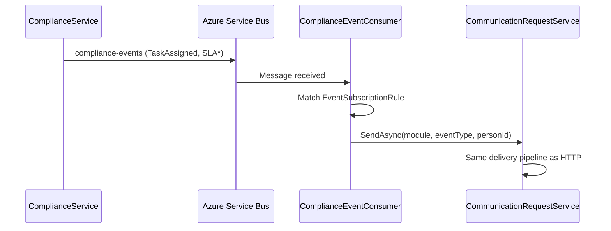
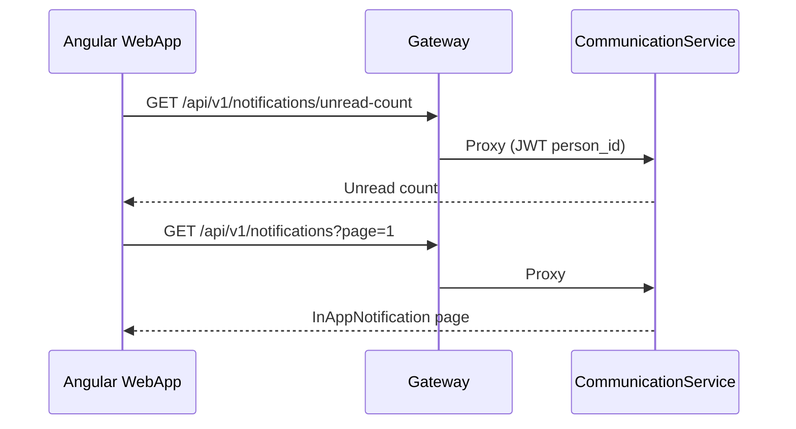
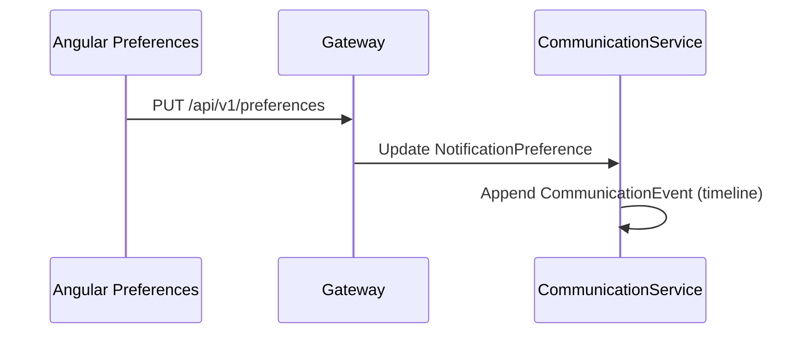
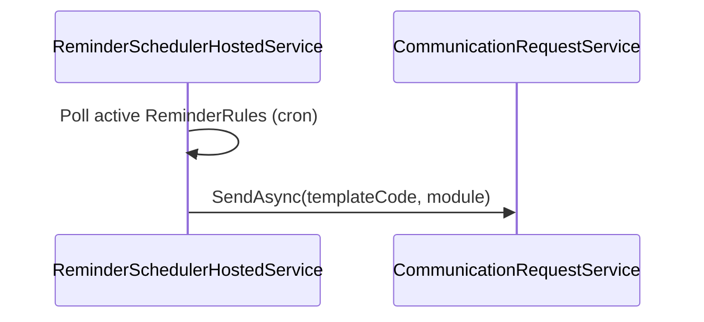

# Communication API Flows

Phase 8 introduces **CommunicationService** as the shared delivery framework. Business modules publish communication **requests**; the framework resolves recipients, preferences, availability, templates, channels, and audit.

## Imperative send (HTTP)

**Callers:** Organization invitations (`InvitationCreated`), Governance escalations (`EscalationTriggered`), admin imperative send via Gateway.

## Event-driven send (Azure Service Bus)

Compliance remains **broker-agnostic** — it publishes domain/outbox events; CommunicationService owns subscription rules and templates.

## User-facing inbox (Gateway → CommunicationService)

## Preference update

Quiet hours and channel toggles apply on the next delivery attempt unless `Critical=true`.

## Reminder scheduler

## Escalation (Governance)

Governance **state** (escalation chain level) stays in GovernanceService. On level advance, `EscalationResolverService` calls `ICommunicationClient` with template `governance-escalation` after resolving assignee email via Identity internal contact API.

## Gateway route map

| Gateway route | CommunicationService |
|---------------|---------------------|
| `GET /notifications` | In-app inbox |
| `GET /notifications/unread-count` | Badge count |
| `POST /notifications/{id}/read` | Mark read |
| `GET/PUT /preferences` | Notification preferences |
| `GET/POST /templates` | Template catalog |
| `GET /communication/history` | Unified timeline |
| `GET /communication/dashboard` | Delivery stats |
| `GET/POST /reminders` | Reminder rules |
| `GET/POST /campaigns` | Campaigns |
| `GET/PUT /availability` | Working hours / vacation |

Internal only: `POST /internal/communication/send` (internal API key).

## Boundary notes

- **Toast notifications** in the WebApp (`NotificationService`) remain ephemeral UX; the header bell uses CommunicationService inbox data.
- **PersonService** exposes contacts; typed preferences migrate to CommunicationService.
- **Governance escalation state** is not duplicated in CommunicationService — only delivery artifacts (OutboundMessage, DeliveryRecord, InAppNotification).
