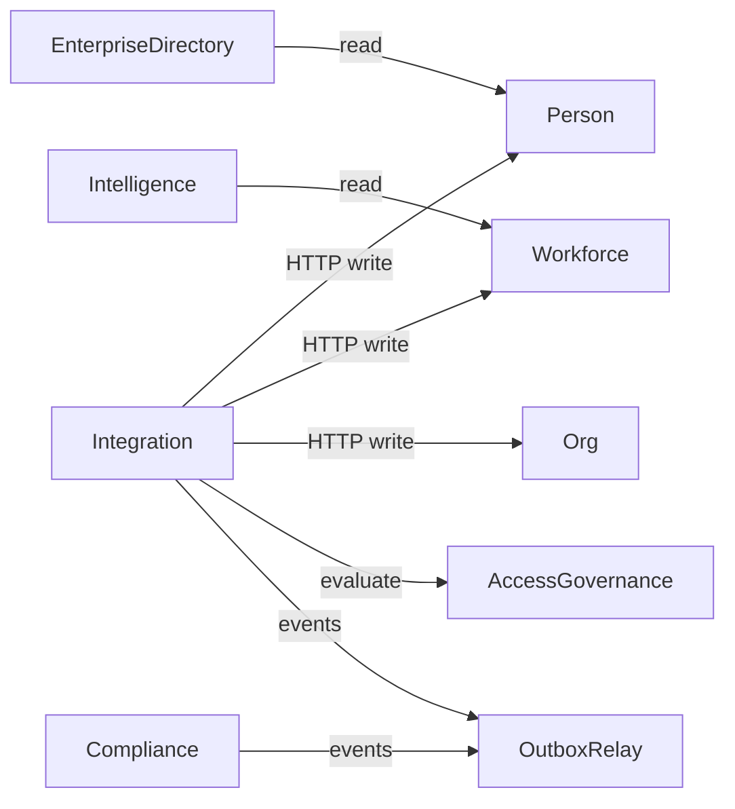

# EIWAM Bounded Contexts

## Context map

| Phase | Bounded context | Service | Owns |
|-------|-----------------|---------|------|
| 0 | Platform foundation | Shared.* | Cross-cutting infra |
| 1 | Identity | IdentityService | Users, tokens, sessions |
| 2 | Person | PersonService | Person aggregate |
| 3 | Workforce | WorkforceService | Employment, assignments |
| 4 | Professional | ProfessionalService | Credentials, privileges |
| 5 | Organization | OrganizationService | Tenants, hospitals, departments |
| 6 | Access Governance | AccessGovernanceService | RBAC/ABAC, permissions |
| 7 | Governance | GovernanceService | Committees, responsibilities |
| 8 | Communication | CommunicationService | Notifications, campaigns |
| 9 | AI Identity | AIOrchestratorService | AI orchestration, copilot |
| 10 | Workforce Intelligence | WorkforceIntelligenceService | Analytics projections |
| 11 | Enterprise Directory | EnterpriseDirectoryService | Search index, profiles |
| 12 | Enterprise Integration | IntegrationService | Connectors, sync, webhooks |
| — | Compliance | ComplianceService | Journeys, evidence, tasks |
| — | Audit | AuditService | Audit trail |
| — | Knowledge Base | KnowledgeBase | Frameworks, regulations |

## Integration context boundary

`IntegrationService` owns **orchestration metadata only**:

- Connectors, credentials (encrypted), mapping profiles
- Sync jobs/runs, webhook subscriptions/deliveries
- Import/export jobs, integration audit, outbox

It does **not** own Person, Employment, Organization, or Compliance aggregates.

## Anti-patterns

- Adding sync logic to Enterprise Directory or Workforce Intelligence
- Direct SQL across service databases
- Duplicate lifecycle state enums outside `ComplianceLifecycleState`
- Publishing to Service Bus without outbox

## Context relationships

## Database ownership

Each bounded context has a dedicated SQL Server database (e.g. `PramanIntegration`, `PramanEnterpriseDirectory`). See `EIWAM_DATABASE_OVERVIEW.md`.
