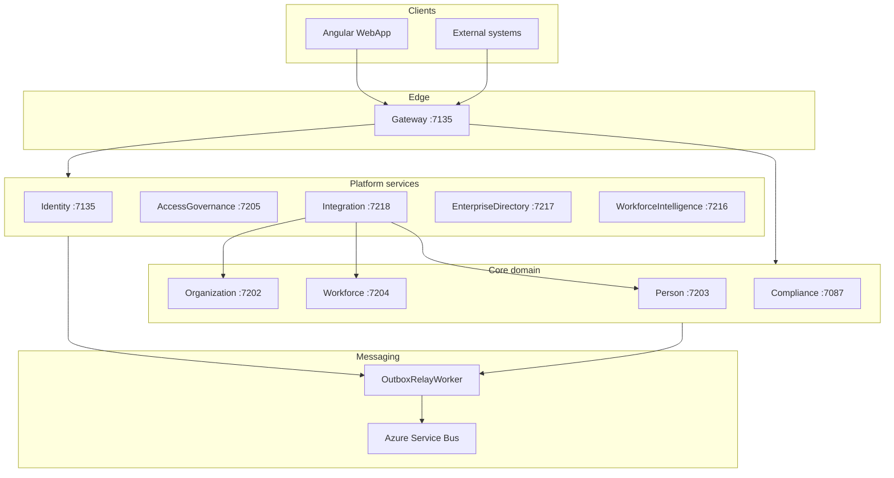

# EIWAM Platform Architecture

## Overview

PRAMAN EIWAM (Enterprise Identity, Workforce, Access, and Messaging) is a modular healthcare compliance platform composed of independently deployable services behind a single Gateway BFF. Phase 12 completes the platform with **Enterprise Integration** — external system orchestration without duplicating domain ownership.

## Architectural layers

| Layer | Responsibility | Examples |
|-------|----------------|----------|
| **Experience** | Angular WebApp, operator workflows | `/app/journey`, `/app/integration` |
| **Gateway** | Auth termination, routing, MediatR orchestration | `Gateway` (7135) |
| **Domain services** | Bounded contexts, EF persistence, outbox | Compliance, Person, Workforce |
| **Integration** | Connectors, sync, webhooks, import/export | `IntegrationService` (7218) |
| **Intelligence & Directory** | Analytics vs governed discovery | WIS (7216), EDS (7217) |
| **Platform** | Identity, AG, Communication, AI | Identity, AccessGovernance, AIOrchestrator |
| **Messaging** | Azure Service Bus relay from outbox | `OutboxRelayWorker` |

## Deployment topology

## Key principles

1. **Single lifecycle owner** — `ComplianceJourney` + `ComplianceLifecycleStateMachine` only.
2. **Outbox-first messaging** — domain services never publish directly to RabbitMQ/Service Bus.
3. **Gateway HTTP proxy** — no cross-service DbContext references.
4. **Access Governance** — all sensitive operations require seeded permissions.
5. **Integration boundary** — orchestration only; HTTP writes to existing APIs.

## Service ports (development)

| Service | HTTPS | HTTP |
|---------|-------|------|
| Gateway | 7135 | 5135 |
| Integration | 7218 | 5218 |
| Enterprise Directory | 7217 | 5217 |
| Workforce Intelligence | 7216 | 5216 |

## AOVIAS platform registration

All services register via `PramanServiceCatalog` with health/readiness endpoints, migration packages, and deployment metadata (`*.aovpkg`).

## Phase completion status

Phases 0–12 deliver Identity through Enterprise Integration, forming the frozen EIWAM foundation documented in this package.
