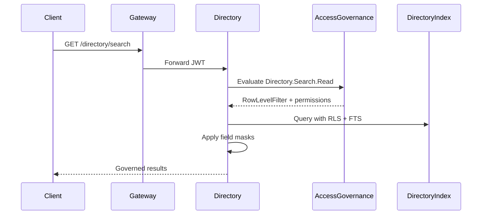

# Enterprise Directory API Flows

## Search (governed)

1. Client calls `GET /api/v1/directory/search?q=...&organizationId=...` via Gateway.
2. Gateway forwards JWT to `EnterpriseDirectoryService`.
3. `DirectoryAuthorizationService` evaluates `Directory.Search.Read` + RLS via Access Governance.
4. `DirectorySearchService` applies RLS filters in SQL, runs FTS (or LIKE fallback), ranking, field masks.
5. `SearchHistoryService` records the query for the authenticated user.
6. `ApiResponse<DirectorySearchResultDto>` returned.

## Index rebuild

1. `POST /api/v1/directory/rebuild?organizationId=...` or scheduled `IndexRebuildSchedulerHostedService`.
2. `DirectoryIndexProjector` hydrates Person, Workforce, Professional sources over HTTP.
3. Rebuilds `DirectoryIndex`, `DirectoryFacet`, `DirectorySnapshot`.
4. Emits `SearchIndexRebuilt` via directory outbox → `directory-events` relay.

## Incremental projection

1. Source services publish workforce domain events to `workforce-events`.
2. `DirectoryEventConsumerHostedService` receives events.
3. `DirectoryProjectionRegistry` routes to `DirectoryIndexProjector` handlers.
4. Index rows upserted; `DirectoryIndexUpdated` outbox message created.

## Natural language search

1. `POST /api/v1/directory/nl-search` with `{ query, organizationId }`.
2. Requires `Directory.NLSearch.Use`.
3. `NaturalLanguageQueryTranslator` calls AI Orchestrator structured output (fallback heuristic).
4. Org scope enforced server-side on translated `DirectoryQuery`.
5. Executes standard search pipeline; returns `translatedQuery` + results.

## Enterprise profile

1. `GET /api/v1/directory/profile/{personOrEmploymentId}`.
2. Requires `Directory.Profile.Read`; contact/credential fields masked per `Directory.Contact.Read` / `Directory.Credential.Read`.
3. `DirectoryProfileComposer` assembles live profile from source HTTP APIs (60s cache).

## Security pipeline (every request)

## Boundary vs Workforce Intelligence

- **Workforce Intelligence** (`/intelligence/*`): analytics, KPIs, forecasts, recommendations.
- **Enterprise Directory** (`/directory/*`): discovery, search, profiles, saved searches, NL query translation.

Do not extend intelligence search APIs for directory discovery; use Enterprise Directory as the single governed discovery layer.

## Performance targets

| Scenario | Target |
|----------|--------|
| Search p95 (100K rows) | < 200ms |
| Autocomplete p95 | < 100ms |
| Full rebuild (10K profiles) | < 5 min |
