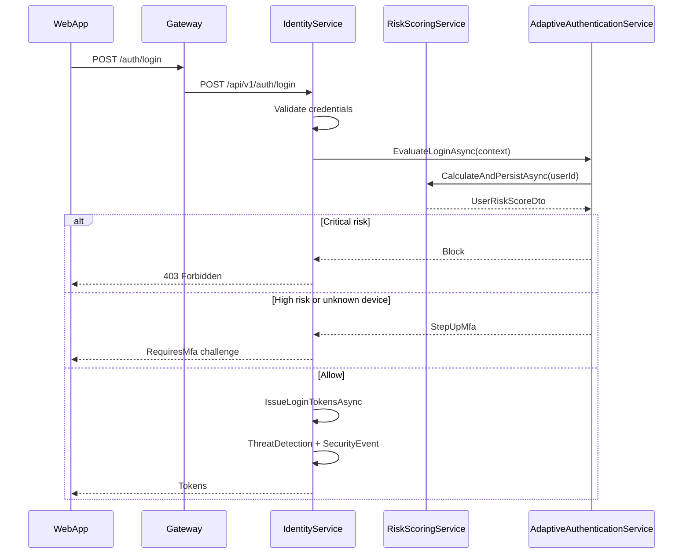
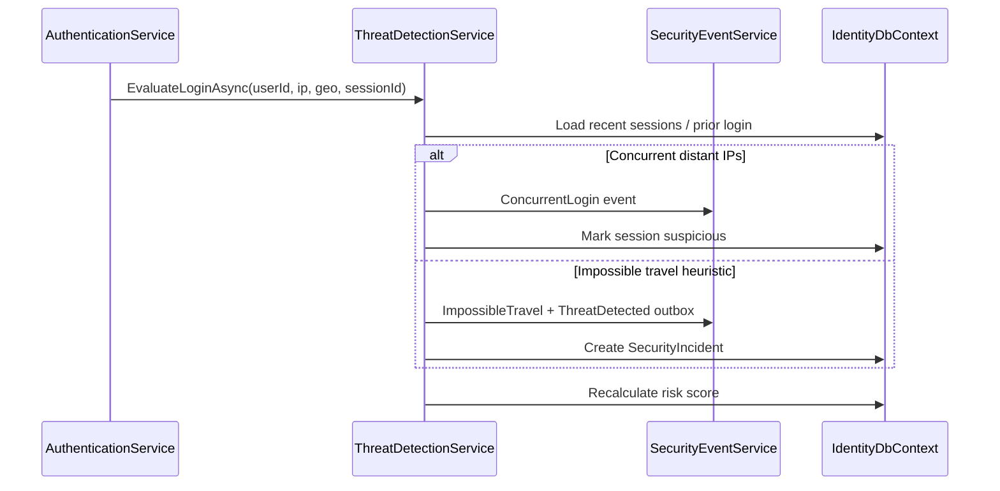
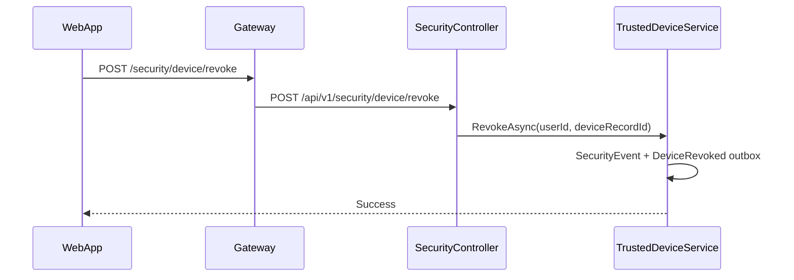
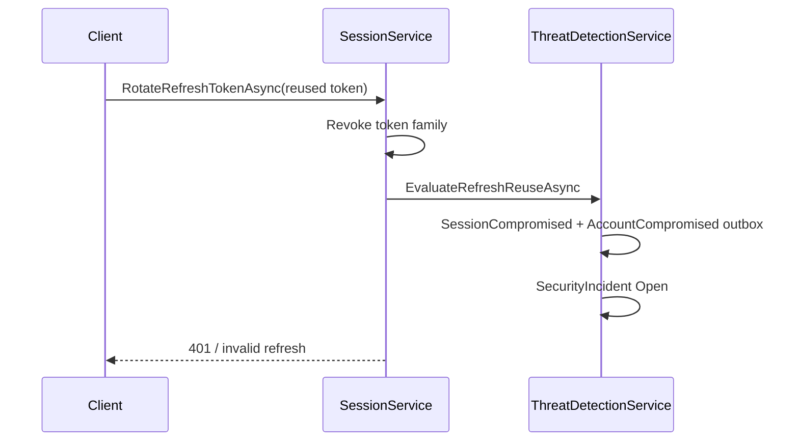

# Enterprise Security API Flows (EIWAM Phase 7)

IdentityService remains the single owner of authentication, sessions, devices, policies, and security telemetry. Gateway exposes `/api/v1/security/*` as a transparent proxy.

## Adaptive login

## Threat detection on login

## Device revoke

## Refresh token reuse

## Boundary note

- **Identity security** (this document): authentication, sessions, device trust, risk, threats, security events.
- **Access governance** (see `governance-api-flows.md`): roles, permissions, delegations, authorization evaluation.

Both are consumed via Gateway; domain services do not call each other directly for user lifecycle data.
