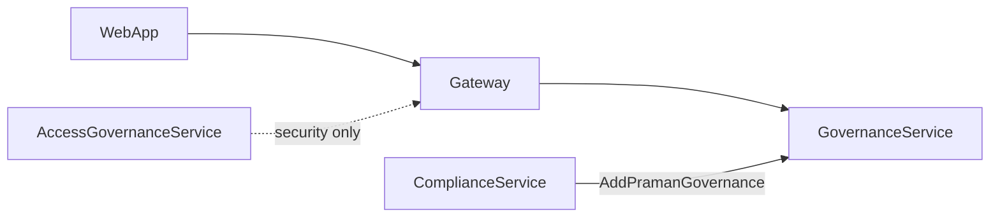
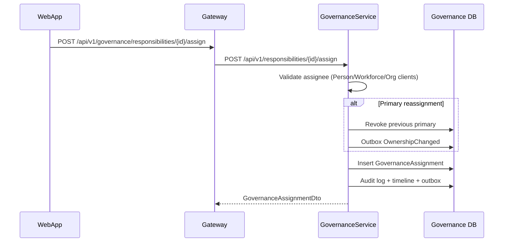
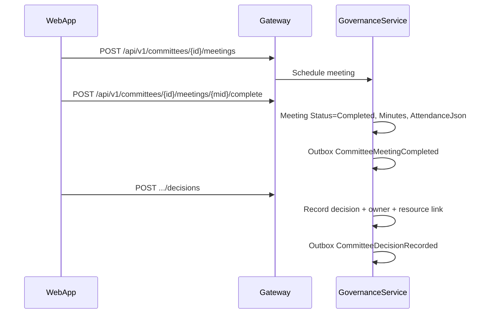
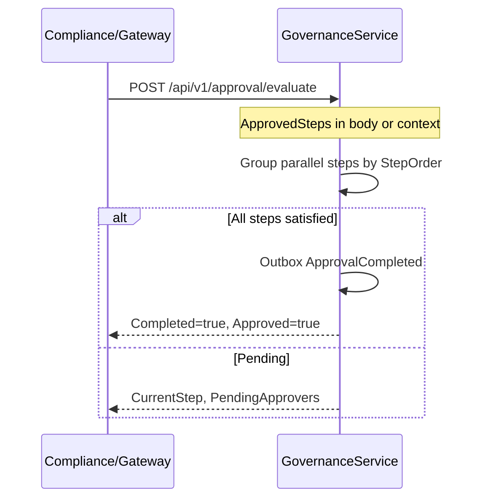
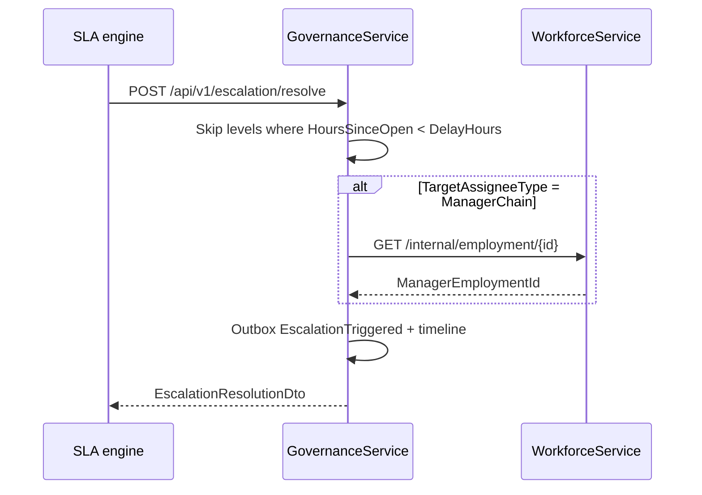

# Governance API Flows — EIWAM Phase 6

| Field | Value |
|-------|-------|
| **Status** | Phase 6 — Governance & Accountability |
| **Service** | `GovernanceService` (HTTPS `7210` / HTTP `5210`) |
| **Gateway** | Full proxy via `ProxyToGovernanceServiceAsync` |

## Platform position

Identity → Person → Workforce → Professional → Organization → AccessGovernance → **Governance**

**Boundary:** Enterprise **identity security** (sessions, device trust, risk, threats) lives in **IdentityService** (`/api/v1/security/*` via Gateway). **Access governance** (roles, permissions, delegations) lives in **AccessGovernanceService**. **Governance** (responsibilities, committees, approvals) is accountability — not authentication or RBAC.

## 1. Assign responsibility

---

## 2. Committee decision + meeting complete

---

## 3. Approval evaluate (parallel + completion)

---

## 4. Escalation resolve (delay + manager chain)

---

## Gateway route map (Phase 6)

| Gateway route | GovernanceService target |
|---------------|-------------------------|
| `GET/POST/PUT/DELETE /api/v1/governance/responsibilities` | `/api/v1/responsibilities` |
| `POST /api/v1/governance/responsibilities/{id}/assign` | `/api/v1/responsibilities/{id}/assign` |
| `GET/POST/PUT /api/v1/committees` | `/api/v1/committees` |
| `POST /api/v1/committees/{id}/members|meetings|...` | same |
| `GET/POST /api/v1/approval-chains` + publish | `/api/v1/approval-chains` |
| `POST /api/v1/approval/evaluate` | `/api/v1/approval/evaluate` |
| `GET/POST /api/v1/escalation-chains` + publish | `/api/v1/escalation-chains` |
| `POST /api/v1/escalation/resolve` | `/api/v1/escalation/resolve` |
| `GET /api/v1/governance/timeline` | `/api/v1/governance/timeline` |

Legacy: `GET/POST /api/v1/responsibilities` on Gateway still works via AccessGovernance controller.

---

## Angular UI

| Route | Phase 6 capability |
|-------|-------------------|
| `/app/governance/responsibilities` | Create + assign |
| `/app/governance/committees` | Create committee |
| `/app/governance/committees/:id/members` | Add members |
| `/app/governance/committees/:id/meetings` | Schedule + complete |
| `/app/governance/approvals` | Create, publish, evaluate simulator |
| `/app/governance/escalations` | Create, publish, resolve simulator |
| `/app/governance/ownership` | Timeline search by resource |

See [governance-consumer-playbook.md](./governance-consumer-playbook.md) for module adoption.

## AI Identity boundary (Phase 9)

**GovernanceService** owns escalation and approval **chain state**. **AIOrchestratorService** owns AI profile identity, automation policies, and execution audit. When `AIApprovalPolicy` references a `GovernanceApprovalChainId`, AI requests human approval through that chain — but does not duplicate governance aggregates. Communication delivery of approval notifications is owned by **CommunicationService** (`ai-approval-requested` template).
