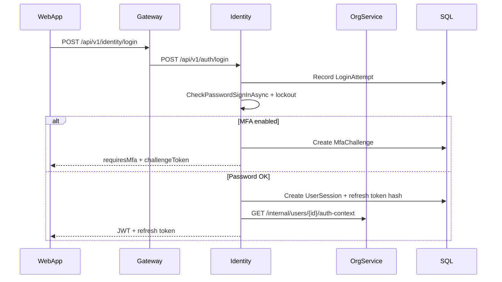
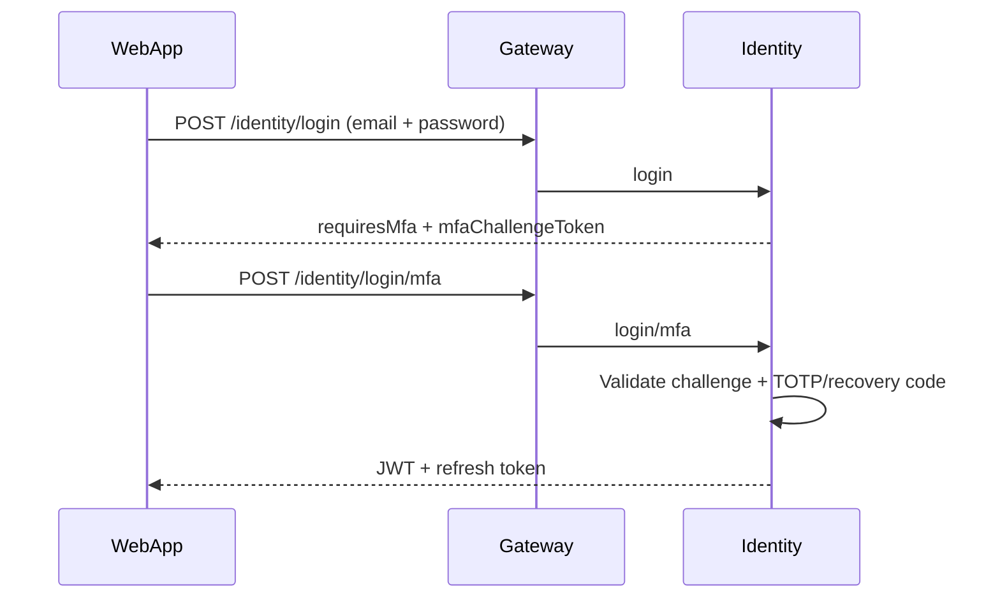
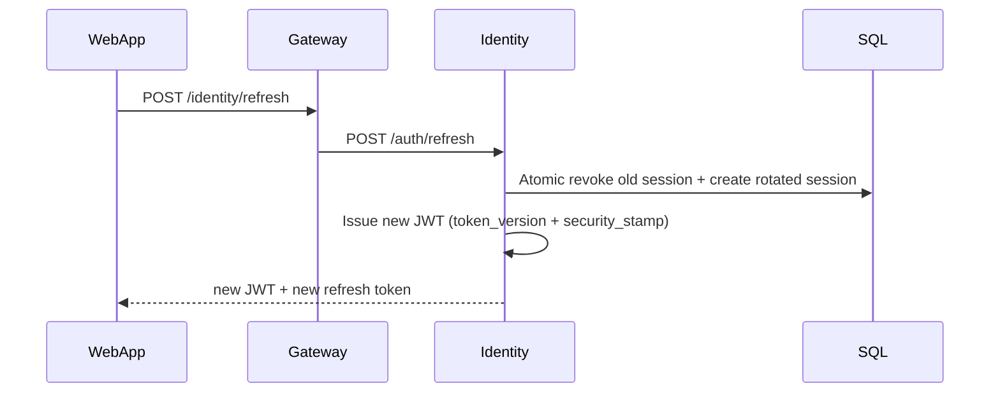
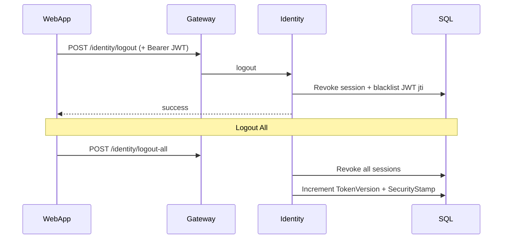
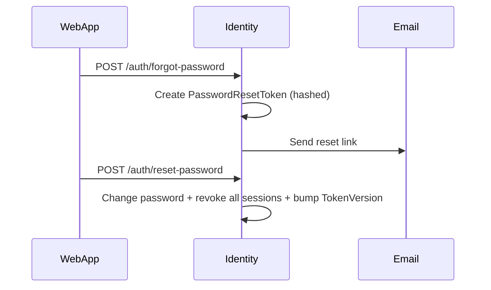

# PRAMAN Identity Authentication Flows

This document describes the M6.0 identity security flows implemented in `IdentityService`, proxied via `Gateway`, and consumed by the Angular `WebApp`.

## Token Storage (Known Limitation)

Access and refresh tokens are stored in browser `localStorage` (`token.service.ts`). This is acceptable for current development but carries XSS exfiltration risk. Production hardening should evaluate an httpOnly cookie + Gateway BFF pattern.

---

## Login Flow

**Account gates:** suspended/disabled/archived/pending verification, forced password change, password max age, admin MFA requirement.

---

## MFA Login Flow

---

## Refresh Flow

**Security:** Refresh tokens are SHA-256 hashed in SQL. Rotation uses atomic `ExecuteUpdate` to prevent concurrent double-refresh. Reuse of a revoked refresh token revokes the entire token family.

**Gateway JWT validation:** After refresh, API calls validate JWT signature, expiry, `jti` blacklist, `token_version`, and `security_stamp` against live user state.

---

## Logout / Logout All

Single logout blacklists the current access token `jti`. Logout-all invalidates all refresh sessions and bumps `token_version` so existing JWTs fail Gateway validation.

---

## Password Reset

---

## Session Lifecycle

| State | Meaning |
|-------|---------|
| Active | Valid refresh token; may issue JWTs |
| Revoked | Rotated or explicitly logged out |
| Expired | Past `ExpiresAt` |
| ReuseDetected | Family compromised after refresh reuse |

Concurrent session limit enforced on login; oldest sessions revoked when limit exceeded. Background cleanup marks expired sessions and purges old records.

---

## Internal Service Security

Service-to-service calls to `/internal/*` require header `X-Internal-Api-Key` when `InternalApi:ApiKey` is configured. In development without a key, only localhost callers are permitted.

---

## Incident Recovery

| Scenario | Action |
|----------|--------|
| Compromised refresh token | User logout-all; family reuse detection revokes chain |
| Compromised access token | Short TTL (60 min default); logout blacklists jti |
| Compromised admin account | Suspend via `/internal/users/{id}/suspend`; revokes all sessions |
| Password breach | Force password reset; all sessions invalidated on change |

---

## Deployment Notes

- Configure `JwtSettings:SecretKey` via environment or user secrets (not committed).
- Set `InternalApi:ApiKey` consistently on Gateway, Identity, and Organization services.
- Production Identity signing may use certificate mode (`appsettings.Production.json`).
