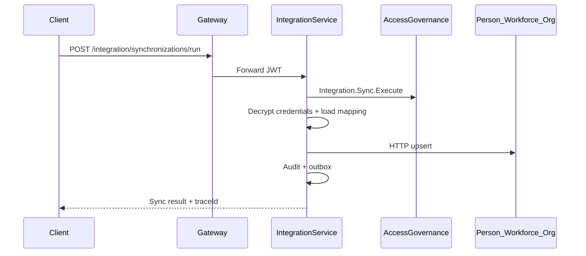

# Integration Layer API Flows

## Connector lifecycle

1. Client calls `POST /api/v1/integration/connectors` via Gateway with provider type and configuration JSON.
2. Gateway forwards JWT; `Integration.Connector.Manage` enforced.
3. `ConnectorAppService` resolves `IConnectorProvider`, validates configuration, optionally encrypts credentials.
4. Connector persisted in `Configured` state; `ApiResponse<ConnectorDto>` returned.

## Validate and connect

1. `POST /api/v1/integration/connectors/{id}/validate`.
2. Provider `ValidateConfigurationAsync` + `CheckHealthAsync` executed.
3. Lifecycle transitions: `Configured` → `Validated` → `Connected`.
4. `ConnectorHealth` record written; `ConnectorConnected` outbox event enqueued.

## Manual synchronization

1. `POST /api/v1/integration/synchronizations/run?jobId=...`.
2. Requires `Integration.Sync.Execute`.
3. `SynchronizationEngine.RunAsync` creates `SynchronizationRun`, pulls records from source connector.
4. `MappingEngine` applies profile; conflict detection per job policy.
5. `IPlatformWriteClient.UpsertAsync` routes by `TargetEntity` to internal upsert APIs (Person, Employment, Organization.Department); failures throw `PlatformWriteException`.
6. `IntegrationAuditLog` + `SynchronizationCompleted` outbox event; run DTO returned with `traceId`.

## Internal platform writes (Phase 12.1)

| Target entity | Internal endpoint |
|---------------|-------------------|
| Person | `PUT /internal/persons/upsert` |
| Employment | `PUT /internal/employment/upsert` |
| Organization.Department | `PUT /internal/departments/upsert` |

Rollback (import undo) calls `POST /internal/{entity}/{id}/integration-rollback` on the same services.

## Scheduled synchronization

1. `SyncSchedulerHostedService` polls enabled `SynchronizationSchedule` rows.
2. Due jobs invoke `SynchronizationEngine.RunAsync` with system correlation.
3. `NextRunUtc` computed from cron expression via Cronos (replaces fixed 6h increment).

## Mapping profile

1. `POST /api/v1/integration/mappings` with field mappings and optional transformation rule refs.
2. `MappingProfileService` persists `MappingProfile`, `FieldMapping` rows.
3. No hardcoded field maps in code — all configuration-driven.

## Import wizard

1. `POST /api/v1/integration/imports` — upload metadata + content.
2. `POST /api/v1/integration/imports/{id}/preview` — parse CSV/Excel/JSON, return preview rows.
3. `POST /api/v1/integration/imports/{id}/execute` — map + HTTP write; rollback checkpoint stores `{ externalId, targetEntity, platformId }`.
4. `POST /api/v1/integration/imports/{id}/rollback` — deserialize checkpoint, call internal rollback endpoints, set status `RolledBack`, emit `ImportRolledBack`.

## Export

1. `POST /api/v1/integration/exports` then `POST /api/v1/integration/exports/{id}/execute`.
2. Generates CSV/Excel/JSON output sample; `ExportCompleted` outbox event.

## Inbound webhook

1. External caller `POST /api/v1/integration/webhooks/inbound/{subscriptionId}` (anonymous at Gateway).
2. HMAC-SHA256 signature verified; optional `X-Praman-Timestamp` (5 min skew) and `X-Praman-Idempotency-Key` dedupe.
3. `WebhookDelivery` recorded; may trigger linked sync job from subscription `triggerSyncJobId` rule.
4. Returns `ApiResponse` envelope on success.

## Outbound webhook

1. Platform event or sync completion triggers `WebhookService.DeliverOutboundAsync`.
2. Signed payload POST with retry; DLQ on max attempts.

## Security pipeline

## Event relay

1. Integration outbox processed locally; relay worker publishes to `integration-events` topic.
2. `IntegrationEventConsumerHostedService` subscribes to `workforce-events`, `directory-events`, `compliance-events` for incremental sync watermarks and outbound webhooks.

## Boundary rules

- Integration **never owns** Person/Employment/Organization aggregates.
- All domain writes via HTTP internal APIs only.
- Do not extend Enterprise Directory or Workforce Intelligence for external sync orchestration.

## Performance targets

| Scenario | Target |
|----------|--------|
| Connector health check | < 5s |
| CSV import preview (100 rows) | < 2s |
| Sync throughput | 500 records/min (reference) |
| Webhook delivery p95 | < 30s with 3 retries |
