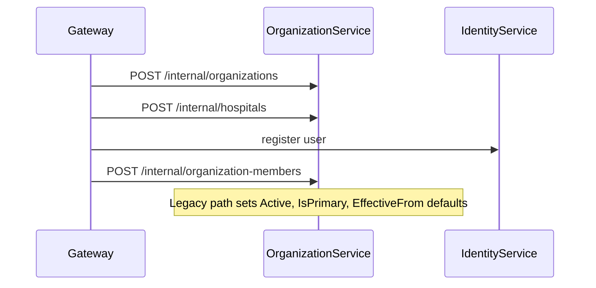
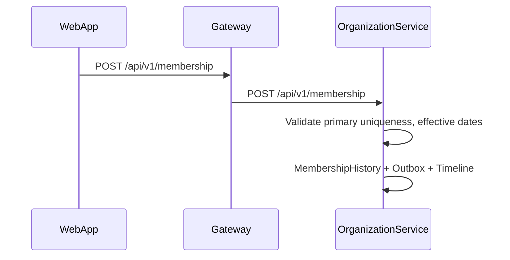
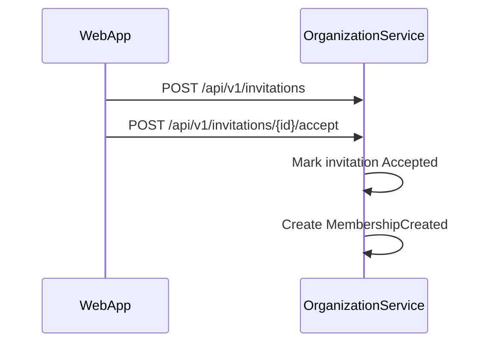

# Organization API Flows (EIWAM Phase 4)

| Field | Value |
|-------|-------|
| **Status** | Implemented — Organization & Membership Evolution |
| **Service** | `OrganizationService` |
| **Gateway** | `ProxyToOrganizationServiceAsync` |

## Platform position

```
Identity → Person → Workforce → Professional → AccessGovernance → Governance
                    ↑ Employment hospital/dept assignments (Workforce owns)
OrganizationService → membership + org structure (canonical)
```

---

## 1. Signup / onboarding membership



---

## 2. Enterprise membership create



---

## 3. Invitation accept



---

## 4. Organization tree

`GET /api/v1/organizations/tree?organizationId=` returns Organization → Hospitals → OrganizationalUnits.

---

## 5. Auth context (JWT)

`GET /internal/users/{userId}/auth-context?organizationId=` resolves **primary active** membership (not first CreatedAt).

---

## Workforce boundary

Department/hospital **assignments** for employed staff: query WorkforceService `/api/v1/employment` — not duplicated in OrganizationService.

See [`WORKFORCE_DOMAIN_MODEL.md`](./WORKFORCE_DOMAIN_MODEL.md).
