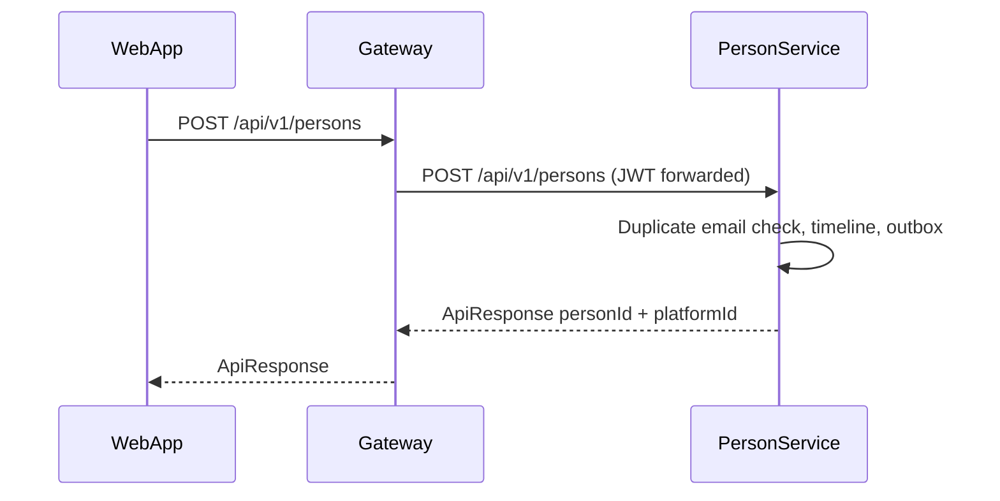
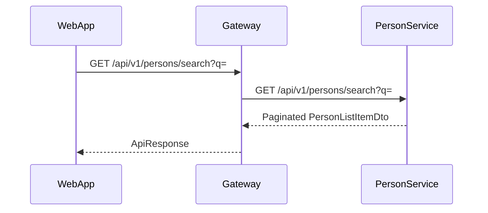
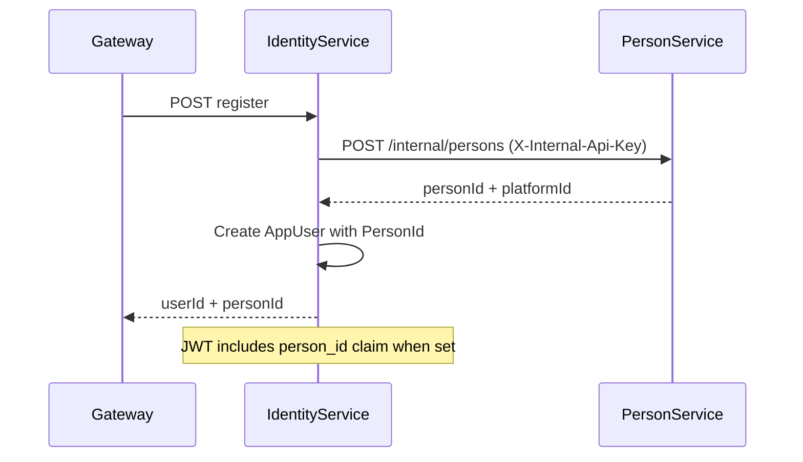

# Person API flows (M6.1)

Canonical human identity lives in **PersonService**. **IdentityService** holds authentication (`AppUser`) linked via `AppUser.PersonId`. The Gateway proxies public Person APIs; Identity calls internal Person endpoints during registration.

## Create person (admin)

## Search directory

## Registration link (new user)

## Backfill (existing users)

On IdentityService startup, `PersonIdBackfillHostedService` creates minimal Person records for `AppUser` rows where `PersonId` is null (best effort, batch of 100).

## Internal vs public

| Surface | Auth | Routes |
|---------|------|--------|
| Public | JWT `[Authorize]` | `/api/v1/persons/*` via Gateway |
| Internal | `InternalOnly` + `X-Internal-Api-Key` | `/internal/persons` on PersonService |

## Related

- [PERSON_DOMAIN_MODEL.md](./PERSON_DOMAIN_MODEL.md)
- [user-module-gap-analysis.md](./user-module-gap-analysis.md)
