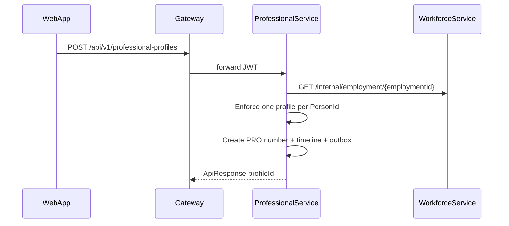
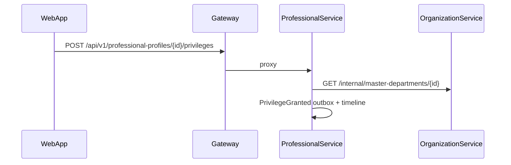

# Professional API flows (M6.3)

Canonical professional credentials live in **ProfessionalService**. Person identity stays in PersonService; employment participation in WorkforceService.

## Create professional profile

## Grant clinical privilege

## Renewal dashboard

`GET /api/v1/professional-profiles/renewals?withinDays=90` aggregates expiring registrations, licenses, and certifications.

## Related

- [PROFESSIONAL_DOMAIN_MODEL.md](./PROFESSIONAL_DOMAIN_MODEL.md)
- [WORKFORCE_DOMAIN_MODEL.md](./WORKFORCE_DOMAIN_MODEL.md)
