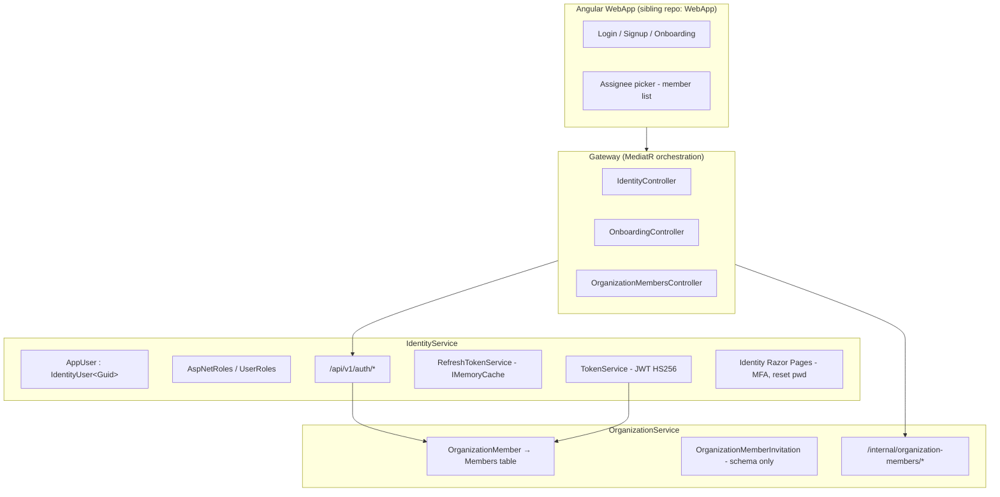
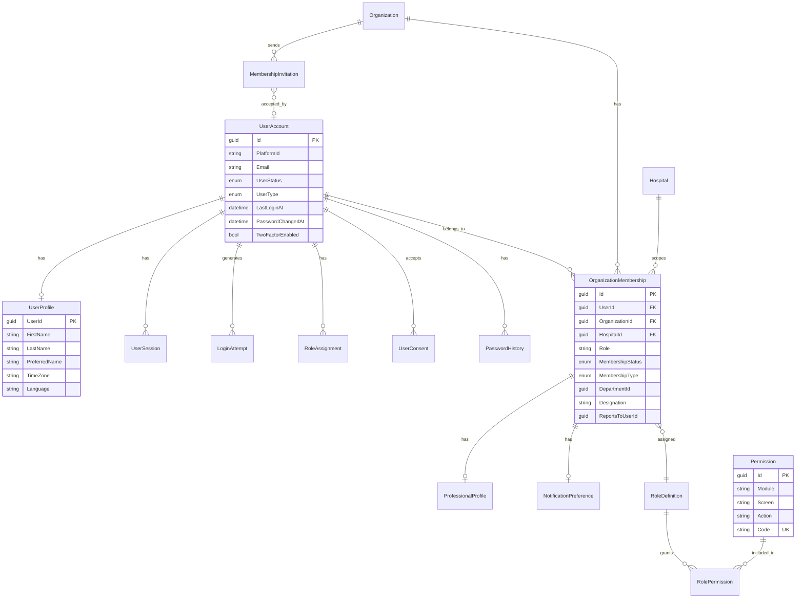

# PRAMAN User Module — Architectural Investigation & Gap Analysis

| Field | Value |
|-------|-------|
| **Status** | Implemented — M6.0 Identity Security Foundation (2026-07-06) |
| **Date** | 2026-07-06 |
| **Scope** | IdentityService, OrganizationService, Gateway, Shared.Infrastructure, Shared.Logging, Angular WebApp |
| **Audience** | Principal architects, backend/frontend leads, security/compliance reviewers |

**M6.0 implementation (2026-07-06):** Identity Security Foundation delivered in `IdentityService` — application-layer auth services, SQL-backed `UserSessions`, extended JWT claims, MFA/password/session REST APIs, `IdentityAuditLogs`, Gateway proxies, and WebApp auth pages (`/login/mfa`, `/verify-email`, `/app/account/security`).

**M6.1 implementation (2026-07-06):** Enterprise Person & Profile Foundation — new `PersonService` microservice (canonical `Person` aggregate, master data, timeline/audit), `AppUser.PersonId` linkage, Gateway `/api/v1/persons` proxy, Angular Person Directory at `/app/persons`. Phase 2.1 `UserProfile` on `AppUser` is **superseded** by PersonService; denormalized `OrganizationMember` names remain until M6.2.

**M6.2 implementation (2026-07-06):** Enterprise Workforce Foundation — new `WorkforceService` (`Employment` aggregate, position/department/manager assignments, transfer/promote, org chart), `OrganizationMember.PersonId` link, Gateway `/api/v1/employment` proxy, Angular Workforce at `/app/workforce`.

**M6.3 implementation (2026-07-06):** Professional Registry & Credentialing Foundation — new `ProfessionalService` (`ProfessionalProfile` aggregate, qualifications/registrations/licenses/certifications, clinical privileges, credentialing lifecycle), one profile per Person anchored to Employment, Gateway `/api/v1/professional-profiles` proxy, Angular Professional at `/app/professional`. Supersedes org-scoped `ProfessionalProfile` on OrganizationMember.

**M6.4 implementation (2026-07-06):** Enterprise Access Governance & Authorization Foundation — new `AccessGovernanceService` (RBAC, ABAC policies, delegations, responsibilities, approval authorities, explainable `AuthorizationEvaluator`), `Shared.Authorization` SDK (`IAuthorizationEvaluator`), Identity JWT context claims (`employment_id`, `professional_profile_id`), Gateway proxy for `/api/v1/roles|permissions|policies|delegations|responsibilities|approval-authorities|authorization`, Angular Access Governance at `/app/access-governance`. Authentication remains in Identity; authorization decisions are runtime-evaluated (not embedded in JWT).

**M6.5 implementation (2026-07-06):** Enterprise Governance & Responsibility Framework — new `GovernanceService` (canonical `Responsibility`, `GovernanceAssignment`, `Committee`, `ApprovalChain`, `EscalationChain` aggregates; approval/escalation engines; timeline + outbox), `Shared.Governance` SDK (`IGovernanceClient`, `IApprovalWorkflowEvaluator`, `IEscalationResolver`), Gateway proxy for `/api/v1/responsibilities|committees|governance/*`, Angular Governance at `/app/governance`. M6.4 `ResponsibilityAssignments` table is **read-only/deprecated**; all new responsibility writes go through GovernanceService. ComplianceService ownership migration documented in [GOVERNANCE_DOMAIN_MODEL.md](./GOVERNANCE_DOMAIN_MODEL.md) — no Compliance code changes in M6.5.

**EIWAM Phase 5 (2026-07-06):** Identity & Access Governance evolution — extends M6.4 in place (no new IAM service). Delivered: [ACCESS_GOVERNANCE_GAP_ANALYSIS.md](./ACCESS_GOVERNANCE_GAP_ANALYSIS.md), updated [ACCESS_GOVERNANCE_DOMAIN_MODEL.md](./ACCESS_GOVERNANCE_DOMAIN_MODEL.md), `Shared.Authorization` ASP.NET handler (`RequirePermission`, `PermissionAuthorizationHandler`), Gateway + ComplianceService `AddPramanAuthorization()`, deepened evaluator (scoped RBAC, inherited roles, ABAC operators, RLS, evaluation trace, effective permissions union), `POST /role-assignments`, policy get/update/archive, outbox writes, `IOrganizationServiceClient`, Compliance evidence verify pilot, Angular `permissionGuard` + assignment UI, 14 authorization tests. See [module-authorization-adoption-playbook.md](./module-authorization-adoption-playbook.md).

**EIWAM Phase 4 implementation (2026-07-07):** Organization & Membership Evolution — evolved `OrganizationService` (temporal `OrganizationMember`, `OrganizationalUnit` hierarchy, org-scoped `Department` tree, invitations, timeline/outbox), Gateway proxy for `/api/v1/membership|organizations/tree|departments/tree|organization/graph|invitations`, Angular Organization at `/app/organization`. Workforce-owned employment/hospital/department assignments unchanged. See [ORGANIZATION_DOMAIN_MODEL.md](./ORGANIZATION_DOMAIN_MODEL.md) and [organization-api-flows.md](./organization-api-flows.md).


PRAMAN is an AI-powered Enterprise Healthcare Governance, Compliance, Accreditation, and Operational Intelligence Platform. Every user action must be **secure, traceable, auditable, and permission-driven**. Users may belong to multiple organizations in future deployments spanning NABH, JCI, NABL, ISO, CAP, multiple countries, hospital chains, and enterprise customers.

This document captures a **codebase-backed audit** of the existing User module and a structured gap analysis with recommended domain model and implementation roadmap. Recommendations favor **extensibility and backward compatibility** over disruptive redesign.

**Related docs**

- [Organization member invitations (schema)](../organization-member-invitations.md)
- [Onboarding wizard rules](../onboarding-wizard-rules.md)
- [Backend API inventory](../backend-api-inventory.md)
- [API response standardization](../API-Response-Standardization.md)

---

## Table of contents

1. [Current Architecture](#section-1--current-architecture)
2. [Strengths](#section-2--strengths)
3. [Weaknesses](#section-3--weaknesses)
4. [Missing Features](#section-4--missing-features)
5. [Missing Domain Objects](#section-5--missing-domain-objects)
6. [Missing APIs](#section-6--missing-apis)
7. [Missing Database Columns](#section-7--missing-database-columns)
8. [Missing UI Pages](#section-8--missing-ui-pages)
9. [Security Recommendations](#section-9--security-recommendations)
10. [Recommended Domain Model](#section-10--recommended-domain-model)
11. [Implementation Roadmap](#section-11--implementation-roadmap)
12. [Appendix — Investigation Area Summary](#appendix--investigation-area-summary)

---

## Section 1 — Current Architecture

### 1.1 High-level topology

User concerns are **split across three bounded areas**, not a single User module:



| Layer | Responsibility | Key artifacts |
|-------|----------------|---------------|
| **Identity (credentials)** | Authentication, global roles, JWT | `AppUser`, ASP.NET Identity tables, `AuthController` |
| **Organization (membership + profile copy)** | Org-scoped role, profile, hierarchy | `OrganizationMember`, `OrganizationMemberAppService` |
| **Gateway (orchestration)** | Signup wizard, proxy auth, member CRUD | `SignupCommandHandler`, `OnboardWizardCommandHandler` |

There is **no `UserService` microservice**, **no User aggregate**, and **no DDD domain events** for users (unlike `ComplianceService`).

### 1.2 Domain model (as implemented)

#### `AppUser` — Identity aggregate (thin)

**File:** `IdentityService/Domain/AppUser.cs`

```csharp
public class AppUser : IdentityUser<Guid>
{
    public string PlatformId { get; set; } = string.Empty;
}
```

Inherits all ASP.NET Identity fields: `Email`, `PasswordHash`, `PhoneNumber`, `TwoFactorEnabled`, `LockoutEnd`, `AccessFailedCount`, etc. Only **one custom field**: `PlatformId`.

#### `OrganizationMember` — Org membership + denormalized profile

**File:** `Shared.Infrastructure/Domain/OrganizationMember.cs`

| Field | Type | Notes |
|-------|------|-------|
| `OrganizationId`, `UserId` | `Guid` | Logical link to Identity user (no DB FK) |
| `DepartmentId` | `Guid?` | Master department context |
| `Designation` | `string?` | Operational title (Sprint 9B) |
| `ReportsToUserId` | `Guid?` | Escalation hierarchy |
| `Role` | `string` | Org-scoped canonical role |
| `FirstName`, `LastName`, `Email` | `string?` | Denormalized profile |
| `PhoneNumber`, `AlternatePhoneNumber` | `string?` | Contact |
| `ProfilePicUrl` | `string?` | Avatar URL |
| `Preferences` | `string?` | Opaque JSON string |

Inherits `BaseEntity`: `Id`, `RowVersion`, `CreatedAt` only.

#### `OrganizationMemberInvitation` — Schema only (no API/service)

Pending invite model with `InvitationStatus` enum (`Pending`, `Accepted`, `Expired`, `Revoked`). Documented in [organization-member-invitations.md](../organization-member-invitations.md) but **not wired** to application services or APIs.

### 1.3 Roles and authorization

**Global roles** (11 canonical names in `Shared.Infrastructure/Auth/ApplicationRoles.cs`):

`USER`, `ORG_ADMIN`, `GROUP_ADMIN`, `SUPER_ADMIN`, `REGULATORY_ADMIN`, `COMPLIANCE_VIEWER`, `AUTHORITY`, `REGULATOR`, `MANAGER`, `SYSTEM`, `EXTERNAL_AUDITOR`

**Dual-role model:**

- **Identity role** → JWT `ClaimTypes.Role` (platform-wide)
- **Org member role** → `OrganizationMember.Role` (org-scoped, stored separately)

These are **not automatically synchronized** when one changes.

**Authorization model:** Role-based + JWT API scopes (`compliance.api`, `organization.api`, `audit.api`, `ai.api`). **No permission entity or catalog.**

### 1.4 Authentication flow

| Capability | Implementation |
|------------|----------------|
| JWT access token | HS256, 60 min default; claims: sub, email, roles, `organization_id`, `hospital_id`, `scope`, `jti` |
| Refresh token | Opaque string in `IMemoryCache`, 7-day TTL, **not rotated** |
| Login | `POST /api/v1/auth/login` with rate limiting + `IAuditLogger` |
| Logout | Revokes single refresh token; **no access-token blacklist from Identity** |
| MFA | `TwoFactorEnabled` field + Razor Pages only; **REST login bypasses 2FA** |
| SSO/OIDC | Duende IdentityServer scaffolded; product path uses custom JWT |
| Org context in JWT | First membership by `CreatedAt` + first hospital in org |

### 1.5 User lifecycle (as implemented)

| Stage | Status |
|-------|--------|
| Registration | ✅ Public API, internal API, onboarding wizard |
| Email verification | ❌ Bypassed (`EmailConfirmed = true`, `RequireConfirmedAccount = false`) |
| Invitation | ⚠️ Schema + docs only; wizard uses auto-generated passwords |
| Login / refresh | ✅ |
| Password reset/change | ⚠️ Razor Pages only |
| Suspension | ⚠️ Lockout fields exist; no explicit suspend API or `UserStatus` |
| Deletion | ✅ Internal `DELETE /internal/users/{id}` only |
| Soft delete | ❌ Hard delete only |

### 1.6 APIs (existing)

**Gateway (public):** login, refresh, register/signup, onboarding wizard, organization-members CRUD, tenant org detail.

**IdentityService:** register, login, refresh, logout, internal register/delete/token-generate, `GET /api/token/me`.

**Missing at Gateway:** logout proxy, user admin, roles, permissions, MFA, password management, sessions, bulk ops.

### 1.7 UI (Angular WebApp — sibling repo)

**Exists:** Login, signup, forgot/reset password, onboarding team invite step, header user menu (Profile/Settings are `href="#"` placeholders), assignee picker using member list.

**Missing:** User list, profile, account settings, roles/permissions admin, sessions, login history, notification preferences, digital signature.

Identity Razor Pages provide MFA/password management **outside** the Angular shell.

### 1.8 Database

| Table | Service DB | Notes |
|-------|-----------|-------|
| `AspNetUsers` + Identity junction tables | IdentityService | Standard ASP.NET Identity |
| `Members` | OrganizationService | Org membership + profile copy |
| `OrganizationMemberInvitations` | OrganizationService | Filtered unique index on pending email |
| Refresh tokens | **Not persisted** | In-memory cache |
| Permissions | **None** | — |
| Login history / sessions | **None** | — |

**Gaps:** No indexes on `Members(OrganizationId)`, `Members(UserId)`; no FK from `Members.UserId` → `AspNetUsers`; no soft delete; no temporal/history tables for users.

---

## Section 2 — Strengths

1. **Solid Identity foundation** — ASP.NET Identity provides password hashing, lockout infrastructure, 2FA scaffolding, external login schema, and role management out of the box.

2. **Canonical role naming** — `ApplicationRoles` with UPPER_SNAKE_CASE, legacy migration (`RoleLegacyMap`), and seeded roles reduce drift.

3. **Gateway orchestration pattern** — Signup/onboarding correctly orchestrates org + hospital + user + member + token in one flow via MediatR.

4. **Org-scoped membership model** — `OrganizationMember` separates identity from org context and includes hierarchy fields (`Designation`, `ReportsToUserId`, `DepartmentId`).

5. **Invitation schema readiness** — `OrganizationMemberInvitation` with filtered unique index and `InvitationStatus` is a sound foundation for email invites.

6. **Structured security audit logging** — `IAuditLogger` emits tamper-evident CLEF events for register/login/logout/token operations with `EventCode` constants.

7. **Standardized API responses on auth** — `AuthController` uses `ApiResponse<T>` envelope and `ApiResponseCode`.

8. **Multi-tenant JWT claims** — `organization_id` and `hospital_id` embedded in token; `OrganizationAccessHandler` enforces tenant isolation at Gateway.

9. **Rate limiting on auth endpoints** — `LoginPolicy` on register/login reduces brute-force surface.

10. **Extensible preferences hook** — `OrganizationMember.Preferences` as JSON allows incremental preference modeling without immediate schema churn (though untyped today).

---

## Section 3 — Weaknesses

1. **No unified User domain model** — User identity is a 1-field extension of `IdentityUser`; profile data is duplicated per org on `OrganizationMember`.

2. **Split-brain roles** — Identity global role vs org member role can diverge with no sync mechanism.

3. **Non-persistent, non-distributed refresh tokens** — `IMemoryCache` breaks multi-instance deployment and loses tokens on restart.

4. **Lockout not enforced on failed login** — Login uses `CheckPasswordAsync` without `AccessFailedAsync`, so failed attempts likely **do not increment** `AccessFailedCount`.

5. **MFA disconnected from product API** — REST login never challenges 2FA; enterprise MFA is unusable from Angular.

6. **Email verification disabled** — All users auto-confirmed; invitation flow not implemented despite schema.

7. **Single-org JWT context** — Multi-org users get only first membership; no org switcher or multi-membership claims.

8. **No permission system** — Enterprise RBAC requires module/screen/action/API/field/row-level controls; only coarse roles + scopes exist.

9. **Minimal audit on user entities** — No `CreatedBy`/`UpdatedBy`; auth audit is file-based CLEF only, not queryable DB audit with old/new values.

10. **No user admin surface** — Neither backend public APIs nor Angular UI for user lifecycle management post-onboarding.

11. **Anemic domain** — No aggregates, value objects, domain events, or outbox for user changes (inconsistent with ComplianceService DDD patterns).

12. **Security gaps** — No PII encryption, no GDPR/HIPAA consent tracking, no session/device tracking; `TenantController` lacks `[Authorize]`.

13. **Public register omits `PlatformId`** — Internal register generates `USR-*`; public `AuthController.Register` leaves it empty.

---

## Section 4 — Missing Features

### Critical

| Feature | Current state |
|---------|---------------|
| Persistent refresh token store (Redis/DB) with rotation | In-memory only |
| Fix account lockout increment on failed login | Check exists; increment broken |
| Email invitation flow (create invite → email → accept) | Schema only |
| User status lifecycle (`Active`, `Suspended`, `Archived`) | No enum or API |
| MFA via REST API integrated with Angular login | Razor only |
| Identity ↔ Org role synchronization | Manual/divergent |
| Multi-org membership resolution in JWT | First org only |
| Queryable user audit trail (who/when/old/new) | File logs only |
| Gateway logout + token revocation pipeline | Logout not proxied; blacklist unused |
| User suspend/deactivate API | Lockout only, no admin API |

### High

| Feature | Current state |
|---------|---------------|
| Fine-grained permission model (RBAC + policy engine) | Roles + scopes only |
| Password reset/change REST APIs | Razor Pages |
| Email verification flow | Disabled |
| Session management (list/revoke all) | None |
| Login history (IP, user-agent, device) | Audit log only, no query API |
| User CRUD admin APIs (list, update, soft-delete) | Internal delete only |
| Org member delete API | Missing |
| DB indexes on `Members` | PK only |
| `UpdatedAt` / `UpdatedBy` on user-related entities | Missing |
| Notification preference model | Opaque JSON, no schema |
| Consent/compliance tracking (Terms, Privacy, HIPAA) | None |

### Medium

| Feature | Current state |
|---------|---------------|
| Custom org roles | Fixed canonical set only |
| Temporary / time-bound role assignments | None |
| Role assignment history | None |
| Professional profile (qualifications, licenses) | None |
| Global user profile separate from org membership | Profile duplicated on member |
| Bulk user import/update/delete | Wizard batch invite only |
| Device tracking / trusted devices | None |
| Password history enforcement | None |
| Field-level / row-level security framework | None |
| Digital signature capture | None |
| User type taxonomy (Doctor, Auditor, Vendor, etc.) | Roles only, no `UserType` |
| API keys for user/service accounts | Internal API key for Compliance only |
| Impersonation (support/admin) | None |

### Low

| Feature | Current state |
|---------|---------------|
| SSO / Azure AD / Google OAuth (productized) | IdentityServer scaffold |
| Magic link login | None |
| WhatsApp / Teams / Slack notification channels | None |
| White-label theming per org | Header theme toggle only |
| Temporal tables for user history | None |
| Patient user type (future) | None |
| AI agent service accounts | `SYSTEM` role exists |

---

## Section 5 — Missing Domain Objects

### Recommended new entities / value objects

| Object | Purpose | Location |
|--------|---------|----------|
| **`UserAccount`** (extend `AppUser`) | Platform identity root: status, last login, password metadata | IdentityService |
| **`UserProfile`** | Global personal info (name, DOB, timezone, language) | IdentityService |
| **`OrganizationMembership`** (evolve `OrganizationMember`) | Org context: role, department, designation, status | OrganizationService |
| **`MembershipInvitation`** | Wire existing `OrganizationMemberInvitation` | OrganizationService |
| **`RoleDefinition`** | Metadata for system/org/custom roles | Shared or IdentityService |
| **`RoleAssignment`** | User ↔ Role with expiry, scope (global vs org) | IdentityService + OrganizationService |
| **`Permission`** | Atomic capability (module.screen.action) | New permissions module |
| **`RolePermission`** / **`MembershipPermission`** | Permission grants | Permissions module |
| **`UserSession`** | Refresh token, device, IP, last active | IdentityService |
| **`LoginAttempt`** | Failed/successful login audit record | IdentityService |
| **`UserConsent`** | Terms, privacy, HIPAA acceptance | IdentityService |
| **`NotificationPreference`** | Channel + frequency + quiet hours | OrganizationService or User module |
| **`ProfessionalProfile`** | Qualifications, registration numbers, specialization | OrganizationService (org-scoped) |
| **`UserPreference`** | Theme, dashboard, AI settings | Value object or separate table |
| **`DigitalSignature`** | Signature image/hash + date | Compliance or User module |
| **`PasswordHistory`** | Prevent password reuse | IdentityService |
| **`TrustedDevice`** | MFA bypass / device trust | IdentityService |

### Value objects (recommended)

- `PersonName` (First, Middle, Last, Preferred, Display)
- `EmailAddress`, `PhoneNumber`
- `Address` (Country, State, City, Postal)
- `EmploymentInfo` (EmployeeId, JoiningDate, EmploymentType)
- `UserStatus` enum
- `MembershipStatus` enum
- `UserType` enum (orthogonal to Role)

### What stays on Identity vs extracted

| Concern | Recommendation |
|---------|----------------|
| Credentials, lockout, 2FA secrets | Stay on `AppUser` / Identity |
| Personal profile (global) | Extract to `UserProfile` |
| Org-specific professional data | Stay on `OrganizationMembership` |
| Preferences | Extract typed `UserPreference` + `NotificationPreference` |
| Roles (global) | Identity `AspNetRoles` + new `RoleAssignment` for history/expiry |
| Roles (org) | `OrganizationMembership.Role` + optional custom org roles |
| Permissions | New `Permission` aggregate — not on User |

---

## Section 6 — Missing APIs

### Identity / user admin

| Endpoint | Priority |
|----------|----------|
| `GET /api/v1/users` (paginated, filterable) | Critical |
| `GET /api/v1/users/{id}` | Critical |
| `PUT /api/v1/users/{id}/profile` | High |
| `POST /api/v1/users/invite` | Critical |
| `POST /api/v1/users/{id}/activate` | Critical |
| `POST /api/v1/users/{id}/suspend` | Critical |
| `POST /api/v1/users/{id}/unlock` | Critical |
| `DELETE /api/v1/users/{id}` (soft) | High |
| `POST /api/v1/auth/forgot-password` | Critical |
| `POST /api/v1/auth/reset-password` | Critical |
| `PUT /api/v1/auth/change-password` | Critical |
| `POST /api/v1/auth/logout` (Gateway proxy) | Critical |
| `POST /api/v1/auth/logout-all` | High |

### MFA

| Endpoint | Priority |
|----------|----------|
| `POST /api/v1/auth/mfa/setup` | Critical |
| `POST /api/v1/auth/mfa/verify` | Critical |
| `POST /api/v1/auth/mfa/disable` | High |
| `GET /api/v1/auth/mfa/recovery-codes` | High |
| `POST /api/v1/auth/login/mfa` (2-step login) | Critical |

### Roles and permissions

| Endpoint | Priority |
|----------|----------|
| `GET /api/v1/roles` | High |
| `POST /api/v1/users/{id}/roles` | High |
| `DELETE /api/v1/users/{id}/roles/{roleId}` | High |
| `GET /api/v1/permissions` | Medium |
| `POST /api/v1/roles/{id}/permissions` | Medium |

### Sessions and audit

| Endpoint | Priority |
|----------|----------|
| `GET /api/v1/users/{id}/sessions` | High |
| `DELETE /api/v1/users/{id}/sessions/{sessionId}` | High |
| `GET /api/v1/users/{id}/login-history` | High |
| `GET /api/v1/users/{id}/audit-trail` | Medium |

### Organization membership

| Endpoint | Priority |
|----------|----------|
| `DELETE /api/v1/organization-members/{id}` | High |
| `GET /api/v1/users/{id}/memberships` | Critical |
| `POST /api/v1/users/{id}/memberships` (multi-org) | Critical |
| `PUT /api/v1/users/{id}/switch-organization` | Critical |
| `POST /api/v1/invitations` | Critical |
| `POST /api/v1/invitations/{token}/accept` | Critical |

### Preferences and profile

| Endpoint | Priority |
|----------|----------|
| `PUT /api/v1/users/{id}/avatar` | Medium |
| `GET/PUT /api/v1/users/{id}/notification-preferences` | High |
| `GET/PUT /api/v1/users/{id}/preferences` | Medium |
| `POST /api/v1/users/{id}/consents` | High |

### Bulk operations

| Endpoint | Priority |
|----------|----------|
| `POST /api/v1/users/import` | Medium |
| `POST /api/v1/users/bulk-update` | Medium |
| `POST /api/v1/users/bulk-deactivate` | Medium |
| `GET /api/v1/users/export` | Low |

---

## Section 7 — Missing Database Columns

### `AspNetUsers` / `UserAccount` extensions

| Column | Purpose |
|--------|---------|
| `Status` (int/enum) | Active, Suspended, Archived, PendingVerification |
| `UserType` (int/enum) | Platform Admin, Doctor, Auditor, Vendor, etc. |
| `LastLoginAt` | Security dashboard |
| `LastFailedLoginAt` | Security monitoring |
| `PasswordChangedAt` | Force password change |
| `PasswordResetRequired` (bit) | Admin-initiated reset |
| `ForcePasswordChange` (bit) | Next-login prompt |
| `PreferredLanguage` | i18n |
| `TimeZone` | Scheduling |
| `CreatedAt`, `UpdatedAt` | Audit |
| `CreatedBy`, `UpdatedBy` | Audit |
| `IsDeleted`, `DeletedAt`, `DeletedBy` | Soft delete |
| `ConsentAcceptedAt` | Compliance |
| `TermsAcceptedAt`, `PrivacyAcceptedAt` | Compliance |

*Note: Some security fields exist implicitly via Identity (`LockoutEnd`, `AccessFailedCount`, `TwoFactorEnabled`) but are not exposed through APIs.*

### New table: `UserProfiles`

| Column | Purpose |
|--------|---------|
| `UserId` (PK/FK) | 1:1 with AspNetUsers |
| `FirstName`, `MiddleName`, `LastName` | Personal |
| `PreferredName`, `DisplayName` | UX |
| `Gender`, `DateOfBirth` | Demographics |
| `ProfilePhotoUrl` | Avatar |
| `AddressLine1/2`, `City`, `State`, `Country`, `PostalCode` | Address |
| `EmergencyContactName`, `EmergencyContactPhone` | Safety |

### `Members` / `OrganizationMembership` extensions

| Column | Purpose |
|--------|---------|
| `Status` (enum) | Active, Suspended, Removed |
| `JoinedAt`, `RemovedAt` | Lifecycle |
| `EmployeeId`, `RegistrationNumber` | Professional |
| `Qualification`, `Specialization` | Professional |
| `EmploymentType` | Full-time, Consultant, etc. |
| `HospitalId` | Per-hospital assignment (currently org-only) |
| `MembershipType` | Employee, Vendor, Auditor, Consultant |
| `UpdatedAt`, `UpdatedBy` | Audit |
| `IsDeleted`, `DeletedAt` | Soft delete |

### New tables

| Table | Purpose |
|-------|---------|
| `UserSessions` | Refresh tokens, device, IP, user-agent |
| `LoginAttempts` | Login audit |
| `UserConsents` | Consent history |
| `NotificationPreferences` | Typed notification settings |
| `RoleAssignments` | Role history with expiry |
| `Permissions` | Permission catalog |
| `RolePermissions` | Role ↔ Permission |
| `PasswordHistory` | Password reuse prevention |
| `UserAuditLog` | Entity change tracking |

### Recommended indexes

```sql
-- Members
IX_Members_OrganizationId
IX_Members_UserId
IX_Members_OrganizationId_UserId (unique)
IX_Members_Email_OrganizationId

-- UserSessions
IX_UserSessions_UserId
IX_UserSessions_RefreshTokenHash (unique)

-- LoginAttempts
IX_LoginAttempts_UserId_CreatedAt
IX_LoginAttempts_Email_CreatedAt
```

---

## Section 8 — Missing UI Pages

| Page | Priority | Notes |
|------|----------|-------|
| **User List / Directory** | Critical | Admin view with filters, status, roles |
| **User Detail** | Critical | View/edit single user |
| **Profile (self-service)** | Critical | Header links are placeholders today |
| **Account Settings** | Critical | Password, email, MFA |
| **Security Settings** | Critical | MFA setup, recovery codes, sessions |
| **Professional Details** | High | Designation, department, qualifications |
| **Organization Membership** | Critical | Multi-org view, switch org |
| **Roles & Permissions** | High | Admin assignment UI |
| **Team Management** | High | Post-onboarding invite/manage |
| **Invitation Accept** | Critical | Token-based invite landing page |
| **Activity Timeline** | Medium | User action history |
| **Sessions / Devices** | High | Active sessions, revoke |
| **Login History** | High | Failed/success attempts |
| **Notification Preferences** | High | Email, SMS, push, digest, quiet hours |
| **AI Settings** | Medium | AI assistant preferences |
| **Digital Signature** | Medium | Capture/manage signature |
| **Consent Management** | High | Terms, privacy, HIPAA |
| **Bulk Import** | Medium | CSV upload for users |
| **Audit History** | Medium | Admin view of user changes |

**Existing partial UI:** Login, signup, onboarding team invite, assignee picker, role guards/labels, CCC "Access Accountability" stub.

---

## Section 9 — Security Recommendations

### Immediate (Phase 1)

1. **Fix lockout enforcement** — On failed password, call `AccessFailedAsync`; reset on success via `ResetAccessFailedCountAsync`.
2. **Persist refresh tokens** — Move to Redis or SQL with rotation, family tracking, and revoke-all support.
3. **Wire MFA into REST login** — Two-step flow: credentials → MFA challenge → token issuance.
4. **Enable real email verification** — Set `RequireConfirmedAccount = true` for production; implement verification token API.
5. **Proxy logout through Gateway** — Revoke refresh token + blacklist JWT `jti` via shared `TokenBlacklistService`.
6. **Add `[Authorize]` to `TenantController`** — Currently unauthenticated org detail exposure.
7. **Synchronize Identity ↔ Org roles** — On membership role change, update Identity role or document explicit dual-model rules.
8. **Generate `PlatformId` on all registration paths** — Public register must use `PlatformSequence`.

### Short-term (Phase 2–3)

9. **Encrypt sensitive PII at rest** — Phone, DOB, emergency contact using field-level encryption or Always Encrypted.
10. **Implement `UserStatus` with admin APIs** — Explicit suspend vs lockout distinction.
11. **Password history** — Store last N hashes; enforce on change.
12. **Session/device tracking** — IP, user-agent, geo on login; anomaly detection hooks.
13. **Queryable audit store** — Extend `IAuditLogger` to durable DB with old/new values for user mutations.
14. **Consent tracking** — Terms, privacy, HIPAA with versioned acceptance records.
15. **Rate limit** all auth endpoints consistently (refresh, forgot-password when added).

### Long-term (Phase 4)

16. **Enterprise SSO** — Azure AD / OIDC as primary IdP with JIT provisioning.
17. **Permission engine** — Policy-based authorization (`IAuthorizationHandler`) backed by permission catalog.
18. **Row-level security** — Org/hospital/department scoping in queries (partially exists via JWT claims).
19. **GDPR tooling** — Data export, right-to-erasure, retention policies.
20. **Impersonation** — Audited admin impersonation with time limits.
21. **API key management** — Per-user/per-service keys with scopes and rotation.

---

## Section 10 — Recommended Domain Model

### Target architecture (evolutionary, backward-compatible)



### Aggregate boundaries (recommended)

| Aggregate | Root | Consistency boundary |
|-----------|------|---------------------|
| **UserAccount** | `UserAccount` (`AppUser` evolution) | Credentials, status, global roles, sessions |
| **UserProfile** | `UserProfile` | Personal info (1:1 with account) |
| **OrganizationMembership** | `OrganizationMembership` | Org role, dept, professional info, org preferences |
| **MembershipInvitation** | `MembershipInvitation` | Invite lifecycle |
| **PermissionCatalog** | `Permission` | Static/semi-static permission definitions |
| **RoleDefinition** | `RoleDefinition` | Role metadata + permission mappings |

### User profile separation — recommendation

**Yes, extract `UserProfile` from `OrganizationMember`.**

| Data | Location | Rationale |
|------|----------|-----------|
| Name, photo, timezone, language | `UserProfile` (global) | Same across orgs |
| Designation, department, reports-to | `OrganizationMembership` | Org/hospital-specific |
| Role | Both layers | Global platform role vs org operational role |
| Notification prefs | `NotificationPreference` per membership (or global + override) | Escalation rules are org-specific |
| AI/theme/dashboard prefs | `UserPreference` (global with org override) | UX vs compliance context |

This supports future multi-org users without duplicating personal data.

### User type vs role — recommendation

Introduce **`UserType`** (what they *are*) orthogonal to **`Role`** (what they *can do*):

- **UserType:** Doctor, Nurse, Auditor, Vendor, Consultant, PlatformAdmin
- **Role:** ORG_ADMIN, COMPLIANCE_VIEWER, EXTERNAL_AUDITOR (capability bundles)

A Doctor may have role USER; a Consultant may have EXTERNAL_AUDITOR. UserType drives UI/workflow defaults; Role drives authorization.

### Organization membership — recommendation

**Keep separation:** `UserAccount` (identity) ≠ `OrganizationMembership` (tenant context).

Support:

- Multiple memberships per user
- `MembershipType`: Employee, Vendor, Auditor, Consultant, AccreditationBody
- JWT carries **active** org/hospital; org-switch API re-issues token
- `organization_id` claim remains single-active-org (extend, don't break)

### Strategic alignment

PRAMAN's ComplianceService demonstrates mature DDD (aggregates, state machines, outbox, domain events). The User module **does not yet match that maturity**. The recommended path is **evolutionary extension**:

1. Keep ASP.NET Identity as the credential store.
2. Elevate `AppUser` with status, audit, and profile extraction.
3. Strengthen `OrganizationMembership` for multi-tenant enterprise scenarios.
4. Introduce permissions as a parallel concern (similar to framework policies via `IFrameworkJourneyPolicy`).
5. Align user mutations with outbox/domain events when cross-service notification is needed.

---

## Section 11 — Implementation Roadmap

### Phase 1 — Critical security and identity (4–6 weeks)

**Goal:** Production-safe authentication and basic user lifecycle.

| # | Work item | Touches |
|---|-----------|---------|
| 1.1 | Fix lockout increment on failed login | `AuthController` |
| 1.2 | Persistent refresh tokens (Redis) + rotation | `RefreshTokenService`, new `UserSession` entity |
| 1.3 | Gateway logout proxy + JWT blacklist integration | Gateway, Identity, Compliance `TokenBlacklistService` |
| 1.4 | MFA REST API + Angular login 2-step flow | IdentityService, WebApp |
| 1.5 | Password reset/change REST APIs | IdentityService, Gateway, WebApp |
| 1.6 | `UserStatus` enum + suspend/activate/unlock APIs | `AppUser` extension, new endpoints |
| 1.7 | `PlatformId` on all registration paths | `AuthController` |
| 1.8 | Secure `TenantController` with authorization | Gateway |
| 1.9 | DB indexes on `Members` | OrganizationService migration |

**Exit criteria:** MFA works in Angular; tokens survive restarts; lockout works; admin can suspend users.

---

### Phase 2 — Profile, organization membership, and role enhancements (6–8 weeks)

**Goal:** Multi-org readiness and proper user admin.

| # | Work item | Touches |
|---|-----------|---------|
| 2.1 | ~~Extract `UserProfile` entity (1:1 with AppUser)~~ **→ M6.1 PersonService** (`Person` aggregate + `AppUser.PersonId`) | PersonService, IdentityService |
| 2.2 | Evolve `OrganizationMember` → `OrganizationMembership` with status, hospital, membership type | OrganizationService |
| 2.3 | Wire `OrganizationMemberInvitation` — create, email, accept APIs | OrganizationService, Gateway |
| 2.4 | Multi-org membership list + org-switch token re-issue | Identity + Org services |
| 2.5 | Identity ↔ Org role sync policy | Application service |
| 2.6 | User admin CRUD APIs + Gateway MediatR handlers | Gateway, IdentityService |
| 2.7 | Angular: User List, Profile, Account Settings, Team Management | WebApp |
| 2.8 | Email verification flow | IdentityService, mailer |
| 2.9 | `UpdatedAt`/`UpdatedBy` on user entities | Shared.Infrastructure |
| 2.10 | Soft delete for users and memberships | Identity + Org |

**Exit criteria:** Invite-by-email works; users can belong to multiple orgs; admin UI for team management.

---

### Phase 3 — Advanced permissions, notifications, and auditing (8–10 weeks)

**Goal:** Enterprise RBAC and compliance-grade traceability.

| # | Work item | Touches |
|---|-----------|---------|
| 3.1 | `Permission` catalog + `RolePermission` mapping | New module or IdentityService |
| 3.2 | Policy-based authorization handlers | Gateway + services |
| 3.3 | `NotificationPreference` typed model + API | OrganizationService |
| 3.4 | `LoginAttempt` + `UserSession` query APIs | IdentityService |
| 3.5 | Durable `UserAuditLog` (old/new values) | Shared.Logging → DB |
| 3.6 | `UserConsent` (Terms, Privacy, HIPAA) | IdentityService |
| 3.7 | `ProfessionalProfile` on membership | OrganizationService |
| 3.8 | Role assignment history with expiry | IdentityService |
| 3.9 | Angular: Permissions, Sessions, Login History, Notification Prefs | WebApp |
| 3.10 | Password history enforcement | IdentityService |
| 3.11 | Field-level permission framework (start with evidence/compliance modules) | ComplianceService integration |

**Exit criteria:** Permission-driven UI elements; queryable audit trail; notification preferences persisted.

---

### Phase 4 — Enterprise capabilities (10–14 weeks)

**Goal:** Hospital chains, multi-country, SSO, AI, white-label readiness.

| # | Work item | Touches |
|---|-----------|---------|
| 4.1 | Azure AD / OIDC SSO with JIT provisioning | IdentityService, IdentityServer config |
| 4.2 | Custom org roles + role templates per framework (NABH, JCI) | OrganizationService |
| 4.3 | Bulk user import/export | Gateway |
| 4.4 | `UserType` taxonomy + workflow defaults | Domain model |
| 4.5 | Digital signature capture | User/Compliance module |
| 4.6 | i18n user language + timezone scheduling | UserProfile, platform |
| 4.7 | AI preferences (model, tone, notification of AI actions) | AIOrchestrator + UserPreference |
| 4.8 | White-label theming per org | WebApp + org settings |
| 4.9 | API key management for integrations | IdentityService |
| 4.10 | GDPR export/erase tooling | Cross-service |
| 4.11 | Impersonation (audited) | Gateway + Identity |
| 4.12 | User domain events + outbox (align with ComplianceService patterns) | IdentityService |

**Exit criteria:** Enterprise SSO; hospital chain multi-org; framework-specific role templates; API ecosystem ready.

---

## Appendix — Investigation Area Summary

| # | Area | Verdict |
|---|------|---------|
| 1 | Domain Model | Minimal — 1 custom field on User; profile on org member |
| 2 | User Profile | Should be separate entity — currently duplicated per org |
| 3 | Roles | Global + org dual model; no custom/temporary/inherited roles |
| 4 | Permissions | Missing — roles + API scopes only |
| 5 | Org Membership | Correct separation concept; lacks multi-org/token switch |
| 6 | Authentication | JWT + in-memory refresh works for MVP; not enterprise-ready |
| 7 | User Lifecycle | Register/login only; invite/suspend/verify incomplete |
| 8 | User Types | Missing — roles conflate type and capability |
| 9 | Capabilities | Implicit in roles; no permission catalog |
| 10 | Notification Prefs | Missing — opaque JSON column only |
| 11 | Audit | Auth events logged to CLEF; no entity audit or query API |
| 12 | Security | Gaps in lockout, MFA API, PII encryption, consent |
| 13 | UI | Auth + onboarding only; no user admin module |
| 14 | API | ~15 endpoints exist; ~40+ enterprise endpoints missing |
| 15 | Database | Identity standard + Members table; missing indexes/history |
| 16 | Future Readiness | Foundation present; multi-org, SSO, permissions, i18n not ready |

---

## Key source files (audit reference)

| Path | Role |
|------|------|
| `IdentityService/Domain/AppUser.cs` | User entity |
| `IdentityService/Controllers/V1/AuthController.cs` | Auth REST API |
| `IdentityService/Services/TokenService.cs` | JWT issuance |
| `IdentityService/Services/RefreshTokenService.cs` | Refresh token cache |
| `Shared.Infrastructure/Domain/OrganizationMember.cs` | Org membership |
| `Shared.Infrastructure/Domain/OrganizationMemberInvitation.cs` | Invitation schema |
| `Shared.Infrastructure/Auth/ApplicationRoles.cs` | Canonical roles |
| `Shared.Logging/Audit/IAuditLogger.cs` | Security audit logging |
| `OrganizationService/Application/Services/OrganizationMemberAppService.cs` | Member CRUD |
| `Gateway/Controllers/IdentityController.cs` | Auth proxy |
| `Gateway/Controllers/OrganizationMembersController.cs` | Member API |

---

*Document generated from codebase inspection on 2026-07-06. Re-audit after Phase 1 completion or major Identity/Organization schema changes.*
