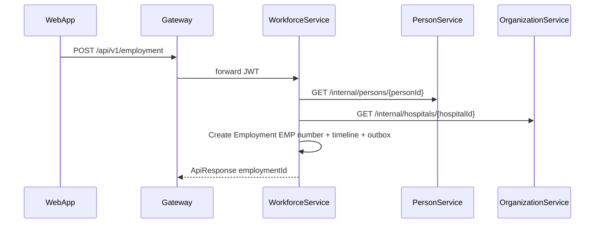
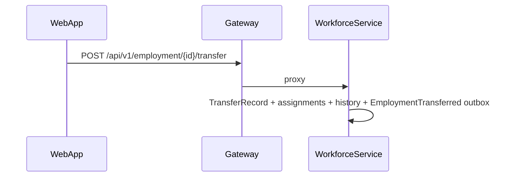

# Workforce API flows (M6.2)

Canonical employment lifecycle lives in **WorkforceService**. **PersonService** holds identity; **OrganizationService** holds org topology references.

## Create employment

## Transfer / promote

## Org chart

`GET /api/v1/employment/org-chart?organizationId=&hospitalId=` builds reporting tree from `ReportingRelationships`.

## Related

- [WORKFORCE_DOMAIN_MODEL.md](./WORKFORCE_DOMAIN_MODEL.md)
- [PERSON_DOMAIN_MODEL.md](./PERSON_DOMAIN_MODEL.md)
