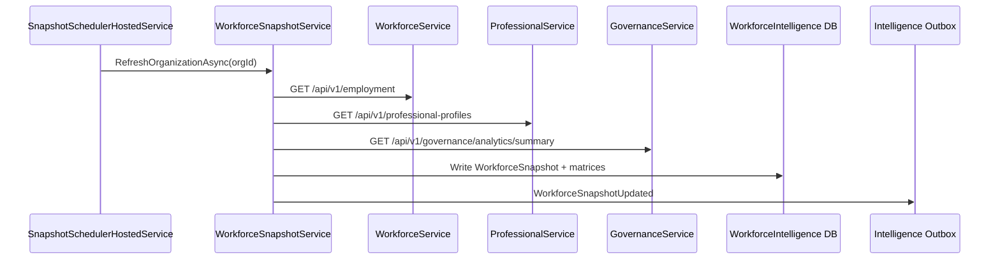
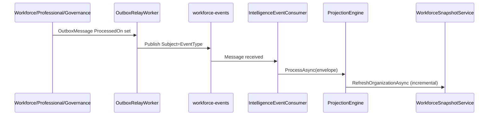
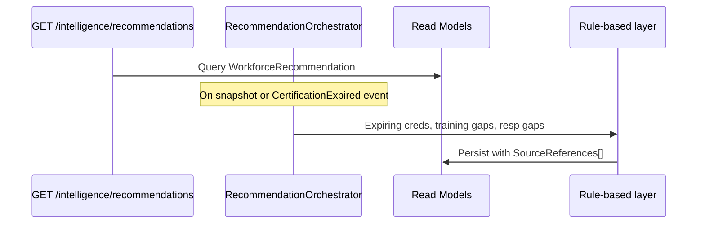
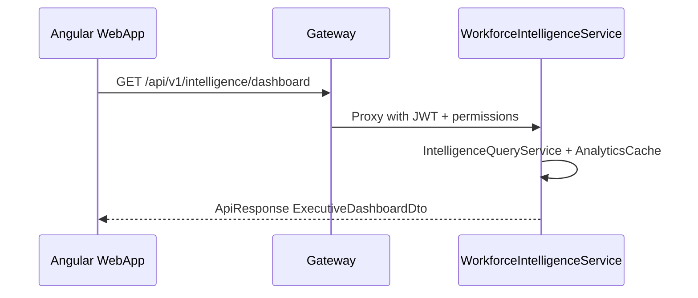

# Workforce Intelligence API Flows — EIWAM Phase 10

## Snapshot refresh (scheduled + manual)

## Event projection (hybrid)

## Recommendation generation

## Gateway read path

## Boundary rule

WorkforceIntelligenceService **never** POST/PUT to source services. All writes are to read models, caches, forecasts, and recommendations only.
