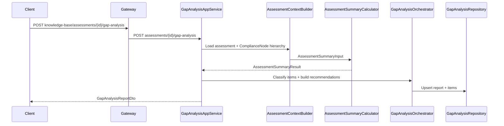

# Gap Analysis Orchestration

Assessment-driven gap analysis in **KnowledgeBase**: classifies each assessed Objective Element (OE) into **Critical**, **Major**, **Minor**, or **Compliant**, attaches KB recommendations, and persists a report linked to an existing `Assessment`.

This is **not** the ComplianceService operational gap detector (missing tasks/evidence). That subsystem lives in `ComplianceService/Application/Services/GapDetector.cs` and addresses a different domain.

---

## Flow



Pipeline:

| Step | Component | Reused logic |
|------|-----------|--------------|
| Assessment | `AssessmentContextBuilder` | Same load path as `GetSummaryAsync` |
| Scoring | `IAssessmentSummaryCalculator` | NABH-style aggregate rules (CORE, chapter/standard averages, etc.) |
| Gap detection | `GapAnalysisOrchestrator` | One result row per `AssessmentItem` |
| Classification | `GapClassifier` | Uses calculator outputs + item score |
| Recommendations | `GapRecommendationBuilder` | `KnowledgeItem.HowToComply` (fallback: evidence/checklist) |

---

## Classification rules

Evaluated in priority order:

| Category | Rule |
|----------|------|
| **Critical** | Node in `CoreFailureNodeIds`, OR in `ActionPlanViolationNodeIds`, OR `Score <= 1` |
| **Major** | `Score == 2`, OR ancestor standard in `StandardsWithMultipleLowScores` |
| **Minor** | `Score == 3` (and not Critical) |
| **Compliant** | `Score >= 4` (and not Critical) |

Implementation: [`GapClassifier.cs`](../KnowledgeBase/Application/GapAnalysis/GapClassifier.cs)

---

## Persistence

| Entity | Purpose |
|--------|---------|
| `GapAnalysisReport` | One report per assessment (unique `AssessmentId`); regenerate upserts |
| `GapAnalysisItem` | Per-node category, score, recommendation; unique `(ReportId, NodeId)` |

---

## APIs

### KnowledgeBase (direct)

| Method | Path |
|--------|------|
| POST | `/api/v1.0/assessments/{assessmentId}/gap-analysis` |
| GET | `/api/v1.0/assessments/{assessmentId}/gap-analysis` |

### Gateway (client-facing)

| Method | Path |
|--------|------|
| POST | `/api/v1.0/knowledge-base/assessments/{assessmentId}/gap-analysis` |
| GET | `/api/v1.0/knowledge-base/assessments/{assessmentId}/gap-analysis` |

Requires `ComplianceScope` authorization on Gateway routes.

### Sample generate response (abbreviated)

```json
{
  "data": {
    "assessmentId": "...",
    "criticalCount": 1,
    "majorCount": 0,
    "minorCount": 0,
    "compliantCount": 0,
    "items": [
      {
        "nodeId": "...",
        "category": "Critical",
        "score": 1,
        "recommendation": "Maintain records"
      }
    ],
    "summary": { "overallPercent": 20.0 }
  }
}
```

---

## Idempotency

`POST` gap-analysis **regenerates** the report for the assessment: existing `GapAnalysisReport` is updated in place and line items are replaced. One active report per `AssessmentId`.

---

## Prerequisites

- Assessment must exist with at least one `AssessmentItem` (typically from onboarding `POST /assessments/from-wizard` or manual item upserts).
- Empty assessments return `RESOURCE_NOT_FOUND`.

---

## Verification

1. Create/submit an assessment with mixed answers (`yes` / `no` / `not_sure`).
2. `POST .../gap-analysis` — expect persisted report and category counts.
3. `GET .../gap-analysis` — returns same report with live `summary` recomputed from current items.

Unit tests: `GapClassifierTests`, `GapRecommendationBuilderTests`, `KnowledgeApiIntegrationTests.Post_assessments_gap_analysis_generates_report`, `KnowledgeBaseGapAnalysisProxyHandlerTests`.

**Angular UI:** standalone results screen at `/app/gap-analysis/{assessmentId}` — see [Gap Analysis Results (WebApp)](../WebApp/src/app/features/gap-analysis/pages/gap-analysis-results.component.ts) and mapper tests in `gap-analysis.mapper.spec.ts`. Manual entry: navigate after onboarding when you have a KB `assessmentId`.

---

## Related docs

- [Onboarding assessment engine integration](./onboarding-assessment-engine-integration.md) — how wizard answers become `Assessment` + `AssessmentItem` rows.
