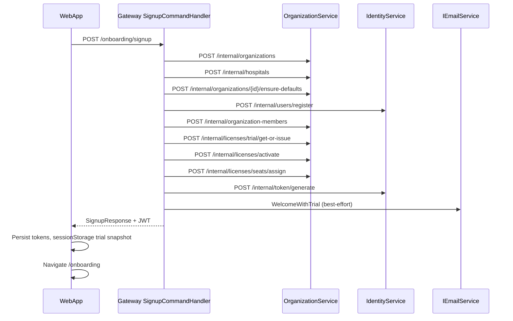

# CRP Phase 2 — Sequence Diagram

## Failure path

Any hard failure after stack pushes → `RunRollbackAsync` (LIFO): revoke license (if issued this run), release seat, delete user/hospital/org. Welcome email failure does **not** rollback.
