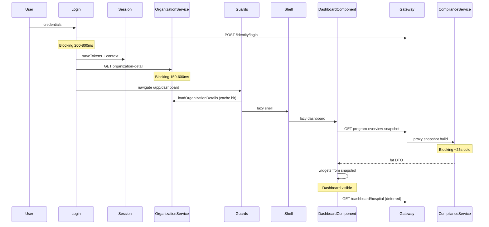

# AOVIAS Command — Platform Loading Performance Opportunity Assessment

**Type:** Analysis only (no code changes)  
**Date:** 2026-07-09  
**Evidence:** Browser network observation (most APIs &lt;100 ms; `program-overview-snapshot` ≈ **25 s**) + codebase review of WebApp login/dashboard/shell and `DashboardSnapshotService` / `AggregationService`

Interactive companion: Cursor canvas `DashboardLoadingOpportunityAssessment.canvas.tsx`

---

## Verdict

The bottleneck is **isolated** to **`GET …/program-overview-snapshot`**, not a broad “all APIs are slow” problem. Perceived platform slowness comes from the **Dashboard blocking first paint** on that single cold response. Returning to Home repeats the wait when the client cache is cold or expired.

| Observation | Implication |
|-------------|-------------|
| Most APIs &lt;100 ms | Network/Gateway/auth path is healthy |
| Snapshot ≈ 25 s | Backend live aggregation dominates wall clock |
| UI waits for snapshot | Perceived = actual for first contentful dashboard |
| Revisit can reload | Architecture + cache TTL, not only SQL |

---

## Phase 1 — Login journey map

### Blocking vs parallel

| Mode | Steps |
|------|--------|
| **Blocking** | Login → tokens → org → guards → **snapshot HTTP** → content paint |
| **Parallel / deferred** | Heatmap hospital API (after paint), notification badge (idle), chart SVG (cheap) |
| **Unnecessary waits** | Full page gated on fat snapshot; no partial KPI shell from lighter data |
| **Duplicate work** | Sidebar + dashboard share store when warm; cold still one ~25s compute. Backend still N× journey aggregations |

**No** `APP_INITIALIZER`, **no** NgRx bootstrap, **no** route resolvers on dashboard.

---

## Phase 2 — API inventory

| API | Purpose | Typical time | Class | Blocks paint? | Defer after shell? |
|-----|---------|--------------|-------|---------------|--------------------|
| `POST /identity/login` | Auth | 200–800 ms | Critical | Pre-app | No |
| `GET /tenant/{id}/organization-detail` | Hospitals/members | 150–600 ms | Critical | Routing | No |
| `GET /dashboard/{id}/program-overview-snapshot` | KPIs, frameworks, trends, tasks, alerts | **~25 s cold** | Critical | **Yes** | Shell yes; full data no |
| `GET /dashboard/hospital` | Department heatmap | 0.3–2 s | Important | No (deferred) | Yes |
| `GET /control-center/compliance/overview` | Command Center | 0.5–5 s | Critical (CC) | On CC route | Partial |
| Communication unread-count | Badge | &lt;100 ms | Background | No | Yes |

**Dependencies:** Snapshot depends on tenant context, journeys, OE scores, tasks, org hospitals (cross-service), optional framework filter.  
**Frequency:** Login, hospital/framework change, 5-minute refresh, revisit when cache cold.

---

## Phase 3 — Rendering strategy

| Question | Answer | Est. gain if changed |
|----------|--------|----------------------|
| Wait for every API? | Effectively waits for **snapshot**; heatmap deferred | — |
| One widget block page? | **One payload** blocks all widgets | High if split |
| Independent widgets? | Not today (single DTO) | High with split API |
| Skeleton help? | Exists but ~25s still feels stuck | Medium with shell-first |
| Progressive hydration? | Not adopted | High perceived |

---

## Phase 4–5 — Backend & database (root cause of ~25s)

### What the endpoint does (code path)

`DashboardSnapshotService.GetDashboardSnapshotAsync`:

1. Resolve framework / hospital scope  
2. Cross-service `GetHospitalsAsync`  
3. Load journeys  
4. **`ComputeJourneyScoresAsync`** → per journey `GetJourneyScoreAsync` → **`AggregationService.ComputeFrameworkAsync`** (chapters + standards + OEs + OE scores)  
5. Task summary projection  
6. History, alerts, score trends  
7. Assemble large DTO (+ optional 2-minute memory cache)

### Estimated share of cold wall time

| Subsystem | Share of ~25s |
|-----------|----------------|
| Journey score aggregations (N× catalog + OE scores) | **~70%** |
| Task summary query | ~10% |
| Org hospitals HTTP | ~8% |
| Alerts + trends + history | ~8% |
| Gateway / serialization | ~4% |

### Opportunities (no implementation)

| Opportunity | Est. savings | Risk |
|-------------|--------------|------|
| Prefer fresh persisted `ComplianceSnapshots` | 70–95% cold | Medium (staleness) |
| Shared framework catalog + batch scoring | 40–70% | Medium |
| Projected OE score queries / compiled queries | 30–60% | Low–medium |
| Indexes on `ObjectiveElementScores(JourneyId, …)`, `ComplianceTasks.HospitalId` | 10–30% on scans | Low |
| Longer server cache + warm after login | Near-instant warm | Low |
| Split summary vs trends/activity APIs | First paint −70–90% wait | Medium |
| Merge heatmap into snapshot | −1 heavy call | Low |

---

## Phase 6 — Frontend opportunity assessment

| Area | Finding | Est. gain |
|------|---------|-----------|
| Guards | Auth + onboarding only; org cached | Low |
| Resolvers | None | — |
| APP_INITIALIZER | None | Keep |
| NgRx | Not used | — |
| Signals / stores | Snapshot store TTL ~3 min; CC facade better for revisit | Medium–high if dashboard matches CC |
| Subscriptions | Context change reloads snapshot | Correct; ensure not double-fire |
| Change detection | OnPush; charts cheap | Low |
| Eager widgets | 11 components; not the 25s | Low |

---

## Phase 7 — Navigation / revisit

| Question | Answer |
|----------|--------|
| Dashboard destroyed? | **Yes** (lazy `loadChildren`) |
| Route reuse? | **No** `RouteReuseStrategy` |
| Cache discarded? | Component state yes; **root snapshot store** may retain TTL |
| APIs every visit? | Only if cache miss/expired |
| Client caching? | Yes (`ProgramOverviewSnapshotStore`) — insufficient for cold 25s |

**Opportunities:** route reuse, longer TTL, warm cache on login, root dashboard state like Control Center, widget state preservation.

---

## Phase 8 — Actual vs perceived

| Actual | Perceived |
|--------|-----------|
| One endpoint ~25s | Entire platform “slow after login” |
| Other APIs fast | Skeleton/blank wait = product feel |
| Compute is real | Synchronous all-widgets-from-one-DTO amplifies wait |
| | UX-only (shell-first, progressive, reuse) can feel ~instant on revisit **without** faster SQL |

**UX-only estimated improvement:** ~50–90% of *perceived* wait on revisit; first cold login still needs backend/API split for true &lt;2s first paint.

---

## Phase 9 — Opportunity matrix

| Opportunity | Area | Effort | Est. gain | Risk |
|-------------|------|--------|-----------|------|
| Shell-first + progressive widgets | Frontend UX | S | High perceived | Low |
| RouteReuseStrategy / root dashboard store | Frontend | S | Revisit ~instant | Low |
| Warm snapshot after login + longer TTL | FE+BE | S | High on warm | Low |
| DB indexes | Database | S | 10–30% | Low |
| Split snapshot (summary vs secondary) | API | M | First paint −70–90% | Medium |
| Materialized / precomputed snapshots | Backend | M–L | Cold −70–95% | Medium |
| Shared catalog batch scoring | Backend | M | Cold −40–70% | Medium |
| Merge heatmap into snapshot | API | M | −1 heavy call | Low |
| BFF login bootstrap | Architecture | L | −1 RTT | Medium |
| Response compression | Network | — | Low (already on Gateway) | Low |

---

## Phase 10 — Priority roadmap

### High ROI / low risk (Sprint 1)

1. Shell-first rendering + progressive KPI strip  
2. Route reuse or persistent dashboard store (match Control Center)  
3. Warm snapshot in background immediately after auth  
4. Verify/add indexes on OE scores and tasks  

### Medium ROI (Sprint 2)

1. Split snapshot API (critical summary vs trends/activity)  
2. Batch scoring with shared framework catalog  
3. Merge department heatmap into snapshot DTO  
4. Stronger server cache + invalidation on score/task events  

### Long-term architectural

1. Event-driven / nightly materialized snapshots as source of truth for dashboard  
2. BFF post-login bootstrap (org + summary)  
3. Dedicated read models / CQRS for command views  
4. Distributed cache across ComplianceService instances  

---

## Recommended measurement before locking Sprint 2

1. Cold login HAR + `window.__AOVIAS_PERF_REPORT__`  
2. ComplianceService `DashboardRequestTiming` + slow-query logs during one snapshot  
3. Break out ms for: scoring vs tasks vs org HTTP vs alerts/trends  

That replaces relative % estimates with exact sub-step timings for prioritization.

---

## Related

- Prior implementation notes: [`dashboard-baseline-report.md`](./dashboard-baseline-report.md)  
- Key code: `DashboardSnapshotService.cs`, `AggregationService.cs`, `dashboard.component.ts`, `program-overview-snapshot.store.ts`
