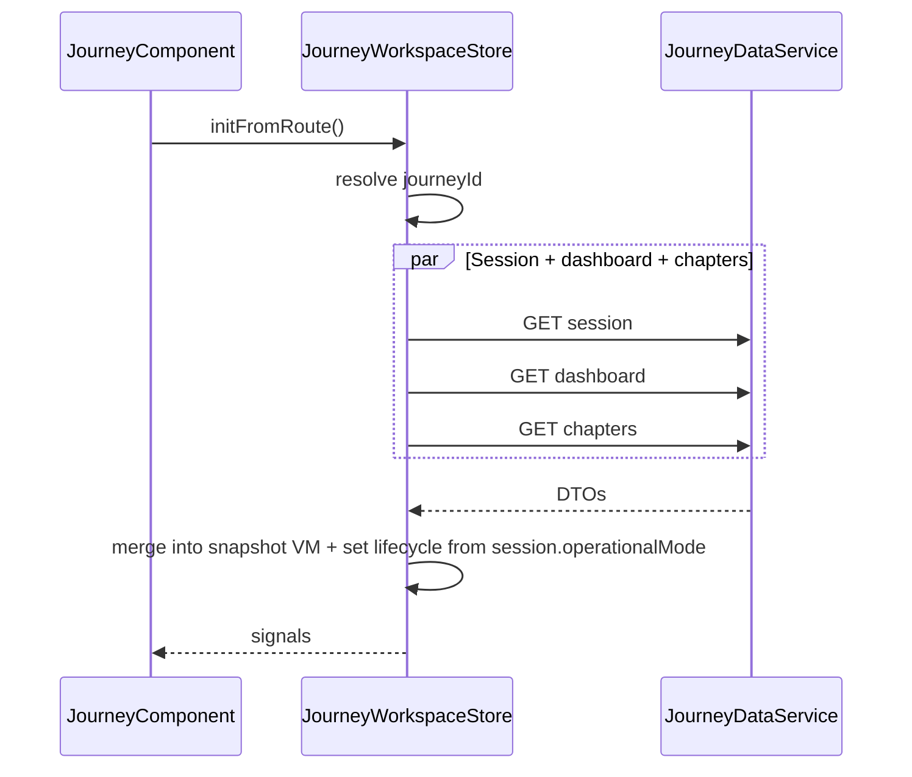
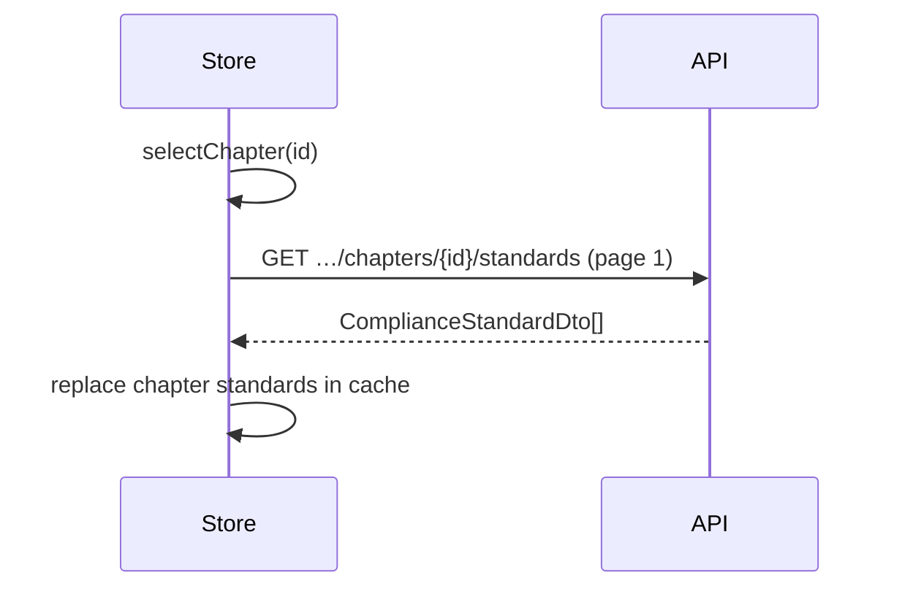

## RESEARCH COMPLETE

### Sources

- **API:** `ComplaincePlatform/docs/backend/journey-module-api-specification.md` (v1.0, Gateway → ComplianceService; folder name as in repo).
- **Frontend:** `WebApp/src/app/features/journey/**` — `JourneyWorkspaceStore`, `JourneyMockWorkspaceService`, `JourneyDataService`, `journey-workspace.mapper.ts`, `journey-api.model.ts`, `journey-operational-mode.policy.ts`, `JourneyContextResolverService`, `journey.component.ts`, `execution-screen.component.ts`.
- **Local spec:** `WebApp/docs/backend/journey-screen-api-spec.md` (aligned intent; path segment may differ from deployed Gateway).

---

## 1. Current vs target architecture

| Concern | Today | Target (Phase 49) |
|--------|--------|-------------------|
| Journey + execution data | `JourneyMockWorkspaceService` → `buildMockWorkspaceSnapshot` | HTTP: session + dashboard + chapters + standards (per chapter) + OE detail |
| `journeyId` | `JourneyContextResolverService` from org + compliance context; **fallback** `mock-nabh-hospital-6` when unresolved | Require real UUID when user is in app; **no production mock id** — show empty/error state |
| `JourneyDataService` | Legacy `GET /Journeys/workspace?journeyId=`, OE paths under `/Journeys/objective-elements/{oeId}` | Spec paths: `/journeys/{journeyId}/session`, `/dashboard`, `/chapters`, `/chapters/{chapterId}/standards`, `/objective-elements/{oeId}`, evidence under same OE prefix |
| Operational mode | `lifecycleMode` signal + mock reload per mode | **GET session** → persisted `operationalMode`; **PATCH** `…/session/operational-mode`; reload session + dashboard + chapters (+ invalidate standards cache) |
| OE mutations | Local `patchObjectiveElement` on snapshot | **PATCH** with `version`; merge `PatchObjectiveElementResponseDto`; refresh `overview` if returned |
| Read-only | Computed from mode + snapshot `readOnly` | **`readOnly` + `snapshotReadOnly`** from **session** override client rules where API says so |
| `changedSinceLastAudit` | **Mock** hash on `selectedOeId` in store | **OE GET** + chapter index fields when present |

**Interceptor:** `api-response.interceptor.ts` unwraps `ApiResponse<T>` to `T` — services should type `get<T>` as inner payload shapes.

**Base URL:** `environment.apiBaseUrl` is e.g. `https://localhost:7216/api/v1` — relative paths must be **`/journeys/{journeyId}/…`** (confirm whether Gateway uses `v1` or `v1.0`; spec shows `v1.0`).

---

## 2. Deliverable 1 — UI → API mapping (inventory)

#### Journey dashboard (`journey.component` + children)

| UI region | Primary API | Key fields |
|-----------|-------------|------------|
| Framework chip / header context | `GET …/session` | `frameworkCode`, `frameworkName`, `catalog` |
| Mode cards (4–5 phases) | `GET …/session` | `operationalMode`, `modeProgression.allowedNextModes`, `lockReasonByTargetMode` |
| Progress / accreditation card | `GET …/dashboard` | `accreditationReadinessPercent`, `accreditation.*` |
| Metric cards | `GET …/dashboard` | `overview.*` |
| Charts (3 trends) | `GET …/dashboard` | `oeScoreTrend`, `chapterImprovementTrend`, `riskEvolutionTrend` |

**Remove** client-only blending in `accreditationReadinessPercent` (e.g. Internal/Surveillance/ReAccreditation tweaks) when `accreditationReadinessPercent` is non-null from API; keep minimal fallback only if null.

#### Execution — chapter rail

| UI | API | Notes |
|----|-----|------|
| Chapter list | `GET …/chapters` | `data.items[]` — **not** a bare array |
| Search | Client filter on loaded list; spec allows future `search` query | Same as today |
| Sort by risk | Client sort on `risk` / `highlightHighRisk` | Same |

#### Execution — standards + OE table

| UI | API |
|----|-----|
| Standards + nested OE rows | `GET …/chapters/{chapterId}/standards?page=&pageSize=` |
| Pagination / “load more” | Use `page` / `pageSize`; cache pages per chapter if needed |

#### OE context panel + drawer + wizard

| UI | API |
|----|-----|
| Rich OE + evidence + history | `GET …/objective-elements/{oeId}` |
| After PATCH | Prefer returned `objectiveElement` fragment; bump local `version` |
| Evidence upload | `POST …/evidence` multipart (`file` field) or JSON register |
| Evidence delete | `DELETE …/evidence/{evidenceId}` |
| Optional list refresh | `GET …/evidence`, `GET …/history` if not embedding enough in OE GET |

#### Wizard step persistence

| User request | Spec |
|--------------|------|
| `POST …/wizard/progress` | **Not implemented** — use **sessionStorage** (namespaced by `userId` + `journeyId` + `oeId`) or in-memory only; document product follow-up |

---

## 3. Deliverable 2 — Data flow (diagrams)

### Initial load (journey route)



### Execution — chapter selected



### Mode switch

```mermaid
sequenceDiagram
  participant UI
  participant Store
  participant API

  UI->>Store: setLifecycleMode(next) / confirm advance
  Store->>API: PATCH …/session/operational-mode { operationalMode }
  API-->>Store: JourneySessionDto
  Store->>API: GET dashboard + GET chapters (parallel)
  Store->>Store: clear standards cache; refetch selected chapter standards
```

---

## 4. Deliverable 3 — State management plan

**Recommendation:** Keep a **single** `JourneyWorkspaceStore` as the facade (minimal template churn) but **internal** layers:

| Logical store | Responsibility |
|---------------|----------------|
| **Session slice** | `JourneySessionDto` fields, `readOnly`, `snapshotReadOnly`, `modeProgression`, `lastSyncedAt` |
| **Dashboard slice** | `JourneyDashboardDto` — trends + overview + accreditation |
| **Chapters index** | `items` from `JourneyChaptersIndexDto` |
| **Standards cache** | `Map<chapterId, { page, standards, loading }>` or merge into `JourneyWorkspaceSnapshot.chapters` after mapping |
| **OE detail cache** | Optional `Map<oeId, ObjectiveElement>` for detail panel; invalidate on PATCH |

**Avoid redundant calls:** `forkJoin` or `combineLatest` for parallel initial load; **do not** refetch full dashboard on every OE selection; **do** refetch OE on wizard open if stale flag set.

**Partial refresh:** After PATCH OE, update OE in nested tree from response; if `overview` present, update dashboard slice.

---

## 5. Deliverable 4 — Component binding (summary)

| Component | Data source | Loading / error |
|-----------|-------------|-----------------|
| `JourneyComponent` | Store: session + dashboard + overview computeds | `store.loading`, `store.loadError` |
| `JourneyCardComponent` | VM from store (`modeCards`) — feed from **session** progression | Disabled from `isModeLocked` → API `allowedNextModes` |
| `AccreditationProgressCardComponent` | `accreditationReadinessPercent`, `accreditation` | |
| `MetricCardComponent` | `overview` | |
| `ChartCardComponent` | Trend arrays | |
| `ExecutionChapterPanelComponent` | `filteredChapters` from chapters index | |
| `ExecutionStandardsPanelComponent` | Standards for `selectedChapterId` | Per-chapter loading |
| `JourneyContextPanelComponent` | `selectedOe` + OE GET fields | |
| `OeExecutionWizardComponent` | OE detail + policy; wizard state local | 409 → refresh OE |

---

## 6. Deliverable 5 — Gaps / risks

| Gap | Mitigation |
|-----|------------|
| **Wizard progress POST** not implemented | Local persistence only; no API |
| **Chapters** `search` / `sort` query “when implemented” | Client-only until backend supports |
| **`ObjectiveElementApiDto.classification`** in code as string; spec uses **int** | Extend mapper: accept int enum → `OeClassification` |
| **`ComplianceStandardApiDto`** uses `title`; spec uses **`name`** | Mapper already uses defensive `normStr`; align field name |
| **Evidence POST response** spec: `{ evidenceId }`; old `JourneyDataService` expected array | Update client to new shape + refetch OE or append |
| **Path version** `v1` vs `v1.0` | Verify against deployed Gateway |
| **409** on PATCH OE | Reload `GET …/objective-elements/{id}` and show toast |
| **403** on mutation | Rely on session `readOnly` + error banner |

---

## 7. Deliverable 6 — Integration strategy (wave overview)

1. **Wave 1:** DTOs + `JourneyDataService` methods for all spec endpoints; mappers from DTO → domain models; unit tests for mappers.
2. **Wave 2:** `JourneyWorkspaceStore` async load, cache, PATCH + mode PATCH, replace mock in `initFromRoute`.
3. **Wave 3:** Remove mock-specific UX strings; wire errors (401/403/404/409); feature flag or dev-only mock optional.

---

### References (code)

- Store mock load: `journey-workspace.store.ts` — `loadMockData`, `setLifecycleMode`.
- Resolver: `journey-context-resolver.service.ts`.
- Legacy HTTP: `journey-data.service.ts`.
