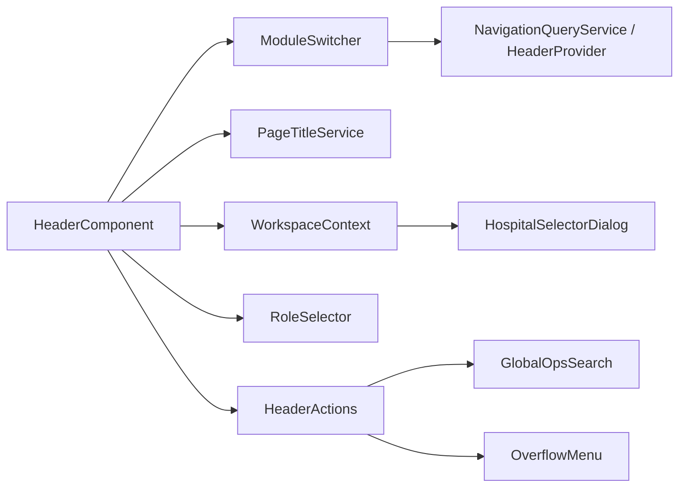

# AOVIAS Command — Header Navigation (NAV-2)

Enterprise shell header: Module Switcher, workspace context, Viewing As role selector, and overflow-safe actions.

**Does not change:** routes, permissions, module hierarchy, or business logic.

Related:

- [Navigation Foundation (NAV-1)](./navigation-foundation.md)
- [Navigation Framework (NAV-3)](./navigation-framework.md)
- [Menu Registry](./menu-registry.md)
- [Navigation Engine](./navigation-engine.md)

---

## Layout principles

The header answers three questions on one baseline (~64px):

1. **Where am I?** — Module Switcher (`Compliance ▼`)
2. **What page?** — Shell page title (presentation map / route `data.title`)
3. **What context?** — Workspace Context (hospital · framework) + Viewing As

Secondary: Search, Notifications, Theme, Refresh, User — never clip User.

Density tokens (`foundation.tokens.css`):

| Token | Value |
|-------|------:|
| `--header-height` | 64px |
| `--header-control-height` | 36px |
| `--header-gap` | 16px |
| `--header-icon-size` | 18px |

Rules: `flex-wrap: nowrap`, no horizontal page scroll, brand column tracks `--header-rail-px` (NAV-1 sidebar).

---

## Package

```
WebApp/src/app/core/navigation/header/
  app-header.component.ts
  module-switcher/
    module-switcher.component.ts
    module-switcher.service.ts
    module-switcher.models.ts
  role-selector.component.ts
  workspace-context.component.ts
  header-actions.component.ts
  search-trigger.component.ts
  overflow-menu.component.ts
  page-title.service.ts
  header-refresh.service.ts
  header-layout.service.ts
```

Shell continues to use `<app-header>`; implementation lives in the navigation package. Legacy re-export: `core/layout/header.component.ts`.

Horizontal mega-menu (`header-top-nav`) is removed.

---

## Module Switcher

- **Data:** `HeaderProvider` / `NavigationQueryService.headerModules()` (`MENU_REGISTRY` + `MODULE_REGISTRY`)
- **UI:** CDK Overlay panel, search filter, arrow/Enter/Escape, focus trap
- **Navigate:** primary (first enabled) item route per group
- **Active module:** URL match via existing path helpers; shows “Modules” when on sidebar-only routes
- **Extension fields on `ModuleEntry`:** `pinned`, `favorite`, `recentRank`, `visibilityFilter` (unused in NAV-2)

Settings is included as a registry group pointing at `/app/settings/account`. Administration shell still uses `[administrationMode]="true"` (no switcher).

---

## Workspace Context

Reads:

- Hospital — `OrganizationService` + `ComplianceContextService`
- Framework — `ContextFrameworkDisplayService`

Click opens existing `HospitalSelectorDialogComponent` / `AppContextService.switchContext` (same as the former header switch icon).

---

## Role Selector (Viewing As)

- Display-only list of `UserContextService` roles via `RoleRegistryService.labelOf`
- Selection closes the menu; **no role-switching logic**
- Hooks reserved: `enableRoleSwitch`, `enablePersonaPreview`, `enableSimulation`

Dashboard persona tabs remain feature UI until a later consolidation.

---

## Header actions & overflow

Priority (keep visible longest → first): **User > Notifications > Search > Refresh > Theme > Bookmarks**

`HeaderLayoutService` bands:

| Band | Width | Behavior |
|------|------:|----------|
| wide | >1800 | Full labels, Search with ⌘K hint |
| desktop | 1400–1800 | Condensed; bookmarks → More |
| laptop | 1100–1400 | Search icon; theme/bookmarks → More |
| tablet | 768–1100 | Module kept; more actions in More; hamburger |
| mobile | <768 | ☰ + Module + Search/User; no horizontal scroll |

Search trigger focuses existing `GlobalOpsSearchComponent` (Ctrl/⌘K unchanged).  
Refresh publishes `HeaderRefreshService.refreshTick` only (no forced reload).

---

## Accessibility

- Overlay panels: backdrop dismiss, Escape, `cdkTrapFocus`
- Module Switcher: combobox/listbox pattern, `aria-activedescendant`
- Focus-visible rings on controls
- `prefers-reduced-motion` respected

---

## Component interactions



**NAV-1 sidebar** remains the operational rail (Journey, Evidence, Tasks, Action Center).  
**NAV-2 header** switches cross-cutting product modules (QI, Patient Safety, Audit, …).

---

## Future extension points

| Capability | Hook |
|------------|------|
| Favorites / recent / pinned modules | `ModuleEntry` fields + switcher footer |
| Role switching / persona preview | `RoleSelectorExtensionHooks` |
| Global search / AI command palette | Search trigger → richer overlay |
| Org / workspace / multi-tenant switch | Expand Workspace Context |
| Cross-product navigation | Additional `ModuleEntry` categories |
| Page refresh consumers | `HeaderRefreshService.refreshTick` |

---

## Migration notes

- Removed: horizontal module tabs + module “More” overflow
- Added: Module Switcher, shell page title, workspace chip, Viewing As, actions More
- Hospital/framework switch icon retired in favor of Workspace Context
- Bookmarks moved into actions (inline or overflow), not primary nav
- No route or permission model changes

**NAV-3:** Module Switcher reads `HeaderProvider` → `NavigationQueryService.headerModules()` (registry SSOT). Page titles resolve via `PageTitleService` → `query.titleForUrl()`.
