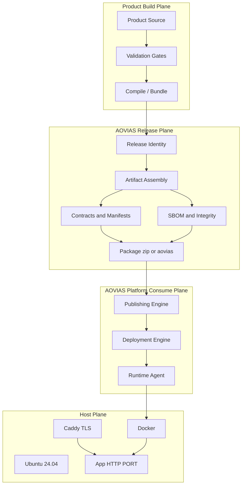
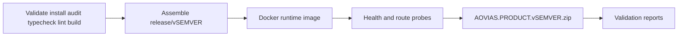
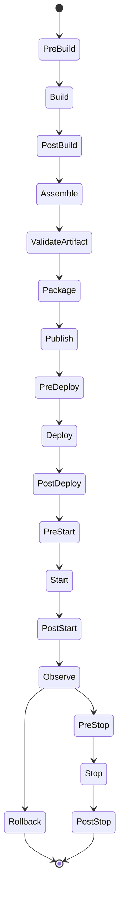

# AOVIAS Release Specification v1.0

**Document type:** Normative engineering specification (deployment contract)  
**Specification Version:** `1.0`  
**Manifest Version:** `1.0`  
**Schema Version:** `1.0`  
**Status:** Proposed GA for platform adoption  
**First conforming product:** AOVIAS Website `1.0.0`  
**Supersedes:** Website Release Artifact plan (content preserved and generalized below)

---

## 1. Purpose

This document defines the **AOVIAS Release Specification v1.0** — the official, stable contract for producing, validating, packaging, distributing, deploying, observing, and rolling back every AOVIAS software product.

It is not a one-off website deployment checklist. It is the platform-wide release engineering standard consumed by:

- AOVIAS Website  
- AOVIAS Command  
- AOVIAS Studio  
- Runtime Agent  
- Publishing Engine  
- Deployment Engine  
- Identity Service  
- Organization Service  
- Future AOVIAS products  

Every product **must** emit an identical release structure. Products differ only by **application payload files**. All manifests, contracts, scripts, reports, and packaging conventions remain standardized.

---

## 2. Goals

### 2.1 Primary goals

1. **Self-contained artifacts** — deployable without the source repository.  
2. **Identical package shape** across all products.  
3. **Deterministic validation** before publish.  
4. **HTTP-only application runtime** — TLS terminated at reverse proxy (Caddy).  
5. **Decade-stable layout** — additive evolution; no breaking removals within major Spec Version.  
6. **Platform-consumable metadata** — Deployment Engine, Publishing Engine, and Runtime Agent can parse manifests without product-specific logic.  
7. **Integrity and provenance** — checksums now; digital signatures as a forward-compatible extension.  
8. **Operational safety** — health contracts, rollback metadata, environment schema, lifecycle hooks.

### 2.2 Non-goals (v1.0)

- Mandating a specific CI vendor.  
- Mandating Kubernetes as the only runtime (Docker on Ubuntu remains the baseline; K8s is a compatible future strategy).  
- Replacing product-internal build systems (Next.js, .NET, Go, etc.) — only the **outbound artifact contract** is standardized.  
- Redesigning the locked release model defined in §4.

---

## 3. Architecture

### 3.1 Release system context



### 3.2 Separation of concerns

| Plane | Responsibility |
| --- | --- |
| Product Build | Language/framework-specific compile; must satisfy validation gates |
| Release Plane | Identity, assembly, manifests, SBOM, integrity, packaging |
| Platform Consume | Ingest artifact, schedule deploy, observe health, execute rollback |
| Host | OS, container runtime, reverse proxy |

### 3.3 Compatibility principle

**Additive only within Spec Version `1.0`.**  
New files and JSON fields may be introduced. Existing required files and required fields must not be removed or renamed. Consumers must ignore unknown fields.

---

## 4. Release Model (LOCKED — preserved)

The following decisions are **normative and must not be redesigned**:

1. Ship a **prebuilt, self-contained artifact**. Hosts do **not** require the source repository.  
2. Build once in CI/dev from product source.  
3. Package application runtime payload into `release/v{SEMVER}/`.  
4. Release `Dockerfile` is **runtime-only** (copy payload + run as non-root). It does **not** recompile the product inside the release package.  
5. Application listens on **HTTP only**, bind `0.0.0.0`, port from environment (`PORT`, default `3000`).  
6. **No HTTPS in the application container.** TLS is terminated by **Caddy**.  
7. Target host baseline: **Ubuntu 24.04 + Docker + Caddy**.  
8. Monorepo source-build Dockerfiles (e.g. Website [`deployment/docker/Dockerfile`](deployment/docker/Dockerfile)) remain valid as an **internal build path**; the **release artifact Dockerfile** remains the **distribution path**.

### 4.1 Website-specific preserved mapping (first implementation)

For AOVIAS Website (Next.js standalone):

- Build with `output: "standalone"`.  
- Package `.next/standalone`, `.next/static`, and `public`.  
- Runtime command: `node apps/website/server.js` (or product-equivalent entrypoint declared in manifest).  
- Patterns reuse [`apps/website/scripts/start-standalone.mjs`](apps/website/scripts/start-standalone.mjs) and the existing runner stage.



---

## 5. Specification Identity

| Field | Value | Meaning |
| --- | --- | --- |
| `specificationVersion` | `1.0` | This document’s major.minor |
| `manifestVersion` | `1.0` | `deploy-manifest.json` contract generation |
| `schema` | `aovias.release.deploy-manifest` | Logical schema id |
| `schemaVersion` | `1.0` | JSON schema revision |

Every `deploy-manifest.json` **must** include:

```json
{
  "manifestVersion": "1.0",
  "schema": "aovias.release.deploy-manifest",
  "schemaVersion": "1.0",
  "specificationVersion": "1.0"
}
```

---

## 6. Release Identity

### 6.1 Identifiers (required)

| ID | Format | Example |
| --- | --- | --- |
| **Release ID** | `AOVIAS.{PRODUCT}.{SEMVER}.{YYYYMMDD}.{SEQ}` | `AOVIAS.WEBSITE.1.0.0.20260722.001` |
| **Build ID** | `{YYYYMMDD}.{SEQ}` or CI run id | `20260722.001` |
| **Artifact ID** | Same as Release ID unless republish of identical bits | `AOVIAS.WEBSITE.1.0.0.20260722.001` |
| **SemVer** | `MAJOR.MINOR.PATCH` | `1.0.0` |
| **Product Code** | Uppercase token | `WEBSITE`, `COMMAND`, `STUDIO`, `RUNTIME_AGENT`, … |

### 6.2 Product codes (initial registry)

| Product | Code |
| --- | --- |
| AOVIAS Website | `WEBSITE` |
| AOVIAS Command | `COMMAND` |
| AOVIAS Studio | `STUDIO` |
| Runtime Agent | `RUNTIME_AGENT` |
| Publishing Engine | `PUBLISHING_ENGINE` |
| Deployment Engine | `DEPLOYMENT_ENGINE` |
| Identity Service | `IDENTITY` |
| Organization Service | `ORGANIZATION` |

### 6.3 Version file rules (preserved + generalized)

- If root `VERSION` exists: increment per SemVer policy (default **patch** unless release engineer specifies otherwise).  
- If absent: initialize `1.0.0` for first GA artifact of that product line.  
- Always emit `VERSION`, `release.json`, `build-info.json` inside the artifact.  
- Website first GA: initialize **`1.0.0`** (current package.json `0.1.0` is pre-spec).

---

## 7. Release Channels

Every release **must** declare exactly one channel in `release.json` and `deploy-manifest.json`:

| Channel | Intended use |
| --- | --- |
| `alpha` | Incomplete; internal dogfood |
| `beta` | Feature-complete candidate; limited audience |
| `rc` | Release candidate; production-parity validation |
| `ga` | Generally available production |
| `patch` | SemVer patch on GA line |
| `hotfix` | Emergency production fix (may skip intermediate channels) |
| `internal` | AOVIAS-only distribution |
| `experimental` | Non-supported experiments; never production-default |

**Website v1.0.0 default channel:** `ga`.

Channel does **not** change artifact layout. It only affects Publishing Engine promotion rules.

---

## 8. Release Lifecycle

### 8.1 Stages



### 8.2 Lifecycle hooks (required support surface)

Hook scripts live under `hooks/` (optional per product; **directory always present** in Spec v1.0 packages, with `.gitkeep` or no-op stubs if unused):

| Hook | When |
| --- | --- |
| `pre-build` | Before product compile |
| `post-build` | After successful compile |
| `pre-deploy` | Before Deployment Engine applies release |
| `post-deploy` | After deploy units created |
| `pre-start` | Before process/container start |
| `post-start` | After health becomes ready |
| `pre-stop` | Before SIGTERM / stop |
| `post-stop` | After process exit |
| `rollback` | When rollback procedure executes |

Hook contract:

- Executable via `startup.sh` / Deployment Engine.  
- Exit `0` = continue; non-zero = fail the stage (except documented best-effort hooks).  
- Must be idempotent where possible.  
- Must not embed secrets.

---

## 9. Artifact Specification

### 9.1 Stable artifact root

```
release/v{SEMVER}/
```

Alternate future package root (same internals):

```
AOVIAS.{PRODUCT}.v{SEMVER}.zip   → extracts to release/v{SEMVER}/
AOVIAS.{PRODUCT}.v{SEMVER}.aovias → identical internal tree (see §17)
```

### 9.2 Stable layout (normative)

**Required — preserved from Website plan, now product-agnostic:**

```
release/v{SEMVER}/
  Dockerfile
  .dockerignore
  app/                         # OPTIONAL alias; Website uses .next/ + public/ (see §9.3)
  .next/                       # Website payload (Next.js); other products use app/
  public/                      # Website static public; other products may omit if N/A
  package.json                 # or product-equivalent runtime manifest
  package-lock.json            # or language lockfile / provenance lock
  VERSION
  README.md
  DEPLOYMENT.md
  RELEASE_NOTES.md
  CHANGELOG.md
  .env.example
  LICENSE
  build-info.json
  release.json
  deploy-manifest.json
  checksums.sha256
  healthcheck.sh
  startup.sh
  rollback.md
  Caddyfile.example
```

**Required — Spec v1.0 extensions (additive):**

```
  environment.schema.json
  rollback.json
  integrity.json
  sbom/
    cyclonedx.json
    spdx.json
  hooks/
    pre-build
    post-build
    pre-deploy
    post-deploy
    pre-start
    post-start
    pre-stop
    post-stop
    rollback
  reports/
    RELEASE_VALIDATION_REPORT.md
    BUILD_REPORT.md
    SECURITY_REPORT.md
    DEPLOYMENT_REPORT.md
    ARTIFACT_SUMMARY.md
    quality-report.json
    security-report.json
    deployment-validation-report.json
```

### 9.3 Application payload convention

| Product family | Payload directories | Notes |
| --- | --- | --- |
| Next.js (Website) | `.next/standalone`, `.next/static`, `public/` | Preserved Website mapping |
| Node services | `app/` | `package.json` + compiled `dist/` |
| Other runtimes | `app/` | Entry declared in `deploy-manifest.json` |

**Rule:** Non-application files (manifests, hooks, reports, Dockerfile, scripts) remain identical across products.

### 9.4 Website Dockerfile behavior (preserved)

- Base: `node:22-alpine` + `wget` for healthcheck  
- Non-root user (uid `1001`)  
- `ENV NODE_ENV=production NEXT_TELEMETRY_DISABLED=1 PORT=3000 HOSTNAME=0.0.0.0`  
- Copy standalone → `/app`, static → `/app/apps/website/.next/static`, public → `/app/apps/website/public`  
- `EXPOSE 3000`  
- `HEALTHCHECK` → `http://127.0.0.1:3000/api/health`  
- `CMD ["node", "apps/website/server.js"]`  
- No HTTPS in container  

Generalized: `deploy-manifest.json` declares `entrypoint`, `containerPort`, `healthEndpoint`.

### 9.5 Operational scripts (preserved + extended)

- **`startup.sh`** — sets `PORT`/`HOSTNAME` (and `HOST` alias if needed), runs `pre-start` → entrypoint → waits for ready → `post-start`.  
- **`healthcheck.sh`** — probes health contract endpoints.  
- **`rollback.md`** — human procedure (preserved).  
- **`rollback.json`** — machine-readable rollback metadata (§14).

---

## 10. Manifest Specification

### 10.1 `deploy-manifest.json` (required fields)

Preserved fields + Spec v1.0 extensions:

```json
{
  "manifestVersion": "1.0",
  "schema": "aovias.release.deploy-manifest",
  "schemaVersion": "1.0",
  "specificationVersion": "1.0",

  "releaseId": "AOVIAS.WEBSITE.1.0.0.20260722.001",
  "buildId": "20260722.001",
  "artifactId": "AOVIAS.WEBSITE.1.0.0.20260722.001",
  "channel": "ga",

  "applicationName": "AOVIAS Website",
  "product": "WEBSITE",
  "version": "1.0.0",
  "releaseDate": "2026-07-22",

  "gitCommit": "<sha>",
  "branch": "<branch>",

  "nodeVersion": "22.x",
  "nextVersion": "<from package>",
  "runtime": "node",
  "runtimeVersion": "22",

  "dockerImageName": "aovias/website:1.0.0",
  "containerPort": 3000,
  "healthEndpoint": "/api/health",
  "readyEndpoint": "/api/ready",
  "liveEndpoint": "/api/live",
  "versionEndpoint": "/api/version",

  "buildNumber": "20260722.001",
  "buildTimestamp": "<ISO-8601>",
  "checksum": "<sha256 of package>",

  "entrypoint": ["node", "apps/website/server.js"],
  "workingDirectory": "/app",

  "deploymentStrategy": {
    "default": "recreate",
    "supported": ["recreate", "rolling", "blueGreen", "canary"],
    "kubernetesCompatible": true
  },

  "compatibility": {
    "ubuntu": ["24.04"],
    "docker": [">=24"],
    "node": ["22"],
    "architectures": ["linux/amd64", "linux/arm64"],
    "requiredRuntime": "docker",
    "reverseProxy": ["caddy"]
  },

  "resources": {
    "minimum": { "cpu": "1", "memory": "512Mi", "disk": "2Gi" },
    "recommended": { "cpu": "2", "memory": "1Gi", "disk": "5Gi" },
    "maximumTested": { "cpu": "4", "memory": "4Gi", "disk": "20Gi" }
  },

  "deploymentRequirements": {
    "tlsTermination": "external",
    "httpOnlyContainer": true,
    "bindAddress": "0.0.0.0"
  }
}
```

Website resource defaults remain: **min RAM 512MB**, **min CPU 1 vCPU** (preserved).

### 10.2 `release.json`

Must include: product, productCode, version, releaseId, buildId, artifactId, channel, releaseDate, artifactFileName, dockerImageName, specificationVersion, manifestVersion.

### 10.3 `build-info.json` (preserved + extended)

Must include: operatingSystem, nodeVersion, npmVersion, nextVersion (or runtime toolchain), gitSha, gitBranch, buildTimestamp, builder, buildMachine, buildId, releaseId, specificationVersion.

---

## 11. Metadata Specification

### 11.1 Environment contract — `environment.schema.json`

Every variable documented with:

| Property | Required |
| --- | --- |
| `name` | yes |
| `type` | yes (`string` \| `boolean` \| `number` \| `url` \| `enum`) |
| `required` | yes |
| `default` | yes (null allowed) |
| `description` | yes |
| `validation` | yes (regex, enum, url, or schema fragment) |

Website baseline variables (preserved from [`.env.example`](apps/website/.env.example)):

- `NODE_ENV`, `NEXT_PUBLIC_SITE_URL`, `NEXT_PUBLIC_APP_ENV`  
- Feature flags / integration placeholders  
- `MAINTENANCE_MODE`  

Production builds **must** set explicit `NEXT_PUBLIC_SITE_URL` / `NEXT_PUBLIC_APP_ENV=production` to avoid baking localhost defaults ([`apps/website/src/config/env.ts`](apps/website/src/config/env.ts)).

### 11.2 Integrity metadata — `integrity.json`

```json
{
  "algorithms": ["SHA256"],
  "checksumsFile": "checksums.sha256",
  "signatures": {
    "supported": true,
    "present": false,
    "format": "future:cosign|minisign",
    "files": []
  }
}
```

- **Now:** SHA256 for every file in `checksums.sha256` (preserved).  
- **Future:** digital signature entries without layout change.

### 11.3 SBOM — `sbom/`

| File | Format |
| --- | --- |
| `sbom/cyclonedx.json` | CycloneDX 1.5+ JSON |
| `sbom/spdx.json` | SPDX 2.3+ JSON |

Generation tooling is product-specific; presence and schema are mandatory for GA/patch/hotfix channels. Alpha/experimental may emit empty stub objects with `"status": "not_generated"` only if channel policy allows (Website GA: **full SBOM required**).

---

## 12. Health Contract

All AOVIAS HTTP products **must** expose:

| Endpoint | Purpose | Success |
| --- | --- | --- |
| `GET /api/health` | Liveness (process up) | `200` `{ "status": "ok" }` (product may add fields) |
| `GET /api/ready` | Readiness (accept traffic) | `200` `{ "ready": true }`; `503` when not ready / maintenance |
| `GET /api/live` | Alias/spec-stable liveness | Same semantics as health (Website: implement if missing) |
| `GET /api/version` | Release identity | `200` including `version`, `releaseId`, `buildId`, `channel` |

**Preserved Website endpoints:** `/api/health`, `/api/ready` already exist. Spec implementation must add `/api/live` and `/api/version` for full contract compliance (additive; does not remove existing probes).

Docker `HEALTHCHECK` continues to target `/api/health` (preserved).

---

## 13. Deployment Specification

### 13.1 Host assumptions (unchanged)

- Ubuntu 24.04  
- Docker  
- Caddy reverse proxy (TLS terminate → `reverse_proxy` to container `:PORT`)  
- Container HTTP only  

### 13.2 Compatibility matrix (normative documentation)

| Dimension | Supported |
| --- | --- |
| Ubuntu | 24.04 |
| Docker | ≥ 24 |
| Node (Website / Node products) | 22 |
| Architectures | `linux/amd64`, `linux/arm64` |
| Required runtime | Docker |
| Reverse proxy | Caddy |

### 13.3 Deployment strategies

`deploy-manifest.json.deploymentStrategy.supported` must list applicable strategies:

| Strategy | Spec v1.0 support |
| --- | --- |
| `recreate` | Required baseline (Website default) |
| `rolling` | Supported metadata; engine-implemented |
| `blueGreen` | Supported metadata; engine-implemented |
| `canary` | Supported metadata; engine-implemented |
| Kubernetes | `kubernetesCompatible: true` — manifests may be generated later without changing artifact layout |

### 13.4 Resource requirements

Manifest **must** include minimum / recommended / maximumTested for CPU, memory, disk (see §10.1). Website defaults preserved.

### 13.5 Caddy

`Caddyfile.example` remains required. Application must not configure HTTPS. Proxy headers should be trusted when present; no domain-specific logic baked into runtime bind.

---

## 14. Rollback Specification

### 14.1 Human procedure (preserved)

`rollback.md` — previous image tag retention, zip restore, health fail criteria.

### 14.2 Machine metadata — `rollback.json` (required)

```json
{
  "supported": true,
  "strategy": "recreate-previous-artifact",
  "minimumCompatibleVersion": "1.0.0",
  "databaseCompatibility": {
    "requiresMigration": false,
    "compatibleSchemaVersions": ["n/a"],
    "notes": "Website R1 has no product database migrations"
  },
  "previousReleaseId": null,
  "healthFailCriteria": [
    "/api/health != 200 for 3 consecutive checks",
    "/api/ready == 503 longer than startPeriod"
  ]
}
```

---

## 15. Validation Specification

### 15.1 Pre-publish gates (preserved — must still pass)

1. `npm install` / `npm ci` (or product equivalent)  
2. Dependency audit (`npm audit`; high/critical blockers)  
3. TypeScript validation  
4. ESLint (`--max-warnings=0` where configured)  
5. Production build  

### 15.2 Next.js / Website validation (preserved)

- `output: "standalone"`  
- Production build with explicit public env  
- Standalone server present  
- Images, metadata, static assets, fonts  
- 404 / error pages  
- API routes  
- No localhost / hardcoded ports / hardcoded IPs in **built distribution surfaces** (brand canonical domains allowed)  
- `reactStrictMode: true`  
- HTTP only; no app-level HTTPS  

### 15.3 Production checklist (preserved — still required)

Project quality, Next.js configuration, runtime (`HOST`/`HOSTNAME=0.0.0.0`, configurable `PORT`), Docker (multi-stage or runtime-only release image, non-root, healthcheck, `.dockerignore`), security (no secrets, `.env.example`, headers), assets, SEO (`robots`, `sitemap`, OG, canonical), routing, reverse-proxy compatibility.

### 15.4 Deployment validation (blocker — preserved)

After assemble:

1. `docker build` from **release context**  
2. Run with production-like env  
3. Assert `/api/health`, `/`, `/robots.txt`, `/sitemap.xml`, sample routes, 404  
4. Assert static/brand assets  
5. Clean stop  

Fail release if any probe fails. Emit `reports/deployment-validation-report.json`.

Reuse: [`scripts/ci-local.mjs`](scripts/ci-local.mjs), [`deployment/scripts/validate-container.mjs`](deployment/scripts/validate-container.mjs), [`deployment/scripts/link-audit.mjs`](deployment/scripts/link-audit.mjs).

---

## 16. Security Specification

### 16.1 Reports

| Artifact | Contents |
| --- | --- |
| `reports/SECURITY_REPORT.md` | Human-readable (preserved) |
| `reports/security-report.json` | Machine-readable |

Must cover:

- Dependency audit  
- Known vulnerabilities (severity counts)  
- License scan summary  
- Secrets scan (fail on high-confidence secrets in artifact)  

### 16.2 Packaging rules (preserved)

- No `.env` secrets in artifact  
- `.env.example` + `environment.schema.json` only  
- Non-root container user  
- No debug endpoints in GA channel  

---

## 17. Quality Specification

### 17.1 `reports/quality-report.json`

```json
{
  "build": { "status": "pass|fail", "score": 0 },
  "security": { "status": "pass|fail|warn", "score": 0 },
  "performance": { "status": "pass|fail|warn|skipped", "score": 0 },
  "accessibility": { "status": "pass|fail|warn|skipped", "score": 0 },
  "seo": { "status": "pass|fail|warn|skipped", "score": 0 },
  "tests": { "status": "pass|fail|skipped", "score": 0 },
  "overallQualityScore": 0
}
```

Scores are 0–100. GA channel policy: build+security must be `pass`; overall score threshold documented in product release notes (Website initial threshold: document measured score; do not invent fake 100s).

---

## 18. Package Format and Future `.aovias`

### 18.1 Current

`AOVIAS.{Product}.{v}{SEMVER}.zip` containing `release/v{SEMVER}/` tree.  
Website example (preserved): `AOVIAS.Website.v1.0.0.zip`.

### 18.2 Future-proofing

Internal directory structure **must** remain identical when introducing `.aovias`:

- `.aovias` = container format (zip-compatible or OCI-like wrapper)  
- Payload root remains `release/v{SEMVER}/`  
- No relocation of manifests  

`release.json` includes:

```json
{
  "packageFormats": ["zip"],
  "futurePackageFormats": ["aovias"]
}
```

---

## 19. Automation Specification

### 19.1 Release tooling

Add product release orchestrator (Website: [`scripts/create-release.mjs`](scripts/create-release.mjs)):

1. Resolve SemVer + generate Release/Build/Artifact IDs  
2. Select channel  
3. Run validation gates (+ hooks)  
4. Capture build-info  
5. Assemble stable layout  
6. Write all manifests/contracts  
7. Generate SBOM + checksums + integrity.json  
8. Docker build from release context + probes  
9. Write quality/security/deployment reports  
10. Package zip  
11. Fail closed on any required gate failure  

npm: `"release:package": "node scripts/create-release.mjs"`.

### 19.2 Final Website outputs (preserved)

| Deliverable | Location |
| --- | --- |
| Spec document | `docs/release/AOVIAS-Release-Specification-v1.0.md` |
| Versioned folder | `release/v1.0.0/` |
| Zip package | `AOVIAS.Website.v1.0.0.zip` |
| Reports | `release/v1.0.0/reports/*` |

Do not mark complete until validation gates, container probes, checksums, and zip all succeed.

---

## 20. Future Roadmap

| Horizon | Item |
| --- | --- |
| Spec 1.1 | Mandatory cosign/minisign signatures |
| Spec 1.1 | `.aovias` package format (same internals) |
| Spec 1.2 | Generated Kubernetes manifests alongside Docker |
| Spec 1.2 | Standardized OTEL fields in `/api/version` |
| Spec 1.3 | Multi-service compose bundles as first-class artifacts |
| Spec 2.0 | Breaking schema changes only with major bump + migration guide |

---

## 21. Conformance

A product is **Release Spec v1.0 conformant** when:

1. Emits the stable layout (§9.2)  
2. Includes valid `deploy-manifest.json` with schema fields (§5, §10)  
3. Declares Release/Build/Artifact IDs (§6)  
4. Declares a channel (§7)  
5. Implements health contract (§12)  
6. Ships environment schema (§11.1)  
7. Ships SBOM + checksums (§11.2–11.3)  
8. Passes validation + deployment probes (§15)  
9. Remains HTTP-only behind Caddy (§4, §13)  

---

## 22. Out of scope (preserved)

- Pushing images to a registry / full CD wiring (artifact is the handoff unit)  
- Product UX/content changes beyond release-blocking defects  
- Replacing monorepo source-build Dockerfile (remains internal build path)  

---

## 23. Document control

| Item | Value |
| --- | --- |
| Title | AOVIAS Release Specification |
| Version | 1.0 |
| Manifest Version | 1.0 |
| Schema Version | 1.0 |
| Owner | AOVIAS Platform Engineering |
| Classification | Internal engineering standard |
| First implementation | AOVIAS Website 1.0.0 |
