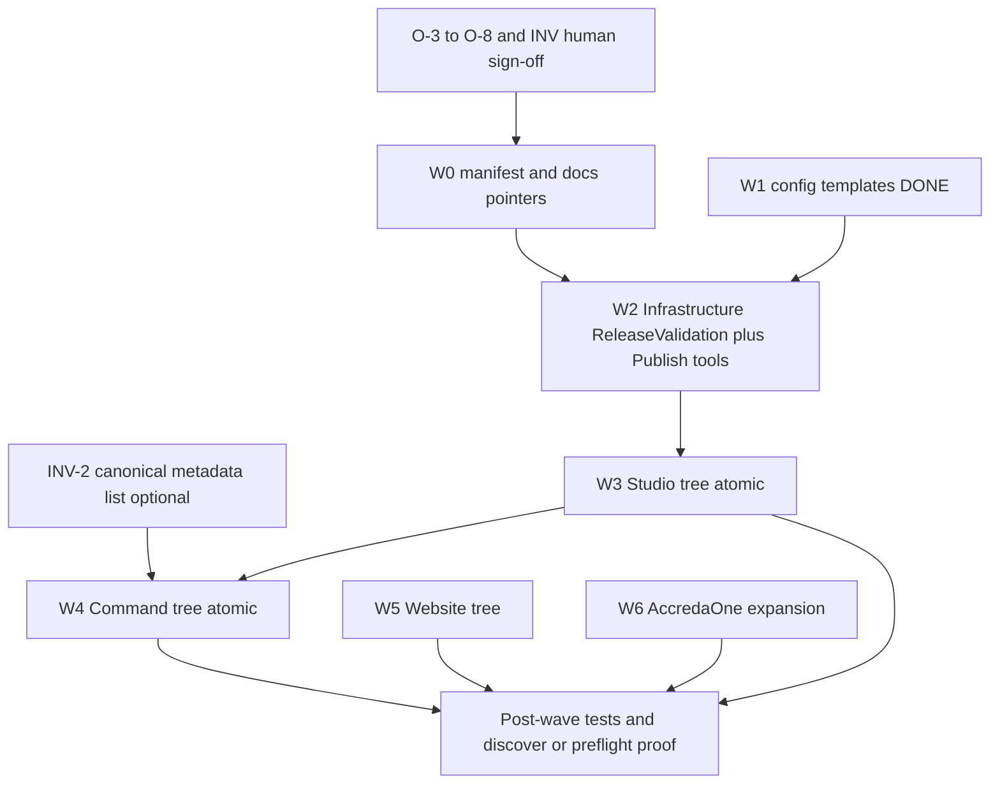

# AOVIAS Phase 1I-B — Resolve Physical Layout Architecture Decisions

**Phase:** 1I-B (evidence and decision proposals only)  
**Date:** 2025-10-25  
**Baseline HEAD:** `7758e30ce0f8c406fe8f292006895f67fb31cafd`

**Confirmation:** No files moved, source edited, manifest changed, or Git writes performed.

---

## Final status

**ARCHITECTURE READY FOR HUMAN APPROVAL**

Evidence-backed **recommendations** are recorded for every open decision. **Human sign-off** is still required to adopt each recommendation as binding before any physical migration wave executes. No decision remains without a proposed disposition; **O-6 (Shared)** and **INV-1** remain explicitly deferred by contract.

---

## 1. Safety snapshot

| Worktree | Branch | HEAD | Tracked tree |
|----------|--------|------|--------------|
| Main | `main` | `7758e30ce0f8c406fe8f292006895f67fb31cafd` | Clean |
| Cursor | `agent/cursor/active` | `7758e30…` | Clean |
| Claude | `agent/claude/active` | `7758e30…` | Clean |

**Preserved:** Untracked phase reports (~45 `AOVIAS_PHASE*.md` at Main root), ZIPs, Lighthouse dirs, Cursor probe, Claude launch settings, ignored `storage/` / `node_modules/`, temp `aovias-phase1hd-…` directory.

---

## 2. Source-derived definitions (exact contract text)

From `repository-layout.json` → `unresolvedDecisions` (L247–255) and `inventoryGapsPreservedFromPhase1B` (L257–261):

| ID | Exact topic (manifest) | Phase 1B provisional context |
|----|------------------------|------------------------------|
| **O-3** | `Aovias.DeploymentValidation product bucket` | Provisional **Studio**; manifest also lists target `AOVIAS.Studio/Aovias.DeploymentValidation` with `ownershipNote: UNRESOLVED O-3` (L116–119) |
| **O-4** | `Aovias.Runtime.Contracts placement` | Provisional **Studio (under Agent)** → `AOVIAS.Studio/Aovias.Runtime.Agent/...` |
| **O-5** | `tools/Publish* ownership` | Provisional **Infrastructure** → `AOVIAS.Infrastructure/tools/`; manifest `publishTools.target` (L137–140) |
| **O-6** | `AOVIAS.Shared population criteria` | Product `shared` → `migrationStatus: not-instantiated`, `paths: {}` |
| **O-7** | `Website folder flatten vs nested name` | Current `AOVIAS Website/AOVIAS Web` → target `AOVIAS.Website` |
| **O-8** | `preflight-docker-probe disposition` | 1B: delete or gitignore; **not tracked at HEAD** |
| **INV-1** | `Full project-to-solution membership matrix` | Gap text: **Full 87×9 project-to-solution membership matrix** |
| **INV-2** | `Complete deployment.metadata.json inventory` | Gap text: **Per-service deployment.metadata.json paths**; plus **Residual compose edge cases** in inventory gaps |

---

## 3. Decision resolutions (evidence, options, recommendation)

### O-3 — `Aovias.DeploymentValidation` product bucket

| Field | Detail |
|-------|--------|
| **Current location** | `Aovias.DeploymentValidation/` (repo root); tracked |
| **Manifest target (provisional)** | `AOVIAS.Studio/Aovias.DeploymentValidation` |
| **Consumers** | Publishing (DRV/preflight), Runtime Agent Dockerfile **COPY**, `RuntimeAgentDockerContextStager`, `Aovias.DeploymentValidation.Tests` (309 tests), CSM indirect via platform |
| **Options** | **A)** Studio (manifest default) **B)** Infrastructure (validation-as-platform-infra) |
| **Recommendation** | **A — Studio** — aligns with Dockerfile/stager grouping with other `Aovias.*` COPY roots; DRV is invoked from Publishing/Studio orchestration, not from Command microservices |
| **Required changes (with W3)** | Move tree; update Dockerfile COPY to `AOVIAS.Studio/Aovias.DeploymentValidation/` **or** update **current** manifest markers + stager list; ProjectReferences across Publishing/Agent |
| **Risk** | **Critical** — Docker build break if COPY/stager omitted |
| **Rollback** | Revert W3 merge; restore root path in manifest **current** |
| **Approval** | **Human** — adopt recommendation or select B |

---

### O-4 — `Aovias.Runtime.Contracts` placement

| Field | Detail |
|-------|--------|
| **Current location** | `Aovias.Runtime.Agent/src/Aovias.Runtime.Contracts/` (csproj in Agent slnx) |
| **Consumers** | Agent Infrastructure/Application; **ComplianceServiceManager** (DeploymentHttpErrorPresenter, Overview/Infrastructure view models); DeploymentValidation tests |
| **Options** | **A)** Move **with Agent** as subfolder (no separate product root) **B)** Promote to `AOVIAS.Shared` **C)** Split API contracts to Shared later |
| **Recommendation** | **A — Co-move with Agent** under `AOVIAS.Studio/Aovias.Runtime.Agent/src/Aovias.Runtime.Contracts/`; update CSM ProjectReferences only if paths change relative to solution |
| **Required changes** | Part of M-S-10; no separate manifest product entry until O-6 criteria met |
| **Risk** | **Medium** — CSM WPF project references |
| **Rollback** | Revert with Agent move |
| **Approval** | **Human** — confirm A; defer B/C to O-6 |

---

### O-5 — `tools/Publish*` ownership

| Field | Detail |
|-------|--------|
| **Current location** | `tools/PublishAllServices/`, `tools/PublishRuntimeAgent/` (only children under `tools/` at HEAD) |
| **Manifest target** | `AOVIAS.Infrastructure/tools` with note **PublishAllServices and PublishRuntimeAgent only** |
| **Consumers** | Human/CI publish entry points; reference `Aovias.Configuration`, `Aovias.Publishing.SDK`; platform root resolution |
| **Options** | **A)** Move **only** Publish* (manifest-aligned) **B)** Move entire `tools/` if future tools added |
| **Recommendation** | **A** — matches manifest `publishTools` scope; `tools/` at root becomes empty → remove or keep as placeholder |
| **Required changes** | W2 batch: path updates in docs/scripts; `dotnet run --project` paths; optional wrapper scripts under `scripts/` |
| **Risk** | **High** for operational docs; **Medium** for code |
| **Rollback** | Revert W2 |
| **Approval** | **Human** |

---

### O-6 — `AOVIAS.Shared` population criteria

| Field | Detail |
|-------|--------|
| **Current state** | No `AOVIAS.Shared/` product tree; manifest empty |
| **Options** | **A)** Defer all Shared moves until explicit promotion policy **B)** Define criteria now (cross-product consumers + versioning) per O-2 sharedPromotion notes |
| **Recommendation** | **A — DEFER** — no physical `AOVIAS.Shared/` creation in W2–W5; Runtime.Contracts stays with Agent (O-4) |
| **Consequences** | Avoids premature extraction of Configuration/Deployment.Contracts to Shared |
| **Approval** | **Human** — accept deferral (default contract posture) |

---

### O-7 — Website folder flatten vs nested name

| Field | Detail |
|-------|--------|
| **Current** | `AOVIAS Website/AOVIAS Web/` (space in path; nested) |
| **Manifest target** | `AOVIAS.Website/` |
| **Evidence** | CI: `AOVIAS Website/AOVIAS Web/.github/workflows/ci.yml` |
| **Options** | **A)** Flatten to `AOVIAS.Website/` **B)** Keep nested folder names under `AOVIAS.Website/AOVIAS Web/` **C)** Rename only outer folder |
| **Recommendation** | **A — Flatten** to manifest target; single product root, simpler CI cwd |
| **Required changes** | W5: move tree; update website CI; untracked ZIPs/Lighthouse remain outside move or human cleanup |
| **Risk** | **High** for path-with-space tooling on Windows; test website CI |
| **Rollback** | Revert W5 |
| **Approval** | **Human** |

---

### O-8 — `preflight-docker-probe` disposition

| Field | Detail |
|-------|--------|
| **Current** | Directory **exists** at repo root; **`git ls-files preflight-docker-probe` → empty** (untracked); appears **empty** on inspection |
| **1B note** | Delete or gitignore; not tracked at HEAD |
| **Relation to code** | Preflight **probe logic** lives in `SolutionPublishingPreflightService` (`TemporaryFolder/preflight-probe`), not this folder |
| **Options** | **A)** Delete empty untracked dir (human/local) **B)** Add to `.gitignore` if recreated **C)** Repurpose for documented local Docker experiments |
| **Recommendation** | **A + B** — remove untracked empty folder when authorized for housekeeping; add ignore pattern if name recurs; **not** part of W2–W5 |
| **Risk** | **None** to product builds |
| **Approval** | **Human** (housekeeping only) |

---

### INV-1 — Full project-to-solution membership matrix

| Field | Detail |
|-------|--------|
| **Contract ask** | Complete **87×9** (per 1B gap) project-to-solution membership |
| **Evidence at HEAD** | **9** `.slnx` files: `Aovias.Platform.slnx`, `Aovias.PublishingEngine.slnx`, `ComplaincePlatform/CompliancePlatform.slnx`, `ComplianceServiceManager/ComplianceServiceManager.slnx`, `Aovias.CommandCenter/Aovias.CommandCenter.slnx`, `Aovias.Runtime.Agent/Aovias.Runtime.Agent.slnx`, `Aovias.Publishing/Aovias.Publishing.slnx`, `Aovias.Release/Aovias.Release.slnx`, `Aovias.Orchestration/Aovias.Orchestration.slnx` |
| **Completeness** | **Insufficient** for automated “move all csproj” proof — matrix not checked in at HEAD |
| **Recommendation** | **DEFER blocking** — generate matrix in **Phase 1I-C or pre-W3** read-only inventory task; W2/W3 may proceed for **enumerated** trees in 1I-A manifest without full 87×9 |
| **Excluded from matrix** | Untracked projects, `_perf_build_out`, `bin/obj` |
| **Approval** | **Human** — accept deferral with pre-W3 inventory gate |

---

### INV-2 — Complete `deployment.metadata.json` inventory

| Field | Detail |
|-------|--------|
| **Contract ask** | Per-service deployment.metadata.json paths |
| **Evidence at HEAD** | **21** files found (glob), including **deployable** services under `ComplaincePlatform/`, `WebApp/`, `Aovias.Runtime.Agent/`, plus **`ComplaincePlatform/_perf_build_out/**`** (likely **generated** — exclude from move planning) |
| **Publishing discover** | 13 deployable projects at 1H-D discover; metadata gaps explain skipped services in discover warnings |
| **Recommendation** | **Sufficient for W4 planning** if `_perf_build_out` copies excluded; formal INV-2 sign-off = publish cleaned inventory doc listing **canonical** paths only |
| **Approval** | **Human** — accept canonical list (~18 production paths) vs full 21 with build artifacts flagged |

---

## 4. Target-profile resolver wiring (assessment)

| Question | Finding |
|----------|---------|
| **Target in production?** | **No** — `RepositoryLayoutProductionAdapter.IsPermittedProductionProfile` allows **Current only** (L12–13); tests assert Target **rejected** |
| **Where Target is used** | `RepositoryLayoutPathResolver`, **contract tests** (`RepositoryLayoutContractTests`, CSM resolver contract tests) — validates future markers against fixtures |
| **Production resolvers** | `PlatformRootResolver`, `RootPathResolver.ResolvePlatformRoot`, publish CLIs, Bootstrap → **`discovery.current`** via adapter |
| **Hard-coded paths** | `SolutionDeployableProjectDiscoverer.GetScanRoots` → `ComplaincePlatform`, `Aovias.Runtime.Agent`; `RuntimeAgentDockerContextStager` → top-level `Aovias.*` names; **not** manifest-driven for scan/stager |
| **Strategy for physical moves** | **Recommended:** Per wave, update **`paths.current`** and **`discovery.current`** in `repository-layout.json` to match new disk **in the same commit** as `git mv`; keep **`discovery.target`** as forward contract OR align target=current after full migration. **Do not** enable Target profile in production without new approved contract phase (contradicts 1C-B) |
| **Order** | **Atomic with move** — manifest current + code paths (resolvers, stager, Dockerfile, scan roots, scripts) in **one authorized batch** |
| **Tests** | Existing 39 layout tests (update expectations); `PublishingProjectPathsTests`; integration test `Integration_manifest_current_markers_match_post_w1_repository_layout`; post-wave discover/preflight proof |

**Do not wire Target profile in this phase** — confirmed not done.

---

## 5. Phase-report archive policy (recommendation only — no moves)

| Option | Pros | Cons |
|--------|------|------|
| **Keep all at root** | Zero migration risk; current discoverability for integrator | Clutters root; ~45 untracked files |
| **Move all to archive** | Clean root | Loses habitual paths; bulk untracked move still manual |
| **Hybrid** | Operational flexibility | Two locations to learn |

**Recommendation (hybrid):**

1. **Keep** `AGENTS.md`, `repository-layout.json`, and **active** phase docs at root **untracked** until human chooses to commit.
2. **Adopt** optional tracked path **`docs/migration/phase-reports/`** for **future** committed reports; **do not** mass-move in W2–W5.
3. **Completed** historical reports: human may copy into archive **without** deleting root copies until integration review complete.
4. **Exclude** phase reports from all **git mv** product waves.

**Approval:** **Human** — adopt hybrid policy.

---

## 6. Target tree validation (1I-A destinations)

| Destination | Manifest / plan support | Coupling concern | Status |
|-------------|-------------------------|------------------|--------|
| **`AOVIAS.Command/`** | **Supported** — `products.command.paths.target` | Command tests/Compose co-located — appropriate | **Ready pending W4 auth** |
| **`AOVIAS.Studio/`** | **Supported** — studio paths + solutions | Large blast radius; DRV+Docker+CSM — **ownership correct** for platform | **Ready pending O-3 sign-off + W3 auth** |
| **`AOVIAS.Infrastructure/`** | **Supported** — config at target; ReleaseValidation + tools | Publishing tools logically infra — **good** | **W2 after O-5** |
| **`AOVIAS.Website/`** | **Supported** — `products.website` | Isolated from .NET monorepo — **good** | **Pending O-7** |
| **Root governance** | **Supported** — 1B W0 | scripts/docs stay cross-cutting — **appropriate** | **KEEP** |

**Inappropriate coupling avoided:** Command csproj graph has **no** ProjectReference to `Aovias.*` at baseline (`repository-layout.json` compatibilityConstraints) — Command move can stay **separate** from Studio (1B rule).

**Not revised:** Target paths unchanged from `repository-layout.json`.

---

## 7. Migration dependency order

| Order | Step | Depends on | Atomic? |
|-------|------|------------|---------|
| 1 | Human approval of §3 recommendations | — | — |
| 2 | Optional INV-2 canonical metadata doc | — | — |
| 3 | **W0** — docs, no physical move | Approvals | Independent |
| 4 | **W1** | — | **Done** |
| 5 | **W2** — `Aovias.ReleaseValidation` + Publish tools | O-5, manifest current update | **Atomic batch** |
| 6 | **W3** — entire Studio tree + slnx | O-3, O-4; manifest+Docker+stager+scan in same PR | **Single atomic batch** |
| 7 | **W4** — Command tree | W3 not required for compile isolation but **serialize** per 1B | **Atomic batch** |
| 8 | **W5** — Website | O-7 | **Atomic batch** |
| 9 | **W6** — AccredaOne | Independent additive | Independent |
| 10 | Phase reports archive | Human policy | **Independent** |
| 11 | Runtime proof | 1H-C/1H-D/1I-* gates | After each wave |

**Independent:** W5 vs W3 if no shared CI (website CI separate). **Must not parallel:** W3+W4 in one wave.

---

## 8. Required human approvals (checklist)

| # | Decision | Recommended choice | Approve? |
|---|----------|-------------------|----------|
| 1 | O-3 DeploymentValidation bucket | Studio | ☐ |
| 2 | O-4 Runtime.Contracts | Co-move with Agent | ☐ |
| 3 | O-5 tools scope | Publish* only → Infrastructure | ☐ |
| 4 | O-6 Shared | Defer | ☐ |
| 5 | O-7 Website | Flatten to `AOVIAS.Website/` | ☐ |
| 6 | O-8 preflight-docker-probe | Delete untracked + gitignore pattern | ☐ |
| 7 | INV-1 matrix | Defer to pre-W3 inventory; non-blocking for W2 | ☐ |
| 8 | INV-2 metadata | Accept ~18 canonical paths; exclude `_perf_build_out` | ☐ |
| 9 | Target profile strategy | Update **current** manifest per wave; no production Target | ☐ |
| 10 | Phase reports | Hybrid archive policy | ☐ |
| 11 | First execution wave | Authorize **W2** or **W3** explicitly when ready | ☐ |

---

## 9. Decisions still unresolved until checklist signed

All items in §8 remain **proposed**, not **binding**, until human integration records approval (e.g. in merge task or governance doc). **O-6** and **INV-1** remain **deferred by design** even after approval.

---

## 10. Deliverable

| Report | Path |
|--------|------|
| Architecture decisions | `AOVIAS_PHASE1IB_ARCHITECTURE_DECISIONS_REPORT.md` (untracked on Main) |

**Final status:** **ARCHITECTURE READY FOR HUMAN APPROVAL**

After §8 checklist approval, proceed to **separate authorization** for **W2** (Infrastructure remainder) or **W3** (Studio) per dependency graph — still **no physical move** until that authorization.
