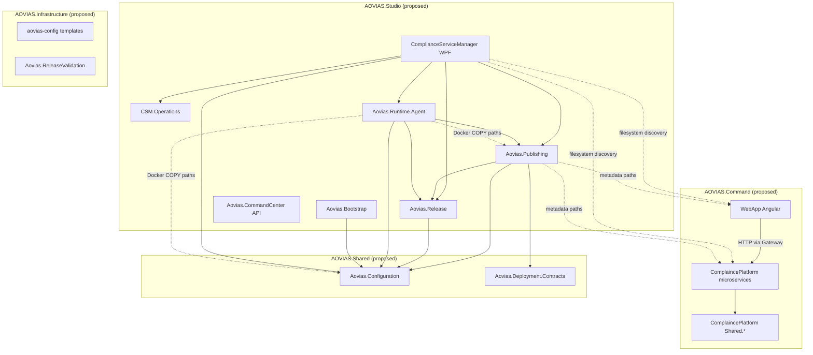

# AOVIAS Repository Restructuring Assessment

**Date:** 2026-10-25  
**Repository:** `V:\DevelopmentRepo\AOVIAS`  
**Scope:** Assessment and planning only — **no migration executed**  
**Status:** `ASSESSMENT ONLY — NO REPOSITORY CHANGES` (except this report file)

---

## 1. Executive Summary

The AOVIAS monorepo today is a **flat, path-convention-driven layout** at `V:\DevelopmentRepo\AOVIAS` with two largely independent .NET ecosystems:

1. **PRAMAN / Command runtime** — `ComplaincePlatform/` (microservices, gateway, shared platform libraries) plus `WebApp/` (Angular portal).
2. **AOVIAS Studio platform** — `ComplianceServiceManager` (WPF operator shell), `Aovias.*` libraries (Configuration, Publishing, Release, Runtime Agent, Orchestration, Bootstrap, CommandCenter API), and supporting tools.

There is **no** existing `AOVIAS.Command`, `AOVIAS.Studio`, `AOVIAS.Shared`, or `AOVIAS.AccredaOne` top-level product boundary on disk. The proposed four-product architecture is **feasible** but requires coordinated updates to **dozens of path-sensitive systems** (Studio discovery, publishing root resolution, Docker build contexts, CI working directories, hard-coded worktree paths, and solution files).

**Preservation recommendation:** Keep `Aovias.Platform.slnx` and `Aovias.PublishingEngine.slnx` as distinct solutions; relocate them under `AOVIAS.Studio/` with updated relative project paths rather than merging.

**Verdict:** **`READY AFTER SPECIFIED DECISIONS`** — migration is technically feasible, but **P0 blockers** include product naming collisions (`Aovias.CommandCenter` vs PRAMAN “Deficiency Command Center”), whether `Aovias.CommandCenter` is Studio vs Infrastructure, whether to rename `ComplaincePlatform` during migration, and a **human integration freeze** while path invariants are updated across three Git worktrees.

---

## 2. Repository Baseline

### 2.1 Verified facts

| Item | Value | Evidence |
|------|--------|----------|
| Git repository | Present at `V:\DevelopmentRepo\AOVIAS` | `.git/HEAD`, `.git/refs/heads/*` |
| **Checked-out branch (integration worktree)** | `codex/accredaone-kb-assessment` | `.git/HEAD` → `refs/heads/codex/accredaone-kb-assessment` |
| **HEAD commit (integration worktree)** | `aa87317e3ace26145770aed741d3d2dddd07790d` | `.git/refs/heads/codex/accredaone-kb-assessment` |
| **`main` tip (not checked out here)** | `a2cb3d5af8690fba9b75a7e580b81d3948f7cde0` | `.git/refs/heads/main` |
| Worktree: Cursor | `V:\DevelopmentRepo\AOVIAS.Cursor` → branch `agent/cursor/phase3h-propagation-contract-closure` @ `c1f8ebd8b6a4fcdaf24f24d78f597819b15f5516` | `.git/worktrees/AOVIAS.Cursor/*` |
| Worktree: Claude | `V:\DevelopmentRepo\AOVIAS.Claude` → branch `agent/claude/def-env-006-angular-lifecycle` @ `ddcb59ee537748649ff079749fda0163feec9f15` | `.git/worktrees/AOVIAS.Claude/*` |
| Agent contract | Two worktrees only; integration at `AOVIAS` on `main` | `AGENTS.md` lines 6–34, 234 |

### 2.2 Unverified (tooling limitation)

| Item | Status |
|------|--------|
| `git status` (porcelain) | **Not verified** — shell/sandbox unavailable in assessment environment |
| Untracked/modified file set | **Not verified** — expect at least this report (+ any in-progress assessment artifacts on feature branch) |
| `dotnet build` / `dotnet test` | **Not executed** (assessment-only; scripts exist but were not run here) |

### 2.3 Migration risk from baseline state

- Integration path **`V:\DevelopmentRepo\AOVIAS` is not on `main`**, contrary to `AGENTS.md` integration expectations (`AGENTS.md` line 234). Restructuring should begin from a **deliberate human checkout of clean `main`**, not from an feature/assessment branch.
- **Cursor and Claude worktrees are on active task branches** with divergent SHAs from `main` and from each other. A structural move during parallel agent work will cause **merge conflicts across all three worktrees**.
- **41 local branch refs** under `.git/refs/heads/` (many `agent/cursor/*` and `agent/claude/*` task branches) share one object database — `git mv` history is preserved, but **open IDE/terminal paths** and **agent task docs** will break until updated.

---

## 3. Current Directory Tree (Evidence-Based)

Top-level layout **observed** (not every nested folder expanded):

```text
V:\DevelopmentRepo\AOVIAS\
├── AGENTS.md
├── ACCREDAONE_KNOWLEDGEBASE_READINESS_ASSESSMENT.md
├── Aovias.Platform.slnx                    # Cross-platform Studio CI “build all Aovias.*”
├── Aovias.PublishingEngine.slnx            # Publishing-focused solution
├── Aovias.Bootstrap/
├── Aovias.CommandCenter/
├── Aovias.Configuration/
├── Aovias.Deployment.Contracts/
├── Aovias.DeploymentValidation/
├── Aovias.DesignSystem/
├── Aovias.Orchestration/
├── Aovias.Publishing/
├── Aovias.Release/
├── Aovias.ReleaseValidation/               # Node/TS + artifacts (partial implementation)
├── Aovias.Runtime.Agent/
├── ComplaincePlatform/                     # Misspelled folder name; PRAMAN backend
│   ├── CompliancePlatform.slnx
│   ├── .github/workflows/platform-integrity.yml
│   ├── docker-compose.*.yml
│   ├── docker/
│   └── <microservices + Shared.* + tests>
├── ComplianceServiceManager/
│   └── ComplianceServiceManager.slnx       # Windows/WPF leg
├── ComplianceServiceManager.Tests/
├── ComplianceServiceManager.Operations/
├── ComplianceServiceManager.Operations.Tests/
├── WebApp/                                 # Angular 21 “praman-web”
├── AOVIAS Website/                         # Corporate site (nested monorepo-style)
│   └── AOVIAS Web/
├── aovias-config/                          # Docker/nginx templates
├── ai-governance/
├── docs/
├── scripts/                                # verify-build.sh, verify-tests.sh, dev/*.ps1
└── tools/
    ├── PublishAllServices/
    └── PublishRuntimeAgent/
```

**Not found:** `AOVIAS.Studio/`, `AOVIAS.Command/`, `AOVIAS.Shared/`, `AOVIAS.Infrastructure/`, `AOVIAS.AccredaOne/`, root `preflight-docker-probe/` directory (`preflight-docker-probe` is a **temporary folder name** inside publishing preflight code only).

**Generated / ignore-heavy areas (not inventoried as products):** `**/bin/`, `**/obj/`, `**/node_modules/`, `Aovias.ReleaseValidation/artifacts/`, local `ComplianceServiceManager/packages/` (gitignored per `ComplianceServiceManager/.gitignore`).

---

## 4. Proposed Target Directory Tree

Adjusted from the mission brief to match **verified** ownership and coupling:

```text
V:\DevelopmentRepo\AOVIAS\
├── AOVIAS.Command\
│   ├── CompliancePlatform\              # Consider rename from ComplaincePlatform (decision)
│   │   └── CompliancePlatform.slnx
│   └── WebApp\
│
├── AOVIAS.Studio\
│   ├── Aovias.Platform.slnx
│   ├── Aovias.PublishingEngine.slnx
│   ├── ComplianceServiceManager\
│   ├── ComplianceServiceManager.Operations\
│   ├── ComplianceServiceManager.*.Tests\
│   ├── Aovias.DesignSystem\
│   ├── Aovias.Bootstrap\
│   ├── Aovias.CommandCenter\            # Ownership: UNRESOLVED (see §4)
│   ├── Aovias.Configuration\            # Or hoist to Shared (see §6)
│   ├── Aovias.Deployment.Contracts\
│   ├── Aovias.DeploymentValidation\
│   ├── Aovias.Orchestration\
│   ├── Aovias.Publishing\
│   ├── Aovias.Release\
│   ├── Aovias.Runtime.Agent\
│   └── tools\Publish*\                   # Or under Infrastructure
│
├── AOVIAS.AccredaOne\
│   └── (placeholder — no implementation today)
│
├── AOVIAS.Website\
│   └── AOVIAS Web\                      # Flatten “AOVIAS Website/AOVIAS Web” (optional)
│
├── AOVIAS.Shared\                       # Genuinely cross-cutting contracts/libs only
│
├── AOVIAS.Infrastructure\
│   ├── aovias-config\
│   ├── Aovias.ReleaseValidation\      # Cross-product release gate tooling
│   └── deployment templates / scripts subset
│
├── docs\
├── scripts\
├── ai-governance\
├── AGENTS.md
└── .gitignore
```

---

## 5. Project Inventory and Ownership Classification

Legend: **Conf.** = High / Medium / Low. **Deploy** = independently deployable artifact.

### 5.1 COMMAND — `ComplaincePlatform/` (PRAMAN backend)

| Path | Name | Tech | Responsibility | Solutions | Deploy | Shared? | Proposed destination | Conf. | Evidence |
|------|------|------|----------------|-----------|--------|---------|------------------------|-------|----------|
| `ComplaincePlatform/Gateway` | Gateway | ASP.NET Core net10 | API gateway / BFF | `CompliancePlatform.slnx` | Yes | No | `AOVIAS.Command/CompliancePlatform/Gateway` | High | `CompliancePlatform.slnx` L9 |
| `ComplaincePlatform/IdentityService` | IdentityService | ASP.NET Core | Auth/identity | slnx | Yes | No | Command | High | slnx L10 |
| `ComplaincePlatform/ComplianceService` | ComplianceService | ASP.NET Core | Core compliance SSOT | slnx | Yes | No | Command | High | slnx L5 |
| `ComplaincePlatform/KnowledgeBase` | KnowledgeBase | ASP.NET Core + EF SQL Server | Internal knowledge/assessment API | slnx | Yes | **Candidate for AccredaOne backend** | Command now; extract later | Medium | slnx L6; `ACCREDACONE_KNOWLEDGEBASE_READINESS_ASSESSMENT.md` |
| `ComplaincePlatform/AIOrchestratorService` | AIOrchestrator | ASP.NET Core | AI retrieval/orchestration | slnx | Yes | No | Command | High | slnx L1 |
| `ComplaincePlatform/*Service` | Organization, Person, Workforce, Professional, Governance, Communication, Audit, Integration, AccessGovernance, EnterpriseDirectory, WorkforceIntelligence | ASP.NET Core | Domain microservices | slnx (most) | Yes | No | Command | High | slnx |
| `ComplaincePlatform/OutboxRelayWorker` | OutboxRelayWorker | Worker | Outbox relay | slnx | Yes | No | Command | High | slnx L34 |
| `ComplaincePlatform/Platform.Dashboard` | Platform.Dashboard | Class library | Shared dashboard models | slnx | No | Internal to Command | Command | High | slnx L35 |
| `ComplaincePlatform/Compliance.MasterData` | Compliance.MasterData | Library | Master data | slnx | No | Internal | Command | High | slnx L4 |
| `ComplaincePlatform/Shared.Infrastructure` | Shared.Infrastructure | Library | Cross-service infra helpers | slnx | No | **Within Command boundary** | Command (not repo Shared) | High | Used by all services; no `Aovias.*` refs |
| `ComplaincePlatform/Shared.Logging` | Shared.Logging | Library | Logging | slnx | No | Command-internal | Command | High | slnx L37 |
| `ComplaincePlatform/Shared.Authorization` | Shared.Authorization | Library | Auth helpers | **Not in slnx** | No | Command-internal | Command | Medium | csproj refs; absent from slnx |
| `ComplaincePlatform/Shared.Governance` | Shared.Governance | Library | Governance | slnx | No | Command-internal | Command | High | slnx L22 |
| `ComplaincePlatform/Shared.Communication` | Shared.Communication | Library | Messaging | slnx | No | Command-internal | Command | High | slnx L25 |
| `ComplaincePlatform/DemoDataSeeder` | DemoDataSeeder | Tool | Demo seeding | **Not in slnx** | No | No | Command or Infrastructure | Low | csproj exists; not in slnx |
| `ComplaincePlatform/tests/*` | Integration + unit tests | xUnit | Guardrails / tests | partial | No | No | Command | High | CI workflow paths |
| `ComplaincePlatform/tests/Aovias.Platform.IntegrationTests` | Platform integration tests | xUnit | Tenant/governance tests | slnx indirect | No | No | Command | High | `platform-integrity.yml` |

**Note:** `ComplaincePlatform` has **no ProjectReference** to root-level `Aovias.*` projects (grep verified). Command and Studio are **build-decoupled** today, coupled only via **filesystem layout**, **Studio discovery**, and **Publishing metadata paths**.

### 5.2 COMMAND — `WebApp/`

| Path | Name | Tech | Responsibility | Solutions | Deploy | Shared? | Destination | Conf. | Evidence |
|------|------|------|----------------|-----------|--------|---------|-------------|-------|----------|
| `WebApp/` | praman-web | Angular 21 | PRAMAN operator portal | Not in `Aovias.Platform.slnx` | Yes (`deployment.metadata.json`) | No | `AOVIAS.Command/WebApp` | High | `angular.json` L10; `WebApp/deployment.metadata.json` |

### 5.3 STUDIO — Operator shell and platform libraries

| Path | Name | Tech | Responsibility | Solutions | Deploy | Shared? | Destination | Conf. | Evidence |
|------|------|------|----------------|-----------|--------|---------|-------------|-------|----------|
| `ComplianceServiceManager` | CSM | WPF net10.0-windows | Studio IDE / local dev orchestration | `ComplianceServiceManager.slnx` | Desktop app | No | `AOVIAS.Studio/` | High | slnx; `ComplianceServiceManager.csproj` refs many `Aovias.*` |
| `ComplianceServiceManager.Tests` | Tests | xUnit | CSM tests | Platform slnx **excluded** (WPF) | No | No | Studio | High | csproj |
| `ComplianceServiceManager.Operations` | Operations engine | net10 class lib | Long-running workflow engine | `Aovias.Platform.slnx` | No | Studio-internal | Studio | High | csproj description L8–9 |
| `ComplianceServiceManager.Operations.Tests` | Tests | xUnit | Operations tests | Platform slnx | No | No | Studio | High | Platform slnx L88–90 |
| `Aovias.DesignSystem` | DesignSystem | WPF net10.0-windows | Studio UI tokens/controls | `ComplianceServiceManager.slnx` only | No | **Used only by CSM** | Studio (not Shared) | High | Platform slnx comment L32–36 |
| `Aovias.Bootstrap/*` | Bootstrap | net10 | Environment bootstrap CLI/host | Platform slnx, Bootstrap.sln | Host deployable | No | Studio | High | Platform slnx L38–44 |
| `Aovias.Runtime.Agent/*` | Runtime Agent | ASP.NET Core | Deployment/runtime control plane | Platform slnx, Agent.slnx | Yes (Docker) | No | Studio | High | Dockerfile; Platform slnx |
| `Aovias.Publishing/*` | Publishing | net10 | Build/publish/deploy orchestration | PublishingEngine + Platform | No | No | Studio | High | PublishingEngine.slnx |
| `Aovias.Release/*` | Release | net10 | Release manager, package builder | Platform slnx | No | No | Studio | High | Platform slnx |
| `Aovias.Orchestration/*` | Orchestration | net10 | Platform core orchestration | Platform + PublishingEngine | No | No | Studio | High | csproj graph |
| `Aovias.CommandCenter/*` | Command Center API | ASP.NET Core | **Fleet registry / ops API (Studio)** | CommandCenter.slnx | Yes | No | **UNRESOLVED** Studio vs Infra | **Low** | `Program.cs` L5–11 “independent product area”; glossary “Command Center” = DCC UX |

### 5.4 SHARED (repo-level — cross Studio components)

| Path | Consumers | Why Shared | Destination | Conf. | Evidence |
|------|-----------|------------|-------------|-------|----------|
| `Aovias.Configuration` | Publishing, Release, Runtime Agent, Bootstrap, DeploymentValidation, CommandCenter | Central configuration binding/resolvers | `AOVIAS.Shared/Aovias.Configuration` | High | ProjectReference graph |
| `Aovias.Deployment.Contracts` | Publishing, Release, Runtime, DeploymentValidation | Deployment contract schemas | Shared | High | Platform slnx L53 |
| `Aovias.Runtime.Contracts` | Runtime Agent, CSM | Runtime API contracts | Shared (or stay under Runtime.Agent) | Medium | CSM csproj L38–39 |
| `Aovias.Orchestration.Contracts` + `Aovias.Platform.Core` | Orchestration, Publishing, Runtime | Platform abstractions | **UNRESOLVED** Shared vs Studio | Medium | Multiple refs |
| `Aovias.Publishing.Contracts` | Publishing, DeploymentValidation | Publish metadata contracts | Shared vs Studio | Medium | Cross-folder refs |
| `Aovias.Release.Contracts` | Release, Bootstrap, DeploymentValidation, CSM | Release contracts | Shared vs Studio | Medium | csproj refs |

**Not SHARED (Command-internal):** all `ComplaincePlatform/Shared.*` libraries — they are **not referenced** by Studio projects.

### 5.5 INFRASTRUCTURE

| Path | Responsibility | Destination | Conf. |
|------|----------------|-------------|-------|
| `aovias-config/templates/*` | Docker/nginx templates for publishing | `AOVIAS.Infrastructure/aovias-config` | High |
| `Aovias.DeploymentValidation` | Deployment validation rules (used by Publishing) | Studio or Infrastructure | Medium |
| `Aovias.ReleaseValidation` | Playwright/release certification harness | Infrastructure | Medium — `ARCHITECTURE.md` |
| `tools/PublishAllServices`, `tools/PublishRuntimeAgent` | CLI publish helpers | Infrastructure or Studio/tools | High |
| `scripts/verify-build.sh`, `verify-tests.sh`, `verify-fingerprint.sh` | Repo-level verification | `scripts/` (root) | High |
| `ComplaincePlatform/docker-compose*.yml` | Command local/dev deploy | `AOVIAS.Command/...` | High |

### 5.6 WEBSITE

| Path | Tech | Destination | Conf. |
|------|------|-------------|-------|
| `AOVIAS Website/AOVIAS Web/` | Next.js/turbo monorepo (package.json workspace) | `AOVIAS.Website/` | High — separate CI under `.github/workflows/ci.yml` |

### 5.7 ACCREDACONE

| Path | Status | Destination | Conf. |
|------|--------|-------------|-------|
| *(none)* | No dedicated AccredaOne app in repo | `AOVIAS.AccredaOne/` scaffold only | High |
| `ComplaincePlatform/KnowledgeBase` | Internal service; AccredaOne candidate backend | **Do not move to AccredaOne folder without API boundary redesign** | Medium — prior KB assessment |

### 5.8 REPOSITORY_GOVERNANCE

| Path | Destination |
|------|-------------|
| `AGENTS.md`, `docs/development/*`, `docs/milestones/*`, `docs/Architecture/*` | Root `docs/` + `AGENTS.md` |
| `ai-governance/context/generated/*.md` | `ai-governance/` |
| `scripts/dev/*.ps1` | `scripts/dev/` (update hard-coded paths) |

---

## 6. Source-to-Destination Migration Matrix (Summary)

| Current path | Proposed path | Owner | Phase |
|--------------|---------------|-------|-------|
| `ComplaincePlatform/` | `AOVIAS.Command/CompliancePlatform/` | COMMAND | 4 |
| `WebApp/` | `AOVIAS.Command/WebApp/` | COMMAND | 4 |
| `ComplianceServiceManager*` + `Aovias.DesignSystem` | `AOVIAS.Studio/` | STUDIO | 3 |
| `Aovias.{Bootstrap,Runtime.Agent,Publishing,Release,Orchestration,CommandCenter}` | `AOVIAS.Studio/` | STUDIO | 3 |
| `Aovias.Configuration`, `Aovias.Deployment.Contracts` | `AOVIAS.Shared/` | SHARED | 2 |
| `Aovias.Runtime.Contracts` | `AOVIAS.Shared/` or `AOVIAS.Studio/Aovias.Runtime.Agent/` | UNRESOLVED | 2 |
| `aovias-config/` | `AOVIAS.Infrastructure/aovias-config/` | INFRA | 1 |
| `Aovias.ReleaseValidation/` | `AOVIAS.Infrastructure/Aovias.ReleaseValidation/` | INFRA | 1–2 |
| `tools/Publish*` | `AOVIAS.Infrastructure/tools/` or Studio | INFRA | 2 |
| `AOVIAS Website/AOVIAS Web/` | `AOVIAS.Website/` | WEBSITE | 5 |
| *(new)* | `AOVIAS.AccredaOne/` | ACCREDACONE | 6 (scaffold) |
| `Aovias.Platform.slnx` | `AOVIAS.Studio/Aovias.Platform.slnx` | STUDIO | 3 |
| `Aovias.PublishingEngine.slnx` | `AOVIAS.Studio/Aovias.PublishingEngine.slnx` | STUDIO | 3 |

---

## 7. Dependency Graph and Mermaid Diagram

### 7.1 Verified coupling

- **Command internal:** microservices → `ComplaincePlatform/Shared.*` (relative refs only).
- **Studio internal:** CSM → many `Aovias.*` + Operations (see `ComplianceServiceManager.csproj` L32–43).
- **Studio cross-library hub:** `Aovias.Configuration` ← Release, Publishing, Runtime, Bootstrap, DeploymentValidation.
- **Command ↔ Studio:** **no csproj ProjectReference**; coupling via:
  - `RootPathResolver` / `SourceDiscoveryBoundary` folder names (`ComplaincePlatform`, `WebApp`) — `ComplianceServiceManager/Services/RootPathResolver.cs` L14–15, L51–52; `SourceDiscoveryBoundary.cs` L50–51.
  - `PlatformRootResolver` markers (`aovias-config` + `ComplaincePlatform` or `Aovias.Runtime.Agent`) — `Aovias.Publishing/.../PlatformRootResolver.cs` L18–20.
  - `deployment.metadata.json` paths under `ComplaincePlatform/` and `WebApp/` — Publishing tests L20–23.
  - Docker Runtime Agent context copies fixed top-level folder names — `Aovias.Runtime.Agent/Dockerfile` L13–29.



---

## 8. Solution Membership and Cross-Boundary Analysis

| Solution | Current location | Projects | Cross-boundary? | Recommendation |
|----------|------------------|----------|-----------------|----------------|
| `Aovias.Platform.slnx` | Repo root | All cross-platform `Aovias.*` + Operations + tools; **excludes** CSM, DesignSystem, **all ComplaincePlatform** | Studio-only by design | Move under `AOVIAS.Studio/`; update paths; add optional repo-root orchestrator script |
| `ComplianceServiceManager.slnx` | `ComplianceServiceManager/` | CSM + DesignSystem | Studio Windows leg | Move with Studio folder |
| `Aovias.PublishingEngine.slnx` | Repo root | Publishing + Orchestration.Platform.Core + Configuration + Deployment* | Studio | Keep distinct; relocate with Studio |
| `ComplaincePlatform/CompliancePlatform.slnx` | Command tree | PRAMAN services/tests | Command-only | Move with Command; fix slnx gaps (Shared.Authorization, DemoDataSeeder) |
| Per-area slnx (Agent, Release, Orchestration, Publishing, CommandCenter, Bootstrap.sln) | Various | Focused subsets | Studio | Colocate with moved projects |

**Excluded but relevant to Command:** entire `ComplaincePlatform` from `Aovias.Platform.slnx` (documented intentional — Platform slnx comments L17–26).

**Shared projects in Studio solutions:** `Aovias.Platform.slnx` should **reference** `AOVIAS.Shared` via relative paths (`../AOVIAS.Shared/...`) — do **not** duplicate shared code into Studio folder.

**Repo-level build orchestration:** Recommended **non-solution** script (e.g. `scripts/build-all-products.ps1`) invoking:

1. `dotnet build AOVIAS.Studio/Aovias.Platform.slnx`
2. `dotnet build AOVIAS.Studio/ComplianceServiceManager/ComplianceServiceManager.slnx` (Windows)
3. `dotnet build AOVIAS.Command/CompliancePlatform/CompliancePlatform.slnx`
4. `npm ci && npm test` under Website/WebApp as needed

---

## 9. Path-Sensitive Dependency Inventory

### 9.1 Platform root & discovery (P0)

| Mechanism | File (lines) | Hard-coded paths |
|-----------|--------------|------------------|
| Studio platform root | `ComplianceServiceManager/Services/RootPathResolver.cs` (51–52) | `Aovias.Runtime.Agent` + `aovias-config` |
| Command platform root | Same file (14–15, 32–33) | `ComplaincePlatform`, `WebApp` |
| Default discovery roots | `ComplianceServiceManager/Services/SourceContext/SourceDiscoveryBoundary.cs` (50–51) | `ComplaincePlatform`, `WebApp` |
| Publishing root | `Aovias.Publishing/.../PlatformRootResolver.cs` (18–20, 33) | `aovias-config`, `ComplaincePlatform`, `WebApp` |
| Deployable discovery | `SolutionDeployableProjectDiscoverer.cs` (140, 150) | `ComplaincePlatform`, excludes CSM |
| Worktree defaults | `DevelopmentWorkspaceRegistry.cs` (128–130) | `AOVIAS`, `AOVIAS.Cursor`, `AOVIAS.Claude` under `DevelopmentRepo` |

### 9.2 Absolute path brittleness

| Area | Examples |
|------|----------|
| Dev scripts | `scripts/dev/*.ps1` default `V:\DevelopmentRepo\AOVIAS` |
| Docs | `docs/development/WORKTREE-OPERATIONS.md`, `AGENTS.md` |
| Tests | `ComplianceServiceManager.Tests/Workspaces/DevelopmentWorkspaceRegistryTests.cs` (15–30); `RealAoviasTopologyTests.cs` (14–16); `RuntimeProfileDiscoveryValidationTests.cs` (88) |
| Publishing tests | Legacy `V:\DevelopmentRepo\V1.0\ComplaincePlatform\...` in `ComposeGeneratorTests.cs` |

### 9.3 MSBuild / solution

- All `ProjectReference Include="..\..\..\"` paths in `Aovias.*` — **must be batch-updated** on move.
- Per-area `Directory.Build.props` under Bootstrap, CommandCenter, Runtime.Agent, Publishing, Orchestration, Release — **no repo-root** `Directory.Build.props` (verified).
- `Directory.Packages.props` only under `ComplaincePlatform/` (Command isolated package management).

### 9.4 Docker / CI

| Asset | Sensitivity |
|-------|-------------|
| `Aovias.Runtime.Agent/Dockerfile` | COPY paths assume current top-level folder names |
| `ComplaincePlatform/docker-compose.dev.yml` | `context: .`, service working_dir `/app/<Service>` |
| `ComplaincePlatform/.github/workflows/platform-integrity.yml` | Relative paths `Gateway/`, `tests/Aovias.Platform.IntegrationTests/` |
| `scripts/verify-build.sh` | `${REPO_ROOT}/Aovias.Platform.slnx` (L18) |
| Website CI | Nested under `AOVIAS Website/AOVIAS Web/.github/` |

### 9.5 Angular / Node

- `WebApp/angular.json`, `proxy.conf.json` — may reference gateway URLs; path to `ComplaincePlatform` usually via proxy not monorepo paths (verify during migration).
- `Aovias.ReleaseValidation/package.json` — paths into Command services for live validation artifacts.

---

## 10. Docker and CI/CD Impact Analysis

| System | Impact if folders move | Mitigation |
|--------|------------------------|------------|
| Runtime Agent Docker build | **Break** until COPY paths updated | Phase 2: change Dockerfile + build context docs |
| ComplaincePlatform compose | **Break** if tree moved without compose cwd update | Keep compose at Command platform root |
| Platform Integrity GH Actions | **Break** — assumes checkout root = `ComplaincePlatform` | Move workflow to repo root or set `defaults.run.working-directory` |
| `verify-build.sh` / `verify-tests.sh` | **Break** if slnx moves | Parameterize `PLATFORM_SLNX` path |
| Corporate website CI | Low if `AOVIAS.Website` path updated in workflow | Single path change |

**Note:** Root repo has **no** `.github/workflows` — Command CI lives **inside** `ComplaincePlatform/.github/`.

---

## 11. Git and Parallel-Agent Impact Analysis

| Topic | Assessment |
|-------|------------|
| Worktrees | Two registered: `AOVIAS.Cursor`, `AOVIAS.Claude` — same Git store, different branches |
| History preservation | `git mv` retains history; preferred over copy/delete |
| Case/spelling renames | `ComplaincePlatform` → `CompliancePlatform` is a **high-conflict** rename on Windows (case-only renames need two-step) |
| Agent path identity | Agents and tests hard-code `V:\DevelopmentRepo\AOVIAS*` — **must update** or use env-based roots |
| Concurrent agents | **Do not migrate** while Cursor/Claude task branches are active — serialize or freeze |
| `.gitignore` | Root `.gitignore` mostly pattern-based; **not path-dependent**; nested gitignore in ComplaincePlatform/WebApp/CSM |
| Branch divergence | Integration on `codex/accredaone-kb-assessment` @ `aa87317` vs `main` @ `a2cb3d5` — merge/rebase decision before migration |

**Recommended agent sequence:** Human merges/quiesces agent branches → all worktrees fast-forward to migration baseline commit → single owner executes phased `git mv` → agents refresh to new paths.

---

## 12. AccredaOne Isolation Assessment

| Requirement | Current state | Restructuring support |
|-------------|---------------|------------------------|
| Independent public web app | **Not present** | `AOVIAS.AccredaOne/` folder establishes **source** boundary only |
| Independent deploy lifecycle | KnowledgeBase tied to Gateway auth (`deployment.metadata.json` dependency on gateway) | AccredaOne should **not** live under Command UI folders; consume **contracts**, not WebApp |
| Public API/auth boundaries | Internal KnowledgeBase controllers; Gateway proxy | New public BFF in AccredaOne; optional read-only projection from KnowledgeBase service |
| Shared knowledge capabilities | KnowledgeBase + AIOrchestrator retrieval | Keep as **downstream services** accessed via explicit API contracts in Shared or AccredaOne-owned OpenAPI |
| Independent config | Command uses SQL Server connection strings per service | Separate appsettings + Key Vault scope per product |
| Avoid Command UI/API deps | WebApp is PRAMAN-specific | Physical separation helps; enforce **no ProjectReference** from AccredaOne to WebApp or Gateway internals |

**Can AccredaOne start before full migration?** **Yes**, if developed under `AOVIAS.AccredaOne/` at repo root (or branch) without moving existing folders — minimal coupling to Command **except** optional HTTP integration to KnowledgeBase.

Evidence: prior assessment `ACCREDACONE_KNOWLEDGEBASE_READINESS_ASSESSMENT.md` — KnowledgeBase is extension-ready but not public-ready.

---

## 13. Risks Ranked P0 / P1 / P2

| ID | Rank | Risk | Evidence |
|----|------|------|----------|
| R1 | **P0** | Studio discovery breaks if `ComplaincePlatform`/`WebApp`/`aovias-config` paths change without code updates | `RootPathResolver`, `PlatformRootResolver`, `SourceDiscoveryBoundary` |
| R2 | **P0** | Parallel agent worktrees on active branches → merge hell during mass `git mv` | Worktree HEADs; 40+ agent branch refs |
| R3 | **P0** | Integration worktree not on `main` | `.git/HEAD` vs `AGENTS.md` |
| R4 | **P1** | Runtime Agent Docker build fails | `Dockerfile` COPY layout |
| R5 | **P1** | Publishing tests encode legacy paths (`ComplaincePlatform/...`, old `V:\DevelopmentRepo\V1.0`) | Publishing test sources |
| R6 | **P1** | Command CI assumes repo subfolder layout | `platform-integrity.yml` relative paths |
| R7 | **P1** | Naming collision: `Aovias.CommandCenter` vs PRAMAN “Deficiency Command Center” | `Program.cs` vs `docs/Architecture/28-Glossary.md` |
| R8 | **P2** | `ComplaincePlatform` typo preserved in metadata/tests | Publishing contract tests |
| R9 | **P2** | Windows path length after nesting | Deep `AOVIAS.Command/CompliancePlatform/...` |
| R10 | **P2** | Operator `%LocalAppData%\AoviasStudio\development-workspaces.json` stale paths | `DevelopmentWorkspaceRegistry` |

---

## 14. Recommended Migration Phases

### Phase 0 — Decision & freeze (prerequisite)

- Resolve UNRESOLVED ownership items (§17).
- Human: checkout **clean `main`** at `V:\DevelopmentRepo\AOVIAS`.
- Freeze agent task assignment; merge or park active branches.
- Capture baseline: `dotnet build`, `dotnet test`, Command CI, CSM manual smoke.

### Phase 1 — Infrastructure + path registry (low product motion)

- Move `aovias-config` → `AOVIAS.Infrastructure/aovias-config`.
- Introduce **single** `RepositoryLayout.json` (or constants) consumed by `RootPathResolver` / `PlatformRootResolver` — **behavior change**, not just docs.
- Update `scripts/dev/*.ps1` to read layout config ( retain `V:\DevelopmentRepo` defaults).

**Validation:** Unit tests for path resolution; Publishing root resolver tests.

### Phase 2 — Shared libraries

- `git mv` `Aovias.Configuration`, `Aovias.Deployment.Contracts` → `AOVIAS.Shared/`.
- Update all `ProjectReference` paths in Studio projects.
- Update `Aovias.Platform.slnx` paths (still at root temporarily).

**Validation:** `scripts/verify-build.sh`, `verify-tests.sh`.

### Phase 3 — Studio product tree

- Create `AOVIAS.Studio/`; move CSM*, `Aovias.*` (except Shared), `tools/Publish*`, both slnx files.
- Update Docker COPY paths for Runtime Agent.
- Keep **relative** references to `../AOVIAS.Shared`.

**Validation:** Windows: `ComplianceServiceManager.slnx`; Linux CI: `Aovias.Platform.slnx`.

### Phase 4 — Command product tree

- Move `ComplaincePlatform` + `WebApp` under `AOVIAS.Command/`.
- Update discovery defaults to new relative names **or** keep symlink/junction `ComplaincePlatform` → new path during transition (Windows junction strategy).
- Update Command CI working directory.

**Validation:** `CompliancePlatform.slnx` build; `platform-integrity.yml` locally with `act` or GH.

### Phase 5 — Website

- Move corporate site to `AOVIAS.Website/`.

### Phase 6 — AccredaOne scaffold

- Add empty `AOVIAS.AccredaOne/README.md` + solution placeholder — **no KnowledgeBase move** until API boundary approved.

### Rollback strategy

- Each phase = one merge commit; rollback = `git revert` of phase commit.
- Avoid mixing path registry code changes with mass moves in same commit.

---

## 15. Build/Test Validation Matrix

| Gate | Command | Phase |
|------|---------|-------|
| Studio cross-platform | `dotnet build AOVIAS.Studio/Aovias.Platform.slnx -c Release` | 2–3 |
| Studio Windows | `dotnet build AOVIAS.Studio/ComplianceServiceManager/ComplianceServiceManager.slnx -c Release` | 3 |
| Publishing focus | `dotnet test AOVIAS.Studio/Aovias.PublishingEngine.slnx -c Release` | 3 |
| Command platform | `dotnet build AOVIAS.Command/CompliancePlatform/CompliancePlatform.slnx -c Release` | 4 |
| Command guardrails | `dotnet test ...Aovias.Platform.IntegrationTests.csproj --filter QueryIsolationGovernanceTests` | 4 |
| Scripts | `scripts/verify-build.sh` + `verify-tests.sh` | 2+ |
| CSM discovery smoke | Launch CSM; verify services discovered under Command paths | 4 |
| Runtime Agent image | `docker build -f AOVIAS.Studio/Aovias.Runtime.Agent/Dockerfile` with repo root context | 3 |
| WebApp | `npm ci` + `ng test` / `ng build` in Command WebApp | 4 |
| Release validation | `Aovias.ReleaseValidation` npm test suite (if configured) | 2+ |

---

## 16. Unresolved Ownership Decisions

1. **`Aovias.CommandCenter`** — Studio fleet API vs shared infrastructure vs future Command ops dashboard (code says “independent product area”; glossary overloads “Command Center”).
2. **Which `Aovias.*.Contracts` live in `AOVIAS.Shared` vs stay colocated** (Publishing/Release/Runtime/Orchestration contracts).
3. **`Aovias.DeploymentValidation`** — Studio vs Infrastructure (tight Publishing coupling).
4. **Rename `ComplaincePlatform` → `CompliancePlatform`** during migration or preserve typo for compatibility.
5. **`ComplaincePlatform/Shared.*`** — remain Command-internal vs extract true cross-product shared libraries (currently **no** Studio consumers).
6. **Repo-root vs product-nested CI** for Command (`ComplaincePlatform/.github` today).
7. **Whether KnowledgeBase ever moves under `AOVIAS.AccredaOne`** vs stays Command SSOT with public API facade.

---

## 17. Final Assessment Summary (Direct Answers)

1. **Is the proposed four-product directory architecture feasible?** **Yes**, with Shared and Infrastructure siblings and phased path-registry updates.
2. **What should the final root contain?** Governance (`AGENTS.md`, `docs/`, `scripts/`, `ai-governance/`), product roots (`AOVIAS.Command`, `AOVIAS.Studio`, `AOVIAS.AccredaOne`, `AOVIAS.Website`, `AOVIAS.Shared`, `AOVIAS.Infrastructure`), optional top-level orchestration scripts — **not** flat `Aovias.*` project folders.
3. **Command projects:** All of `ComplaincePlatform/**` (microservices, Command `Shared.*`, tests, compose, Command CI) and `WebApp/`.
4. **Studio projects:** `ComplianceServiceManager*`, `Aovias.DesignSystem`, `Aovias.Bootstrap`, `Aovias.Runtime.Agent`, `Aovias.Publishing`, `Aovias.Release`, `Aovias.Orchestration`, `Aovias.CommandCenter` (pending decision), `tools/Publish*`, both primary slnx files.
5. **Genuinely shared (repo-level):** At minimum `Aovias.Configuration` and `Aovias.Deployment.Contracts`; optionally runtime/publishing/release **contract** assemblies if multiple products consume them via ProjectReference.
6. **Infrastructure:** `aovias-config`, `Aovias.ReleaseValidation`, publish CLI tools, deployment validation tooling, Docker/nginx templates, repo verify scripts.
7. **Remain at repository root:** `AGENTS.md`, `docs/`, `scripts/`, `ai-governance/`, `.gitignore`, product boundary folders, optional `build-all.ps1` / layout manifest.
8. **Highest-risk path changes:** Discovery roots (`ComplaincePlatform`, `WebApp`, `aovias-config`); `Aovias.Runtime.Agent/Dockerfile` COPY; `Aovias.Platform.slnx` location; hard-coded `V:\DevelopmentRepo\AOVIAS` in tests/scripts.
9. **Safest migration order:** Phase 0 decisions → Infrastructure + **path registry code** → Shared libs → Studio → Command → Website → AccredaOne scaffold (§14).
10. **Must resolve before moving files:** CommandCenter ownership; Shared contract boundary; ComplaincePlatform rename policy; agent branch freeze; integration branch restored to `main`.
11. **Can AccredaOne begin before migration completes?** **Yes** — new folder and apps without moving Command/Studio trees.
12. **Minimum safe first migration batch:** Phase 1 only — add layout manifest + update resolvers/tests **without** `git mv` of product trees (or move **only** `aovias-config` + docs).

---

## 18. Final Verdict

### **`READY AFTER SPECIFIED DECISIONS`**

**Evidence-based rationale:**

- Build topology is **already split** (`Aovias.Platform.slnx` vs `CompliancePlatform.slnx` vs `ComplianceServiceManager.slnx`) — restructuring aligns with existing CI intent (`Aovias.Platform.slnx` header comments L17–26).
- Command and Studio are **not MSBuild-coupled**, which reduces compile-order risk but **increases filesystem/discovery risk** (`RootPathResolver`, `PlatformRootResolver`).
- **Blocking human decisions** remain (§16), and **active multi-worktree development** makes immediate mass moves unsafe (§11, R2).
- Integration repository **not on `main`** at assessment time (§2) — violates stated agent operating contract and must be normalized before migration execution.

---

## Appendix A — Spelling / Naming Inconsistencies

| Issue | Location |
|-------|----------|
| `ComplaincePlatform` vs `CompliancePlatform` | Folder vs slnx filename |
| `Knowledgebase.Tests` vs `KnowledgeBase` | Test project naming |
| PRAMAN “Command Center” (DCC UX) vs `Aovias.CommandCenter` API | Glossary vs `Aovias.CommandCenter/Program.cs` |
| Product “AOVIAS Studio” in docs vs folder `ComplianceServiceManager` | `SOURCE-CONTEXT.md` title |

---

## Appendix B — Key File References

- Platform CI scope: `Aovias.Platform.slnx` L1–36  
- Windows CI scope: `ComplianceServiceManager/ComplianceServiceManager.slnx` L1–14  
- Discovery defaults: `ComplianceServiceManager/Services/SourceContext/SourceDiscoveryBoundary.cs` L50–51  
- Platform root markers: `Aovias.Publishing/src/Aovias.Publishing.Core/Discovery/PlatformRootResolver.cs` L18–20  
- Docker context: `Aovias.Runtime.Agent/Dockerfile` L2–29  
- Agent worktree contract: `AGENTS.md` L14–34  

---

*Report generated as assessment-only deliverable. Re-run `git status`, full builds, and CI after human approval before any migration phase.*
