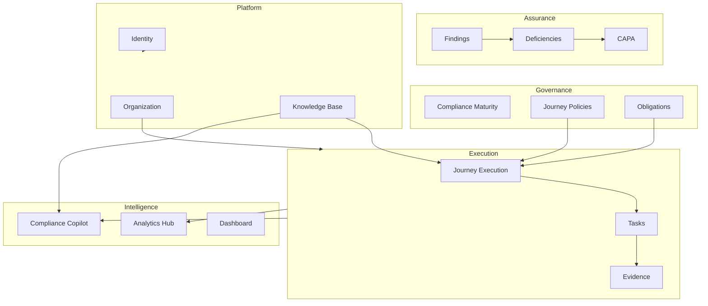

# Business Architecture

[← README](./README.md) · [Module Catalog](./04-Module-Catalog.md)

Bounded contexts derived from `ComplianceService/Domain`, Gateway controllers, and Angular features. Each module: purpose, boundaries, dependencies.

---

## Context Map (High Level)

---

## Module Summaries

### Journey

| | |
|---|---|
| **Purpose** | Accreditations journey: chapters, standards, OE execution, stage unlocking |
| **Owns** | `ComplianceJourney`, journey history, framework configuration, OE wizard state |
| **Does NOT own** | Organization/hospital master data, raw KB node definitions |
| **Inputs** | Framework enrollment, obligations, assessment answers |
| **Outputs** | Task generation signals, maturity progress, execution snapshots |
| **Dependencies** | KnowledgeBase (structure), Organization (hospital), Compliance scoring |
| **Consumers** | Dashboard, Maturity, Evidence Binder, Copilot rules |
| **Navigation** | `/app/journey/*` |
| **Events** | Journey transitions, obligation updates |
| **Status** | **Implemented** (Sprints 1–3, ongoing) |

### Compliance Maturity

| | |
|---|---|
| **Purpose** | Governance view of maturity stages, unlock rules, blocking factors |
| **Owns** | `OrganizationMaturityStageState`, unlock audit entries |
| **Does NOT own** | Journey execution UI, raw scores (reads snapshots) |
| **Route** | `/app/compliance-maturity` |
| **Status** | **Implemented** (Sprint 3) |

### Evidence Library

| | |
|---|---|
| **Purpose** | Upload, classify, link evidence to tasks/OEs; library views |
| **Owns** | `Evidence`, versions, library aggregates |
| **Does NOT own** | Verification policy (shared with review queue) |
| **Route** | `/app/evidence` |
| **Status** | **Implemented** (Sprints 4–5) |

### Evidence Binder

| | |
|---|---|
| **Purpose** | Objective-element-centric evidence presentation for audits |
| **Route** | `/app/evidence/binder` |
| **Status** | **Implemented** |

### Review Queue

| | |
|---|---|
| **Purpose** | Verification workload for evidence approvers |
| **Route** | `/app/evidence/review-queue` |
| **Status** | **Implemented** (Sprint 5A consolidation) |

### Tasks

| | |
|---|---|
| **Purpose** | Compliance task execution, assignment, comments, evidence linkage |
| **Owns** | `ComplianceTask`, comments, assignment routing logs |
| **Route** | `/app/tasks` |
| **Status** | **Implemented** |

### Findings

| | |
|---|---|
| **Purpose** | Operational findings workspace (audit simulation, internal observations) |
| **Owns** | `Finding` aggregate, attachments, comments, audit trail |
| **Does NOT own** | Deficiencies (promoted copy with lifecycle) |
| **Route** | `/app/audit/findings` |
| **Status** | **Implemented** (Sprints 7A, 7A1, 7B) |

### Deficiency Command Center (DCC)

| | |
|---|---|
| **Purpose** | Command-center UX for deficiency lifecycle and RCA |
| **Owns** | UI orchestration; backend: `ComplianceDeficiency` |
| **Route** | Embedded in findings / control-center patterns |
| **Status** | **Implemented** (Sprint 6, 8) |

### CAPA

| | |
|---|---|
| **Purpose** | Corrective and preventive action tracking |
| **Owns** | `Capa` entity, linkage to deficiencies |
| **Status** | **Partially implemented** (Sprint 11 — domain + APIs; UX uneven) |

### SLA & Escalation

| | |
|---|---|
| **Purpose** | SLA policies, breach detection, escalation levels |
| **Owns** | `SlaPolicy`, `EscalationPolicy`, `EscalationLevel` |
| **Status** | **Implemented** (Sprint 10) |

### Assignment Routing

| | |
|---|---|
| **Purpose** | Route tasks/findings to departments based on rules |
| **Owns** | `AssignmentRoutingLog`, department ownership mappings |
| **Status** | **Implemented** (Sprint 9B) |

### Analytics Hub

| | |
|---|---|
| **Purpose** | Cross-domain KPIs, trends, readiness analytics |
| **Owns** | `AnalyticsDailySnapshot`, analytics read APIs |
| **Does NOT own** | Operational writes |
| **Route** | `/app/analytics` |
| **Status** | **Implemented** (Sprint 12B) |

### Compliance Copilot

| | |
|---|---|
| **Purpose** | Persona-driven recommendations, drafts, approvals, observability |
| **Owns** | Copilot aggregates (recommendations, drafts, proposals, activity) |
| **Does NOT own** | Operational mutations without approved proposals |
| **Route** | `/app/copilot` |
| **Status** | **Implemented** (Sprint 13A–13F, migration 13G) |

### Dashboard

| | |
|---|---|
| **Purpose** | Executive program overview, hospital snapshot |
| **Route** | `/app/dashboard` |
| **Status** | **Implemented** |

### Organization

| | |
|---|---|
| **Purpose** | Tenants, hospitals, members, subscriptions |
| **Service** | OrganizationService |
| **Status** | **Implemented** |

### Identity

| | |
|---|---|
| **Purpose** | Authentication, JWT, refresh tokens, user registration |
| **Service** | IdentityService |
| **Status** | **Implemented** |

### Knowledge Base

| | |
|---|---|
| **Purpose** | Framework graph, assessments, wizard questions, gap analysis |
| **Service** | KnowledgeBase |
| **Status** | **Implemented** |

### Audit Service (legacy boundary)

| | |
|---|---|
| **Purpose** | Separate audit session microservice (sessions, CA) |
| **Status** | **Partial** — overlaps with Compliance findings; consolidation ongoing |

### Future Modules (Not Implemented)

| Module | Status |
|--------|--------|
| External Auditor Workspace | **Planned** (Sprint 14 target) |
| Policy Management | **Future** (~5% concepts) |
| Incident Management | **Future** (0%) |
| Clinical Indicators | **Future** |
| Credentialing | **Future** |

Per-module deep dives: [module-specifications/](./module-specifications/).
