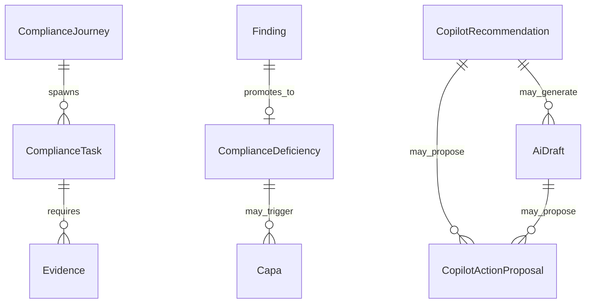

# Domain Architecture

[← README](./README.md) · [Database Architecture](./10-Database-Architecture.md)

Domain model for **ComplianceService** (primary aggregate host). Other services own smaller bounded domains.

---

## Aggregate Overview

| Aggregate / Entity group | Root | Lifecycle |
|--------------------------|------|-----------|
| Compliance Journey | `ComplianceJourney` | Enrolled → active stages → completion |
| Compliance Task | `ComplianceTask` | Open → in progress → closed |
| Evidence | `Evidence` | Draft → submitted → verified/rejected |
| Finding | `Finding` | Open → promoted/closed |
| Compliance Deficiency | `ComplianceDeficiency` | Identified → RCA → closed |
| CAPA | `Capa` | Open → effective/ineffective |
| Copilot Recommendation | `CopilotRecommendation` | Proposed → accepted/dismissed/expired |
| AI Draft | `AiDraft` | Draft → reviewed → archived |
| Copilot Action Proposal | `CopilotActionProposal` | Pending → approved/rejected → executed |
| Organization Obligation | `OrganizationComplianceObligation` | Tracked per framework |

---

## Value Objects & Supporting Types

- `RecommendationRationale`, `RecommendationImpact`, `DraftSourceIntelligence`
- Scoring: `ObjectiveElementScore`, `ComplianceScoreResult`
- Snapshots: `ComplianceSnapshot`, `AnalyticsDailySnapshot`, `CopilotEffectivenessSnapshot`

---

## Repositories (Copilot example)

| Interface | Implementation |
|-----------|----------------|
| `ICopilotRecommendationRepository` | `CopilotRecommendationRepository` |
| `ICopilotDraftRepository` | Draft repositories |
| `ICopilotProposalRepository` | Proposal repositories |
| `ICopilotActivityRepository` | Activity repository |

Pattern: `Repository<T>` base + EF `ComplianceDbContext`.

---

## Domain Services

| Service | Role |
|---------|------|
| `RecommendationEngine` | Orchestrates rule pipeline |
| `DraftGenerationService` | Template-based draft creation |
| `ActionProposalGenerator` | Proposal from recommendation/draft |
| `ApprovalPolicyService` | Approval eligibility |
| `ProposalExecutionService` | Post-approval execution |
| `PersonaExperienceService` | Workspace bundles |
| `CopilotAnalyticsService` | Effectiveness aggregations |

---

## Domain Events

Location: `ComplianceService/Domain/Events/`

| Event | Typical trigger |
|-------|-----------------|
| `DeficiencyIdentifiedDomainEvent` | New deficiency |
| `DeficiencyStatusChangedDomainEvent` | Status transition |
| `DeficiencyClosedDomainEvent` | Closure |
| `ObligationStatusUpdatedDomainEvent` | Obligation progress |
| Compliance lifecycle events | Enrollment, approval, expiry, etc. |

Dispatched via `OutboxDomainEventDispatcher` → `OutboxMessage` table.

---

## Policies & Specifications

- Journey policies: `NabhJourneyPolicy`, `NablJourneyPolicy`, `FireNocJourneyPolicy`, `PollutionJourneyPolicy`, `DefaultJourneyPolicy`
- `ComplianceLifecycleStateMachine` (shared infrastructure)
- Recommendation rules: `IRecommendationRule` implementations (17 rules)

---

## Ownership Rules

| Data | Owner service |
|------|---------------|
| Hospitals, members | OrganizationService |
| Users, tokens | IdentityService |
| Framework graph nodes | KnowledgeBase |
| Compliance operational SSOT | ComplianceService |
| Legacy audit sessions | AuditService |

Cross-service: Gateway orchestration; no direct DB cross-access.

---

## Relationships (Simplified)

---

## Planned Domain Extensions

- External auditor read-only aggregates (**planned**)
- Policy document versioning (**future**)
- Incident records (**future**)
