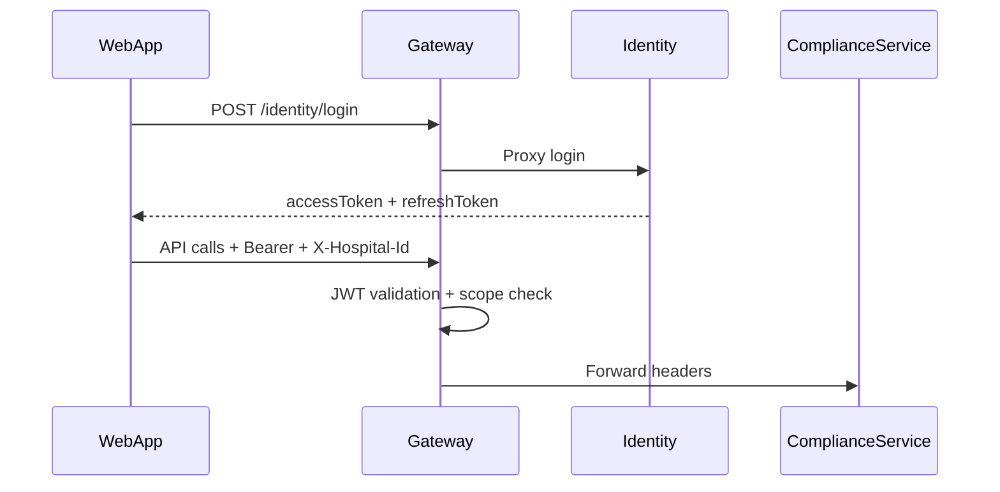

# Technical Architecture

[← README](./README.md) · [Microservices](./09-Microservices.md)

---

## Layering (ComplianceService)

```
Controllers/V1/
Application/        Services, DTOs, Contracts, Handlers
Domain/             Entities, Events, Policies, Enums
Infrastructure/     Persistence, Repositories, Filters, Integration
```

Gateway uses **thin controllers** → **MediatR** handlers → **ProxyService** or local logic.

---

## Patterns in Use

| Pattern | Where | Status |
|---------|-------|--------|
| DDD aggregates | Compliance domain | **Implemented** |
| Repository | Infrastructure repositories | **Implemented** |
| CQRS (partial) | Gateway MediatR queries/commands | **Partial** — not full event sourcing |
| Outbox | `OutboxMessage`, relay worker | **Implemented** |
| BFF | Gateway | **Implemented** |
| API versioning | `api/v1`, v1.1 evidence/scoring | **Implemented** |
| Background jobs | Hangfire in ComplianceService | **Implemented** |

---

## Dependency Injection

- Services registered in `Program.cs` per project.
- Copilot DI block: repositories, engines, analytics (lines ~176+ in ComplianceService `Program.cs`).

---

## Authentication Flow



Scopes: `AuthConstants.Policies.ComplianceScope`, etc. (`Shared.Infrastructure/Auth`).

---

## Caching

- Lookup caches in `CommonLookupService` (frontend).
- No platform-wide Redis layer documented in code — **mostly DB + snapshot reads**.

---

## Observability

- Structured logging (`Shared.Logging`).
- Correlation IDs in Gateway proxy.
- Copilot activity events + effectiveness snapshots.

---

## Configuration

- `appsettings.json` + `appsettings.Development.json` per service.
- Gateway backend URLs: `ComplianceBaseUrl`, `IdentityBaseUrl`, etc.

---

## Forbidden Patterns (Constitution)

- Controllers → DbContext direct access
- UI embedding business rules
- Duplicate repositories for same aggregate

---

## Scalability Notes

- Stateless API services behind Gateway.
- SQL Server per service (dev); horizontal scale **planned** for production K8s.
- Outbox relay decouples integration publish from request path.

---

## Deployment

See [18-Deployment-Architecture.md](./18-Deployment-Architecture.md).
