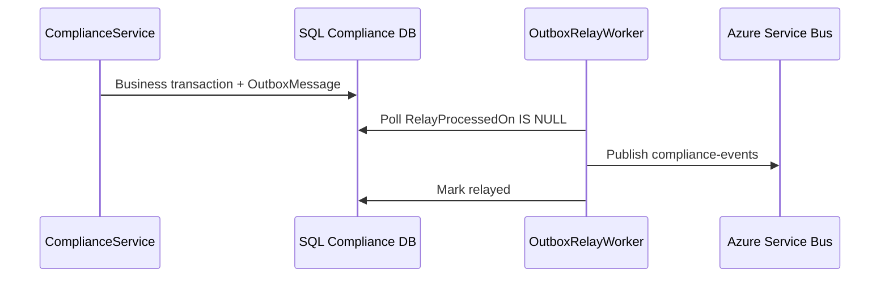

# Event Architecture

[← README](./README.md) · [Event catalog detail](./events/event-catalog.md)

---

## Pattern: Transactional Outbox

**Components:**
- `OutboxMessage` entity
- `OutboxDomainEventDispatcher`
- `OutboxProcessor` / `InProcessOutboxProcessor`
- `IntegrationEventPublisher` (outbox-only)
- `OutboxRelayWorker` → topic `compliance-events`

---

## Domain Events (ComplianceService)

| Event | Publisher context | Business impact |
|-------|-------------------|-----------------|
| `DeficiencyIdentifiedDomainEvent` | Deficiency evaluation | DCC, analytics, Copilot rules |
| `DeficiencyStatusChangedDomainEvent` | Deficiency updates | SLA, escalation |
| `DeficiencyClosedDomainEvent` | Closure | Maturity, readiness KPIs |
| `ObligationStatusUpdatedDomainEvent` | Obligation apply | Journey progress |
| Compliance lifecycle events | Enrollment, approval, etc. | Journey state machine |

---

## Integration Events

Published **only** via outbox relay — not direct broker calls from request handlers.

| Concern | Strategy |
|---------|----------|
| Retry | `RetryCount`, `Error` on outbox row |
| Ordering | Per-aggregate ordering not strictly guaranteed |
| Idempotency | Consumers must handle duplicate delivery |
| Dead letter | Service Bus DLQ (operational config) |

---

## Copilot Activity Events (Client + Server)

| EventType | Source | Purpose |
|-----------|--------|---------|
| `WorkspaceViewed` | Client POST | Engagement metrics |
| `RecommendationViewed` | Client POST | Effectiveness |
| `PersonaChanged` | Client POST | Persona analytics |
| `DraftCreated` | Server (partial) | Should be server-recorded — TD-H02 |
| `ProposalApproved` | Server (partial) | Same gap |

Stored in `CopilotActivityEvents` — **not** the same pipeline as domain outbox (Copilot-specific observability).

---

## Future Event Bus Usage

- Cross-service saga for onboarding (**partial** — mostly sync HTTP today).
- Real-time notifications module (**future**).

See [events/event-catalog.md](./events/event-catalog.md) for extended list.
