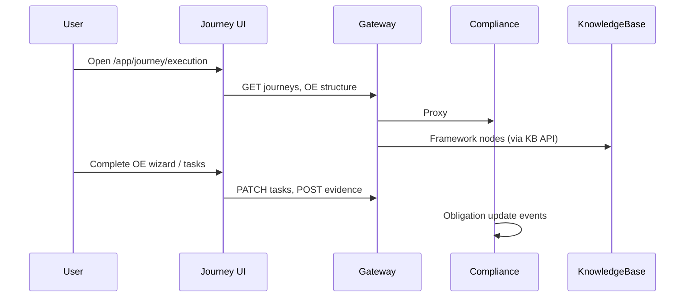
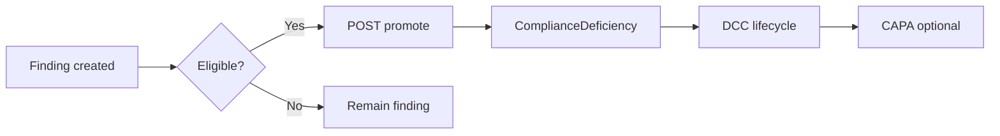
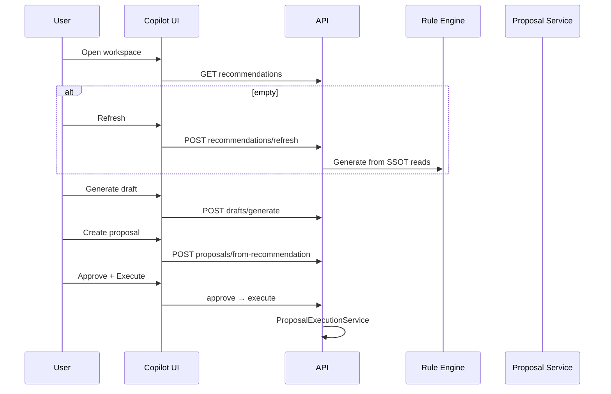

# Workflow Architecture

[← README](./README.md) · [Diagrams](./diagrams/)

---

## Journey Execution

---

## Finding Promotion

Sprint 7B — promotion API on `FindingsController`.

---

## Deficiency Lifecycle

States managed on `ComplianceDeficiency` with audit trail and RCA fields (Sprint 8).

---

## Evidence Verification

1. Evidence uploaded (task/OE context).
2. Appears in library.
3. Review queue for verifier role.
4. Approved/rejected → status drives readiness/scoring inputs.

---

## Assignment Routing

Trigger: task/finding creation → routing engine → department assignment log.

---

## SLA & Escalation

1. SLA policy defines thresholds.
2. Background jobs detect breaches.
3. Escalation policy levels notify/escalate.

Hangfire: `compliance-escalation-job` (3 AM UTC).

---

## Copilot: Recommendation → Draft → Approval

**Rule:** No execute without approve.

---

## Analytics Pipeline

1. Operational changes → snapshots (compliance + daily analytics job).
2. Analytics Hub reads aggregated APIs.
3. Copilot analytics reads Copilot tables (separate surface).

---

## Onboarding Wizard

`/onboarding` → hospital, framework, assessment → internal obligation apply → journey bootstrap.

---

## Planned Workflows

- External auditor read-only review (**Sprint 14**)
- Policy approval workflow (**future**)
